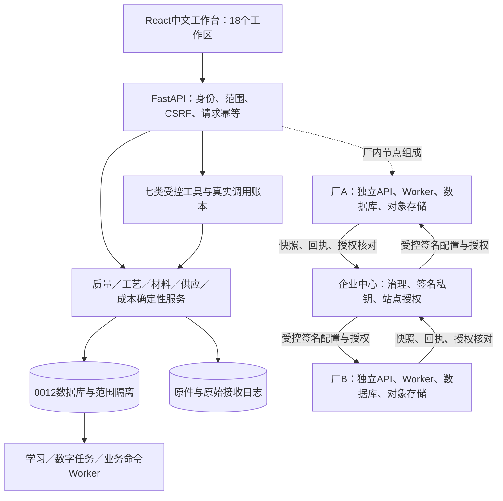
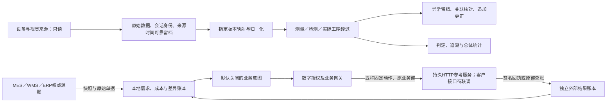
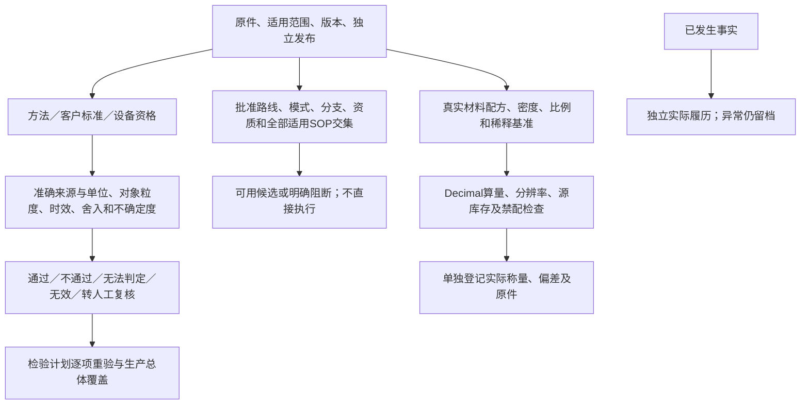
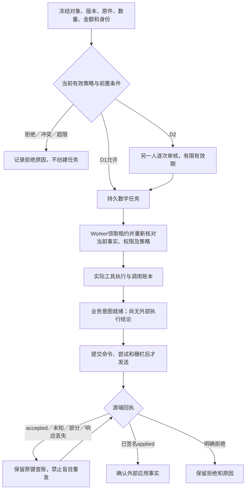
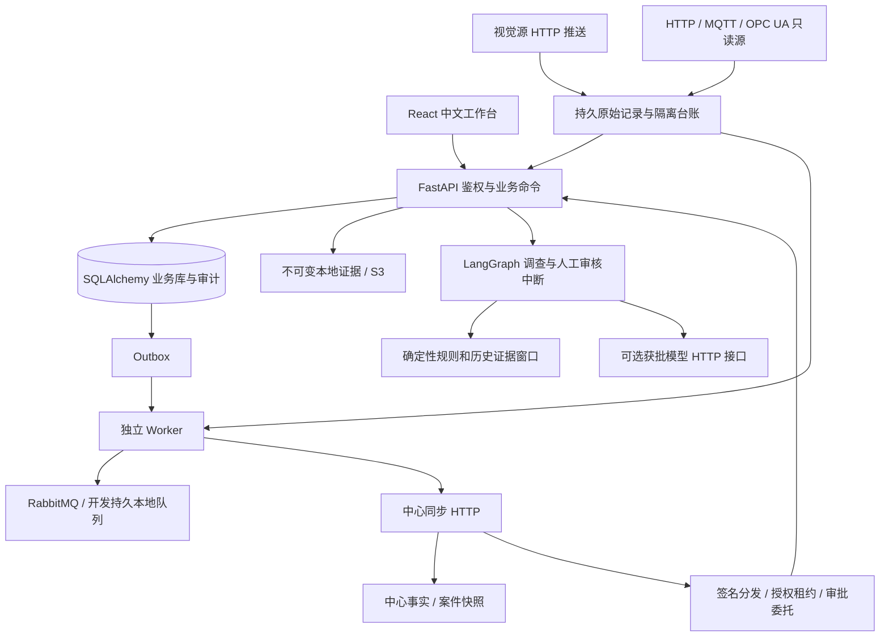
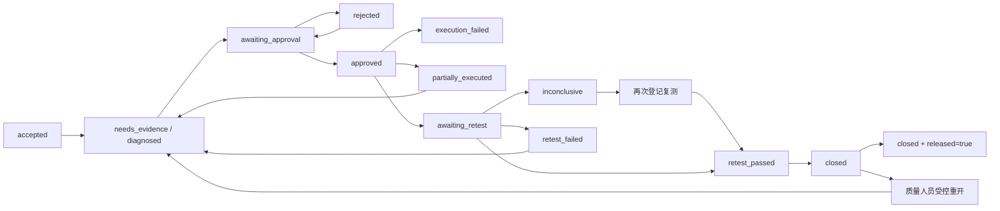
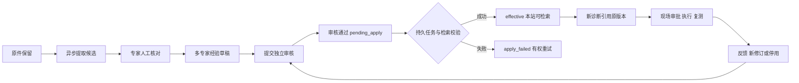
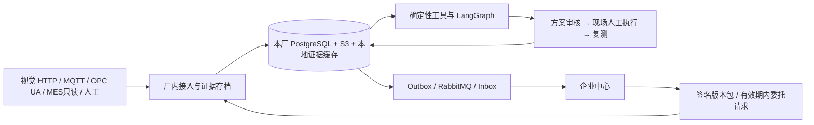

> 原工业平台完整业务说明与历史验证记录。当前云端训练/服务以AGENTS.md第37节及CLOUD_QUICKSTART.md为准；历史报告、客户配置与本机原件未公开。

# 化妆品包材喷涂与真空蒸镀品质溯源及整改闭环平台

> 2026-10-26新增独立 **PC端“涂镀智溯·多模态工艺助手”**：默认5001，免登录、文字/多图/服务端多轮会话，手机端通过独立飞书应用机器人通道。按用户后续授权，真实测试后选用阿里云百炼文字与视觉模型；本地Qwen9B/VL8B配置和训练入口保留，未声称已加载本项目9B Adapter。详见 [独立助手启动、模型和验证说明](assistant_app/README.md)。它不导入本工业平台入口，不使用原业务库，不改变8001登录权限。

**2026-10-25 本地训练目录整理**：新增 `day1/`（数据与 Unsloth LoRA SFT）、`day2/`（vLLM/FastAPI 模型服务）和 `models/`（基座及微调产物）。目录职责、默认36条训练数据、下载进度查看及GPU训练步骤见 [训练架构与操作说明](TRAINING_ARCHITECTURE.md)。既有业务服务和数据库未切换；模型完整下载状态以本地校验标记为准。

<a id="project-overview"></a>

本工程提供中心与厂内节点、中文工作台、视觉结果接入、五维证据诊断、版本审批、人工执行回执、复测和知识治理。设备保持只读；MES/WMS/ERP 的写入使用独立、默认关闭的受控业务命令，不包含设备控制或视觉模型训练。

当前源码为 **企业工业决策与业务协同增量（0.2.0rc1／schema 0012，交付候选）**，实际进度、模块逻辑和限制见[本次企业升级](#enterprise-upgrade-current)。**2026-10-23已再次对照完整提示词检查并补强业务重验、质量覆盖、工艺依据、成本追溯和SDK连接，正文已同步至本轮代码。** 原有0.1.0／0011文档和验证证据保留为基线，不代表本次升级已全部交付。原业务数据库没有迁移；本轮浏览器测试使用新建合成库和临时端口，复查测试期间原8000／8001／8002服务未切换；其后的本机启动状态见下一段。没有客户现场验收，不可据此直接宣称正式交付完成。

**本机查看入口（2026-10-23 10:47启动）**：[打开最新演示](http://127.0.0.1:8002/)。该入口已加载本轮复查代码及前端，API与Worker就绪；本机管理员账号为`JiangHanYu`，密码按用户指定单独设置。保留原账号ID、岗位权限和独立演示记录，旧管理员登录及旧会话已失效。切换前完成数据库和原件备份，未迁移数据库，8000／8001未调整；[启动核验记录](var/enterprise-preview-0012/latest-server.json)包含构建身份、依赖状态和备份路径。后续重启可在仓库根目录运行`.venv/bin/python var/enterprise-preview-0012/latest_runtime.py`；该入口不重复导入演示数据或重设密码。

<a id="enterprise-upgrade-current"></a>

**模型接入后的业务补齐（2026-10-23）**：本轮把真实模型动作候选接入整改草稿、来源留档和人工闭环，补齐截断／工具调用拒绝、真实usage与费用未知展示，并移除等待云模型时提前写入Run造成的SQLite写阻塞；落库前重查案件、授权与批准依据。当前源码、字段和操作说明见下方“模型辅助业务闭环”，验证证据统一在[本轮报告](reports/quality-model-upgrade-2sxryr24/)。本轮开发与测试未重启8000／8001／8002，未迁移或用现有业务库做测试；8002仍是11:02启动的上一版运行进程，新代码与连接参数在后续受控重启时加载。

## 企业升级：当前实际代码与执行边界

本节覆盖2026-10-22开始的0012增量、2026-10-23全面复查和随后模型业务贯通。后文原手册的43模块、31表、13工作区及0011测试数量为升级前快照；当前代码以本节及[模型贯通最新验证](reports/quality-model-upgrade-2sxryr24/)为准，[当日上午模型贯通前复查](reports/quality-reaudit-2pht01ct/)和[前轮增量证据](reports/quality-enterprise-uo5kpima/)按原日期保留。原三本手册仍只维护兼容跳转，新增正文统一在本文更新。

| 范围 | 当前实现 | 验证与边界 |
|---|---|---|
| 方法、客户标准、计划、设备资格 | 五类强类型定义，独立审核、修订和回退；五种判定、准确来源绑定、Decimal、不确定度、全检／抽样及追加更正 | API测试覆盖；浏览器实际完成方法原件上传、创建、提交、另一人发布；客户标准数值须现场批准 |
| 工艺与实际经过 | 批准模式候选、所有适用SOP共同约束；原始经过先可靠落盘，保留未批准／乱序／迟到事实和隔离原因 | 实际HTTP/API及落盘恢复验证；候选、批准与已发生事实分别留档 |
| 材料混配 | 密度、比例、稀释基准、替代／禁配、分辨率舍入、源库存、实际称量及偏差 | API及实际浏览器完成材料／源库存、配方独立发布、10kg算量和合成称量；不代表物理加料 |
| 订单、BOM与供应 | 独立BOM、损耗与单位、有限展开、订单行／修订及原件、缺口、库存口径、内部预占与取消 | 浏览器完成路线与BOM独立发布、60件订单展开120kg需求，源明确纳入20kg耗用后库存80kg、缺口40kg；无产能／日历／到料事实时交期未知 |
| 单据与成本 | 原收料／退料／发票及行、税币种、部分与重复、实际用量／工时、未计价及差异 | 浏览器归集10kg合成用量为50元，保留10元单据差异；添加依据后仍未消除。范围不包含付款或总账 |
| 数字任务 | 持久D1／D2任务、系统责任、限额、独立逐次审核、租约、超时、批量预览、暂停取消恢复及提交前重判 | 真实子进程测试及跨线负例通过；与专家学习任务分表分队列 |
| 外部业务命令 | 独立连接、强幂等意图、先提交账本再HTTP、五种固定动作、签名回执、查账、部分结果、恢复冻结与消费者代际隔离 | 持久HTTP参考服务真实改状态；响应丢失／回调竞态、重复、签名、数量和采购金额验证；真实客户接口未接入 |
| 七类业务工具 | 保留A1—A6；新增七类能力、固定类型工具注册、实际调用账本；数字任务记录实际工具执行 | engine准确标记deterministic_tools，不伪造模型调用 |
| 多项整改与前端 | 18个工作区；结构化整改／责任／逐项回执、检测全身份、实际经过与JSON原件导入、规则及参数、业务命令和批量任务 | 浏览器完成两项整改的另一人审批、逐项回执、独立质量复测和归档；根因未确认及正式未放行保持独立。业务默认拒绝已实测 |
| 迁移、备份与恢复 | 冻结0012前向DDL；真实旧SQLite／PostgreSQL夹具；维护屏障；新空目标恢复，外部发送冻结，旧租约作废 | 非owner／NOSUPERUSER／NOBYPASSRLS真实PG验证；独立对象存储完整恢复；PG本机16.2，目标PG17仍需容器验证 |
| 部署及离线 | 本机、单机三节点与独立主机模板；独立节点密钥／公钥信任、HTTPS入口、统一候选版本、离线依赖保留 | 新环境本机离线安装及新增测试通过；Docker/RabbitMQ、跨主机TLS和现场验收尚无实际环境 |

### 0012当前架构和状态图

图中为实际软件边界及待配置的部署关系；同机合成验证不等于真实跨工厂验收。

```mermaid
erDiagram
  Case ||--o{ RectificationPlan : versions
  RectificationPlan ||--o{ ExecutionReceipt : actual_results
  RectificationPlan ||--o{ Retest : independent_test
  DecisionDefinition ||--o{ QualityAssessment : approved_basis
  ProductionCohort ||--o{ QualityAssessment : coverage
  MaterialFormulation ||--o{ FormulationComponent : approved_parts
  MaterialFormulation ||--o{ FormulationCalculation : frozen_version
  FormulationCalculation ||--o{ MixingBatch : actual_weighing
  BusinessOrder ||--o{ BusinessOrderLine : source_lines
  BillOfMaterials ||--o{ BomComponent : approved_usage
  BusinessOrder ||--o{ SupplyPlan : frozen_demand
  SupplyPlan ||--o{ MaterialDemand : shortage
  InventorySnapshot ||--o{ InventoryReservation : internal_or_confirmed
  BusinessOrder ||--o{ CostReport : actual_and_estimated
  BusinessDocument ||--o{ BusinessDocumentLine : original_facts
  AutomationPolicy ||--o{ DigitalTask : bounded_authority
  BusinessCommand ||--o{ BusinessCommandAttempt : durable_attempts
  BusinessCommand ||--o{ BusinessReceipt : signed_source_results
```












### 模型接入与验证（2026-10-23更新）

当前8002本机实例已按用户指定接入阿里云百炼：Base URL为`https://dashscope.aliyuncs.com/compatible-mode/v1`，模型为`deepseek-v4.1-flash-1017`，通过现有受控HTTP通道调用`/chat/completions`。这是外部云模型，配置明确标记`model_external=true`；开发助手此前的人工分析不再作为运行时接入安排。

密钥仅存于本机`var/enterprise-preview-0012/model-private.json`，文件权限0600、所在目录0700，目录受`.gitignore`排除。启动入口`latest_runtime.py`检查文件权限，并仅允许读取模型连接配置字段；重启会保留此配置。README、源码和验证报告不包含密钥。端点仅增加`dashscope.aliyuncs.com`到允许主机，保留TLS校验、DNS绑定、禁止重定向和环境代理。11:02运行进程的超时为60秒；本轮已将后续启动配置保存为90秒、每请求输出上限4096 Token，独立测试已实际使用此配置。源码默认超时仍为20秒、输出上限2500 Token。每节点2并发、每案件最多6次模型调用和50000 Token上限保持原配置。

`QUALITY_MODEL_ALLOWED_DATA`仍仅含`process_labels`、`evidence_references`，实际请求只发送`process`、`defect`和`evidence_refs`。备注、知识正文、原始图片、材料配方及业务明细均未扩大授权。返回内容使用JSON Object模式，再执行本地结构、证据引用、状态和动作约束校验；模型不能直接确认根因、批准整改或操作设备。标准比较、物料算量、库存、金额、权限及状态变更继续由确定性服务处理。断网、超时、预算不足或输出不合规则按原逻辑标记模型不可用／预算不足，保留规则分析和人工闭环；本机开发及离线安装能力保留，云模型推理需要联网。真实计价系数尚未设置，`estimated_cost`不能当作实际账单，实际费用以提供商账单为准。

本次验证证据：

- [独立真实请求](var/enterprise-preview-0012/model-preflight-20261023-105942.json)：HTTP 200，返回指定模型，JSON结构与引用校验通过，耗时29.652秒，总计2824 Token。
- [项目完整诊断流程](var/enterprise-preview-0012/model-integration-20261023-110054.json)：全新临时数据库、合成案件及真实云调用，`model_status=validated`、`validation=passed`，总计1917 Token；仍需补证与人工审核，未生成执行回执。两次验证均未发送现有业务数据。
- [模型接口回归](reports/model-setup-20261023/pytest.log)：7项全部通过，覆盖正常返回、非法JSON、伪造引用、未批准参数、注入工具、预算不足及超时。
- [8002配置生效核验](var/enterprise-preview-0012/model-runtime-20261023-110206.json)：2026-10-23 11:02重启，首页、管理员登录、API和Worker正常，`/api/ready`返回`model=configured`。此状态只代表已配置；实际调用证据以上述两份独立报告为准。未迁移数据库或向当前业务库导入测试案件。

以上是本机软件接入与合成场景验证，不代表客户现场诊断效果、模型训练、embedding接入或正式交付验收。下文旧手册中的“真实模型未调用”属于历史验证快照，当前接入状态以本节为准。

### 模型辅助业务闭环

本轮复核提示词第十二、十四、十七节及专家经验WP6、T10—T15，沿用既有规则、证据、工具与人审流程。`quality/model_assistance.py`读取本案当前诊断Run的真实模型结果，A3展示摘要和调用依据，A4把通过校验的模型动作与待补证核查建议去重合并，最多30项。读取助手、带入表单和保存草稿均不会额外调用模型；工具本身仍标记`deterministic_tools`，其中模型建议另以`draft_origin=validated_model_and_evidence_checks`及真实Run标识说明来源，未使用模型时为`evidence_checks`。

只有`model_status=validated`、`validation=passed`、本案当前Run、上下文哈希一致、没有未解决更正且动作仍满足当前SOP时，模型动作才能成为可带入候选。无效、旧版本、其他案件、过期SOP或证据已变化时，保留历史运行并阻止其作为当前模型草稿来源。模型给出的责任人、责任岗位和动作ID在带入前清空；工程师编辑时重新赋予稳定动作ID并核对实际责任。模型不能指定审批人或生成现场完成事实。

页面操作：进入案件→启动证据诊断→查看“受控辅助工具”的模型状态、耗时、实际／预留Token和调用摘要→点击“方案起草依据”→“带入整改草稿并人工核对”→逐项编辑、补全真实复测方法／样本量／阈值／稳定与观察时间→保存草稿→明确提交审批→另一审核人批准→现场人员登记逐项结果与原件→质检复测→人工结案。带入不会自动保存或填造样本量、质量阈值；结案仍不等于根因确认或正式放行。模型缺失或失败时，规则核查建议及人工方案继续可用。截图见[模型建议及真实调用信息](reports/quality-model-upgrade-2sxryr24/browser-model-live/model/model-assistance.png)、[人工闭环后仍未正式放行](reports/quality-model-upgrade-2sxryr24/browser-model-live/model/model-closed.png)。

兼容字段：`PlanInput`与`DraftPlanInput`新增可选`source_run_id`，缺省空串，旧客户端不受影响。提供该字段时，服务端重新核对来源，不接受任意Run标识；失效返回409 `model_draft_stale`。计划内容`assistance`保存真实`run_id`、模型、提示词版本、原始候选动作哈希与提交核对人员，`approval_granted=false`明确此来源本身不构成批准。该内容纳入原有方案指纹，审批与执行继续绑定完整计划和关键上下文。表结构未修改，schema仍为0012。

推理合同：提示词升级为`evidence-bounded-v2`，要求最多3个最相关候选和3个动作、简短摘要；不为凑齐五维而虚构结论。`QUALITY_MODEL_MAX_OUTPUT_TOKENS`支持256—8192，默认2500，本机待启动配置4096；预算按实际配置的输出上限加输入与请求开销保守预留。返回`length`、`tool_calls`、`function_call`或其他非完整结束状态时拒绝采用，即使HTTP为200且内容看似JSON；缺失结束原因的旧兼容参考响应仍可按结构校验。usage仅接受提供商返回的非负整数Token计数，正文解析失败也保留已收到的真实usage。分别记录`http_attempted`、`response_received`、`http_status`、结束原因和预留预算；未返回usage不能显示零消耗，未配置真实价格时`estimated_cost=null`、`pricing_configured=false`，不把估算当账单。不会保存内部思维链、自动重新发送未知请求或切换提供商。提供商JSON Object合同参考[阿里云官方文档](https://help.aliyun.com/zh/model-studio/deepseek-api)。

并发与落库：同一案件的文件锁防止API／Worker重复操作检查点，已有调用时返回409 `analysis_in_progress`。读取依据、持久预算和检查点以及等待模型响应期间，不提前写业务Run；新的独立采集／业务写事务可继续。响应后刷新案件并核对版本、上下文、未解决更正、用户授权修订与租约、当前全部适用批准知识及条件快照，再验证动作并写入Run和案件。处理中案件改变、撤权或依据失效时拒绝覆盖，模型调用账本与检查点保留实际结果和预算。正式PostgreSQL保持案件行锁及乐观版本约束，不扩大跨节点并发承诺。

本轮第一次两工艺真实调用触及旧2500输出上限，返回HTTP 200但`finish_reason=length`，被正确拒绝；[首次失败记录](reports/quality-model-upgrade-2sxryr24/live-workflows/result.json)保留。调整有界输出与简洁约束后，[两工艺真实闭环](reports/quality-model-upgrade-2sxryr24/live-workflows-bounded/result.json)均通过：塑料喷涂3952 Token、约26.04秒，玻璃真空蒸镀3369 Token、约22.53秒；都实际采用模型动作，验证作者自批拒绝、样本不足不结案、充分复测后结案且不自动放行。另有[真实模型浏览器闭环](reports/quality-model-upgrade-2sxryr24/browser-model-live/model/result.json)和[本机参考模型浏览器闭环](reports/quality-model-upgrade-2sxryr24/browser-model-reference-verified/model/result.json)。这些都是合成数据的软件验证，没有发送现有备注、配方、原始资料或业务明细；效果、泛化和训练仍待真实授权数据与现场验收。

复验入口（新目录不覆盖历史；真实模型命令最多两次外部请求）：

```sh
.venv/bin/python scripts/verify_local.py --report-dir reports/new-model-regression -- tests/test_model.py tests/test_model_workflows.py
.venv/bin/python scripts/verify_model_workflows.py --config-file var/enterprise-preview-0012/model-private.json --report-dir reports/new-live-model-check
# 使用本机已有Node、Chrome和当前隔离构建；model组默认使用本机HTTP参考模型。
.venv/bin/python scripts/industrial_browser_check.py --report-dir reports/new-model-browser --frontend-dir /absolute/path/to/current-dist --browser-path '/Applications/Google Chrome.app/Contents/MacOS/Google Chrome' --suite model
# 显式添加 --model-config var/enterprise-preview-0012/model-private.json 才使用真实提供商；只允许单独model组。
```

未因接通模型而自动扩展的范围：七类工业工具仍调用确定性领域服务，物料／金额／BOM／质量标准／权限由代码核算；模型不会自动取得业务命令发送权、读取未授权正文或执行模型训练。ERP／MES／WMS现场映射、真实设备／视觉接口、厂内模型部署、embedding、客户有效标准与独立效果评估、Docker／RabbitMQ／目标PG17及跨主机验收仍需要相应环境或资料。

### 质量判定逻辑

新增`quality/enterprise_schemas.py`定义检测方法、客户质量标准、检验计划、设备资质和工艺模式五类判别合同；`enterprise.py`负责草稿→提交→另一审核人发布、停用、修订与回退。所有定义带产线、工艺、产品／版本、基材、设备、工序适用范围、时效和原件证据。作者不能独立发布自己的内容。

`quality/quality_decisions.py`保存`pass / fail / not_tested / invalid / review`五类结果。手工原件、Measurement、LabResult、Inspection来源分别核对对象、粒度、指标物理含义、原始单位、时点和来源版本。外观模型不能证明未测的膜厚、附着力或固化性能；设定值不能充当产品实测。缺标准不判通过；缺测保留未检测；无效单位、校准、资质、数据质量或对象关联进入无效／复核。按批准方法明示的换算及精度计算，不确定度跨越界限时依批准策略处理。原始表达和原来源保留，追加更正引用旧记录，不覆盖原记录；已被更正的判定不能继续作为当前依据。

检验计划须让每个所选对象分别覆盖全部必需标准，不能把样本A的膜厚与样本B的附着力拼成“两个完整样本”。快照保存`complete_object_count`和`missing_standards_by_object`，明确完整对象数及各对象缺失项目。逐对象全检须有已封闭总体、完整对象清单和每项标准完全相同的对象集合；抽样批结论须有批准抽样规则、足量不同完整样本和明确总体。所选样本存在缺项或数量不足时不能判通过；已知失败对象超过批准上限仍优先判失败。

`all_objects`的`maximum_failed_samples`必须为0，不能使用抽样容许不合格数把全检中的NG宣称为全部通过；`sampled_lot`保留批准的抽样接受口径。新输入不合规则拒绝，历史不合规计划在再次评估时返回`quality_plan_rule`冲突，原计划不改写。单一样品通过不会被换算成整批逐瓶合格。检验结果、平台判定与正式放行分别记录；此模块不会自动执行复测、结案或放行。

主要接口为`POST /api/industrial/definitions`、`/governance/definition/{id}`、`/quality-assessments`、`/quality-plans/assess`及`/production-cohorts`。前端“质量标准与判定”使用现有RecordsContext、DataTable、RecordSelect及请求结果恢复机制。定义及判定列表在服务端授权／筛选后计数、排序和分页，沿用个人列设置及当前页导出。

### 材料混配与实际称量逻辑

原有`recipe`仍是工艺参数版本；新增MaterialFormulation及FormulationComponent专门表示真实材料混配。组分区分主剂、固化剂、稀释剂和助剂，明确质量份或体积份、稀释基准、密度来源、批准替代料和禁配组合。体积份转称量质量须有各材料密度，不能猜密度。百分比稀释分别支持主剂量、主剂加固化剂、最终总量；最终总量基准通过`非稀释剂合计÷(1-稀释比例)`求得，不能与其他基准混用。

`quality/formulations.py`用Decimal计算理论量、分辨率舍入后的计划量及差额。称量分辨率按`理论量÷分辨率→取整→乘分辨率`处理，支持0.005 kg等非十进制位数分辨率。目标可为混配总量或主剂量，单位kg、g、L、mL；体积与质量的换算必须有密度。返回逐项公式、密度依据、库存版本、适用范围、计划量和阻断原因，不把计算完成记成物理加料或外部预占。重复的同材料仓库批次不能累加多个来源／旧版本冒充更多库存。

实际称量必须逐项完整对应批准核算材料，引用实际库存批次和称量原件，记录实际发生时点和混配适用期。超容差、过期或异常材料须留原因并记录为`deviation`，不能伪装正常执行。实际加料保存在MixingBatch及ActualMaterialUsage；源WMS库存不会因本地录入而直接改写。

补录历史实际用量时，库存观察时点不得晚于实际发生时点；未来库存不能证明过去已有可用量。已经发生但当时依据不足的用量仍可附明确偏差原因作为事实留档，不据此生成有效库存或生产授权。

主要接口为`POST /api/industrial/materials`、`/formulations`、`/governance/formulation/{id}`、`/calculations`、`/mixing-batches`及`/inventory`。前端“材料混配与称量”提供结构化组分、密度、比例、原件、核算明细和实际称量表单，所有持久列表使用服务端分页。

### 订单、BOM、库存和成本逻辑

`quality/supply.py`将订单与订单行、独立批准BOM及组分、源库存快照、需求计划、需求行、预占建议和实际用量分开。BOM绑定产品版本、产出单位及已批准路线，展开时检查子BOM状态、单位、循环、32层边界和1000节点预算。当前损耗合同为得率损耗：`组分净量×批准换算×订单产量/BOM产出÷(1-损耗率)`；最终需求向上舍入至1e-9并保留原值和差额。订单不同材料需求共用库存池，跨订单行逐次分配，防止每行重复认领同一份库存。

库存`gross`口径按账面在库减冻结和源已预占；`net_available`直接使用源报告可用量，不再减一次冻结／源预占。在途不计为在库。未释放、过期、陈旧、已被更新快照替代或关联质量判定失效的库存不视为可用。内部`proposed`、外部`confirmed`及`unknown`预占状态独立；已确认预占尚未纳入快照时要求核对版本，避免双扣和虚增可用量；未知／部分源效果阻止继续计算可用量。纳入标记必须对应同批次、同源、已应用且时间不早于回执的快照。预占建议不代表WMS已执行。已登记的实际称量／生产／返工／报废耗用若尚未获本源快照明确纳入，可用量为未知，不能继续按旧数预占；较新的观察时间本身不等于已纳入。`InventoryInput.included_usage_ids`最多1000项，须对应同产线、材料、仓库、批次、权威源系统，且源观察不早于实际发生。纳入凭证与原件引用追加到`inventory.source_snapshot`审计，原库存和实际用量不改写，无需改动冻结DDL。按源已更新数量直接使用，不再减一次耗用；异常实际已发生仍可附偏差原因留档，不能借此变为有效库存计划。登记源快照、实际用料／称量和内部预占共用批次锁；重复实际批次或源用量先按409身份冲突核对，不重复记耗用。订单原件按源版本保存在追加审计引用中；修订保留行身份、检查源版本与并发版本，并使旧需求计划失效；当前不暗中删除已关联的订单行。

需求计划冻结订单、BOM、完整批准路线及所选库存的计算时状态。再次用于内部预占、采购起草／提交或其他受控办理时，`current_plan`核对当前订单版本、BOM生效与路线批准、完整路线快照、库存质量／新鲜度／耗用／其他预占，并检查生成计划后新增的需求材料库存依据，包括新增批次。任何变化都要求重新核算；仅订单版本不变不能证明旧缺口仍有效。历史计划缺少路线快照时返回`plan_route_snapshot_missing`，允许查阅历史，但须生成新计划后办理，不回填或改写历史。

详情接口`GET /api/industrial/supply-plans/{id}`增加只读`current_validation={current,code,reason}`；页面显示“计划依据当前有效”或“办理前需重新核算”，交期明确标为“计算时的交期结论”。读详情不会借机更新原计划。未获依赖范围权限时只返回依据不可访问提示。

同一订单的修订、需求重算和预占办理共用订单锁；预占另有计划材料锁与批次锁。绑定计划的内部预占只能使用该计划选定的库存、需求材料，累计`proposed / confirmed / unknown`数量不能超过该材料原计划分配量。重验时仅排除本计划自己的`proposed`占用，避免自己的第一笔建议让第二笔必然失效；竞争计划的占用仍计入。旧计划存在未解决的建议、已确认或未知占用时禁止重算新计划，先取消未发送建议或按源确认流程核对释放，不能自动释放，也不能把已分配数量再次算成采购缺口。

常见重验结果与处理如下；错误说明只影响新办理，不清理历史事实：

| 代码 | 含义及处理 |
|---|---|
| `plan_stale` / `plan_bom_stale` | 订单或BOM已变化，按当前独立批准版本重新展开 |
| `bom_route` / `plan_route_stale` | 路线批准或完整路线内容已变化，核对后重算 |
| `plan_route_snapshot_missing` | 历史计划没有完整路线依据，保留查阅并生成新计划 |
| `plan_inventory_stale` | 库存、来源、质量、耗用、竞争预占或新增材料库存依据变化，重新核对缺口 |
| `order_allocation_pending` | 旧计划占用未处理，先核对取消或源释放，禁止直接重算掩盖占用 |
| `reservation_plan_inventory` / `reservation_plan_quantity` | 不在计划库存范围或累计超分配，改用当前明确计划和允许数量 |
| `plan_dependency_unavailable` | 当前账号无法访问依据，详情不披露越权信息，按授权核对 |

交期缺产能、可用日历、切换时间、到料时点或明确依据时为`unknown`；即使计算为候选可行，也保留“非源系统承诺”。主要接口为`/api/industrial/boms`、`/orders`、`/orders/{id}/revision`、`/supply-plans`、`/reservations`和`/actual-usage`。

`quality/costs.py`保存不可覆写的收料、退料与发票单据及行，保留源系统标识和证据；重复源单据拒绝，退料必须明确对应原收料行且累计不能超原收料。税币种差异单独列出，不默认换汇／抹平。当前支持有明确精度的CNY、USD、EUR、GBP、JPY；其他币种须补合同。对相同订单行、材料及批次的净收料作加权价格依据，实际生产／返工／报废用量与有原件依据的工时分别归集，实际和估算字段分开。无足量有效计价依据的用量保留未计价，不造出完整实际成本。发票数量或金额差异保持打开；差异说明不会改写单据或自动核销。成本范围仅为已记录材料用量与已报告工时，未实现付款或总账。主要接口为`/api/industrial/business-documents`及`/cost-reports`。

对账按“订单行＋材料＋批次＋税率”分组，`reconciliation.matches`逐组保存原收退料行、原发票行、净收料量、发票量、数量及金额差额和`matched / difference`结果；组内不臆造某张发票与某次领料的一对一分配。报告快照保存当时完整订单行及原单据，后来订单修订不改变历史报告。

实际用量按发生时点、记录ID稳定排序后分配可计价数量；逐笔保存归一化单位、单价、舍入前成本及`price_basis_document_line_ids`原收退料行。无实际用量且没有单据差异时状态为`incomplete_cost`；存在未计价用量或单据差异则为`differences_open`。无用量或存在未计价项时`actual_amount`为null，已知部分单独保留，不能把零金额解释为已完整归集。前端“成本与差异核对”详情提供“原单据行匹配依据”和“实际用量计价追溯”两张表，沿用分页、个人列设置和当前页导出。本轮API合成例：2000g返工用量归一为2kg，按5元/kg归集10元；浏览器用2kg夹具验证同一金额及收料、发票和用量原记录追溯。

### 工艺候选、实际履历和统计口径

`process_decisions.py`只在当前产线已绑定并独立批准的路线中选择模式。检查产品／版本、基材、设备、工序、必需质量标准、材料、资质、允许的分支／返工次数及全部适用SOP窗口；不是按检索top-k决定硬约束。返回`candidate`或`blocked`，冻结采用的模式、路线、检测及SOP依据。候选不代表现场已执行，也不授予设备控制权限。

模式和SOP的工序适用性使用目标`next_step_id`。`sop_basis`收集显式引用及当前全部额外适用、独立发布、未过期SOP，按ID去重并冻结完整版本；不是只保留几个参数窗口。模式须提供这些SOP要求的全部参数，单位一致且同时落入所有窗口；空参数或漏掉一个必需参数也返回阻断理由。前置检测及设备资格仍按各自实际对象和适用范围核对。

`actual_passages.py`通过`POST /api/industrial/passages/actual`及`/passages/import`保存实际事实。原始信封先以哈希校验、原子写入及fsync落盘，再归一化；未知路线、未批准分支／返工、重复／冲突、迟到和报告序号异常仍保留原始发生时间和证据。平台到达序号与来源报告序号分别保存；异常事实不会证明流程合规或首次通过。数据库回滚后可按原信封恢复，不改写原记录、来源身份或设备时钟。批量导入最多500项，页面先上传JSON原件，再列出各项结果。

ProductionCohort独立保存总体及对象粒度、预计数量、是否封闭、唯一对象清单和已检／最终良品／放行／出货／报废数量。产品计数必须为整数。出货超过放行、放行超过最终良品或良品加报废超过总体时保留声明并标记核对冲突，不抹平数字。观察样本不等于生产总分母，抽样通过不等于逐件全检，复检通过不覆盖首次NG；最终良率、放行和出货仍须各自事实及批准口径，缺项保持未知。

单项判定重新使用时核对原检测哈希、来源修订／更正、方法时效、标准和资格；计划汇总结论还逐一重核原样本，不能拿已更正样本的旧计划结论继续办理。

### 数字任务、预授权及逐次审核

`digital_tasks.py`负责新的DigitalTask；原LearningTask继续负责专家资料提取、核对和检索验证，两者不混用。数字任务有实际产线范围、发起账号、`system:policy:<policy_id>`系统责任、输入、目标版本／依赖哈希、策略版本、授权修订、批次、租约、重试次数、错误和结果。D0确定性计算可直接在权限内办理；D1需要有效的独立发布策略；D2还需要与发起人不同的逐次审核人；采购起草和提交固定要求D2。D3设备操作不在动作注册表内。

策略明示允许／拒绝、优先级、主体岗位或账号、工厂／产线／产品／设备／目标、数量及单位、含明确税基的金额和币种、频率窗口、有效期、证据类型与离线条件。缺失策略、显式拒绝或同优先级冲突均拒绝。离线状态由近期中心成功通信记录判断，客户端不能用`offline=false`冒充在线。批准的数量／金额必须与服务端实际载荷计算一致；采购金额不能用客户端填0绕过上限。

任务先登记，再由Worker领取并在受限子进程执行。领取、提交前都检查当前账号授权、策略、目标版本、依赖、证据及D2审批期限；取消／暂停／撤权后旧租约结果不能提交。默认并行2、单次30秒、最多3次尝试；可配置范围以Settings合同为准。重试保留原输入，D2新尝试重新审核；依赖已变化时应发起新任务而不是复用旧批准。

`process.select`的冻结依赖包括上述全部适用SOP、实际选定材料及有效设备资格。排队后即使模式自身版本没变，新发布一条适用SOP也会改变依赖哈希，Worker以`digital_target_stale`阻断旧任务，不生成新工艺候选；按新依据重新核对后另建任务。

`POST /api/industrial/digital-tasks/batch`最多200项；`execute_valid=false`仅逐项预览，不创建任务。登记时有效项独立入队，阻断项保留原因；批量结果不代表全部成功，D2项仍分别审核。页面支持批量选取原单项输入、预览与登记有效项；数字任务列表每15秒刷新，编辑表单期间暂停自动刷新。

### 外部业务命令与实际HTTP参考协议

`business_gateway.py`与原只读Adapter分离。BusinessConnector仅登记固定基础地址、MES/WMS/ERP/FINANCE类别、权威源、动作名单、协议版本及服务端凭据引用。连接默认关闭，还须有`QUALITY_BUSINESS_SEND_ENABLED=true`总开关、强幂等与按原键查询合同、白名单主机及有效策略；生产必须HTTPS。凭据只允许`QUALITY_BUSINESS_SECRET_*`环境引用，明文密钥不进入页面或命令输入。

五个动作及其边界如下：

| 动作 | 目标及前置核对 | 源确认效果 |
|---|---|---|
| `retest.create` | 当前未关闭案件及版本，一次`operation` | 创建复测工单；不生成测试结果，不自动复测或结案 |
| `inventory.reserve` | 当前源库存、同SKU仓库批次、明确内部预占建议、数量和单位、仍有效的需求计划 | 源确认后内部预占改为confirmed；不是本地直接扣库存 |
| `inventory.release` | 明确已确认预占、源预占实体与版本、完整数量 | 释放同一源预占，不能推测释放未知操作 |
| `purchase.draft` | 当前订单版本、同源、当前缺口计划、材料／单位、报价、税率和币种 | 创建采购草稿；累计未取消／拒绝意图不能超当前材料缺口 |
| `purchase.submit` | 先前源已应用采购草稿，数量、单价、材料、税基及币种保持一致；重新核验草稿引用的原需求计划仍有效 | 源确认已提交；不付款、不记总账 |

接口顺序为登记`/industrial/business-commands`→`/{id}/control`提交数字授权→D2独立审核（适用时）→数字任务登记业务意图就绪→业务Worker实际发送→源回执确认。不能从接口直接`send`绕过授权。`evidence_ids`是实际文件，`prerequisite_ids`是按策略校验的质量判定、有效算量或当前源回执；类型不混淆。API和列表分别使用business_write、business_review、business_read及实际范围授权。

采购草稿源端已应用不等于永久允许提交。`purchase.submit`冻结并重验原草稿的需求计划；新增库存、路线停用或竞争预占等导致依据变化时，在新HTTP写入前阻断。原已应用草稿及源回执继续保留，不伪造撤销，不因本地拒绝提交就改写源草稿。

业务幂等键由企业、工厂、节点、连接、动作、目标／版本、明确引用及材料身份稳定派生。同一意图不能通过改数量或报价、换HTTP请求键来重复办理。BusinessCommand、BusinessCommandAttempt及租约／栅栏在网络请求前提交；HTTP期间不持有业务数据库事务。发送无响应或回执不完整则为`unknown`，下一次只向原对端按原键查询。`accepted`不等于`applied`，`partial`不等于全量成功；`not_found`也不自动证明可以重发。未知／部分库存效果阻止可用量判断。

固定`business-actions-v1`请求和回执合同见[请求](schemas/business-request.schema.json)、[签名回执](schemas/business-receipt.schema.json)和[协议实现](quality/business_protocol.py)。请求只允许以下两个固定路径：

| 路径 | 用途 |
|---|---|
| `POST <connector>/commands` | Bearer认证，提交绑定企业／工厂／节点／运行代际、稳定键、输入哈希、栅栏、动作及目标源身份的固定请求 |
| `POST <connector>/commands/lookup` | 同一请求身份按原键查询，不办理新业务动作；返回持久源回执或明确查无结果 |
| `POST /api/industrial/business-callbacks/{command_id}` | 连接Bearer身份加HMAC签名的异步回执，固定大小限制；不接受浏览器会话代替连接认证 |

签名回执核对企业、工厂、节点、原键、输入哈希、动作、目标及版本、源实体和修订序号，以及数量、单位、金额、币种和预期效果。相同源修订内容须一致；重复不重复应用，迟到修订不倒退终态。实际回调先确认、HTTP响应随后丢失时，保留已确认事实并记网络差异，不能把成功降级为未知。真正的部分、冲突与异常响应留账待核对。

`quality.business_reference`是独立持久HTTP参考服务：SQLite中实际保存源库存占用、预占实体、复测工单、采购草稿／提交状态、稳定回执及已应用计数；重启保留。支持`accepted`、应用后响应丢失、拒绝和部分占用等注入，以及独立管理员的状态检查／异步完成。相同节点的新运行代际默认被源端拦截，必须显式交接；原键查询仍可使用。它是软件协议验证对端，不是假装已连接客户ERP。

启动参考服务前，从独立密钥保管渠道注入不同的`QUALITY_BUSINESS_SECRET_REFERENCE`和`QUALITY_BUSINESS_SECRET_REFERENCE_ADMIN`（均至少16字符），然后运行：

```sh
.venv/bin/python -m quality.business_reference --state /tmp/quality-reference-new.sqlite --port 8099
```

`/admin/state`、`/admin/control`、`/admin/tick`仅接受管理员凭据。生产不部署该参考服务，不把其合成数量当成业务事实。

### 七类业务能力及实际调用记录

`GET /api/industrial/tools`声明输入／输出schema、权限、范围、副作用、前置条件、证据、幂等、预算与错误；`POST /api/industrial/tools/invoke`只执行注册工具。原A1—A6合同和职责保持，新角色不要求各自部署模型或服务。

| 业务角色 | 固定工具 | 实际职责 |
|---|---|---|
| 数据核对 | `data.reconcile` | 授权内读Measurement、Lab、Inspection或管理员原始记录，不改源事实 |
| 质量 | `quality.assess` | 明确标准、方法、粒度、来源和资格的确定性判定 |
| 工艺与配方 | `process.select`、`formulation.calculate` | 完整约束下的候选选择和十进制材料算量 |
| 闭环执行 | `closure.retest_intent` | 只登记复测工单意图；外部发送另走数字授权及业务Worker |
| 计划与供应 | `supply.plan`、`supply.inventory_intent` | 需求、缺口与未知交期；明确库存预占／释放意图 |
| 财务与成本 | `finance.cost`、`finance.purchase_intent` | 已有凭证及实际用量成本、差异、采购意图；不付款 |
| 知识改进 | `knowledge.retrieve` | 当前有效且适用的已批准知识，不把检索或发布称为训练 |

工具始终由服务端校验。实际调用保存ToolInvocation的工具／版本、输入哈希、输入、结果、授权、证据、产线及准确状态；失败也留调用结果。请求幂等重放不产生第二次调用。实际数字任务完成后引用同一事务内的真实工具记录，业务命令就绪不宣称外部已应用。普通用户不因有read权限就能读取包含财务等内容的全部工具审计；完整工具台账限管理员。没有任意SQL、Shell、文件系统或通用HTTP写工具。未调用模型时engine为`deterministic_tools`。

### 签名工业配置与本地生效

原知识／路线分发增加`definition / formulation / policy / bom`四类；方法、标准、检验计划、资格和工艺模式在definition的强类型子合同中。`industrial_distribution.py`在签名正文中绑定完整组分及所有原件、方法／标准、材料、路线、SOP、子BOM或明确账号的依赖哈希。依赖标识／类型／数量与实际内容须匹配，不能把脚本、任意字段或秘密夹入配置。

目标必须支持0012、匹配企业／工厂／节点、有效期及信任公钥；包自带公钥不授予信任。导入先接收待确认，预览列出差异及缺失／变化依赖；本地依赖未就绪不能应用，也不会暗中创建设备、材料、人员或业务事实。发布、停用与回退分别有分发代次和源／站回执，旧代次不能覆盖新代次。工业配置作者不能自批本地生效；当前有效版本须明确接续修订链，回退须在该链内且依赖仍有效。绑定产线和现场实际执行仍是独立动作。

### 安全、维护屏障、恢复与部署

Cookie认证的变更请求须同时具备会话派生的`quality_csrf`Cookie和`X-CSRF-Token`；Origin校验继续保留。显式Bearer不会回退到Cookie身份。登录、安装及多站点验证客户端已同步携带CSRF令牌。未知`QUALITY_*`拼写在启动时拒绝，错误不输出对应值；连接秘密引用有专用命名空间，不能用宽松前缀吞掉开关拼写错误。

`http_control.py`对已接入的HTTP采集、模型、检索、中心同步及业务协议做DNS复核，连接已检查的数字地址，再核对真实peer，TLS仍按原主机验证；禁用环境代理、自动重定向及盲重试。批准的内网主机可以使用，不一刀切禁止私网。

新增`sdk_control.py`将同一实际连接核对接入锁定版本的S3（boto3/botocore）、MQTT（paho）、OPC UA（asyncua）和OTLP/HTTP遥测（requests）实例：核对显式端点白名单，冻结客户端建立时解析地址集合，每次新TCP连接前重新解析；若出现新地址则在建连前拒绝，连接数字地址后再核对peer。S3仅替换该实例连接池的TCP创建；MQTT只替换该实例socket工厂；OPC使用受控非阻塞socket；遥测使用独立Session。无全局SDK monkeypatch，禁用继承环境代理；遥测不跟随重定向。

SDK的原主机、SNI、证书检查及OPC安全模式仍由原协议栈处理，未关闭TLS校验。地址合法变更须重新核对配置及重建客户端，不能在失败后静默接受新地址。实现使用锁定SDK的内部连接扩展点，日后升级依赖必须复验这些合同。本轮有四类SDK DNS变化前阻断负例、真实本地S3／MQTT／OPC通信及遥测接收验证；客户网络、生产证书、远程TLS与持续负载仍需现场验收。

`GET /api/live`只表示进程存活；兼容的`/api/health`和`/api/ready`明确只检查数据库版本。管理员通过`GET /api/readiness/dependencies`实际核对数据库、对象桶、消息认证连接与新鲜Worker心跳，通过`/api/readiness/business`再核对已启用来源的健康／时效和外部发送冻结。缺依赖返回503，关闭模型仍可运行确定性工作流；即使返回ready，也只表示软件运行条件，不代替工艺、生产总体覆盖、真实接口或客户现场验收。外部探测有有限预算，不返回凭据、完整连接串或SDK原始错误。

`maintenance.py`提供线程加跨进程读／写屏障：API／Worker的数据库工作持共享锁，迁移、备份和恢复持独占锁。备份在持锁期间复制数据库、检查点、原件及原始接收日志，随后保留清单和哈希验证；新工作等待维护，超时返回明确`maintenance_busy`。它要求同一节点所有写进程运行此版本并共享同一data_dir；旧版本进程、数据库直写工具或不同主机的不共享目录必须先停写。屏障不宣称外部系统、数据库和对象存储之间存在分布式原子事务。

恢复仅允许身份一致的新空数据库和新目标缓存，不覆盖现存业务。恢复数据库前先落外部发送冻结标记；在途命令转unknown并清除旧租约、提升栅栏，未完成数字任务暂停。允许原键查账，不自动恢复发送。管理员须在源系统明确交接消费者、核对所有在途／已接受／未知／部分结果，再通过`GET /api/industrial/business-runtime`核对新代际，`POST /api/industrial/business-runtime/reconcile`提交该代际、明确交接确认及原因；提交后再读状态确认解冻。源端代际围栏仍会拦截未交接副本；不能仅靠本机租约避免恢复副本双发。

单机三节点继续使用`deploy/compose.yaml`及生产叠加模板；另增[每主机独立栈](deploy/compose.node.yaml)、[单主机HTTPS入口](deploy/Caddyfile.node)及[独立节点配置生成器](scripts/node_package.py)。独立节点拥有自己的数据库／消息／对象存储／数据卷与凭据，只开放该主机的HTTPS入口；站点只接收中心公钥，不接收中心私钥。生成器只创建新目录，0700／0600，不覆盖已有客户配置；外部业务默认关闭。示意配置命令如下（域名为必须替换的占位符）：

```sh
.venv/bin/python scripts/node_package.py customer-new /tmp/customer-new-center --node center --host center.example.invalid --role center --allowed-sites factory-a
.venv/bin/python scripts/node_package.py customer-new /tmp/customer-new-site-a --node site-a --host factory-a.example.invalid --role site --site-id factory-a --allowed-sites factory-a --center-url https://center.example.invalid --center-public-key-file /tmp/customer-new-center/center-public-key.txt
```

在各目标主机分别使用其`.env`：启动db/broker/storage，maintenance profile运行migrate、init-storage，再交互式initialize明确授权工厂；启动api/edge，通过中心页面注册站点，将该站一次性同步凭据写入本站runtime.env后才启动workers profile。Secure Cookie、DNS、公网／内网HTTPS证书、跨主机访问和防火墙由客户实际部署验证。数据库、消息和对象存储端口不对外公开。迁移使用独立账户，API／Worker不持迁移凭据。节点生命周期必须先独立备份、验证目标平台与密钥托管，再逐站升级并按版本握手分发。原始数据不降级删除；回退应用须保留向前迁移后数据副本并在兼容性验证后决定。

前端构建的`/build-info.json`从`quality/versioning.py`读取应用版本及schema，记录锁文件和最终输出的JS／CSS／HTML哈希；已逐一核对8项输出字节。部署时将它与后端`/api/ready`的版本及schema对照，避免使用旧dist；manifest不是数据库迁移或现场验收证明。前端npm包元数据及依赖锁保持原样，实际应用版本以该构建标识为准。

管理员在“运行与审计”查看真实数字任务排队／执行、过期租约、待源确认命令及最早未完成等待时长；`GET /api/industrial/status`按授权工厂、产线、工艺和建立时间汇总。普通岗位不获得此运行台账；产品筛选不适用于队列聚合时明确提示清除，不静默扩展范围。高成本数字与业务队列已有容量、并发、硬超时及源调用边界；本轮只读小样本测量不能外推写入、模型推理或持续满载SLA。

应用版本、镜像标签和离线清单统一为0.2.0rc1；依赖锁文件、轮子及pnpm缓存没有升级或裁剪。本机离线能力不代表Linux或另一CPU架构的镜像／轮子已验收。本机PG16.2验证不代表目标PG17容器已执行；Docker、真实RabbitMQ及目标OS／CPU环境的构建、许可证审核、TLS和备份演练仍须补做。可运行环境预检及release_manifest生成实际清单，缺环境的结果标为not_performed。

<!-- begin-current-enterprise-reference -->

<a id="enterprise-current-reference"></a>

### 0012当前源码、接口、字段和配置总表

以下由当前源码及契约导出：67个后端模块、61张业务表（新增30张）、154个API路径／169个操作、59项运行配置、10类岗位、18个工作区。旧手册数字属于此前快照。完整当前契约为[OpenAPI](schemas/openapi.json)和[数据字典](schemas/data-dictionary.json)。

新增模块按职责映射如下：

| 模块 | 职责 |
|---|---|
| [model_base.py](quality/model_base.py) | 共享Scoped/Base，不变更既有导入合同 |
| [model_assistance.py](quality/model_assistance.py) | 当前模型Run的来源、上下文、动作复核及人工方案草稿，不授予执行权 |
| [enterprise_models.py](quality/enterprise_models.py) | 30张新领域表，与原31表共用租户/站点/产线隔离 |
| [enterprise_schemas.py](quality/enterprise_schemas.py) | 所有工业输入、适用范围、精确数字及日期验证 |
| [enterprise.py](quality/enterprise.py) | 独立发布、修订、回退、证据与范围检查 |
| [enterprise_api.py](quality/enterprise_api.py) | 固定动作接口和受控详情/分页资源 |
| [quality_decisions.py](quality/quality_decisions.py) | 来源、五种判定、样本计划及总体声明 |
| [process_decisions.py](quality/process_decisions.py) | 批准路线、模式、材料/资质及全部SOP约束候选 |
| [actual_passages.py](quality/actual_passages.py) | 原始履历可靠落盘、事实异常标识、导入与恢复 |
| [material_inventory.py](quality/material_inventory.py) | 单位、密度、源可用量、内部预占/取消与未知阻断 |
| [formulations.py](quality/formulations.py) | 真实材料配方、精确算量、称量和实际使用 |
| [supply.py](quality/supply.py) | 版本BOM、订单源证据、需求、缺口与交期 |
| [costs.py](quality/costs.py) | 原始单据、退料、部分发票、实际/估算及差异 |
| [digital_tasks.py](quality/digital_tasks.py) | 系统责任、策略、逐次审核、子进程、租约及最终重判 |
| [business_protocol.py](quality/business_protocol.py) | 五种固定业务动作的HTTP请求和签名回执合同 |
| [business_gateway.py](quality/business_gateway.py) | 稳定意图、提交后发送、原键查账、回执、恢复冻结 |
| [business_reference.py](quality/business_reference.py) | 真实持久HTTP对端与故障注入，仅软件验证 |
| [industrial_tools.py](quality/industrial_tools.py) | 七类固定能力、合同及真实ToolInvocation |
| [industrial_distribution.py](quality/industrial_distribution.py) | 工业配置组分、版本依赖、签名验证与本地生效 |
| [http_control.py](quality/http_control.py) | 连接检查过的实际IP、peer核对和原主机TLS |
| [sdk_control.py](quality/sdk_control.py) | S3／MQTT／OPC UA／遥测的实例级实际连接钉住与DNS复核 |
| [maintenance.py](quality/maintenance.py) | 线程及跨进程维护屏障 |
| [readiness.py](quality/readiness.py) | 依赖真实探测、Worker心跳、来源健康与软件业务就绪 |
| [versioning.py](quality/versioning.py) | 应用、数据库头及合同版本 |

当前工业接口（默认继承会话、CSRF、请求幂等及对象范围；独立回执按协议认证）：

| 方法 | 路径 |
|---|---|
| GET | `/api/industrial/status` |
| POST | `/api/industrial/definitions` |
| POST | `/api/industrial/governance/{kind}/{id}` |
| POST | `/api/industrial/quality-assessments` |
| POST | `/api/industrial/quality-plans/assess` |
| POST | `/api/industrial/production-cohorts` |
| POST | `/api/industrial/process-decisions` |
| POST | `/api/industrial/passages/actual` |
| POST | `/api/industrial/passages/import` |
| POST | `/api/industrial/materials` |
| POST | `/api/industrial/inventory` |
| POST | `/api/industrial/formulations` |
| POST | `/api/industrial/calculations` |
| POST | `/api/industrial/mixing-batches` |
| POST | `/api/industrial/reservations` |
| POST | `/api/industrial/boms` |
| POST | `/api/industrial/orders` |
| POST | `/api/industrial/orders/{id}/revision` |
| POST | `/api/industrial/supply-plans` |
| POST | `/api/industrial/actual-usage` |
| POST | `/api/industrial/business-documents` |
| POST | `/api/industrial/cost-reports` |
| POST | `/api/industrial/policies` |
| POST | `/api/industrial/digital-tasks` |
| POST | `/api/industrial/digital-tasks/batch` |
| POST | `/api/industrial/digital-tasks/{id}/review` |
| POST | `/api/industrial/digital-tasks/{id}/control` |
| POST | `/api/industrial/connectors` |
| POST | `/api/industrial/connectors/{id}/revision` |
| POST | `/api/industrial/business-commands` |
| POST | `/api/industrial/business-commands/{id}/control` |
| GET | `/api/industrial/business-runtime` |
| POST | `/api/industrial/reservations/{id}/control` |
| POST | `/api/industrial/business-runtime/reconcile` |
| POST | `/api/industrial/business-callbacks/{id}` |
| GET | `/api/industrial/tools` |
| POST | `/api/industrial/tools/invoke` |
| GET | `/api/industrial/{resource}/{id}` |

`/api/records/industrial-<resource>`负责授权范围内的白名单排序、筛选后total和分页；详情子表通过parent_id限定父对象。不是任意SQL或任意表接口。

当前岗位权限：

| 岗位 | 明确权限 |
|---|---|
| `viewer` | `read` |
| `inspector` | `case`, `file`, `inspect`, `read`, `retest` |
| `engineer` | `case`, `diagnose`, `digital_execute`, `file`, `industrial_write`, `inspect`, `knowledge`, `master`, `plan`, `read` |
| `approver` | `approve`, `industrial_review`, `knowledge_review`, `policy_review`, `read`, `recipe_review`, `route_review` |
| `executor` | `execute`, `file`, `read` |
| `quality` | `close`, `digital_execute`, `disposition`, `file`, `inspect`, `read`, `release`, `retest` |
| `admin` | `admin`, `approve`, `business_read`, `business_review`, `business_write`, `case`, `close`, `diagnose`, `digital_execute`, `disposition`, `execute`, `file`, `finance`, `industrial_review`, `industrial_write`, `inspect`, `knowledge`, `knowledge_review`, `master`, `plan`, `policy_admin`, `policy_review`, `read`, `recipe_review`, `release`, `retest`, `route_review`, `supply` |
| `planner` | `business_read`, `business_write`, `digital_execute`, `file`, `read`, `supply` |
| `storekeeper` | `business_read`, `business_write`, `digital_execute`, `file`, `read`, `supply` |
| `finance` | `business_read`, `business_review`, `file`, `finance`, `read` |

以下为新增输入及嵌套合同的全部字段。required列表示是否必须显式提供；默认值、数字精度、枚举及跨字段约束仍以当前JSON schema和上述领域逻辑为准。所有Strict模型拒绝未知字段。

#### IndustrialScope

| 字段 | 类型／枚举 | 必填 | 约束／默认 |
|---|---|---|---|
| `line_id` | string | 是 | {"minLength":1,"maxLength":100} |
| `process` | plastic_spray / glass_vacuum | 是 | — |
| `product_ids` | list[string] | 否 | {"maxItems":100} |
| `product_families` | list[string] | 否 | {"maxItems":100} |
| `substrate_ids` | list[string] | 否 | {"maxItems":100} |
| `shapes` | list[string] | 否 | {"maxItems":100} |
| `step_ids` | list[string] | 否 | {"maxItems":100} |
| `route_ids` | list[string] | 否 | {"maxItems":100} |
| `product_versions` | list[string] | 否 | {"maxItems":100} |
| `equipment_ids` | list[string] | 否 | {"maxItems":100} |

#### GovernedInput

| 字段 | 类型／枚举 | 必填 | 约束／默认 |
|---|---|---|---|
| `code` | string | 是 | {"minLength":1,"maxLength":100} |
| `name` | string | 是 | {"minLength":2,"maxLength":200} |
| `scope` | IndustrialScope | 是 | — |
| `valid_from` | string | 否 | — |
| `valid_until` | string | 是 | — |
| `evidence_ids` | list[string] | 是 | {"minItems":1,"maxItems":100} |
| `previous_id` | string 或 null | 否 | {"default":null} |

#### MethodSpec

| 字段 | 类型／枚举 | 必填 | 约束／默认 |
|---|---|---|---|
| `kind` | method | 否 | {"default":"method"} |
| `item` | string | 是 | {"minLength":1,"maxLength":100} |
| `method_version` | string | 是 | {"minLength":1,"maxLength":100} |
| `result_type` | numeric / enumerated / visual | 是 | — |
| `unit` | string | 是 | {"maxLength":40} |
| `granularity` | bottle / load / batch / sample | 是 | — |
| `calibration_required` | boolean | 否 | {"default":false} |
| `qualification_required` | boolean | 否 | {"default":false} |
| `max_age_seconds` | integer | 否 | {"minimum":1,"maximum":2678400,"default":86400} |
| `approved_unit_factors` | object | 否 | — |

#### QualificationSpec

| 字段 | 类型／枚举 | 必填 | 约束／默认 |
|---|---|---|---|
| `kind` | qualification | 否 | {"default":"qualification"} |
| `equipment_id` | string | 是 | {"minLength":1,"maxLength":100} |
| `method_id` | string | 是 | — |
| `calibration_included` | boolean | 否 | {"default":false} |
| `certificate_reference` | string | 是 | {"minLength":3,"maxLength":500} |

#### StandardSpec

| 字段 | 类型／枚举 | 必填 | 约束／默认 |
|---|---|---|---|
| `kind` | quality_standard | 否 | {"default":"quality_standard"} |
| `item` | string | 是 | {"minLength":1,"maxLength":100} |
| `customer_reference` | string | 是 | {"minLength":1,"maxLength":120} |
| `method_id` | string | 是 | — |
| `unit` | string | 是 | {"maxLength":40} |
| `minimum` | number 或 string 或 null | 否 | {"default":null} |
| `maximum` | number 或 string 或 null | 否 | {"default":null} |
| `allowed_values` | list[string] | 否 | {"maxItems":100} |
| `rounding_places` | integer | 否 | {"minimum":0,"maximum":9,"default":6} |
| `rounding` | half_up / half_even / none | 否 | {"default":"none"} |
| `uncertainty_policy` | review_overlap / conservative / ignore_approved | 否 | {"default":"review_overlap"} |
| `lower_inclusive` | boolean | 否 | {"default":true} |
| `upper_inclusive` | boolean | 否 | {"default":true} |

#### QualityPlanSpec

| 字段 | 类型／枚举 | 必填 | 约束／默认 |
|---|---|---|---|
| `kind` | quality_plan | 否 | {"default":"quality_plan"} |
| `standard_ids` | list[string] | 是 | {"minItems":1,"maxItems":100} |
| `granularity` | bottle / load / batch / sample | 是 | — |
| `sampling` | all_objects / sampled_lot | 是 | — |
| `required_sample_count` | integer | 是 | {"minimum":1,"maximum":1000000} |
| `maximum_failed_samples` | integer | 否 | {"minimum":0,"default":0} |
| `sampling_rule_reference` | string | 是 | {"minLength":3,"maxLength":500} |
| `visual_review_below` | number 或 string 或 null | 否 | {"default":null} |

#### ProcessModeSpec

| 字段 | 类型／枚举 | 必填 | 约束／默认 |
|---|---|---|---|
| `kind` | process_mode | 否 | {"default":"process_mode"} |
| `route_id` | string | 是 | — |
| `from_step_id` | string | 是 | — |
| `next_step_id` | string | 是 | — |
| `required_standard_ids` | list[string] | 否 | {"maxItems":100} |
| `required_material_ids` | list[string] | 否 | {"maxItems":100} |
| `equipment_qualification_ids` | list[string] | 否 | {"maxItems":100} |
| `sop_ids` | list[string] | 是 | {"minItems":1,"maxItems":100} |
| `parameters` | object | 否 | — |
| `parameter_units` | object | 否 | — |
| `max_cycles` | integer | 否 | {"minimum":1,"maximum":10,"default":1} |

#### DefinitionInput

| 字段 | 类型／枚举 | 必填 | 约束／默认 |
|---|---|---|---|
| `code` | string | 是 | {"minLength":1,"maxLength":100} |
| `name` | string | 是 | {"minLength":2,"maxLength":200} |
| `scope` | IndustrialScope | 是 | — |
| `valid_from` | string | 否 | — |
| `valid_until` | string | 是 | — |
| `evidence_ids` | list[string] | 是 | {"minItems":1,"maxItems":100} |
| `previous_id` | string 或 null | 否 | {"default":null} |
| `spec` | MethodSpec 或 StandardSpec 或 QualityPlanSpec 或 ProcessModeSpec 或 QualificationSpec | 是 | — |

#### GovernanceAction

| 字段 | 类型／枚举 | 必填 | 约束／默认 |
|---|---|---|---|
| `version` | integer | 是 | {"minimum":1} |
| `action` | submit / publish / reject / retire / rollback | 是 | — |
| `reason` | string | 是 | {"minLength":3,"maxLength":3000} |

#### QualityObservation

| 字段 | 类型／枚举 | 必填 | 约束／默认 |
|---|---|---|---|
| `standard_id` | string | 是 | — |
| `plan_id` | string 或 null | 否 | {"default":null} |
| `cohort_id` | string 或 null | 否 | {"default":null} |
| `line_id` | string | 是 | — |
| `object_id` | string | 是 | {"minLength":1,"maxLength":120} |
| `granularity` | bottle / load / batch / sample | 是 | — |
| `product_id` | string | 是 | {"minLength":1,"maxLength":100} |
| `product_version` | string | 否 | {"maxLength":100,"default":""} |
| `substrate_id` | string | 否 | {"maxLength":100,"default":""} |
| `process` | plastic_spray / glass_vacuum | 是 | — |
| `step_id` | string | 是 | {"minLength":1,"maxLength":100} |
| `equipment_id` | string | 否 | {"maxLength":100,"default":""} |
| `method_id` | string | 是 | — |
| `source_kind` | measurement / lab / inspection / manual | 是 | — |
| `source_id` | string | 否 | {"maxLength":100,"default":""} |
| `source_version` | string | 否 | {"maxLength":100,"default":""} |
| `original_value` | string | 否 | {"maxLength":3000,"default":""} |
| `value` | number 或 string 或 string 或 null | 否 | {"default":null} |
| `unit` | string | 是 | {"maxLength":40} |
| `occurred_at` | string | 是 | — |
| `available_at` | string | 是 | — |
| `quality` | Good / manual_verified / Bad / Uncertain / missing | 是 | — |
| `association` | physical_tracking / load_record / batch_record / manual_confirmed / unresolved | 是 | — |
| `calibration_valid_until` | string 或 null | 否 | {"default":null} |
| `qualification_id` | string | 否 | {"maxLength":120,"default":""} |
| `evidence_ids` | list[string] | 是 | {"minItems":1,"maxItems":100} |
| `uncertainty` | number 或 string | 否 | {"default":"0"} |
| `inspection_round` | integer | 否 | {"minimum":1,"maximum":100,"default":1} |
| `sample_count` | integer | 否 | {"minimum":1,"maximum":1000000,"default":1} |
| `model_confidence` | number 或 string 或 null | 否 | {"default":null} |
| `supersedes_id` | string 或 null | 否 | {"default":null} |
| `correction_reason` | string | 否 | {"maxLength":3000,"default":""} |

#### PlanAssessmentInput

| 字段 | 类型／枚举 | 必填 | 约束／默认 |
|---|---|---|---|
| `plan_id` | string | 是 | — |
| `line_id` | string | 是 | — |
| `object_id` | string | 是 | — |
| `assessment_ids` | list[string] | 否 | {"maxItems":1000} |
| `cohort_id` | string 或 null | 否 | {"default":null} |

#### ProcessDecisionInput

| 字段 | 类型／枚举 | 必填 | 约束／默认 |
|---|---|---|---|
| `line_id` | string | 是 | — |
| `route_id` | string | 是 | — |
| `mode_id` | string | 是 | — |
| `object_id` | string | 是 | {"minLength":1,"maxLength":120} |
| `product_id` | string | 是 | {"minLength":1,"maxLength":100} |
| `product_version` | string | 否 | {"default":""} |
| `substrate_id` | string | 否 | {"default":""} |
| `equipment_id` | string | 否 | {"default":""} |
| `from_step_id` | string | 是 | — |
| `assessment_ids` | list[string] | 否 | {"maxItems":100} |
| `material_ids` | list[string] | 否 | {"maxItems":100} |
| `qualification_ids` | list[string] | 否 | {"maxItems":100} |
| `cycle` | integer | 否 | {"minimum":1,"maximum":100,"default":1} |

#### ActualPassageInput

| 字段 | 类型／枚举 | 必填 | 约束／默认 |
|---|---|---|---|
| `line_id` | string | 是 | — |
| `object_id` | string | 是 | {"minLength":1,"maxLength":120} |
| `granularity` | bottle / load / batch / sample | 是 | — |
| `route_id` | string | 是 | {"minLength":1,"maxLength":64} |
| `step_id` | string | 是 | {"minLength":1,"maxLength":64} |
| `source_id` | string | 是 | {"minLength":1,"maxLength":100} |
| `source_session_id` | string | 是 | {"minLength":1,"maxLength":100} |
| `source_record_id` | string | 是 | {"minLength":1,"maxLength":120} |
| `reported_sequence` | integer | 是 | {"minimum":1,"maximum":2147483647} |
| `entered_at` | string | 是 | — |
| `exited_at` | string | 是 | — |
| `cycle` | integer | 否 | {"minimum":1,"maximum":100,"default":1} |
| `disposition_id` | string | 否 | {"maxLength":100,"default":""} |
| `product_id` | string | 否 | {"maxLength":120,"default":""} |
| `production_batch_id` | string | 否 | {"maxLength":120,"default":""} |
| `evidence_ids` | list[string] | 是 | {"minItems":1,"maxItems":100} |
| `actual_confirmation` | boolean | 是 | — |
| `notes` | string | 是 | {"minLength":3,"maxLength":3000} |

#### ActualPassageBatch

| 字段 | 类型／枚举 | 必填 | 约束／默认 |
|---|---|---|---|
| `records` | list[ActualPassageInput] | 是 | {"minItems":1,"maxItems":500} |

#### CohortInput

| 字段 | 类型／枚举 | 必填 | 约束／默认 |
|---|---|---|---|
| `line_id` | string | 是 | — |
| `external_id` | string | 是 | {"minLength":1,"maxLength":120} |
| `granularity` | bottle / load / batch / sample | 是 | — |
| `object_granularity` | bottle / load / batch / sample | 否 | {"default":"bottle"} |
| `product_id` | string | 是 | — |
| `expected_quantity` | number 或 string | 是 | — |
| `closed` | boolean | 否 | {"default":false} |
| `object_ids` | list[string] | 否 | {"maxItems":10000} |
| `inspected_quantity` | number 或 string 或 null | 否 | {"default":null} |
| `final_good_quantity` | number 或 string 或 null | 否 | {"default":null} |
| `released_quantity` | number 或 string 或 null | 否 | {"default":null} |
| `shipped_quantity` | number 或 string 或 null | 否 | {"default":null} |
| `scrapped_quantity` | number 或 string 或 null | 否 | {"default":null} |
| `quantity_basis` | string | 是 | {"minLength":3,"maxLength":1000} |
| `evidence_ids` | list[string] | 是 | {"minItems":1,"maxItems":100} |

#### MaterialItemInput

| 字段 | 类型／枚举 | 必填 | 约束／默认 |
|---|---|---|---|
| `line_id` | string | 是 | — |
| `code` | string | 是 | {"minLength":1,"maxLength":100} |
| `name` | string | 是 | {"minLength":2,"maxLength":200} |
| `unit` | kg / g / L / mL / piece | 是 | — |
| `density_kg_l` | number 或 string 或 null | 否 | {"default":null} |
| `density_basis` | string | 否 | {"maxLength":500,"default":""} |
| `prohibited_material_ids` | list[string] | 否 | {"maxItems":100} |

#### ComponentInput

| 字段 | 类型／枚举 | 必填 | 约束／默认 |
|---|---|---|---|
| `material_id` | string | 是 | — |
| `role` | main / hardener / diluent / additive | 是 | — |
| `parts` | number 或 string | 是 | — |
| `approved_substitute_ids` | list[string] | 否 | {"maxItems":100} |

#### FormulationInput

| 字段 | 类型／枚举 | 必填 | 约束／默认 |
|---|---|---|---|
| `code` | string | 是 | {"minLength":1,"maxLength":100} |
| `name` | string | 是 | {"minLength":2,"maxLength":200} |
| `scope` | IndustrialScope | 是 | — |
| `valid_from` | string | 否 | — |
| `valid_until` | string | 是 | — |
| `evidence_ids` | list[string] | 是 | {"minItems":1,"maxItems":100} |
| `previous_id` | string 或 null | 否 | {"default":null} |
| `ratio_basis` | mass / volume | 是 | — |
| `dilution_basis` | parts / main / main_hardener / final_total | 否 | {"default":"parts"} |
| `dilution_fraction` | number 或 string | 否 | {"default":"0"} |
| `resolution_kg` | number 或 string | 否 | {"default":"0.001"} |
| `tolerance_fraction` | number 或 string | 否 | {"default":"0.01"} |
| `pot_life_minutes` | integer | 是 | {"minimum":1,"maximum":10080} |
| `technical_version` | string | 是 | {"minLength":1,"maxLength":100} |
| `prohibited_pairs` | list[list[object]] | 否 | {"maxItems":100} |
| `components` | list[ComponentInput] | 是 | {"minItems":1,"maxItems":100} |

#### CalculationInput

| 字段 | 类型／枚举 | 必填 | 约束／默认 |
|---|---|---|---|
| `line_id` | string | 是 | — |
| `formulation_id` | string | 是 | — |
| `formulation_version` | integer | 是 | {"minimum":1} |
| `product_id` | string | 是 | — |
| `product_version` | string | 否 | {"default":""} |
| `substrate_id` | string | 否 | {"default":""} |
| `equipment_id` | string | 否 | {"default":""} |
| `basis` | total / main | 是 | — |
| `quantity` | number 或 string | 是 | — |
| `unit` | kg / g / L / mL | 是 | — |
| `inventory_ids` | list[string] | 否 | {"maxItems":200} |
| `substitutions` | object | 否 | — |

#### ActualWeighing

| 字段 | 类型／枚举 | 必填 | 约束／默认 |
|---|---|---|---|
| `material_id` | string | 是 | — |
| `inventory_id` | string | 是 | — |
| `quantity` | number 或 string | 是 | — |
| `unit` | kg / g / L / mL | 是 | — |
| `evidence_ids` | list[string] | 是 | {"minItems":1,"maxItems":100} |
| `deviation_reason` | string | 否 | {"maxLength":2000,"default":""} |

#### MixingInput

| 字段 | 类型／枚举 | 必填 | 约束／默认 |
|---|---|---|---|
| `line_id` | string | 是 | — |
| `calculation_id` | string | 是 | — |
| `external_id` | string | 是 | {"minLength":1,"maxLength":120} |
| `mixed_at` | string | 是 | — |
| `order_line_id` | string 或 null | 否 | {"default":null} |
| `weighings` | list[ActualWeighing] | 是 | {"minItems":1,"maxItems":100} |
| `actual_confirmation` | boolean | 是 | — |

#### PolicyScope

| 字段 | 类型／枚举 | 必填 | 约束／默认 |
|---|---|---|---|
| `line_id` | string | 是 | {"minLength":1,"maxLength":100} |
| `process` | plastic_spray / glass_vacuum | 是 | — |
| `product_ids` | list[string] | 否 | {"maxItems":100} |
| `product_families` | list[string] | 否 | {"maxItems":100} |
| `substrate_ids` | list[string] | 否 | {"maxItems":100} |
| `shapes` | list[string] | 否 | {"maxItems":100} |
| `step_ids` | list[string] | 否 | {"maxItems":100} |
| `route_ids` | list[string] | 否 | {"maxItems":100} |
| `product_versions` | list[string] | 否 | {"maxItems":100} |
| `equipment_ids` | list[string] | 否 | {"maxItems":100} |
| `quantity_unit` | operation / kg / g / L / mL / piece / bottle / load / batch / sample | 是 | — |

#### PolicyInput

| 字段 | 类型／枚举 | 必填 | 约束／默认 |
|---|---|---|---|
| `code` | string | 是 | {"minLength":1,"maxLength":100} |
| `name` | string | 是 | {"minLength":2,"maxLength":200} |
| `scope` | PolicyScope | 是 | — |
| `valid_from` | string | 否 | — |
| `valid_until` | string | 是 | — |
| `evidence_ids` | list[string] | 是 | {"minItems":1,"maxItems":100} |
| `previous_id` | string 或 null | 否 | {"default":null} |
| `priority` | integer | 否 | {"minimum":0,"maximum":1000,"default":0} |
| `effect` | allow / deny | 否 | {"default":"allow"} |
| `automation_level` | D1 / D2 | 是 | — |
| `actor_ids` | list[string] | 否 | {"maxItems":100} |
| `actor_roles` | list[string] | 是 | {"minItems":1,"maxItems":20} |
| `actions` | list[quality.assess / formulation.calculate / process.select / retest.create / inventory.reserve / inventory.release / purchase.draft / purchase.submit] | 是 | {"minItems":1,"maxItems":8} |
| `object_ids` | list[string] | 否 | {"maxItems":1000} |
| `max_quantity` | number 或 string | 是 | — |
| `max_amount` | number 或 string | 是 | — |
| `currency` | string | 是 | {"minLength":3,"maxLength":10} |
| `window_seconds` | integer | 否 | {"minimum":1,"maximum":86400,"default":3600} |
| `max_frequency` | integer | 是 | {"minimum":1,"maximum":10000} |
| `offline_allowed` | boolean | 否 | {"default":false} |
| `required_evidence_kinds` | list[quality_assessment / calculation / source_receipt / evidence] | 否 | {"maxItems":4} |

#### DigitalTaskInput

| 字段 | 类型／枚举 | 必填 | 约束／默认 |
|---|---|---|---|
| `line_id` | string | 是 | — |
| `action` | quality.assess / formulation.calculate / process.select / retest.create / inventory.reserve / inventory.release / purchase.draft / purchase.submit | 是 | — |
| `object_id` | string | 是 | {"minLength":1,"maxLength":120} |
| `object_version` | string | 是 | {"minLength":1,"maxLength":100} |
| `policy_id` | string 或 null | 否 | {"default":null} |
| `quantity` | number 或 string | 否 | {"default":"0"} |
| `amount` | number 或 string | 否 | {"default":"0"} |
| `currency` | string | 否 | {"minLength":3,"maxLength":10,"default":"CNY"} |
| `offline` | boolean | 否 | {"default":false} |
| `evidence_ids` | list[string] | 否 | {"maxItems":100} |
| `payload` | object | 否 | — |

#### DigitalBatchInput

| 字段 | 类型／枚举 | 必填 | 约束／默认 |
|---|---|---|---|
| `tasks` | list[DigitalTaskInput] | 是 | {"minItems":1,"maxItems":200} |
| `execute_valid` | boolean | 否 | {"default":false} |

#### TaskAction

| 字段 | 类型／枚举 | 必填 | 约束／默认 |
|---|---|---|---|
| `version` | integer | 是 | {"minimum":1} |
| `action` | pause / resume / cancel / retry | 是 | — |
| `reason` | string | 是 | {"minLength":3,"maxLength":2000} |

#### ConnectorInput

| 字段 | 类型／枚举 | 必填 | 约束／默认 |
|---|---|---|---|
| `line_id` | string | 是 | — |
| `name` | string | 是 | {"minLength":2,"maxLength":200} |
| `system` | MES / WMS / ERP / FINANCE | 是 | — |
| `endpoint` | string | 是 | {"minLength":8,"maxLength":500} |
| `credential_reference` | string | 是 | {"minLength":1,"maxLength":100} |
| `actions` | list[quality.assess / formulation.calculate / process.select / retest.create / inventory.reserve / inventory.release / purchase.draft / purchase.submit] | 是 | {"minItems":1,"maxItems":8} |
| `enabled` | boolean | 否 | {"default":false} |
| `supports_idempotency` | boolean | 否 | {"default":false} |
| `supports_lookup` | boolean | 否 | {"default":false} |
| `authority` | string | 是 | {"minLength":3,"maxLength":120} |
| `contract_version` | business-actions-v1 | 否 | {"default":"business-actions-v1"} |

#### BusinessActionPayload

| 字段 | 类型／枚举 | 必填 | 约束／默认 |
|---|---|---|---|
| `action` | retest.create / inventory.reserve / inventory.release / purchase.draft / purchase.submit | 是 | — |
| `target_id` | string | 是 | {"minLength":1,"maxLength":120} |
| `target_version` | string | 是 | {"minLength":1,"maxLength":100} |
| `material_id` | string | 否 | {"maxLength":100,"default":""} |
| `quantity` | number 或 string | 否 | {"default":"0"} |
| `unit` | string | 否 | {"maxLength":20,"default":""} |
| `reference_id` | string | 否 | {"maxLength":160,"default":""} |
| `reason` | string | 是 | {"minLength":3,"maxLength":2000} |
| `unit_price` | number 或 string 或 null | 否 | {"default":null} |
| `currency` | string | 否 | {"minLength":3,"maxLength":10,"default":"CNY"} |
| `tax_basis` | tax_inclusive / tax_exclusive | 否 | {"default":"tax_exclusive"} |
| `tax_rate` | number 或 string | 否 | {"default":"0"} |

#### BusinessCommandInput

| 字段 | 类型／枚举 | 必填 | 约束／默认 |
|---|---|---|---|
| `line_id` | string | 是 | — |
| `connector_id` | string | 是 | — |
| `payload` | BusinessActionPayload | 是 | — |
| `policy_id` | string 或 null | 否 | {"default":null} |
| `approval_id` | string 或 null | 否 | {"default":null} |
| `evidence_ids` | list[string] | 否 | {"maxItems":50} |
| `prerequisite_ids` | list[string] | 否 | {"maxItems":100} |
| `expected_result` | work_order_created / inventory_reserved / inventory_released / purchase_draft_created / purchase_submitted | 是 | — |

#### ApprovalInput

| 字段 | 类型／枚举 | 必填 | 约束／默认 |
|---|---|---|---|
| `version` | integer | 是 | {"minimum":1} |
| `approved` | boolean | 是 | — |
| `reason` | string | 是 | {"minLength":3,"maxLength":2000} |
| `expires_at` | string | 是 | — |

#### CommandAction

| 字段 | 类型／枚举 | 必填 | 约束／默认 |
|---|---|---|---|
| `version` | integer | 是 | {"minimum":1} |
| `action` | submit / send / lookup / cancel | 是 | — |
| `reason` | string | 是 | {"minLength":3,"maxLength":2000} |

#### ConnectorRevision

| 字段 | 类型／枚举 | 必填 | 约束／默认 |
|---|---|---|---|
| `line_id` | string | 是 | — |
| `name` | string | 是 | {"minLength":2,"maxLength":200} |
| `system` | MES / WMS / ERP / FINANCE | 是 | — |
| `endpoint` | string | 是 | {"minLength":8,"maxLength":500} |
| `credential_reference` | string | 是 | {"minLength":1,"maxLength":100} |
| `actions` | list[quality.assess / formulation.calculate / process.select / retest.create / inventory.reserve / inventory.release / purchase.draft / purchase.submit] | 是 | {"minItems":1,"maxItems":8} |
| `enabled` | boolean | 否 | {"default":false} |
| `supports_idempotency` | boolean | 否 | {"default":false} |
| `supports_lookup` | boolean | 否 | {"default":false} |
| `authority` | string | 是 | {"minLength":3,"maxLength":120} |
| `contract_version` | business-actions-v1 | 否 | {"default":"business-actions-v1"} |
| `version` | integer | 是 | {"minimum":1} |

#### BusinessRecoveryInput

| 字段 | 类型／枚举 | 必填 | 约束／默认 |
|---|---|---|---|
| `node_epoch` | string | 是 | {"minLength":16,"maxLength":100} |
| `source_handover_confirmed` | boolean | 是 | — |
| `reason` | string | 是 | {"minLength":10,"maxLength":2000} |

#### BomLineInput

| 字段 | 类型／枚举 | 必填 | 约束／默认 |
|---|---|---|---|
| `material_id` | string 或 null | 否 | {"default":null} |
| `child_bom_id` | string 或 null | 否 | {"default":null} |
| `quantity` | number 或 string | 是 | — |
| `unit` | string | 是 | {"minLength":1,"maxLength":20} |
| `loss_fraction` | number 或 string | 否 | {"default":"0"} |
| `conversion_factor` | number 或 string | 否 | {"default":"1"} |
| `conversion_basis` | string | 是 | {"minLength":3,"maxLength":500} |

#### BomInput

| 字段 | 类型／枚举 | 必填 | 约束／默认 |
|---|---|---|---|
| `code` | string | 是 | {"minLength":1,"maxLength":100} |
| `name` | string | 是 | {"minLength":2,"maxLength":200} |
| `scope` | IndustrialScope | 是 | — |
| `valid_from` | string | 否 | — |
| `valid_until` | string | 是 | — |
| `evidence_ids` | list[string] | 是 | {"minItems":1,"maxItems":100} |
| `previous_id` | string 或 null | 否 | {"default":null} |
| `product_id` | string | 是 | — |
| `product_version` | string | 是 | {"minLength":1,"maxLength":100} |
| `output_quantity` | number 或 string | 是 | — |
| `output_unit` | string | 是 | {"minLength":1,"maxLength":20} |
| `route_id` | string | 是 | — |
| `components` | list[BomLineInput] | 是 | {"minItems":1,"maxItems":200} |

#### OrderLineInput

| 字段 | 类型／枚举 | 必填 | 约束／默认 |
|---|---|---|---|
| `external_line` | string | 是 | {"minLength":1,"maxLength":100} |
| `product_id` | string | 是 | — |
| `product_version` | string | 是 | — |
| `quantity` | number 或 string | 是 | — |
| `unit` | string | 是 | {"minLength":1,"maxLength":20} |
| `bom_id` | string | 是 | — |

#### OrderInput

| 字段 | 类型／枚举 | 必填 | 约束／默认 |
|---|---|---|---|
| `line_id` | string | 是 | — |
| `external_id` | string | 是 | {"minLength":1,"maxLength":120} |
| `customer_reference` | string | 是 | {"minLength":1,"maxLength":120} |
| `source_system` | string | 是 | {"minLength":1,"maxLength":100} |
| `source_version` | string | 是 | {"minLength":1,"maxLength":100} |
| `due_at` | string | 是 | — |
| `currency` | string | 是 | {"minLength":3,"maxLength":10} |
| `tax_basis` | tax_inclusive / tax_exclusive | 是 | — |
| `evidence_ids` | list[string] | 否 | {"maxItems":100} |
| `lines` | list[OrderLineInput] | 是 | {"minItems":1,"maxItems":200} |

#### OrderRevisionInput

| 字段 | 类型／枚举 | 必填 | 约束／默认 |
|---|---|---|---|
| `line_id` | string | 是 | — |
| `external_id` | string | 是 | {"minLength":1,"maxLength":120} |
| `customer_reference` | string | 是 | {"minLength":1,"maxLength":120} |
| `source_system` | string | 是 | {"minLength":1,"maxLength":100} |
| `source_version` | string | 是 | {"minLength":1,"maxLength":100} |
| `due_at` | string | 是 | — |
| `currency` | string | 是 | {"minLength":3,"maxLength":10} |
| `tax_basis` | tax_inclusive / tax_exclusive | 是 | — |
| `evidence_ids` | list[string] | 否 | {"maxItems":100} |
| `lines` | list[OrderLineInput] | 是 | {"minItems":1,"maxItems":200} |
| `version` | integer | 是 | {"minimum":1} |

#### InventoryInput

| 字段 | 类型／枚举 | 必填 | 约束／默认 |
|---|---|---|---|
| `line_id` | string | 是 | — |
| `material_id` | string | 是 | — |
| `warehouse` | string | 是 | {"minLength":1,"maxLength":100} |
| `lot` | string | 是 | {"minLength":1,"maxLength":120} |
| `quality_status` | released / quarantined / pending / rejected | 是 | — |
| `quantity_basis` | gross / net_available | 是 | — |
| `on_hand` | number 或 string | 是 | — |
| `held` | number 或 string | 否 | {"default":"0"} |
| `reserved` | number 或 string | 否 | {"default":"0"} |
| `in_transit` | number 或 string | 否 | {"default":"0"} |
| `reported_available` | number 或 string 或 null | 否 | {"default":null} |
| `unit` | kg / g / L / mL / piece | 是 | — |
| `source_system` | string | 是 | {"minLength":1,"maxLength":100} |
| `source_version` | string | 是 | {"minLength":1,"maxLength":100} |
| `observed_at` | string | 是 | — |
| `expires_at` | string | 是 | — |
| `fresh_seconds` | integer | 是 | {"minimum":1,"maximum":2678400} |
| `evidence_ids` | list[string] | 是 | {"minItems":1,"maxItems":100} |
| `included_command_ids` | list[string] | 否 | {"maxItems":1000} |
| `included_usage_ids` | list[string] | 否 | {"maxItems":1000} |
| `quality_assessment_id` | string 或 null | 否 | {"default":null} |

#### SupplyPlanInput

| 字段 | 类型／枚举 | 必填 | 约束／默认 |
|---|---|---|---|
| `order_id` | string | 是 | — |
| `order_version` | integer | 是 | {"minimum":1} |
| `inventory_ids` | list[string] | 是 | {"minItems":1,"maxItems":1000} |
| `capacity_basis` | string | 否 | {"maxLength":1000,"default":""} |
| `capacity_per_day` | number 或 string 或 null | 否 | {"default":null} |
| `calendar_available_days` | number 或 string 或 null | 否 | {"default":null} |
| `changeover_days` | number 或 string 或 null | 否 | {"default":null} |
| `arrival_at` | string 或 null | 否 | {"default":null} |

#### ReservationInput

| 字段 | 类型／枚举 | 必填 | 约束／默认 |
|---|---|---|---|
| `inventory_id` | string | 是 | — |
| `plan_id` | string 或 null | 否 | {"default":null} |
| `quantity` | number 或 string | 是 | — |

#### UsageInput

| 字段 | 类型／枚举 | 必填 | 约束／默认 |
|---|---|---|---|
| `line_id` | string | 是 | — |
| `material_id` | string | 是 | — |
| `inventory_id` | string | 是 | — |
| `order_line_id` | string | 是 | — |
| `source_id` | string | 是 | {"minLength":1,"maxLength":120} |
| `quantity` | number 或 string | 是 | — |
| `unit` | kg / g / L / mL / piece | 是 | — |
| `purpose` | production / rework / scrap | 是 | — |
| `occurred_at` | string | 是 | — |
| `evidence_ids` | list[string] | 是 | {"minItems":1,"maxItems":100} |
| `deviation_reason` | string | 否 | {"maxLength":3000,"default":""} |

#### DocumentLineInput

| 字段 | 类型／枚举 | 必填 | 约束／默认 |
|---|---|---|---|
| `external_line` | string | 是 | {"minLength":1,"maxLength":100} |
| `order_line_id` | string | 是 | — |
| `material_id` | string | 是 | — |
| `lot` | string | 是 | {"minLength":1,"maxLength":120} |
| `quantity` | number 或 string | 是 | — |
| `unit` | string | 是 | {"minLength":1,"maxLength":20} |
| `unit_price` | number 或 string | 是 | — |
| `reference_line_id` | string 或 null | 否 | {"default":null} |

#### DocumentInput

| 字段 | 类型／枚举 | 必填 | 约束／默认 |
|---|---|---|---|
| `line_id` | string | 是 | — |
| `kind` | receipt / return / invoice | 是 | — |
| `external_id` | string | 是 | {"minLength":1,"maxLength":120} |
| `source_system` | string | 是 | {"minLength":1,"maxLength":100} |
| `order_id` | string | 是 | — |
| `currency` | string | 是 | {"minLength":3,"maxLength":10} |
| `tax_basis` | tax_inclusive / tax_exclusive | 是 | — |
| `tax_rate` | number 或 string | 是 | — |
| `occurred_at` | string | 是 | — |
| `evidence_ids` | list[string] | 是 | {"minItems":1,"maxItems":100} |
| `lines` | list[DocumentLineInput] | 是 | {"minItems":1,"maxItems":200} |

#### CostInput

| 字段 | 类型／枚举 | 必填 | 约束／默认 |
|---|---|---|---|
| `order_id` | string | 是 | — |
| `allocation_version` | string | 是 | {"minLength":1,"maxLength":100} |
| `evidence_ids` | list[string] | 是 | {"minItems":1,"maxItems":100} |
| `labor_hours` | number 或 string 或 null | 否 | {"default":null} |
| `hourly_cost` | number 或 string 或 null | 否 | {"default":null} |
| `labor_basis` | string | 否 | {"maxLength":2000,"default":""} |
| `estimated_unit_cost` | number 或 string 或 null | 否 | {"default":null} |
| `difference_resolutions` | object | 否 | — |


新增数据库表的全部字段；Numeric(28,9)写入前检查范围和精度，不以数据库舍入掩盖输入变化。JSON快照保存当时的原始输入、定义、事实和计算／授权依据，不能用当前版本静默替换。

#### `decision_definitions`

| 字段 | 数据库类型 | 可空 | 外键 |
|---|---|---|---|
| `kind` | `VARCHAR(30)` | 否 | — |
| `payload` | `JSON` | 否 | — |
| `code` | `VARCHAR(100)` | 否 | — |
| `name` | `VARCHAR(200)` | 否 | — |
| `status` | `VARCHAR(30)` | 否 | — |
| `version` | `INTEGER` | 否 | — |
| `revision` | `INTEGER` | 否 | — |
| `author_id` | `VARCHAR(64)` | 否 | — |
| `reviewer_id` | `VARCHAR(64)` | 是 | — |
| `previous_id` | `VARCHAR(64)` | 是 | — |
| `scope` | `JSON` | 否 | — |
| `valid_from` | `DATETIME` | 否 | — |
| `valid_until` | `DATETIME` | 否 | — |
| `evidence_ids` | `JSON` | 否 | — |
| `id` | `VARCHAR(64)` | 否 | — |
| `tenant_id` | `VARCHAR(80)` | 否 | — |
| `site_id` | `VARCHAR(80)` | 否 | — |
| `created_at` | `DATETIME` | 否 | — |
| `scope_line_id` | `VARCHAR(100)` | 否 | — |

#### `quality_assessments`

| 字段 | 数据库类型 | 可空 | 外键 |
|---|---|---|---|
| `definition_id` | `VARCHAR(64)` | 是 | decision_definitions.id |
| `method_id` | `VARCHAR(64)` | 是 | decision_definitions.id |
| `plan_id` | `VARCHAR(64)` | 是 | decision_definitions.id |
| `object_id` | `VARCHAR(120)` | 否 | — |
| `granularity` | `VARCHAR(30)` | 否 | — |
| `product_id` | `VARCHAR(100)` | 否 | — |
| `process` | `VARCHAR(40)` | 否 | — |
| `step_id` | `VARCHAR(100)` | 否 | — |
| `outcome` | `VARCHAR(30)` | 否 | — |
| `version` | `INTEGER` | 否 | — |
| `source_kind` | `VARCHAR(30)` | 否 | — |
| `source_id` | `VARCHAR(100)` | 否 | — |
| `source_version` | `VARCHAR(100)` | 否 | — |
| `original_value` | `TEXT` | 否 | — |
| `value` | `NUMERIC(28, 9)` | 是 | — |
| `unit` | `VARCHAR(40)` | 否 | — |
| `occurred_at` | `DATETIME` | 否 | — |
| `author_id` | `VARCHAR(64)` | 否 | — |
| `snapshot` | `JSON` | 否 | — |
| `reasons` | `JSON` | 否 | — |
| `supersedes_id` | `VARCHAR(64)` | 是 | quality_assessments.id |
| `id` | `VARCHAR(64)` | 否 | — |
| `tenant_id` | `VARCHAR(80)` | 否 | — |
| `site_id` | `VARCHAR(80)` | 否 | — |
| `created_at` | `DATETIME` | 否 | — |
| `scope_line_id` | `VARCHAR(100)` | 否 | — |

#### `process_decisions`

| 字段 | 数据库类型 | 可空 | 外键 |
|---|---|---|---|
| `object_id` | `VARCHAR(120)` | 否 | — |
| `route_id` | `VARCHAR(64)` | 否 | routes.id |
| `mode_id` | `VARCHAR(64)` | 是 | decision_definitions.id |
| `from_step_id` | `VARCHAR(100)` | 否 | — |
| `next_step_id` | `VARCHAR(100)` | 否 | — |
| `status` | `VARCHAR(30)` | 否 | — |
| `author_id` | `VARCHAR(64)` | 否 | — |
| `snapshot` | `JSON` | 否 | — |
| `reasons` | `JSON` | 否 | — |
| `id` | `VARCHAR(64)` | 否 | — |
| `tenant_id` | `VARCHAR(80)` | 否 | — |
| `site_id` | `VARCHAR(80)` | 否 | — |
| `created_at` | `DATETIME` | 否 | — |
| `scope_line_id` | `VARCHAR(100)` | 否 | — |

#### `production_cohorts`

| 字段 | 数据库类型 | 可空 | 外键 |
|---|---|---|---|
| `external_id` | `VARCHAR(120)` | 否 | — |
| `granularity` | `VARCHAR(30)` | 否 | — |
| `product_id` | `VARCHAR(100)` | 否 | — |
| `version` | `INTEGER` | 否 | — |
| `expected_quantity` | `NUMERIC(28, 9)` | 否 | — |
| `closed` | `BOOLEAN` | 否 | — |
| `object_ids` | `JSON` | 否 | — |
| `ledger` | `JSON` | 否 | — |
| `evidence_ids` | `JSON` | 否 | — |
| `id` | `VARCHAR(64)` | 否 | — |
| `tenant_id` | `VARCHAR(80)` | 否 | — |
| `site_id` | `VARCHAR(80)` | 否 | — |
| `created_at` | `DATETIME` | 否 | — |
| `scope_line_id` | `VARCHAR(100)` | 否 | — |

#### `material_items`

| 字段 | 数据库类型 | 可空 | 外键 |
|---|---|---|---|
| `code` | `VARCHAR(100)` | 否 | — |
| `name` | `VARCHAR(200)` | 否 | — |
| `unit` | `VARCHAR(20)` | 否 | — |
| `density_kg_l` | `NUMERIC(28, 9)` | 是 | — |
| `version` | `INTEGER` | 否 | — |
| `quality_requirements` | `JSON` | 否 | — |
| `id` | `VARCHAR(64)` | 否 | — |
| `tenant_id` | `VARCHAR(80)` | 否 | — |
| `site_id` | `VARCHAR(80)` | 否 | — |
| `created_at` | `DATETIME` | 否 | — |
| `scope_line_id` | `VARCHAR(100)` | 否 | — |

#### `material_formulations`

| 字段 | 数据库类型 | 可空 | 外键 |
|---|---|---|---|
| `ratio_basis` | `VARCHAR(20)` | 否 | — |
| `dilution_basis` | `VARCHAR(30)` | 否 | — |
| `dilution_fraction` | `NUMERIC(28, 9)` | 否 | — |
| `resolution_kg` | `NUMERIC(28, 9)` | 否 | — |
| `tolerance_fraction` | `NUMERIC(28, 9)` | 否 | — |
| `pot_life_minutes` | `INTEGER` | 否 | — |
| `technical_version` | `VARCHAR(100)` | 否 | — |
| `prohibited_pairs` | `JSON` | 否 | — |
| `code` | `VARCHAR(100)` | 否 | — |
| `name` | `VARCHAR(200)` | 否 | — |
| `status` | `VARCHAR(30)` | 否 | — |
| `version` | `INTEGER` | 否 | — |
| `revision` | `INTEGER` | 否 | — |
| `author_id` | `VARCHAR(64)` | 否 | — |
| `reviewer_id` | `VARCHAR(64)` | 是 | — |
| `previous_id` | `VARCHAR(64)` | 是 | — |
| `scope` | `JSON` | 否 | — |
| `valid_from` | `DATETIME` | 否 | — |
| `valid_until` | `DATETIME` | 否 | — |
| `evidence_ids` | `JSON` | 否 | — |
| `id` | `VARCHAR(64)` | 否 | — |
| `tenant_id` | `VARCHAR(80)` | 否 | — |
| `site_id` | `VARCHAR(80)` | 否 | — |
| `created_at` | `DATETIME` | 否 | — |
| `scope_line_id` | `VARCHAR(100)` | 否 | — |

#### `formulation_components`

| 字段 | 数据库类型 | 可空 | 外键 |
|---|---|---|---|
| `formulation_id` | `VARCHAR(64)` | 否 | material_formulations.id |
| `material_id` | `VARCHAR(64)` | 否 | material_items.id |
| `role` | `VARCHAR(30)` | 否 | — |
| `parts` | `NUMERIC(28, 9)` | 否 | — |
| `approved_substitute_ids` | `JSON` | 否 | — |
| `id` | `VARCHAR(64)` | 否 | — |
| `tenant_id` | `VARCHAR(80)` | 否 | — |
| `site_id` | `VARCHAR(80)` | 否 | — |
| `created_at` | `DATETIME` | 否 | — |
| `scope_line_id` | `VARCHAR(100)` | 否 | — |

#### `formulation_calculations`

| 字段 | 数据库类型 | 可空 | 外键 |
|---|---|---|---|
| `formulation_id` | `VARCHAR(64)` | 否 | material_formulations.id |
| `formulation_version` | `INTEGER` | 否 | — |
| `author_id` | `VARCHAR(64)` | 否 | — |
| `basis` | `VARCHAR(20)` | 否 | — |
| `target_quantity` | `NUMERIC(28, 9)` | 否 | — |
| `target_unit` | `VARCHAR(20)` | 否 | — |
| `status` | `VARCHAR(30)` | 否 | — |
| `snapshot` | `JSON` | 否 | — |
| `result` | `JSON` | 否 | — |
| `id` | `VARCHAR(64)` | 否 | — |
| `tenant_id` | `VARCHAR(80)` | 否 | — |
| `site_id` | `VARCHAR(80)` | 否 | — |
| `created_at` | `DATETIME` | 否 | — |
| `scope_line_id` | `VARCHAR(100)` | 否 | — |

#### `mixing_batches`

| 字段 | 数据库类型 | 可空 | 外键 |
|---|---|---|---|
| `calculation_id` | `VARCHAR(64)` | 否 | formulation_calculations.id |
| `external_id` | `VARCHAR(120)` | 否 | — |
| `author_id` | `VARCHAR(64)` | 否 | — |
| `mixed_at` | `DATETIME` | 否 | — |
| `expires_at` | `DATETIME` | 否 | — |
| `status` | `VARCHAR(30)` | 否 | — |
| `snapshot` | `JSON` | 否 | — |
| `id` | `VARCHAR(64)` | 否 | — |
| `tenant_id` | `VARCHAR(80)` | 否 | — |
| `site_id` | `VARCHAR(80)` | 否 | — |
| `created_at` | `DATETIME` | 否 | — |
| `scope_line_id` | `VARCHAR(100)` | 否 | — |

#### `automation_policies`

| 字段 | 数据库类型 | 可空 | 外键 |
|---|---|---|---|
| `priority` | `INTEGER` | 否 | — |
| `effect` | `VARCHAR(10)` | 否 | — |
| `automation_level` | `VARCHAR(3)` | 否 | — |
| `actor_ids` | `JSON` | 否 | — |
| `actor_roles` | `JSON` | 否 | — |
| `actions` | `JSON` | 否 | — |
| `object_ids` | `JSON` | 否 | — |
| `max_quantity` | `NUMERIC(28, 9)` | 否 | — |
| `max_amount` | `NUMERIC(28, 9)` | 否 | — |
| `currency` | `VARCHAR(10)` | 否 | — |
| `window_seconds` | `INTEGER` | 否 | — |
| `max_frequency` | `INTEGER` | 否 | — |
| `offline_allowed` | `BOOLEAN` | 否 | — |
| `required_evidence_kinds` | `JSON` | 否 | — |
| `code` | `VARCHAR(100)` | 否 | — |
| `name` | `VARCHAR(200)` | 否 | — |
| `status` | `VARCHAR(30)` | 否 | — |
| `version` | `INTEGER` | 否 | — |
| `revision` | `INTEGER` | 否 | — |
| `author_id` | `VARCHAR(64)` | 否 | — |
| `reviewer_id` | `VARCHAR(64)` | 是 | — |
| `previous_id` | `VARCHAR(64)` | 是 | — |
| `scope` | `JSON` | 否 | — |
| `valid_from` | `DATETIME` | 否 | — |
| `valid_until` | `DATETIME` | 否 | — |
| `evidence_ids` | `JSON` | 否 | — |
| `id` | `VARCHAR(64)` | 否 | — |
| `tenant_id` | `VARCHAR(80)` | 否 | — |
| `site_id` | `VARCHAR(80)` | 否 | — |
| `created_at` | `DATETIME` | 否 | — |
| `scope_line_id` | `VARCHAR(100)` | 否 | — |

#### `policy_decisions`

| 字段 | 数据库类型 | 可空 | 外键 |
|---|---|---|---|
| `policy_id` | `VARCHAR(64)` | 是 | automation_policies.id |
| `policy_version` | `INTEGER` | 是 | — |
| `actor_id` | `VARCHAR(64)` | 否 | — |
| `action` | `VARCHAR(80)` | 否 | — |
| `object_id` | `VARCHAR(120)` | 否 | — |
| `allowed` | `BOOLEAN` | 否 | — |
| `input_hash` | `VARCHAR(64)` | 否 | — |
| `snapshot` | `JSON` | 否 | — |
| `reasons` | `JSON` | 否 | — |
| `id` | `VARCHAR(64)` | 否 | — |
| `tenant_id` | `VARCHAR(80)` | 否 | — |
| `site_id` | `VARCHAR(80)` | 否 | — |
| `created_at` | `DATETIME` | 否 | — |
| `scope_line_id` | `VARCHAR(100)` | 否 | — |

#### `digital_tasks`

| 字段 | 数据库类型 | 可空 | 外键 |
|---|---|---|---|
| `kind` | `VARCHAR(80)` | 否 | — |
| `actor_id` | `VARCHAR(64)` | 否 | users.id |
| `policy_id` | `VARCHAR(64)` | 否 | automation_policies.id |
| `policy_decision_id` | `VARCHAR(64)` | 否 | policy_decisions.id |
| `responsibility` | `VARCHAR(160)` | 否 | — |
| `authorization_hash` | `VARCHAR(64)` | 否 | — |
| `status` | `VARCHAR(30)` | 否 | — |
| `version` | `INTEGER` | 否 | — |
| `attempts` | `INTEGER` | 否 | — |
| `lease_token` | `VARCHAR(64)` | 否 | — |
| `lease_until` | `DATETIME` | 是 | — |
| `next_at` | `DATETIME` | 否 | — |
| `input` | `JSON` | 否 | — |
| `target_snapshot` | `JSON` | 否 | — |
| `result` | `JSON` | 否 | — |
| `error_code` | `VARCHAR(100)` | 否 | — |
| `batch_id` | `VARCHAR(64)` | 否 | — |
| `id` | `VARCHAR(64)` | 否 | — |
| `tenant_id` | `VARCHAR(80)` | 否 | — |
| `site_id` | `VARCHAR(80)` | 否 | — |
| `created_at` | `DATETIME` | 否 | — |
| `scope_line_id` | `VARCHAR(100)` | 否 | — |

#### `domain_approvals`

| 字段 | 数据库类型 | 可空 | 外键 |
|---|---|---|---|
| `resource_kind` | `VARCHAR(40)` | 否 | — |
| `resource_id` | `VARCHAR(100)` | 否 | — |
| `resource_version` | `INTEGER` | 否 | — |
| `actor_id` | `VARCHAR(64)` | 否 | users.id |
| `approved` | `BOOLEAN` | 否 | — |
| `fingerprint` | `VARCHAR(64)` | 否 | — |
| `reason` | `TEXT` | 否 | — |
| `expires_at` | `DATETIME` | 否 | — |
| `id` | `VARCHAR(64)` | 否 | — |
| `tenant_id` | `VARCHAR(80)` | 否 | — |
| `site_id` | `VARCHAR(80)` | 否 | — |
| `created_at` | `DATETIME` | 否 | — |
| `scope_line_id` | `VARCHAR(100)` | 否 | — |

#### `business_connectors`

| 字段 | 数据库类型 | 可空 | 外键 |
|---|---|---|---|
| `name` | `VARCHAR(200)` | 否 | — |
| `system` | `VARCHAR(20)` | 否 | — |
| `endpoint` | `VARCHAR(500)` | 否 | — |
| `credential_reference` | `VARCHAR(100)` | 否 | — |
| `actions` | `JSON` | 否 | — |
| `enabled` | `BOOLEAN` | 否 | — |
| `supports_idempotency` | `BOOLEAN` | 否 | — |
| `supports_lookup` | `BOOLEAN` | 否 | — |
| `version` | `INTEGER` | 否 | — |
| `contract_version` | `VARCHAR(40)` | 否 | — |
| `authority` | `VARCHAR(120)` | 否 | — |
| `id` | `VARCHAR(64)` | 否 | — |
| `tenant_id` | `VARCHAR(80)` | 否 | — |
| `site_id` | `VARCHAR(80)` | 否 | — |
| `created_at` | `DATETIME` | 否 | — |
| `scope_line_id` | `VARCHAR(100)` | 否 | — |

#### `business_commands`

| 字段 | 数据库类型 | 可空 | 外键 |
|---|---|---|---|
| `connector_id` | `VARCHAR(64)` | 否 | business_connectors.id |
| `task_id` | `VARCHAR(64)` | 是 | digital_tasks.id |
| `action` | `VARCHAR(80)` | 否 | — |
| `contract_version` | `VARCHAR(40)` | 否 | — |
| `idempotency_key` | `VARCHAR(120)` | 否 | — |
| `actor_id` | `VARCHAR(64)` | 否 | users.id |
| `policy_id` | `VARCHAR(64)` | 是 | automation_policies.id |
| `approval_id` | `VARCHAR(64)` | 是 | domain_approvals.id |
| `target_id` | `VARCHAR(120)` | 否 | — |
| `target_version` | `VARCHAR(100)` | 否 | — |
| `input_hash` | `VARCHAR(64)` | 否 | — |
| `input` | `JSON` | 否 | — |
| `snapshot` | `JSON` | 否 | — |
| `expected_result` | `JSON` | 否 | — |
| `status` | `VARCHAR(30)` | 否 | — |
| `version` | `INTEGER` | 否 | — |
| `fencing` | `INTEGER` | 否 | — |
| `lease_token` | `VARCHAR(64)` | 否 | — |
| `lease_until` | `DATETIME` | 是 | — |
| `external_id` | `VARCHAR(160)` | 否 | — |
| `result` | `JSON` | 否 | — |
| `error_code` | `VARCHAR(100)` | 否 | — |
| `id` | `VARCHAR(64)` | 否 | — |
| `tenant_id` | `VARCHAR(80)` | 否 | — |
| `site_id` | `VARCHAR(80)` | 否 | — |
| `created_at` | `DATETIME` | 否 | — |
| `scope_line_id` | `VARCHAR(100)` | 否 | — |

#### `business_command_attempts`

| 字段 | 数据库类型 | 可空 | 外键 |
|---|---|---|---|
| `command_id` | `VARCHAR(64)` | 否 | business_commands.id |
| `fencing` | `INTEGER` | 否 | — |
| `kind` | `VARCHAR(20)` | 否 | — |
| `status` | `VARCHAR(30)` | 否 | — |
| `request_hash` | `VARCHAR(64)` | 否 | — |
| `response` | `JSON` | 否 | — |
| `finished_at` | `DATETIME` | 是 | — |
| `id` | `VARCHAR(64)` | 否 | — |
| `tenant_id` | `VARCHAR(80)` | 否 | — |
| `site_id` | `VARCHAR(80)` | 否 | — |
| `created_at` | `DATETIME` | 否 | — |
| `scope_line_id` | `VARCHAR(100)` | 否 | — |

#### `business_receipts`

| 字段 | 数据库类型 | 可空 | 外键 |
|---|---|---|---|
| `command_id` | `VARCHAR(64)` | 否 | business_commands.id |
| `external_id` | `VARCHAR(160)` | 否 | — |
| `source_revision` | `INTEGER` | 否 | — |
| `status` | `VARCHAR(30)` | 否 | — |
| `payload_hash` | `VARCHAR(64)` | 否 | — |
| `payload` | `JSON` | 否 | — |
| `id` | `VARCHAR(64)` | 否 | — |
| `tenant_id` | `VARCHAR(80)` | 否 | — |
| `site_id` | `VARCHAR(80)` | 否 | — |
| `created_at` | `DATETIME` | 否 | — |
| `scope_line_id` | `VARCHAR(100)` | 否 | — |

#### `bills_of_materials`

| 字段 | 数据库类型 | 可空 | 外键 |
|---|---|---|---|
| `product_id` | `VARCHAR(100)` | 否 | — |
| `product_version` | `VARCHAR(100)` | 否 | — |
| `output_quantity` | `NUMERIC(28, 9)` | 否 | — |
| `output_unit` | `VARCHAR(20)` | 否 | — |
| `route_id` | `VARCHAR(64)` | 否 | routes.id |
| `code` | `VARCHAR(100)` | 否 | — |
| `name` | `VARCHAR(200)` | 否 | — |
| `status` | `VARCHAR(30)` | 否 | — |
| `version` | `INTEGER` | 否 | — |
| `revision` | `INTEGER` | 否 | — |
| `author_id` | `VARCHAR(64)` | 否 | — |
| `reviewer_id` | `VARCHAR(64)` | 是 | — |
| `previous_id` | `VARCHAR(64)` | 是 | — |
| `scope` | `JSON` | 否 | — |
| `valid_from` | `DATETIME` | 否 | — |
| `valid_until` | `DATETIME` | 否 | — |
| `evidence_ids` | `JSON` | 否 | — |
| `id` | `VARCHAR(64)` | 否 | — |
| `tenant_id` | `VARCHAR(80)` | 否 | — |
| `site_id` | `VARCHAR(80)` | 否 | — |
| `created_at` | `DATETIME` | 否 | — |
| `scope_line_id` | `VARCHAR(100)` | 否 | — |

#### `bom_components`

| 字段 | 数据库类型 | 可空 | 外键 |
|---|---|---|---|
| `bom_id` | `VARCHAR(64)` | 否 | bills_of_materials.id |
| `material_id` | `VARCHAR(64)` | 是 | material_items.id |
| `child_bom_id` | `VARCHAR(64)` | 是 | bills_of_materials.id |
| `quantity` | `NUMERIC(28, 9)` | 否 | — |
| `unit` | `VARCHAR(20)` | 否 | — |
| `loss_fraction` | `NUMERIC(28, 9)` | 否 | — |
| `conversion_factor` | `NUMERIC(28, 9)` | 否 | — |
| `conversion_basis` | `VARCHAR(500)` | 否 | — |
| `id` | `VARCHAR(64)` | 否 | — |
| `tenant_id` | `VARCHAR(80)` | 否 | — |
| `site_id` | `VARCHAR(80)` | 否 | — |
| `created_at` | `DATETIME` | 否 | — |
| `scope_line_id` | `VARCHAR(100)` | 否 | — |

#### `business_orders`

| 字段 | 数据库类型 | 可空 | 外键 |
|---|---|---|---|
| `external_id` | `VARCHAR(120)` | 否 | — |
| `customer_reference` | `VARCHAR(120)` | 否 | — |
| `source_system` | `VARCHAR(100)` | 否 | — |
| `source_version` | `VARCHAR(100)` | 否 | — |
| `version` | `INTEGER` | 否 | — |
| `due_at` | `DATETIME` | 否 | — |
| `currency` | `VARCHAR(10)` | 否 | — |
| `tax_basis` | `VARCHAR(20)` | 否 | — |
| `id` | `VARCHAR(64)` | 否 | — |
| `tenant_id` | `VARCHAR(80)` | 否 | — |
| `site_id` | `VARCHAR(80)` | 否 | — |
| `created_at` | `DATETIME` | 否 | — |
| `scope_line_id` | `VARCHAR(100)` | 否 | — |

#### `business_order_lines`

| 字段 | 数据库类型 | 可空 | 外键 |
|---|---|---|---|
| `order_id` | `VARCHAR(64)` | 否 | business_orders.id |
| `external_line` | `VARCHAR(100)` | 否 | — |
| `product_id` | `VARCHAR(100)` | 否 | — |
| `product_version` | `VARCHAR(100)` | 否 | — |
| `quantity` | `NUMERIC(28, 9)` | 否 | — |
| `unit` | `VARCHAR(20)` | 否 | — |
| `bom_id` | `VARCHAR(64)` | 否 | bills_of_materials.id |
| `version` | `INTEGER` | 否 | — |
| `id` | `VARCHAR(64)` | 否 | — |
| `tenant_id` | `VARCHAR(80)` | 否 | — |
| `site_id` | `VARCHAR(80)` | 否 | — |
| `created_at` | `DATETIME` | 否 | — |
| `scope_line_id` | `VARCHAR(100)` | 否 | — |

#### `inventory_snapshots`

| 字段 | 数据库类型 | 可空 | 外键 |
|---|---|---|---|
| `material_id` | `VARCHAR(64)` | 否 | material_items.id |
| `warehouse` | `VARCHAR(100)` | 否 | — |
| `lot` | `VARCHAR(120)` | 否 | — |
| `quality_status` | `VARCHAR(30)` | 否 | — |
| `quantity_basis` | `VARCHAR(20)` | 否 | — |
| `on_hand` | `NUMERIC(28, 9)` | 否 | — |
| `held` | `NUMERIC(28, 9)` | 否 | — |
| `reserved` | `NUMERIC(28, 9)` | 否 | — |
| `in_transit` | `NUMERIC(28, 9)` | 否 | — |
| `reported_available` | `NUMERIC(28, 9)` | 是 | — |
| `unit` | `VARCHAR(20)` | 否 | — |
| `source_system` | `VARCHAR(100)` | 否 | — |
| `source_version` | `VARCHAR(100)` | 否 | — |
| `observed_at` | `DATETIME` | 否 | — |
| `expires_at` | `DATETIME` | 否 | — |
| `fresh_seconds` | `INTEGER` | 否 | — |
| `evidence_ids` | `JSON` | 否 | — |
| `included_command_ids` | `JSON` | 否 | — |
| `quality_assessment_id` | `VARCHAR(64)` | 是 | quality_assessments.id |
| `id` | `VARCHAR(64)` | 否 | — |
| `tenant_id` | `VARCHAR(80)` | 否 | — |
| `site_id` | `VARCHAR(80)` | 否 | — |
| `created_at` | `DATETIME` | 否 | — |
| `scope_line_id` | `VARCHAR(100)` | 否 | — |

#### `supply_plans`

| 字段 | 数据库类型 | 可空 | 外键 |
|---|---|---|---|
| `order_id` | `VARCHAR(64)` | 否 | business_orders.id |
| `author_id` | `VARCHAR(64)` | 否 | — |
| `status` | `VARCHAR(30)` | 否 | — |
| `version` | `INTEGER` | 否 | — |
| `snapshot` | `JSON` | 否 | — |
| `delivery_assessment` | `JSON` | 否 | — |
| `id` | `VARCHAR(64)` | 否 | — |
| `tenant_id` | `VARCHAR(80)` | 否 | — |
| `site_id` | `VARCHAR(80)` | 否 | — |
| `created_at` | `DATETIME` | 否 | — |
| `scope_line_id` | `VARCHAR(100)` | 否 | — |

#### `material_demands`

| 字段 | 数据库类型 | 可空 | 外键 |
|---|---|---|---|
| `plan_id` | `VARCHAR(64)` | 否 | supply_plans.id |
| `order_line_id` | `VARCHAR(64)` | 否 | business_order_lines.id |
| `material_id` | `VARCHAR(64)` | 否 | material_items.id |
| `required_quantity` | `NUMERIC(28, 9)` | 否 | — |
| `available_quantity` | `NUMERIC(28, 9)` | 否 | — |
| `shortage` | `NUMERIC(28, 9)` | 否 | — |
| `unit` | `VARCHAR(20)` | 否 | — |
| `calculation` | `JSON` | 否 | — |
| `id` | `VARCHAR(64)` | 否 | — |
| `tenant_id` | `VARCHAR(80)` | 否 | — |
| `site_id` | `VARCHAR(80)` | 否 | — |
| `created_at` | `DATETIME` | 否 | — |
| `scope_line_id` | `VARCHAR(100)` | 否 | — |

#### `inventory_reservations`

| 字段 | 数据库类型 | 可空 | 外键 |
|---|---|---|---|
| `plan_id` | `VARCHAR(64)` | 是 | supply_plans.id |
| `inventory_id` | `VARCHAR(64)` | 否 | inventory_snapshots.id |
| `quantity` | `NUMERIC(28, 9)` | 否 | — |
| `status` | `VARCHAR(30)` | 否 | — |
| `command_id` | `VARCHAR(64)` | 是 | business_commands.id |
| `source_reference` | `VARCHAR(160)` | 否 | — |
| `version` | `INTEGER` | 否 | — |
| `id` | `VARCHAR(64)` | 否 | — |
| `tenant_id` | `VARCHAR(80)` | 否 | — |
| `site_id` | `VARCHAR(80)` | 否 | — |
| `created_at` | `DATETIME` | 否 | — |
| `scope_line_id` | `VARCHAR(100)` | 否 | — |

#### `actual_material_usage`

| 字段 | 数据库类型 | 可空 | 外键 |
|---|---|---|---|
| `material_id` | `VARCHAR(64)` | 否 | material_items.id |
| `inventory_id` | `VARCHAR(64)` | 否 | inventory_snapshots.id |
| `mixing_batch_id` | `VARCHAR(64)` | 是 | mixing_batches.id |
| `order_line_id` | `VARCHAR(64)` | 是 | business_order_lines.id |
| `source_id` | `VARCHAR(120)` | 否 | — |
| `quantity` | `NUMERIC(28, 9)` | 否 | — |
| `unit` | `VARCHAR(20)` | 否 | — |
| `purpose` | `VARCHAR(30)` | 否 | — |
| `occurred_at` | `DATETIME` | 否 | — |
| `author_id` | `VARCHAR(64)` | 否 | — |
| `evidence_ids` | `JSON` | 否 | — |
| `deviation_reason` | `TEXT` | 否 | — |
| `id` | `VARCHAR(64)` | 否 | — |
| `tenant_id` | `VARCHAR(80)` | 否 | — |
| `site_id` | `VARCHAR(80)` | 否 | — |
| `created_at` | `DATETIME` | 否 | — |
| `scope_line_id` | `VARCHAR(100)` | 否 | — |

#### `business_documents`

| 字段 | 数据库类型 | 可空 | 外键 |
|---|---|---|---|
| `kind` | `VARCHAR(30)` | 否 | — |
| `external_id` | `VARCHAR(120)` | 否 | — |
| `source_system` | `VARCHAR(100)` | 否 | — |
| `order_id` | `VARCHAR(64)` | 否 | business_orders.id |
| `currency` | `VARCHAR(10)` | 否 | — |
| `tax_basis` | `VARCHAR(20)` | 否 | — |
| `tax_rate` | `NUMERIC(28, 9)` | 否 | — |
| `occurred_at` | `DATETIME` | 否 | — |
| `evidence_ids` | `JSON` | 否 | — |
| `author_id` | `VARCHAR(64)` | 否 | — |
| `id` | `VARCHAR(64)` | 否 | — |
| `tenant_id` | `VARCHAR(80)` | 否 | — |
| `site_id` | `VARCHAR(80)` | 否 | — |
| `created_at` | `DATETIME` | 否 | — |
| `scope_line_id` | `VARCHAR(100)` | 否 | — |

#### `business_document_lines`

| 字段 | 数据库类型 | 可空 | 外键 |
|---|---|---|---|
| `document_id` | `VARCHAR(64)` | 否 | business_documents.id |
| `external_line` | `VARCHAR(100)` | 否 | — |
| `order_line_id` | `VARCHAR(64)` | 否 | business_order_lines.id |
| `material_id` | `VARCHAR(64)` | 否 | material_items.id |
| `lot` | `VARCHAR(120)` | 否 | — |
| `quantity` | `NUMERIC(28, 9)` | 否 | — |
| `unit` | `VARCHAR(20)` | 否 | — |
| `unit_price` | `NUMERIC(28, 9)` | 否 | — |
| `reference_line_id` | `VARCHAR(64)` | 是 | business_document_lines.id |
| `id` | `VARCHAR(64)` | 否 | — |
| `tenant_id` | `VARCHAR(80)` | 否 | — |
| `site_id` | `VARCHAR(80)` | 否 | — |
| `created_at` | `DATETIME` | 否 | — |
| `scope_line_id` | `VARCHAR(100)` | 否 | — |

#### `cost_reports`

| 字段 | 数据库类型 | 可空 | 外键 |
|---|---|---|---|
| `order_id` | `VARCHAR(64)` | 否 | business_orders.id |
| `author_id` | `VARCHAR(64)` | 否 | — |
| `currency` | `VARCHAR(10)` | 否 | — |
| `allocation_version` | `VARCHAR(100)` | 否 | — |
| `actual_amount` | `NUMERIC(28, 9)` | 是 | — |
| `estimated_amount` | `NUMERIC(28, 9)` | 是 | — |
| `snapshot` | `JSON` | 否 | — |
| `reconciliation` | `JSON` | 否 | — |
| `status` | `VARCHAR(30)` | 否 | — |
| `id` | `VARCHAR(64)` | 否 | — |
| `tenant_id` | `VARCHAR(80)` | 否 | — |
| `site_id` | `VARCHAR(80)` | 否 | — |
| `created_at` | `DATETIME` | 否 | — |
| `scope_line_id` | `VARCHAR(100)` | 否 | — |

#### `tool_invocations`

| 字段 | 数据库类型 | 可空 | 外键 |
|---|---|---|---|
| `actor_id` | `VARCHAR(64)` | 否 | — |
| `role` | `VARCHAR(40)` | 否 | — |
| `tool` | `VARCHAR(100)` | 否 | — |
| `tool_version` | `VARCHAR(40)` | 否 | — |
| `status` | `VARCHAR(30)` | 否 | — |
| `input_hash` | `VARCHAR(64)` | 否 | — |
| `input` | `JSON` | 否 | — |
| `result` | `JSON` | 否 | — |
| `authorization` | `JSON` | 否 | — |
| `evidence_ids` | `JSON` | 否 | — |
| `id` | `VARCHAR(64)` | 否 | — |
| `tenant_id` | `VARCHAR(80)` | 否 | — |
| `site_id` | `VARCHAR(80)` | 否 | — |
| `created_at` | `DATETIME` | 否 | — |
| `scope_line_id` | `VARCHAR(100)` | 否 | — |

当前全部运行配置（环境名均加QUALITY_前缀；敏感项仅显示配置占位状态，绝不从本机.env或客户文件读出值）：

| 配置字段 | 类型 | 源码默认值 |
|---|---|---|
| `QUALITY_MODE` | typing.Literal['demo', 'integration', 'production'] | "demo" |
| `QUALITY_NODE_ROLE` | typing.Literal['center', 'site'] | "site" |
| `QUALITY_TENANT_ID` | <class 'str'> | "demo-customer" |
| `QUALITY_SITE_ID` | <class 'str'> | "factory-a" |
| `QUALITY_SITE_TIMEZONE` | <class 'str'> | "Asia/Shanghai" |
| `QUALITY_NODE_ID` | <class 'str'> | "site-a" |
| `QUALITY_DATABASE_URL` | <class 'str'> | "sqlite:///var/site.db" |
| `QUALITY_MIGRATION_DATABASE_URL` | <class 'str'> | "" |
| `QUALITY_DATA_DIR` | <class 'pathlib.Path'> | "var" |
| `QUALITY_SESSION_HOURS` | <class 'int'> | 8 |
| `QUALITY_OFFLINE_AUTH_HOURS` | <class 'int'> | 24 |
| `QUALITY_COOKIE_SECURE` | <class 'bool'> | false |
| `QUALITY_TRUSTED_ORIGINS` | list[str] | ["http://127.0.0.1:8000", "http://localhost:8000", "http://localhost:5173"] |
| `QUALITY_APPROVED_HOSTS` | list[str] | ["127.0.0.1", "localhost"] |
| `QUALITY_STORAGE_BACKEND` | typing.Literal['local', 's3'] | "local" |
| `QUALITY_S3_ENDPOINT` | <class 'str'> | "" |
| `QUALITY_S3_BUCKET` | <class 'str'> | "quality-evidence" |
| `QUALITY_S3_ACCESS_KEY` | <class 'str'> | 服务端独立秘密／受控引用 |
| `QUALITY_S3_SECRET_KEY` | <class 'str'> | 服务端独立秘密／受控引用 |
| `QUALITY_RABBITMQ_URL` | <class 'str'> | "" |
| `QUALITY_CENTER_URL` | <class 'str'> | "" |
| `QUALITY_SYNC_TOKEN` | <class 'str'> | 服务端独立秘密／受控引用 |
| `QUALITY_PACKAGE_SECRET` | <class 'str'> | 服务端独立秘密／受控引用 |
| `QUALITY_PACKAGE_PUBLIC_KEY` | <class 'str'> | "" |
| `QUALITY_CENTER_DELEGATIONS` | dict[str, str] | {} |
| `QUALITY_IDENTITY_BINDINGS` | dict[str, str] | {} |
| `QUALITY_LOCAL_RECOVERY_KEY` | <class 'str'> | 服务端独立秘密／受控引用 |
| `QUALITY_MODEL_URL` | <class 'str'> | "" |
| `QUALITY_MODEL_NAME` | <class 'str'> | "" |
| `QUALITY_MODEL_API_KEY` | <class 'str'> | "" |
| `QUALITY_MODEL_APPROVED` | <class 'bool'> | false |
| `QUALITY_MODEL_EXTERNAL` | <class 'bool'> | false |
| `QUALITY_MODEL_TIMEOUT` | <class 'float'> | 20 |
| `QUALITY_MODEL_MAX_OUTPUT_TOKENS` | int（256—8192） | 2500 |
| `QUALITY_MODEL_CONCURRENCY` | <class 'int'> | 2 |
| `QUALITY_LEARNING_CONCURRENCY` | <class 'int'> | 2 |
| `QUALITY_LEARNING_TIMEOUT` | <class 'int'> | 30 |
| `QUALITY_LEARNING_QUEUE_LIMIT` | <class 'int'> | 100 |
| `QUALITY_DIGITAL_CONCURRENCY` | <class 'int'> | 2 |
| `QUALITY_DIGITAL_TIMEOUT` | <class 'int'> | 30 |
| `QUALITY_DIGITAL_QUEUE_LIMIT` | <class 'int'> | 100 |
| `QUALITY_BUSINESS_SEND_ENABLED` | <class 'bool'> | false |
| `QUALITY_BUSINESS_TIMEOUT` | <class 'int'> | 10 |
| `QUALITY_BUSINESS_QUEUE_LIMIT` | <class 'int'> | 100 |
| `QUALITY_MODEL_ALLOWED_DATA` | list[typing.Literal['process_labels', 'evidence_references', 'candidates', 'aggregated_features', 'case_notes', 'approved_knowledge', 'embedding_query']] | ["process_labels", "evidence_references"] |
| `QUALITY_MODEL_COST_PER_1K` | <class 'float'> | 0 |
| `QUALITY_MAX_CASE_TOKENS` | <class 'int'> | 服务端独立秘密／受控引用 |
| `QUALITY_MAX_CASE_COST` | <class 'float'> | 25 |
| `QUALITY_MAX_UPLOAD_BYTES` | <class 'int'> | 10485760 |
| `QUALITY_MAX_INVESTIGATIONS` | <class 'int'> | 3 |
| `QUALITY_MAX_CASE_HOURS` | <class 'int'> | 168 |
| `QUALITY_MAX_MODEL_CALLS` | <class 'int'> | 6 |
| `QUALITY_CACHE_MAX_BYTES` | <class 'int'> | 2147483648 |
| `QUALITY_RETENTION_DAYS` | <class 'int'> | 90 |
| `QUALITY_WARNING_RATIO` | <class 'float'> | 0.8 |
| `QUALITY_OTLP_ENDPOINT` | <class 'str'> | "" |
| `QUALITY_EMBEDDING_URL` | <class 'str'> | "" |
| `QUALITY_EMBEDDING_MODEL` | <class 'str'> | "" |
| `QUALITY_EMBEDDING_DIMENSIONS` | <class 'int'> | 384 |

<!-- end-current-enterprise-reference -->

### 数据保护和验证记录

新增0012实体使用独立Scoped表及PostgreSQL FORCE RLS，实际称量、原质量判定、源库存、单据／行、业务回执和工具调用使用追加型记录约束。旧迁移文件保留；`tests/fixtures/schema_0011.sqlite.sql`和`schema_0011.postgres.sql`均来自升级前源码真实执行旧迁移后的DDL，附来源与哈希，不用当前结构改版本号冒充旧库。

前轮增量开始前保存200项源码哈希；2026-10-23复查另保存276项源码哈希及独立ZIP快照，继承并复核27项原始资料、客户配置和依赖保护文件。复查测试阶段不迁移或切换原业务库，不重启原8000／8001／8002。当时[8002隔离演示](http://127.0.0.1:8002/)及`var/enterprise-preview-0012/preview.db`仍运行前轮版本；此后用户明确要求启动，已按本文开头的本机查看记录切换最新代码，沿用原演示数据。最新浏览器验收由独立脚本创建全新合成库、对象目录、随机测试凭据和临时端口，测试完仅停止它自己创建的服务。所有实际录入、称量、库存、订单、单据及闭环验证均为明确合成软件夹具，不代表现场生产或质量结论。

本轮最终状态为**软件交付候选**。新旧功能详解、字段、操作及图纸以上述0012章节为准；以下旧手册中的“当前／本轮／已完成”和版本数字属于其注明日期的历史快照，不覆盖本节的边界。尚未实际完成真实客户ERP／MES／WMS、设备与视觉接口、厂内模型部署、Docker／RabbitMQ／目标PG17、跨主机TLS及真实两厂现场验收；客户标准数值和效益指标不得用合成测试替代。本轮已补齐S3／MQTT／OPC UA／OTLP的实例级实际连接复核，2026-10-23另已完成用户指定阿里云模型的真实调用与合成案件诊断验证；证书、网络与持续流量的现场验证仍待完成。原依赖锁、离线轮子和pnpm缓存保留，没有新增依赖或数据库DDL变更。

**2026-10-23模型业务贯通后的最新验证**（不累计重复重跑）：

| 范围 | 本轮实际结果与证据 |
|---|---|
| 最终代码完整业务回归 | 全新离线Python环境 **164通过、1跳过**，198.32秒；[完整日志](reports/quality-model-upgrade-2sxryr24/offline-full-final/pytest.log)、[JUnit](reports/quality-model-upgrade-2sxryr24/offline-full-final/pytest.xml)、[逐项用例清单](reports/quality-model-upgrade-2sxryr24/test-coverage.json)。唯一跳过为真实RabbitMQ环境未提供 |
| 新增模型业务风险 | 两工艺草稿到结案、作者自批拒绝、样本不足、来源跨案件／补证后失效、同案重复调用、慢模型时并行录入、处理中撤权、截断／工具封套／非法usage拒绝；包含在完整回归中 |
| 真实云模型 | 两类工艺完整API业务闭环通过；另一次真实浏览器办理通过；[实际提供商结果](reports/quality-model-upgrade-2sxryr24/live-workflows-bounded/result.json)、[浏览器结果](reports/quality-model-upgrade-2sxryr24/browser-model-live/model/result.json)。先前截断失败保留，无自动重试 |
| 实际浏览器业务 | **16个不同场景通过**：原12个基础／经验／交接／工业场景、2个分发／任务、1个多厂权限、新增1个模型草稿闭环；后者分别使用本机参考模型和真实云模型验证，按1个不同场景计数；[基础四组](reports/quality-model-upgrade-2sxryr24/browser-full/run.json)、[分发任务](reports/quality-model-upgrade-2sxryr24/browser-advanced/result.json)、[多厂](reports/quality-model-upgrade-2sxryr24/browser-multisite/result.json) |
| 多客户与多节点 | 两个独立合成客户、各中心＋两厂，共六个实际OS进程；范围、撤权、离线事实、同步、闭环证据和浏览器核对通过；[报告](reports/quality-model-upgrade-2sxryr24/browser-multisite/multisite.json)。仍为同机验证 |
| 本机开发与离线 | 新venv从保留wheelhouse离线安装并完成上述全量回归；前端新目录用保留pnpm缓存`--offline --frozen-lockfile --ignore-scripts`安装，TypeScript、Vite通过；[Python安装](reports/quality-model-upgrade-2sxryr24/offline-python-install.log)、[前端安装](reports/quality-model-upgrade-2sxryr24/offline-frontend-install.log)、[类型检查](reports/quality-model-upgrade-2sxryr24/offline-typescript.log)、[构建](reports/quality-model-upgrade-2sxryr24/offline-vite.log) |
| 交付与资产核对 | [需求对应表](reports/quality-model-upgrade-2sxryr24/requirement-matrix.json)、[变更清单](reports/quality-model-upgrade-2sxryr24/source-changes.json)、[文档与保护校验](reports/quality-model-upgrade-2sxryr24/documentation-check.json)、[本轮汇总](reports/quality-model-upgrade-2sxryr24/run-summary.json)。原报告、17段历史正文、原始资料、客户配置和离线依赖保留；业务库不是测试目标，未迁移或切换当前运行服务 |

**2026-10-23上午模型业务贯通前的复查记录**（保留原日期、数字和日志）：

| 验证范围 | 实际结果与证据 |
|---|---|
| 完整后端回归 | **155通过、1跳过，179.44秒**；[日志](reports/quality-reaudit-2pht01ct/full-regression/pytest.log)、[JUnit](reports/quality-reaudit-2pht01ct/full-regression/pytest.xml) |
| 全新离线Python环境 | 从本机wheelhouse以`--no-index`安装；**155通过、1跳过，182.23秒**；[安装](reports/quality-reaudit-2pht01ct/offline-python-install.log)、[完整回归](reports/quality-reaudit-2pht01ct/offline-regression/pytest.log) |
| 全新离线前端环境 | 使用本机`.pnpm-store`，`--offline --frozen-lockfile --ignore-scripts`安装；TypeScript和Vite通过；[安装](reports/quality-reaudit-2pht01ct/offline-frontend-install.log)、[构建](reports/quality-reaudit-2pht01ct/offline-vite.log) |
| 新增与增强业务反例 | 旧计划新库存／新增批次／竞争预占／路线停用失效；本计划累计占用、历史时点、采购已起草后缺口变化、SOP新发布后任务失效、不同样本缺项、全检NG、成本原行依据；[定向28项](reports/quality-reaudit-2pht01ct/targeted-verified/pytest.log)，均纳入完整回归 |
| 真实PostgreSQL并发及隔离 | 非owner、无superuser／BYPASSRLS运行账号；同计划5kg分配并发两笔4kg，仅一笔成功且仅留一笔4kg建议；[实际PG环境](reports/quality-reaudit-2pht01ct/full-regression/artifacts/postgres-integration0-environment.json)。本机16.2／pgvector0.6.2，不代表目标PG17／0.8.7 |
| SDK与协议 | DNS变更前阻断、真实S3／MQTT／OPC通信、OTLP接收及重定向阻断共15项通过；[定向日志](reports/quality-reaudit-2pht01ct/sdk-first/pytest.log)。SDK测试不是生产TLS验收 |
| 真实浏览器 | **15个不同场景通过**：原工作流2、专家学习3、交付5、库存失效重算与成本追溯2、分发与补证2、多厂范围1；[原流程](reports/quality-reaudit-2pht01ct/browser-first/)、[新增最终结果](reports/quality-reaudit-2pht01ct/browser-reaudit-evidence/reaudit/result.json)、[分发与补证](reports/quality-reaudit-2pht01ct/browser-advanced/result.json)、[多厂范围](reports/quality-reaudit-2pht01ct/browser-multisite/result.json)。测试前API仅准备合成夹具，新业务操作通过页面完成 |
| 当前双客户六节点 | 两套独立合成客户，各一中心两站点；同步、断线、撤权、跨站拒绝、完整闭环摘要和原件HTTP通过；[实际报告](reports/quality-reaudit-2pht01ct/browser-multisite/multisite.json)。全部同机临时进程，不宣称跨主机TLS或现场验收 |
| 当前源码静态与构建 | ruff、TypeScript、Vite通过，8项最终资源哈希核对；[ruff](reports/quality-reaudit-2pht01ct/ruff-final.log)、[构建](reports/quality-reaudit-2pht01ct/vite.log)、[构建身份](reports/quality-reaudit-2pht01ct/frontend-build-identity.json) |
| 文档与数据保护 | 当前接口／字段契约导出，README链接与45类工业输入字段核对；17段历史正文、27项保护文件逐项哈希核对；[完整性报告](reports/quality-reaudit-2pht01ct/documentation-check.json) |
| 明确未执行 | 仅真实RabbitMQ集成在两次完整回归中跳过；Docker／Erlang不具备。正式环境迁移、模型调用、跨主机及客户现场验收均未执行 |

本轮逐项需求对应见[最新需求矩阵](reports/quality-reaudit-2pht01ct/requirement-matrix.json)，汇总、失败修正及边界见[运行报告](reports/quality-reaudit-2pht01ct/run-summary.json)，实际修改见[变更清单](reports/quality-reaudit-2pht01ct/source-changes.json)与[补丁](reports/quality-reaudit-2pht01ct/source-changes.patch)。历史报告不覆盖；本轮PG环境证据写入各自测试报告目录，避免复验覆盖旧环境报告。

契约导出的索引数组按名称排序，连续导出结果一致；本轮数据字典只有索引展示顺序规范化，数据库结构不变。初始276项快照未包含根目录的Playwright配置，变更清单已单独注明该测试配置缺少起始哈希，并保存当前全文，不捏造基线完整性。

全部156项后端测试的实际用例名、模块、结果和耗时见[逐项业务验证清单](reports/quality-reaudit-2pht01ct/test-coverage.json)。完整回归覆盖原案件／整改／独立复测、专家学习和规则回放、标准／检测／总体、实际工序、混配和库存、BOM及订单、成本、数字任务、业务协议、分发、权限与CSRF、HTTP／SDK连接、真实PG／RLS、旧库升级及恢复等；“覆盖模块”不等于所有客户输入组合已穷尽，正式规则和现场效果仍须验收。

**前轮0012增量的历史验证证据**（以下139项及13个浏览器场景属于前轮，不与本轮重复相加）：

| 验证范围 | 实际结果与原始证据 |
|---|---|
| 升级前基线 | 100通过、1跳过；[基线日志](reports/quality-enterprise-uo5kpima/baseline-pytest.log) |
| 最终后端完整回归 | 139通过、1跳过，189.46秒；[日志](reports/quality-enterprise-uo5kpima/release-validation.log)、[JUnit](reports/quality-enterprise-uo5kpima/release-validation.xml) |
| 全新离线Python环境完整回归 | 从本机wheelhouse无索引安装，139通过、1跳过，182.96秒；[日志](reports/quality-enterprise-uo5kpima/offline-release-validation.log)、[JUnit](reports/quality-enterprise-uo5kpima/offline-release-validation.xml) |
| 跳过项 | 仅真实RabbitMQ发布确认／Inbox重放；当前主机没有Docker／Erlang，明确未执行，不计通过 |
| 前端与构建身份 | TypeScript、Vite及ruff通过；8项最终资源哈希与规范版本已核对；[构建身份](reports/quality-enterprise-uo5kpima/frontend-build-identity.json) |
| 浏览器自动化 | 13个不同场景最终通过：原业务2、专家学习3、交付5、分发补证2、多厂范围1；初始失败及修复复验分别保存，详见[统一运行报告](reports/quality-enterprise-uo5kpima/run-summary.json)，不重复累计重跑次数 |
| 浏览器新增实际办理 | 方法原件与独立发布；配方、算量、称量；BOM独立审核；两项整改审批／逐项回执／复测／归档；业务默认拒绝；订单／实际用量／单据／成本；源明确纳入耗用后重新需求展开 |
| 实际HTTP参考协议 | 五种固定动作、源端真实持久状态、幂等与丢响应、原键查账、回调竞态、签名、部分结果和恢复代际；[协议复验](reports/quality-enterprise-uo5kpima/reference-protocol.log)；不称为客户ERP联调 |
| 旧库、RLS及恢复 | 真实旧0011 SQLite和PG夹具升级，非owner／无superuser／无BYPASSRLS运行账号；独立对象存储新目标恢复与维护屏障；[旧库/RLS](reports/quality-enterprise-uo5kpima/historical-upgrade-rls.log)、[一致性恢复](reports/quality-enterprise-uo5kpima/backup-recovery.log) |
| 双客户与多厂 | 两个独立合成客户各一中心两站点，同机真实进程／HTTP及浏览器筛选；[新多厂报告](reports/quality-enterprise-uo5kpima/multisite-current.json)。不是跨主机或现场验收 |
| 只读容量小样本 | 600请求／4并发／2.58秒，约232.7请求/秒、P95约40.04ms、0 HTTP错误；数据量、RSS、CPU和限制见[性能原始报告](reports/quality-enterprise-uo5kpima/performance-current.json)。不评价图像、写入、模型或生产满载 |

操作示例：在“材料混配与称量”登记材料和真实来源库存→新建配方并由另一人发布→算量→逐项登记实际称量。新增实际耗用后，在源库存详情核对待对账原因；获取源系统明确纳入凭证后登记新版本，并选择已纳入用量。前轮软件演示中旧100kg保留、两笔共20kg耗用纳入后的源报告80kg直接生效；“订单与物料协同”重新按已发布BOM展开60件订单，需求120kg、分配80kg、缺口40kg，仍无交期承诺。成本页10kg按收料5元/kg归集50元，发票6元/kg产生10元差异；添加说明后仍显示“已说明，仍未消除”。本轮独立浏览器夹具另用两行共125kg需求验证：库存100kg时缺口25kg；页面登记150kg源新版本后旧计划失效，重新展开两行缺口均为0；原计划及旧库存继续留档。

BOM审核员已有`industrial_review`时可进入仅含BOM的审核页；没有`supply`时不出现订单与预占办理入口，API权限不放宽。多项整改归档后可在“证据与记录”查看每项任务、结果及原件，整改效果、根因确认和正式放行分别显示。重复打开表单时清理旧状态，再在新字段挂载后预填，避免明细默认值、订单和证据被清空；这些问题均有真实浏览器复验。

前轮需求—实现—验证—外部依赖对照保存在[历史需求矩阵](reports/quality-enterprise-uo5kpima/requirement-matrix.json)；前轮修改／新增／兼容清单见[历史源码变更](reports/quality-enterprise-uo5kpima/source-changes.json)和[历史补丁](reports/quality-enterprise-uo5kpima/source-changes.patch)。[前轮完整性检查](reports/quality-enterprise-uo5kpima/documentation-check.json)的README哈希对应其生成时文件，本轮以最新完整性报告为准。没有Git仓库提交／推送或正式部署。

复现命令须使用独立测试配置和合成库，不能把本轮测试地址改为真实客户服务：

```sh
.venv/bin/python scripts/verify_local.py
# --python /path/to/offline-venv/bin/python 可复验已安装的离线环境。
.venv/bin/ruff check quality tests scripts migrations
cd frontend
pnpm exec tsc -b
# 若原dist正由其他服务使用，请改用唯一新目录进行隔离构建：
pnpm exec vite build --outDir /tmp/current-candidate-dist
# 返回仓库根目录；PATH需可执行Node.js，浏览器须本机已安装：
cd ..
.venv/bin/python scripts/industrial_browser_check.py --report-dir /tmp/new-industrial-browser-report --frontend-dir /tmp/current-candidate-dist --browser-path '/Applications/Google Chrome.app/Contents/MacOS/Google Chrome'
# 默认四组共12场景；只复验新增组可加 --suite reaudit。每次使用全新report-dir。
.venv/bin/python scripts/advanced_browser_check.py --frontend-dir /tmp/current-candidate-dist
.venv/bin/python scripts/multisite_check.py --browser --frontend-dir /tmp/current-candidate-dist
```

`scripts/verify_local.py`创建独立默认数据库／存储，清除继承的客户QUALITY配置，重设全部运行默认值并写入全新报告目录；可用`--python`指定已有离线环境，保留venv启动路径而不解析为基础解释器。默认不继承真实RabbitMQ地址，未配置的真实集成测试继续明确跳过。`PYTEST_ARTIFACT_DIR`自动指向本次报告的artifacts目录，PG真实环境报告以夹具唯一目录名保存，旧报告不覆盖。

`scripts/industrial_browser_check.py`同样重设配置，使用全新临时数据目录、合成API夹具、随机0600凭据、独立API与Worker及随机空闲端口；凭据不写入报告，退出时停止自己启动的进程。`--suite`可重复选取`reaudit / workflow / learning / delivery`；默认运行全部。报告目录已存在、构建标识缺失或浏览器路径无效时直接拒绝，不改已有服务。浏览器的API夹具准备与真实页面操作分别标识；失败日志和截图也保留。

上述`/tmp`目标每次须换成尚不存在的新路径。自动化支持`QUALITY_BROWSER_OUTPUT`另设浏览器产物目录，`QUALITY_E2E_SCREENSHOTS`防止覆盖原截图。正式依赖安装、跨主机节点生成、维护锁、备份／恢复及解冻步骤见当前安全部署章节；不能因本地构建与健康检查通过就直接迁移原业务环境。

## 文档导航

本文包含全部原手册正文及17份历史专题内容。历史日期与旧版本信息保留；整合时仅调整标题层级、相对链接和当前维护入口。旧报告的哈希对应其生成时文件，本次合并的内容完整性及链接检查见[合并核对报告](reports/readme-consolidation-20261022-dbuppcf0/consolidation-check.json)。

项目的完整说明统一维护在本README：技术与业务、部署与运维、验证与交付三个部分均含原章节目录。原三本手册路径仅保留跳转索引。

| README完整手册分区 | 内容 |
|---|---|
| [技术与业务](#manual-technical) | 产品基线、系统架构、工作流与权限、数据字典、适配器、配置分发与诊断 |
| [部署与运维](#manual-operations) | 部署、离线安装、运行维护、备份恢复、客户实施与现场调研 |
| [验证与交付](#manual-validation) | 项目状态、测试报告、已知限制、待验证事项、验收计划、需求对应关系 |

历史文档名称可查阅[旧路径索引](#legacy-document-index)。

## 完整功能、逻辑和字段说明

以下原手册入口保留 **2026-10-22的0011基线快照**：43个后端模块、31张业务表、114个路径／129个接口操作、68个输入及规则模型、52项运行配置、13个前端工作区，以及CLI、维护脚本与测试入口。全部功能正文已完整合并在本README，原手册路径用于兼容旧链接。

| 要查的内容 | 直接入口 |
|---|---|
| 全业务链、工艺、检测、案件、诊断、模型、同步和前端 | [当前实现逐项详解](#complete-implementation) |
| 每个模块、岗位权限、每张表每个字段、全部接口和错误码 | [模块入口](#source-module-map)、[权限矩阵](#complete-role-matrix)、[数据字典](#complete-data-reference)、[API](#complete-api-reference)、[输入合同](#complete-input-reference)、[错误码](#complete-error-reference) |
| 本机开发、目录保留、离线安装、部署、备份恢复和故障排查 | [完整运维说明](#complete-runtime-operations)、[所有配置](#complete-settings-reference)、[脚本与CLI](#complete-tools-reference) |
| 已实现/已验证/未完成、通话需求差异、全部测试覆盖 | [当前能力和边界](#current-capability-status)、[测试映射](#complete-test-map)、[维护方法](#documentation-maintenance) |

当前实现为专家规则与可选受限模型辅助诊断；没有自动训练/微调流水线。模型建议不直接生成为有效执行方案，人工审批、现场执行、复测、结案与正式放行各有独立约束。原始资料和业务数据保留。

## 项目目录

| 目录 | 内容 |
|---|---|
| docs | 原三本手册的兼容跳转索引，完整正文统一在本README |
| quality | FastAPI、SQLAlchemy、LangGraph、协议、同步、备份和CLI |
| frontend | React / TypeScript / Ant Design 中文工作台及 Playwright 测试 |
| migrations | Alembic、PostgreSQL RLS、索引与数据迁移 |
| tests | 业务风险、真实协议、PostgreSQL、模型合同、对象存储与恢复测试 |
| deploy | 固定版本容器、三节点基础拓扑和生产HTTPS入口 |
| scripts | 客户配置、协议/多站点验证、离线包、性能和清单工具 |
| schemas / reports | 导出的接口契约及实际验证证据 |

## 历史基线：0011增量与验证

次级持久列表已接入服务端分页、范围/筛选计数、白名单排序、列设置和当前页CSV；四类授权全量导出去掉1000条截断。专家工作台补齐原件/提取/核对稿分离、多位专家意见、标签、独立审核、实际生效检索、开发回放与反馈修订。字典类型/单位/性质/质量/时点及来源分组隔离独立治理。仍保留13工作区、本机开发、完整测试和本机离线安装能力。

以下为2026-10-22历史基线，schema为0011；当前候选源码已为0012，详见本文开头；**原业务库没有由本轮升级**，切换新版前须有权人员备份后迁移。模型权重训练、自动ASR/图像判定/视频理解、真实现场及独立效果验收未完成。实现见[专家治理详解](#expert-learning-details)，操作见[升级与任务](#expert-learning-operations)，测试及限制见[当前验证](#current-capability-status)与[本轮报告](reports/quality-experience-trtyy02s/run-summary.json)。

## 已有项目一键运行

本次0012候选预览为 [http://127.0.0.1:8002/](http://127.0.0.1:8002/)，数据库位于`var/enterprise-preview-0012/preview.db`，使用合成验证数据。8000原业务服务和8001历史预览未被替换。候选源码在原库迁移前不可直接作为旧库运行版本；使用新空演示库或先独立备份并验证迁移。

2026-10-22保留的0011历史独立演示入口为 [http://127.0.0.1:8001/](http://127.0.0.1:8001/)，前端、API与后台Worker使用`var/preview-0011-20261022/`内的0011演示数据副本。该目录保留启动状态、日志与本机演示凭据；示例来自隔离验证数据。原业务库及8000旧服务未由该预览迁移或替换。进程停止后此地址不可用；运行状态说明见[本机独立预览](#expert-learning-operations)。

升级现有库前先按[迁移与备份顺序](#delivery-operations)验证独立备份；本轮没有迁移原业务库。双击当前目录的 **启动平台.command**，自动启动 API 和本机开发 Worker 并打开 http://127.0.0.1:8000/ 。也可执行 `.venv/bin/python scripts/run_local.py --no-browser`。移动/改名项目后重新使用当前目录启动器；不要打开旧目录的 file:// 地址。`打开平台.html` 提供正确入口。

本轮补齐与使用见 [配置分发与诊断增强](#config-distribution-and-diagnostics)；Docker 和现场后续验证独立见 [待 Docker / 现场环境补做的验证](#pending-validation)。

## 从源码首次安装

需要 Python 3.12、Node 24及pnpm 11.25.0（有corepack时也可用corepack pnpm）。依赖均安装到项目内，禁止使用示例配置连接真实生产。

```sh
python3 -m venv .venv
.venv/bin/python -m pip install -r requirements.txt
cd frontend
pnpm install --frozen-lockfile --ignore-scripts
pnpm build
cd ..
.venv/bin/python scripts/bootstrap_demo.py
.venv/bin/python scripts/run_local.py --no-browser
```

打开 `http://127.0.0.1:8000`，接口文档为 `http://127.0.0.1:8000/docs`。随机演示凭据保存在 `var/demo-admin.json` 与 `var/demo-credentials.json`，权限0600；没有通用默认密码。演示与集成使用真实业务逻辑，SQLite仅用于方便本地验证，正式部署必须 PostgreSQL。

## 验证

```sh
.venv/bin/python -m pytest -q
.venv/bin/python -m ruff check quality tests scripts migrations
.venv/bin/python scripts/multisite_check.py
cd frontend
pnpm build
pnpm test:e2e
cd ..
.venv/bin/python scripts/advanced_browser_check.py
```

浏览器用例统一放在 `frontend/e2e/`，共用 `frontend/playwright.config.ts`。`pnpm test:e2e` 运行原有业务场景；`scripts/advanced_browser_check.py` 自动选择高级场景并建立临时中心/站点。原两组保留报告路径；QUALITY_BROWSER_SUITE=delivery选择增量组，multisite_check.py --browser补多厂范围场景。

PostgreSQL 测试启动独立 Unix socket 测试实例；协议测试使用 loopback 参考服务。S3验证先执行 `scripts/fetch_storage_reference.py`，脚本仅下载官方固定版本并核验SHA256。浏览器需要 Playwright Chromium，已有浏览器可通过 `QUALITY_BROWSER_PATH` 指定。所有模拟验证不得登记为现场验收。

容器安装见 [部署](#deployment)，现场实施见 [客户实施流程](#customer-onboarding)。原始DOC及用户资料保留，未提交Git、推送或正式部署。

本机离线安装：Python使用pip --no-index --find-links var/wheelhouse；前端使用项目.pnpm-store、pnpm install --offline --frozen-lockfile --ignore-scripts。完整命令、硬链接/平台限制和生产镜像未验项见[本轮离线与恢复](#delivery-operations)。


---

<!-- begin-manual: docs/ARCHITECTURE_AND_WORKFLOWS.md -->

<a id="manual-technical"></a>

## 第一部分：技术与业务

更新核对日期：2026-10-22（Asia/Shanghai）。前半部为当前源码逐项详解和完整索引；后半部保留原专题章节、历史日期和验证证据。原始需求与未实现设想不作为已上线能力。

文中路径相对项目根目录；命令默认从根目录执行。原始资料、业务数据和客户配置保留；本轮代码/测试增量与独立验证记录在当前章节。

[返回项目入口](#project-overview)

### 技术与业务目录

- [当前实现逐项详解](#complete-implementation)
- [本轮交付增量与工艺点表](#delivery-core-details)
- [界面改造依据与证据](#delivery-design-evidence)
- [专家持续贡献、条件字典与学习治理实现](#expert-learning-details)
- [全部后端模块职责及代码入口](#source-module-map)
- [完整角色动作权限矩阵](#complete-role-matrix)
- [完整业务数据模型与字段字典](#complete-data-reference)
- [完整 API 操作目录（129项）](#complete-api-reference)
- [全部输入、规则与模型输出字段](#complete-input-reference)
- [业务错误码与定位](#complete-error-reference)
- [原专题：产品业务与控制基线](#project-baseline)
- [原专题：系统架构](#architecture)
- [原专题：工作流与权限](#workflow-and-permissions)
- [原专题：数据字典](#data-dictionary)
- [原专题：适配器支持矩阵](#adapter-support-matrix)
- [原专题：配置分发与诊断增强](#config-distribution-and-diagnostics)

<a id="complete-implementation"></a>

### 当前实现逐项详解

#### 1.1 本手册怎样对应当前工程

核对基准为 2026-10-22 当前工作区、应用版本 `0.1.0`、数据库迁移 `0011`。下面的“当前实现详解”和字段／接口附录描述实际代码；后面的原专题章节保留设计基线和历史背景。代码决定运行行为，原始需求、宣传描述、录音设想不能替代实现或现场验证。

系统处理的是化妆品包材加工质量，不是化妆品配方生产。业务闭环为：接收检测和历史工艺数据 → 确认对象、来源和适用性 → 建立异常 → 五维候选原因与缺证清单 → 人工提交整改及复测方案 → 独立审核 → 现场人工执行并登记证据 → 按原方案复测 → 质量结案 → 单独放行 → 案例草稿进入知识治理。根因确认、整改效果、质量处置分别留存。

当前后端有 43 个 Python 模块文件（含包入口），31 张业务表；API 为 114 个路径、129 个 GET/POST 操作；严格输入／规则模型 68 个（含基类）；前端有 13 个工作区。FastAPI 自带 `/docs`、`/redoc`、`/openapi.json` 和根目录静态页面不计入这 129 个业务操作。

#### 1.2 运行组件和调用方向



`quality.app.create_app` 创建 Settings、Database、Storage、可观测性组件，注册主接口和各领域路由；存在 `frontend/dist` 时挂载工作台。请求经中间件获得 request_id，服务依赖开启数据库事务，构建携带 Actor 的 Service。正常返回后提交，异常回滚；API 不在启动时自动迁移或创建管理员。生产启动另外检查运行角色和 RLS。

中心、站点复用同一代码和镜像，以 `node_role`、企业／工厂／节点身份及独立数据库区分。每客户独立部署；基础 Compose 一个中心、两个站点，仍是单主机拓扑。中心保存站点上传的质量事实和闭环快照，原文件留在所属站点。单个节点连接故障不等于整个平台停止，但本地数据库／磁盘本身故障没有透明高可用切换。

#### 1.3 工艺模板、对象和来源

`plastic_spray` 参考顺序共 14 个工序实例：来料检验 → 除油脱脂清洗 → 火焰／电晕 → 静电除尘 → 底漆 → 流平 → 底漆低温烘烤 → 面漆 → 流平 → 面漆低温烘烤 → 可选罩光漆 → 流平与终烘 → 冷却 → 成品全检。罩光默认未启用，默认有效步骤为 13；“流平”重复名称仍有不同 step_id。

`glass_vacuum` 共 16 步：来料检验 → 超声波清洗及脱脂 → 脱水烘干 → 静电除尘 → 底漆 → 流平 → 底漆固化 → 真空机上料 → 抽高真空 → 真空蒸镀铝层 → 破真空下料 → 保护面漆 → 流平 → 面漆固化 → 自然冷却 → 成品全检。两套模板的首末步骤带 quality_gate；模板状态为 reference，没有正式温度、压力、时间数值。

`bottle / load / batch / sample` 分别代表瓶、挂次、批次、抽样单位。`object_id` 是现场身份字符串，不能由系统凭空推断单瓶追踪；关联依据为 physical_tracking、load_record、batch_record、manual_confirmed 或 unresolved。单瓶只允许物理追踪、人工确认或未解决关联。生产身份还包括企业、工厂、车间、产线、工位、设备、产品、基材、工单、生产批次、物料批次、挂具和设备运行批次。挂次必须引用挂具和生产批次，二者与检测中的关联保持一致。

来源 provenance 的主要值是 demo、reference、manual、real、mixed。它是来源标识，不能证明检测、设备或工艺已经现场验收。production 拒绝演示／参考适配器、相关新建案件及正式知识入口的模拟来源；`health.field_acceptance` 和接入健康信息仍明确 not_performed。原始 DOC、工艺 TXT 和录音转写是项目资料，不会自动成为发布知识、工艺参数或训练数据。

#### 1.4 基础台账、工艺和配方治理

台账写入由 `Service.create_master` 校验权限、上级引用、挂次关联和异常策略。`MasterInput.kind` 枚举中保留 recipe，但通用台账入口明确拒绝配方，必须使用配方专用接口。台账没有通用任意编辑／删除 API，不能把 JSON 扩展字段理解为已实现完整 MES。

工艺复制或创建形成版本，`previous_id` 指向前版，revision 增加。每步必须有唯一且非空 id、名称，启用后至少两步；可选步骤由 optional/enabled 决定。reference／draft 可提交到 pending_review；有 route_review 的另一人发布或驳回；驳回回到 draft，停用为 retired，回退要求前版仍为published、已审核且工艺相同，当前版本标rolled_back并将相关产线重绑前版。路线新版本发布没有像配方那样自动停用前版，实际生效取决于绑定。发布和绑定是两个动作，绑定要求已发布路线。当前绑定入口没有完整逐项验证路线工艺与产线 `data.process` 一致，现场配置仍须核对；建案时会检查指定路线与案件工艺及绑定。

配方并非单独表，存于 `masters(kind=recipe)`，业务编码表现为 `code@vN`，原编码在 `data.recipe_code`，生命周期、作者、审核人、产线和参数存于 data。创建只形成 draft；提交及发布都验证参数：非空；每个参数恰为 value、unit、sop_id；数值不能是布尔；单位须等于引用 SOP 单位；适用 SOP 的公共窗口必须允许该值。配方与产线工艺、同一版本族和来源说明也会核验。作者不能审核自己。新版本发布停用前版；绑定是独立操作；回退恢复已审核且当前约束仍有效的前版，并更新关联产线。案件创建时保存配方快照；审批、执行时再次检查当前配方及绑定。

返工／退镀的“路线级规则批准”和“实际对象处置批准”也是两层。路线 disposition 定义 ng 动作 rework／strip、approved、return_step_id 和 max_cycles（1–10）。实际 Disposition 保存对象、产线、路线、可选案件、原因和原证据，初始 pending；quality／admin 的另一人审核时再校验路线、绑定、返回有效节点和次数。PostgreSQL 用对象级 advisory transaction lock 防止同对象并发耗尽次数。已批准处置次数 used 对应新经过 cycle=`used+2`，因此首次处置通常是 cycle=2；它不是从零开始的“已返工次数”。

Passage 记录实际进入／离开时间、全对象 sequence、step_id 和扩展 data。需带时区、离开不早于进入、路线已发布且步骤有效；指定产线时核验绑定，产线受限账号必须指定产线。对象／sequence 唯一。重复经过同一步或显式 cycle>1 时，必须引用同对象同路线的已批准 disposition，cycle 一致，新循环首步是批准的返回节点。当前没有完整的全工序连续性、相邻 sequence 连号或所有前后步骤顺序自动证明；不能把“可记录经过”写成 PLC 级防错联锁。

#### 1.5 文件、视觉／人工检测、检验及导入

证据上传先限大小、扩展名和内容签名，再生成独立 UUID 对象键 `tenant/site/id.ext`，本地以排他创建、0600 和 fsync 保存；数据库保存 SHA256、类型、大小、来源及复制状态，不保存文件正文。普通上传须 file 权限，视觉源只可上传图片。下载先经企业／工厂／产线范围获取 Evidence，再按原 SHA256 核验，图片 inline，其他 attachment。未绑定文件先属于 `unassigned:<上传者>`，业务引用后绑定产线，不能改绑其他产线。

支持 PNG、JPG/JPEG、WEBP、PDF、DOCX、TXT、MD、CSV、JSON；默认每文件 10MiB。图片及 PDF 检查 magic；DOCX 限 2000 个 ZIP 项、解压总量 50MiB、必须存在 word/document.xml，拒绝越界路径。TXT／CSV／JSON 上传不等于其内容已通过领域校验。原始 `.doc` 不是知识上传解析支持格式，原文件保留；需要受控转换后再导入，不能改写原件。

视觉接入是 HTTP POST 结果合同，不运行视觉识别器。管理员创建 visual 适配器时绑定产线，只显示一次随机 token，数据库仅存 token_hash；结果和图片接口用源 Bearer 而非人账号。生产仅允许 real 源。普通人工检测使用 inspect 权限；demo 标为 demo，其他模式标为 manual。

检测中 `inspected_count` 是检测件数，`defective_count` 是不良件数，`defects[].count` 是缺陷数量；三者不可混用。NG 必须不良件数>0，不能大于检测件数；一个不良件可以有多个缺陷。bbox 必须同时提供坐标约定与图像尺寸，并满足边界和坐标顺序。

接收顺序为：校验产线和源绑定 → 绑定且核验图片 → 查来源 record_id 去重 → 校验更正分支及关联身份 → 计算接收状态 → 标准术语映射 → 核验可选经过引用及质量关口 → 检查未来时间 → 写 Inspection、审计和 inspection.recorded Outbox → 尝试异常触发。

来源唯一键为企业／工厂／source_id／record_id。同记录同内容返回原记录，内容不同报 source_record_conflict；更正使用新 record_id、correction_of 和至少 3 字说明，保留原记录，只允许在最新更正后继续追加；设备源不能更正其他源，人工受权限和产线范围约束。发生时间统一 UTC，输入须带时区，未来超过 5 分钟拒绝。

接收状态按优先级处理：无对象或 unresolved→unassociated；不适用→out_of_scope；超过 7 天→stale；非人工 OK/NG 无图片→missing_image；其余保持源状态。非人工有效 OK/NG 的缺陷词若没有唯一已发布术语对应，则变 unknown_defect。术语采用已发布 defect 知识的标题及 aliases **精确匹配**，多义为 conflict，缺词为 unknown，不是大模型语义自动归一。若提供 passage_id，需同对象、产线、粒度，经过结束不晚于检测；末道已标 quality_gate 才记 terminal_gate，verified_cycle 来自经过 data 的 cycle，缺省 0。

LabResult 单独记录附着力、膜厚、颜色、光泽、固化或 other，包含方法、字符串结果值、单位、对象、粒度、仪器、时间、证据、登记人；时间不能超前 5 分钟。当前没有自动将仪器检验判定成案件复测或模型已读取的根因依据；需要明确关联与业务登记。

CSV／JSON 检测导入及结构化 masters／lab-results／receipts 导入都是“预检→确认提交”。默认单批最多 2000 行，CSV 的嵌套数组／对象字段使用 JSON 字符串。预检主要做解析和 Pydantic 字段校验，不能承诺数据库引用、状态、权限、版本已经通过；提交时重新调用业务逻辑，任一失败整批事务回滚。结构化预检接口依赖登录，具体动作权限在提交业务函数核验；前端选项还按岗位过滤。执行回执导入必须包含 case_id 和当前案件 version，不能绕过批准。

#### 1.6 连续异常窗口和质量统计

自动建案由产线 `data.anomaly_threshold` 控制；没有策略或 enabled=false 不自动触发。源记录最终状态必须是 NG，且迟到不超过 max_lateness_seconds。window_seconds=0 看单条，否则取事件时间向前窗口，最多 10000 条；超出记录 audit 并转人工核对，不截断后宣称可靠触发。窗口只合并同产线、粒度、来源性质、工艺、产品、检测版本及检验阶段/轮次，same_batch=true时同批；复用明确视角归并，排除更正原件、冲突组和非OK/NG。

同时满足窗口最低检测件数、最低 NG 记录数、不良率阈值才触发，可按 defects 白名单过滤。去重 key 包括产线、可选批次、粒度、按 dedup_seconds 划分的时间桶及目标缺陷集合；它是固定时间桶，不是连续滑动 TTL。相同 key 已有案件时只记合并审计，不把所有后续记录自动改写进原案件快照；新案最多取 300 个 NG 检测 ID，再写 case.analysis.requested，Worker 只对仍 accepted 且版本相同的案件执行调查。阈值触发的成败与知识、路线和对象资料质量相关。

统计站点读取Inspection，中心读取已接收Inbox事实；按事实ID、来源/会话/事件/对象/工位/检验轮次明确归并视角，剔除被更正原记录。只有明确同事件同对象才归并，不按近邻时间猜测。计数或检测/产品版本冲突的视角组排除，并返回excluded_conflicting_observation_groups。保留inspection_observations、标准记录数和原引用，缺陷框不伪装成空间去重后的缺陷数。

统计窗口为源发生时间[start,end)，支持工厂、产线、产品、工艺、粒度；不同粒度不合并分母。观察不良率为Σdefective_count/Σinspected_count，不代表整线总体良率。collection_scope=ng_only或只有NG且覆盖未知时不推断初检/总体良率。population_yield与客户终态final_yield保持null，coverage明确未知生产总分母；缺失结果不算OK。

生产经过cycle从1开始，检验初始verified_cycle为0；新事实标记production_one_based_v2。显式复检与inspection_round≥2单列，不改变初始NG。旧事实仅在本站有精确关联Passage及cycle时，按recalculated_from_passage_v2重算；中心缺原经过或编码不明标记legacy_requires_review，不猜测、不回写旧事实。calculation_version=inspection-metrics-v3，旧签署快照保持原版本。

100件固定身份初检夹具为96OK/4NG，4件复检、4个额外视角和部分重传后，初检仍96/100；复检4件单列，108个观察、104个检验轮次件数。by_factory_line按粒度分别计算。案件计数按授权范围（含工厂/线/产品/工艺），不由检验时间窗口隐式删掉案件；中心数量仅包含已确认同步数据，积压会造成暂时不完整。追加更正触发引用案件的review_flags，见后面的更正复核说明。

#### 1.7 案件状态机和审批失效



图表示主线，具体可执行状态白名单如下；补证和取消还有独立入口。建案初始数据库 version=1，创建完成调用 advance 后通常返回 version=2；每次 advance 显式+1，同时写审计和完整 case.changed 快照。Case 和 Disposition 配置 SQLAlchemy 乐观版本列，重要写入还用行锁，客户端必须回传当前 version。

| 动作／权限 | 允许的案件状态 | 主要结果和拒绝条件 |
|---|---|---|
| 建案 case | 新建 | 检测同线同工艺；可选路线已发布绑定；配方正式审核且绑定；保存检测／工艺／配方快照；accepted |
| 调查 diagnose | accepted、needs_evidence、diagnosed、retest_failed、rejected、execution_failed、partially_executed | 超时间／轮次／调用预算拒绝；有基本缺证 needs_evidence，否则 diagnosed |
| 补证 case | 除 closed、cancelled | critical追加引用/快照并失效审批；supplemental仅附文件资料，不失效审批且不得用于替代关键事实 |
| 提交方案 plan | diagnosed、needs_evidence、plan_draft、awaiting_approval、rejected、approved、retest_failed、manual_review、execution_failed、partially_executed | 新 revision 和哈希，旧未执行方案失效；进入 awaiting_approval；inconclusive仍需补足复测或受控重审；失败/部分执行可修订新方案 |
| 审批 approve | awaiting_approval | 独立审批人；方案内容／上下文／有效期／当前 SOP 与工艺配方重验；approved 或 rejected |
| 执行 execute | approved | 原审批哈希有效，时间在审批后且不超前 2 分钟；现场对象、动作、证据必填；完成awaiting_retest，失败execution_failed，部分完成partially_executed且不能直接复测 |
| 复测 retest | awaiting_retest、inconclusive | 必须本案本方案 executed 回执；充分条件成立后判 passed／failed，否则 inconclusive |
| 结案 close | retest_passed | rework／strip 需本案批准处置；保存人工确认与处置；closed、released=false，并创建案例知识草稿 |
| 取消 close | 除 closed、cancelled | cancelled；保留历史 |
| 质量放行 release | closed | 必须独立reason，可附证据/单据；无未处理更正且非待处置/报废；记录放行人/时间，仍closed |

方案草稿存为Plan.status=draft，与案件状态分离；不等于审批通过。作者通过专门submit入口提交，缺SOP边界可保留草稿但不能提交执行。Plan 保存动作、复测标准、作者、revision、fingerprint=内容哈希、context_hash 和过期时间（默认24h、1–168h）。`inspect / measure` 只能检查或测量，不能携带参数；`sop_action` 须引用已发布、有效、适用的 SOP，参数须在该 SOP 及全部适用 SOP 的同单位交集内。窗口冲突报409交专家处理，越界报422。模型输出也走此校验。

审批和执行都会 `active_plan` 重新核验，而非只看“曾经批准”：方案过期、补证改变上下文、内容被改、当前路线停用／重绑、配方变化、SOP 失效或范围不再适用都会阻断。Plan 作者不能批准自己的方案，admin 也不例外。审批成功先提交业务，再通过 workflow.reviewed Outbox 恢复 LangGraph；后台恢复失败只重试工作流确认，不能回滚已提交的现场审批记录。

复测充分性同时要求：样本量≥计划下限、样本单位相同、开始时间≥实际执行时间+稳定时间、观察时长≥计划时长、conditions_met 和 other_constraints_met 均为真。结束不能早于开始、不能超前2分钟，不良数不能大于样本数。充分且不良率≤批准上限为 passed，否则 failed；不充分为 inconclusive，不能用一张 OK 图替代数量和条件。复测会将根因确认重置 unverified、质量处置 pending，之后质量人员单独填写结案判断。target_defects、方法和条件保存在方案中，系统依赖人工回执保证实际按目标与方法检测，不自动验证仪器过程。

结案形成 case 类 Knowledge 草稿（365天、包含原 case_id 和 context_hash），不自动发布或训练。放行仅是独立授权记录，不向设备、MES 或 WMS 发控制指令。失败、驳回、取消、初始 NG、旧方案和旧审批保留。plan_draft／manual_review 被服务端接受为兼容状态，但当前正常调查主线不会自动写入它们，SOP 冲突也不能描述成一定自动转此状态。

#### 1.8 五维诊断和证据计算

当前是一个 LangGraph 顺序图 `START→evidence→rules→model→human_review(interrupt)→END`，五维为设备 equipment、物料 material、工艺 process、环境 environment、作业管理 management；没有部署五个相互自主协作的独立 Agent。SQLite 用 data_dir/checkpoints.db，PostgreSQL 用 PostgresSaver 检查点。Run 是调查记录，Case 才是业务状态权威。

分析先选授权、published、有效、完整范围适用的知识。范围包括 process、factory_ids、line_ids、product_ids、substrate_ids、route_ids、recipe_ids；缺少必需上下文不能假定适用。取案件检测发生时间最大值（无检测则建案时间）为 anchor；按检测对象、同产线且离开时间≤anchor 查实际 Passage，再按 Passage.data.equipment_id 在进入／离开时间区间取历史 Measurement 并去重。不会用当前设备值冒充故障发生时数据。旁证取同线 anchor 前24h最多500条，查询501条识别截断，并输出 truncated。

基本缺证包括无关联检测、无实际经过、association=needs_check、无已发布适用 SOP。它们决定 needs_evidence／diagnosed；候选的 required_metrics 或条件缺项独立显示，不一定改变案件状态。分析快照保存知识版本、经过、测量、旁证、特征、anchor、rule_strategy=`deterministic_evidence_v4`、prompt_version=`evidence-bounded-v1`、model_version；run_id=SHA256(case_id:case.version:analysis)前40位，检查点 input_hash 不同报 run_snapshot_conflict，不能重用旧快照得出新证据结论。

MetricCondition 可用 gt／gte／lt／lte／eq／between（闭区间）／outside（严格区间外），last／mean／min／max 聚合，指定 metric、unit、measured／setpoint、可选 equipment_id、max_age_seconds（默认3600，1–604800）和 min_samples（默认1，最多100000）。条件只接受有限值。按顺序判 missing、value_type_mismatch、unit_mismatch、invalid_quality、stale、ambiguous_equipment、insufficient_samples；有效数据须 quality=Good，时距 anchor 介于0与最大龄期；多设备未指定设备不能混算；last 按时间和 id 排序取最后一条。

根因候选只用 category=root_cause 且 defects 含目标缺陷的规则。required_metrics 查 Good 的实测值；支撑条件命中增加证据，支撑不命中记反证；显式 counter_conditions 命中立即 excluded。全部支撑命中且无缺项为 evidence_supported；exclude_when_false 仅在有支撑条件、一个也未命中且无缺项时排除；其余 unverified。相对分=专家 relative_score×支撑命中比例；没有支撑条件时保留专家分但仍 unverified，excluded 得0。排序按分降序，再维度、原因稳定排序；这不是概率、贝叶斯推断或经过标注集校准的准确率。

特征计算保留记录引用：排除被更正的原结果，将相邻 NG 间隔≤900秒聚成时间簇；按工位、生产批次、设备运行批次、物料批次与粒度分组统计实际分母和不良数。测量按设备／指标／单位／值类型分组，与适用已发布 SOP 参数交集比较；单位不一致或窗口无交集记冲突，measured 越界记录偏差，另记无效质量数。聚集、偏差与候选共现只是线索，不能确认为原因。

每次诊断从基本缺证和候选 next_checks 去重生成最多100条补证任务，稳定ID由 run_id+description 哈希得到；待办存于 diagnosis.evidence_tasks 并随 Run 和案件版本持久化。完成任务需当前 case.version、非终态、至少一份**先经过案件补证流程关联**的有效证据；也可说明原因取消任务。完成任务只记办理，不自动删除 missing_evidence、不自动确认根因或恢复旧审批；补证后需要新的调查或人工方案。新一轮调查会生成该轮任务列表，旧任务留在历史 Run。

#### 1.9 模型调用、检索和知识回归

不配置 model_url 时明确 disabled，规则和人工链路继续。配置端点必须 model_approved=true，主机还在 approved_hosts；`model_external` 是配置标识，不等于自动允许外发或额外一套独立数据过滤器。模型收到工艺、目标缺陷、人工 notes、受控 evidence_refs、规则候选、结构化特征、缺证、前10条适用知识各最多4000字，不发送原始图片。人工说明与知识正文可能含内部业务文字，启用端点前应按客户数据政策确认。

请求为 `model_url/chat/completions`，temperature=0、max_tokens=2500、JSON对象输出，默认20s超时、禁止重定向、不信任环境代理，响应最多500000字节。严格 ModelOutput 限20候选、20动作；候选引用必须属于给定 refs，不能冒充 human_confirmed，动作要通过 SOP 范围校验。不提供任意工具、SQL、Shell 或设备控制能力。合规候选追加在规则候选后，模型动作与摘要保存在 Run.model_record.output，**不会直接创建可执行 Plan**。

调查预算默认每案3轮、6次模型调用、建案后168小时、50000 Token、成本25；轮次可配置1–10。`model_calls` 在已配置模型的一轮调查结束时增加，即使该轮因成本预算未实际发 HTTP，也不能把该字段当供应商真实请求账单。Token 采用 UTF-8 JSON 字节数+2048+2500作保守预留，不是模型 tokenizer 精确计数。每1000 Token价格默认0，成本是配置单位的估算，需供应商对账。

`model-journal` 在请求前按案件加文件锁，fsync+原子替换持久预留，独立于业务事务；事务回滚不能重置已发请求预算。同一稳定请求已 completed 则复用结果，结果 unknown 不自动重发，预算耗尽则不调用。HTTP、结构、引用或动作验证异常使 model_status=unavailable，保留类型和预算预留，继续展示规则结果；不掩盖为成功。AI时间／调用预算耗尽会拒绝继续调查，但仍可补证、人工制订方案和闭环。

知识支持 defect（术语）、root_cause（专家规则）、sop（批准动作／参数）、case（案例）。内容、source、scope、rules、valid_until、版本族均留存；rules 为声明式严格字段，不能脚本执行。创建草稿→作者提交→另一人审核发布；驳回回草稿，停用与回退留版本；同范围同类别发布后版停用前版，前版分支已变化会冲突。有效期默认365天、1–3650天。解析文件只返回提取文本及 source_file_id，用户仍要确认内容与来源后提交草稿；PDF最多300页，无文字页提示 needs_ocr，当前不执行 OCR。

`knowledge-search` 是独立检索 API：先按已发布、有效、授权和工艺／产品筛选；关键词为小写后空白 split，再 content.count 计数，支持连续中文字符串包含，但没有中文分词、BM25 或完整语义召回。可选 PostgreSQL pgvector（固定384维）补充余弦相似度；索引内容哈希不匹配则不使用，最多20结果，排序先关键词次数再相似度。embedding 需独立获批端点但共享 model_approved／模型密钥；修改 embedding_dimensions 不会改变校验和数据库384维结构。调查目前直接遍历适用知识，未自动调用此搜索 API，因此不能宣称已实现自动向量 RAG 调查全链路。

`knowledge/{id}/evaluate` 使用历史案件 analysis_snapshot 对比旧规则与待评估规则，最多显式200案，未选则最近20案；计算 applicability、changed、before／after、snapshot_hash，并审计报告哈希。不调用模型，不改原案件；无快照只评价规则匹配。评估不是训练、标签准确率或现场因果证明。

#### 1.10 跨节点同步、授权和版本分发

站点注册只在中心，由 admin 指定授权 site_id、node_id、name 和可选 base_url；随机 token 只返回一次，数据库存哈希。base_url 受 approved_hosts 管控，生产HTTPS。站点同步 Bearer 与注册身份绑定，body 用该 token 做 HMAC；源、目标、企业、工厂以身份绑定验证，不能信任载荷自报。站点当前 sync_once 将目标写为 `center`，部署须保持中心 node_id 一致，不能只改中心节点名。

Outbox 的 broker status 和中心 synced 是两套状态：本地消息已发布不代表中心已接收。同步给未编号事件分配递增 sequence，每批最多200；中心按源连续序号接收，Inbox 按企业／源／event_id 去重，重复同内容可确认，不同内容、序号缺口、快照版本倒退报冲突。站点收到 accepted 或 duplicates 后才置 synced；传输为至少一次，不能承诺 Exactly Once。中心保存 inspection.recorded 的完整 fact 与 case.changed 的版本快照和闭环子记录。

pull 返回待委托请求、完整授权快照、签名分发包，站点先验证 HMAC/目标，再执行本地校验并提交，之后 ACK。网络在提交后断开时通过本地 Command 找到原结果重放，避免重复审批。中心委托首期只有 approve：author 需中心审批权限且有该站点案件快照、版本和 awaiting_approval 状态；请求15分钟有效。站点必须映射到有效中心来源用户或显式 center_delegations 的本地用户，并重新查角色、工厂产线、租约、原作者分离和本地最新 version。中心请求 applied 只是站点按状态机执行结果，中心不直接写站点表。

授权快照最大5000用户，包含账号ID、角色、范围、revision、active 和 Argon2id 密码哈希，因此属于敏感身份数据；只在受控节点传输和保存，不写入项目说明或公开日志。快照有 issued_at／expires_at，默认24h、上限受 offline_auth_hours 控制；账号 revision 变化使旧 Session 失效。同名本地账号默认不覆盖，identity_bindings 明确映射才合并；版本倒退、同版本不同内容、乱序租约拒绝。完整快照未覆盖的中心来源账号撤销授权，本地停用不会被中心同步重新启用。断网撤销不能即时传播；有中心连接的站点租约过期拒绝登录和后续请求，OS级应急仅可给原有效本地账号短时续租。

中心在线查原始证据时先从授权 Snapshot.evidence_refs 找文件，再签45秒请求到站点 `/api/center/evidence`。站点按预置信任 Ed25519 公钥核验 purpose=evidence_read_v1、tenant/site/node/line/file/actor 和有效期（不得超过当前60秒），再核验文件权限与SHA；中心对返回内容再比原快照SHA。站点离线返回503并保留引用。此过程不把原始大文件复制到中心对象库。

正式 Distribution 仅 knowledge／route，支持 publish／retire／rollback，中心为每个目标节点生成独立记录和 generation。包包含 body、sha256、signature、public_key，信任根始终是站点预置公钥；公钥不是从包内自我授信。body.record 必须精确匹配对应模型列、企业工厂范围正确、作者与审核人不同；delivery 恰为 id、target_node、site_id、action、generation、expires_at、reason、expected_hash。默认24h、1–168h，一次1–100目标。

生命周期 queued→received→applied／rejected／expired／conflict。拉取或手工导入只 stage 为 received；本站具有 knowledge_review 的人预览差异并明确 apply/reject。检查签名、目标、TTL、范围、内容hash、可选expected_hash和更新代次；同ID不同内容不覆盖，较新指令阻旧代次。retire 可对已过期知识停用，rollback 的有效状态为恢复已审核记录，不自动绑定产线；auto_bind 始终false。ACK终态不可覆盖；在TTL内应用但网络迟到的回执须以本地 applied_at 校验。旧 `/packages` 接口保留，但发现该记录已受 Distribution 管理则拒绝绕过。配方、适配器脚本、账号密钥不在此通道分发。

#### 1.11 采集、消息和存储故障处理

Worker 每5秒一轮：到期启用且非 visual 的适配器采集 → S3 待补传证据（最多100）→ 本地消息发布/消费 → 站点中心同步。poll_seconds 控制每连接节奏，默认5s。HTTP/MQTT测量统一 record_id、equipment_id、metric、value、unit、occurred_at、value_type，缺省质量 Uncertain；kPa×1000→Pa，mbar×100→Pa，K−273.15→degC；不允许无时区、过度超前时钟、布尔冒充数值、未知值类型、NaN/Inf；声明目标单位时单位不匹配隔离，真实零值保留。HTTP/MQTT的 fields 支持点号嵌套映射，OPC单位由 units[node_id] 指定。

HTTP只GET，环境引用Bearer，主机白名单，无重定向和环境代理；受控分页、超时与响应大小。读到的每行先按源实例/会话/记录ID/载荷摘要落地ingestion-raw，再标准化；无效行隔离。同事件不同载荷保留冲突，不覆盖。全部原始行已持久留存后才可推进cursor/确认spool，即使存在隔离行；未成功落盘或容量满不能推进。HTTP主数据接入仅白名单work_order/production_batch/material_batch/product/substrate/hanger/load/equipment_run，校验关联，拒绝来源改写配方/路线/产线治理。

MQTT 使用 Paho 持久会话、QoS1、手动ACK；收到原payload先本地 adapter-spool 排他写入并 fsync，再给 broker ACK；业务提交后 after_commit 生成 .done。启动先消费最多500个未完成缓存，已完成文件不阻塞新消息；每消息最多1MiB，缓存满拒收，不清原件。无法解析保留错误，采集健康可见。生产mqtts，使用默认CA证书验证；凭据只能引用 `QUALITY_CONNECTOR_` 前缀服务端变量。

OPC UA 仅read_data_value，节点白名单，保留原始StatusCode、源时间和服务器时间；不确定/坏质量分别留存。最近通信不等于数值最近变化。当前是读取合同，不宣称实现所有订阅或数据库/PLC协议；生产只读账号及网络ACL仍须客户验收。记录源时间与质量，bad quality 保留为非Good，不写设备。生产要求 Basic256Sha256 的 SignAndEncrypt，客户端证书、私钥、服务器证书限定 data_dir/certificates 内；真实证书、现场NodeId、权限和网络仍须客户联调。

RabbitMQ 使用 durable topic exchange `quality`、fanout死信 exchange `quality.dead`、节点 events/dead 队列、持久消息、publisher confirms、mandatory。业务和 Outbox 同事务，消费者完成 Inbox／业务事务后ACK；失败持久记录attempts与last_error、指数退避最多300s，累计5次dead，管理员核对后replay才重置pending。开发／integration无broker时使用数据库持久本地队列，相同事件经 Inbox 去重；production不以它替代RabbitMQ。仅 dispatch workflow.reviewed 和 case.analysis.requested，其他事实可正常留存／发布／同步，不自动触发未知业务动作。

S3前始终保存不可变本地副本。断网返回 spooled，数据库 replication_status=pending，Worker恢复补传；远端head元数据SHA不同或条件写竞争时 conflict，禁止覆盖。下载按原SHA校验；路径必须在对象目录内。本地证据缓存默认2GiB，满报507且不删除资料；adapter-spool也有限额，但不是与对象目录统一的全磁盘配额。operations.storage 用实际本地对象字节数，alerts容量规则用授权Evidence.size汇总，两者可能不同，不能等同整台机器剩余空间。

#### 1.12 身份、幂等、事务和错误约定

登录以 Argon2 验证密码，要求新密码至少14字符、至少7种不同字符，拒绝代码列明的通用默认值。失败按用户名哈希计10分钟窗口，≥10次报429；未实现全站API统一限流或独立熔断器。成功生成随机token，库内只存SHA256；浏览器 cookie=quality_session，HttpOnly、SameSite=Strict，生产Secure。Bearer会话也可用；cookie优先。每请求检查Session过期、User.active、auth_revision、central_active与租约，登出删除当前会话。

授权顺序是身份→角色动作→工厂→产线→对象适用范围。allowed_lines 空数组表示未附加产线限制，不能当成“无产线权限”；不在范围的对象统一404，降低枚举泄露。全局共享site_id=''仍受企业和相关知识范围限制。PostgreSQL每事务设置app.tenant/app.sites/app.lines，业务表 ENABLE+FORCE RLS，运行角色不得superuser、BYPASSRLS或表所有者，迁移角色分离。SQLite只执行应用层隔离，不提供PostgreSQL RLS。

通用 `command` 要求 Idempotency-Key 8–120字符，唯一范围是企业／工厂／actor／key，fingerprint包含请求path和body；同键同内容且授权摘要相同才返回脱敏保存响应，不同内容409。授权变化或旧缓存空摘要时POST返回403，GET仅确认committed_restricted且不返回response。不是所有POST都走command：登录、登出、只预检接口、签名节点接口各有自己的合同，完整端点表的“幂等键”列标注实际包装情况。前端按动作路径和载荷摘要保留原幂等键；只在sessionStorage存当前账号的标识/摘要，不存请求正文或密码。响应丢失先查询commands/key；unknown显示待确认，原结果确认后关闭表单并刷新，避免重复建案。同内容重试复用原键；不同内容被阻止，须先核对原结果。一次性令牌只在首次响应给出，命令缓存和重放脱敏为null，丢失时受控轮换。上传指纹含文件名及内容摘要。

数据库事务不能覆盖S3、本地fsync、图检查点、模型HTTP等外部副作用；模型专用日志处理已发请求预算，MQTT原始缓存处理消息交接。文件写成而数据库回滚时可能有无引用对象，不能据此自动删本地证据。备份需协调业务／对象／检查点的一致时点，现有实现没有跨资源分布式快照。中心command禁止直接改 `/api/cases...`，使用委托路径；admin仍遵守业务状态及职责分离。

错误通常为 `{"detail":{"code":"...","message":"..."}}`；字段校验另含fields（loc与message）。400缺幂等键，401登录／租约，403越权／信任／来源，404不可见或不存在，409版本／状态／完整性冲突，413远程文件过大，422字段／业务约束，429登录尝试，503站点离线，507缓存满。IntegrityError映射duplicate_or_reference，StaleDataError映射version_conflict。200/ready只代表当前软件检查结果，不证明所有外部连接可用或客户验收通过。

中间件request_id最长120，cookie写请求若有Origin则校验trusted_origins；无Origin请求当前允许继续，因此不能写成完整CSRF Token机制。响应有CSP同源、nosniff、same-origin Referrer-Policy；日志记录身份范围、请求路径、状态和耗时，不记录请求body。连接端点校验协议、无URL内凭据、无fragment、approved_hosts，并拒link-local／multicast／unspecified解析地址；这不是任意网络策略或完整DNS重绑定防护。登出当前实现按cookie查找并删除Session；仅Bearer调用登出不会凭空删除所有该用户会话，不能写成全终端注销。

#### 1.13 前端逐页功能和数据交互

13个工作区沿用现有React/TypeScript/Ant Design，没有第二套前端。WorkspaceContext以URL保存页面、详情、工厂/产线/产品/工艺/时间/标题/状态/页码；刷新和后退可恢复。切换范围/账号立即隐藏上一上下文的数据并取消旧请求，各资源Promise.allSettled单独容错，保留当前范围可信结果。主案件队列服务端分页与同筛选导出。晚到的文件列表不能覆盖当前范围刚上传的新证据；账号或同账号授权范围变化会清空页面上下文并取消旧请求，阻止尚未发出的旧账号命令；会话401回到登录。空表单校验保留字段错误，不冒泡未处理Promise；主弹窗的编辑守卫不把自身误判为子表单，取消空表单可直接返回。命令缓存绑定创建时服务端授权摘要，授权变化或旧缓存未绑定时GET仅返回committed_restricted且无response；POST不重做动作。前端清除原待确认标识、关闭旧表单并重取授权，用户按原对象核对。晚到的文件列表不能覆盖当前范围刚上传的新证据；账号或同账号授权范围变化会清空页面上下文并取消旧请求，阻止尚未发出的旧账号命令；会话401回到登录。空表单校验保留字段错误，不冒泡未处理Promise；主弹窗的编辑守卫不把自身误判为子表单，取消空表单可直接返回。命令缓存绑定创建时服务端授权摘要，授权变化或旧缓存未绑定时GET仅返回committed_restricted且无response；POST不重做动作。前端清除原待确认标识、关闭旧表单并重取授权，用户按原对象核对。编辑表单绑定对象和版本，切换/后退提示明确放弃；页面卸载有编辑保护。

蓝灰工作台通过ConfigProvider与现有样式增量改造，菜单和按钮装饰图标不污染中文可访问名称。窄屏保留菜单按钮、环境标识、局部表格滚动和必要回执表单。案件宽屏主工作区+证据侧栏，≤1200px顺序展开。来源/平台接收/中心同步时间分开；不把在线当作工艺合格。时间按站点时区展示，筛选输入明确UTC；夏令时边界仍需目标地区验证。

| 工作区／组件 | 实际操作及主要接口 | 使用边界 |
|---|---|---|
| 品质总览 main.tsx | 检测、不良、待闭环、结案指标；岗位待办、逾期与采集告警入口；近期异常；运行边界 | 统计口径依后台，混粒度显示“—” |
| 异常案件 main.tsx | 范围/标题/状态筛选、服务端分页、建案及同范围导出；详情概况／诊断／方案审批／证据记录／时间线 | UI权限控制之外仍后端鉴权；建案表单默认inspection_ids=[] |
| 案件详情 + EvidenceTasks | 调查、补证、方案草稿/提交、单动作方案、独立审批、完成/失败/部分执行、复测、结案、独立放行、取消/受控重开、办理补证任务 | UI方案表单只组一个动作，API可1–30；补证任务仅选本案已关联文件 |
| 检测与检验 | 人工登记Inspection，查看来源和关联状态；仪器/人工LabResult | 不运行视觉模型；人工登记字段少于完整API合同 |
| 生产追溯 | 按object_id查检测和工序经过，显示历史NG与路线节点 | 不是自动发现对象或所有生产设备实时地图 |
| 质量处置 DispositionPanel | 对象返工／退镀申请、列表、独立质量审核 | UI申请没有填写case_id，需关联案件的处置可走API |
| 工艺路线 | 实际路线与候选/登记测点图、名称过滤、复制编辑步骤／可选工序、提交、发布、版本对比、绑定、回退 | 模板和新版本独立，发布不等于绑定 |
| 配方版本 RecipePanel | 创建参数JSON版本、提交、审核、绑定、回退 | 单位和SOP来源受后端校验 |
| 生产基础数据 | 新增类型／编码／名称／上级／扩展JSON、列表 | 不含通用编辑删除入口 |
| 知识与规则 | 草稿、提交发布、停用回退、版本对比、搜索；文件解析后填入新知识表单；历史回归 | 输入rules/scope通过JSON或少量表单；检索相似度不当原因置信度 |
| 接入管理 | 来源台账与工序点表、只读样本、映射草稿/独立发布/回退、隔离重处理、源令牌轮换、采集和健康 | 管理动作需admin；连接成功仍不等于现场验收 |
| 配置分发 DistributionPanel | 中心批量创建/导出/重发；站点JSON导入预览/接收/差异/确认应用/拒绝 | UI默认TTL24h；站点确认后也不自动绑定产线 |
| 站点协作 + SiteCasePanel | 注册节点，查看站点快照、原证据、回执复测、发中心审批请求 | 请求待站点复核，不能在中心改现场事实 |
| 运行与审计 + OperationsExtras / ImportPanel | 最近审计/Run/Outbox、告警、异常策略、死信重试、账号创建撤销、CSV/JSON预检提交 | 指标与traces另需admin；外部通知尚待配置 |

菜单是13项，表中另将案件详情子面板拆开说明。按钮按permissions和部分状态显示，不代表所有API能力都有完整可视表单；精细allowed_lines、多工厂知识scope、完整检测身份、更正链、经过登记、向量索引等以API合同为准。页面没有自动填入模型建议并批准执行的路径。`frontend/src/api.ts` 统一同源fetch、cookie、JSON/FormData、原请求结果恢复和错误消息；下载链接直接走授权GET，退出清服务端Session。

#### 1.14 一次完整闭环如何核对

以下只用抽样计数说明软件状态，不给正式工艺调节参数，也不向现有数据库写演示记录。假设inspect记录已正确关联产线/对象，路线与可选配方已经独立审核绑定：

1. inspector/engineer建案获得Case与当前version；诊断使用该version，Run保存当时知识和历史经过窗口。若缺证显示needs_evidence，工程师可先补证再调查，或提交人工检查/测量方案，不凭空填SOP参数。
2. 方案例：核对现场清洁及记录；复测按既定方法抽20个sample，允许不良率0.05，稳定10分钟、观察30分钟，列明条件。此时只形成awaiting_approval，不能登记为已经执行。
3. 与方案作者不同的approver核对当前版本、证据、方案与有效期后批准。executor实际到现场执行，带对象、真实执行时间、动作、偏差和至少一份证据登记回执，成功才进入awaiting_retest。
4. retest有20样本、1不良时rate=1/20=0.05，且单位、时长、两个条件确认都满足，则passed；只有10样本或条件未核实，即使0不良仍inconclusive；20样本2不良且条件充分则failed，需要再调查/修订方案。
5. quality在retest_passed后填写根因确认程度、质量处置与结案依据，closed但released=false；另一独立动作记录正式放行。案例草稿进入知识治理，不能因为复测通过就自动发布“原因已证实”的规则。

每一步使用服务端刚返回的version；同一请求网络超时重试保留原Idempotency-Key与同一body，确认已提交结果后再用新version办理下一步。若中间补证、换路线/配方或SOP停用，旧审批按规则阻断，应重新核验，不能通过换幂等键绕过状态。中心同步快照可稍后到达，现场事实以站点为准。

<a id="expert-learning-details"></a>

### 专家持续贡献、条件字典与学习治理实现

当前案件可明确填写product_family、substrate_id、shape及调查聚焦step_id。step_id须属于选择的已发布/绑定路线；来源点位在哪一工序仍由来源登记单独说明。不能把聚焦工序字段解释为系统已经自动归因全部前工序。

同源隔离不仅看文件ID，还看站点绑定的原件SHA、案件、事件、物品、多材料批次、炉次/设备运行标识；重新上传同一内容不解除隔离。同站点跨产线的内部策略核查使用独立受控会话，仅返回是否冲突，不把其他产线资料返回当前用户。既有知识的可识别来源也检查，交互式历史核查超过5000条时要求分批审计；来源不明、外部裁剪变体和跨站点同源关系仍需人工来源审计，不能宣称已消除全部泄漏。

版本按父版本加一，version另用于乐观并发控制。激活失败的中间修订不会阻断旧有效祖先停用；同根版本的另一活跃分支拒绝覆盖，回退寻找实际应用过的祖先。修订号可能因分支重复，定位依赖记录ID/父版本/根版本链，不据修订号推断全局顺序。关键词active/inactive与实际停用/回退同步。

数据集创建即登记来源组，封存后不允许编辑或改分组；审核拒绝仍保留来源登记，防止通过反复建草稿把保留样本释放回开发。资料、经验、条件、候选规则和交接草稿可按相应合同受控编辑。数据集“已独立封存”、交接“交接记录已审核”与知识“已生效”使用不同状态文案。开发回放计数是候选规则在冻结开发样本上的匹配混淆计数，不是整套诊断系统或因果准确率。

界面统一表格请求在范围变化时撤销旧请求并立即隐藏旧结果；原件/案件异步切换也校验请求代次。嵌套录入表单只在明确新建时重置，不因材料弹窗切换丢失关联案件。分发刷新按钮直接使分页查询失效，避免只刷新已不显示的旧数组。规则再次编辑保持数值/布尔类型；新增人工条件不重复写入旧版“来源实测必备”指标，保留其独立性质约束。

本节对应本轮增量，数据库迁移 **0011**，应用版本仍为0.1.0。它是在原有13工作区、案件/知识/规则/审批/复测链上的扩展；没有切换技术栈或升级核心依赖。实现入口为quality/learning.py、learning_schemas.py、learning_tasks.py、records.py，以及frontend/src/ExperienceWorkbench.tsx、DataTable.tsx。

#### 来源、基线与工程选择

需求来源是仓库《通话录音_完整转写_标疑版.txt》，SHA256为6339b251ceb39f9c52be680b008b4605746a4728eae787e85765b06d94f1bca0。完整机器转写00:00–15:11已核对，时间为模型预测，尚未逐字回听验收；D01–D08保持原文。通话明确表达的是工艺理解、专家经验持续贡献、检测结果关联和辅助分析意图；已有审批、复测、结案和放行采用项目既定基线。“知识/案例积累、规则治理、权重训练”三级划分是本轮工程方案，不是通话已签署的技术选择。口红管首期范围、术语疑点、厂区试点授权、时间及效果目标仍待客户确认。逐项映射见[需求证据矩阵](reports/quality-experience-trtyy02s/requirement-matrix.json)。

#### 三段交接和只读边界

交接记录必须分别填写device_to_server、server_to_platform、platform_processing三段，每段有交付人、接收人、数据位置/通道、格式合同、读取权限、失败处理、样本引用、验证状态和验收证据。缺信息记unconfirmed；fixture_validated只表示开发夹具。field_connected/field_accepted要求生产配置与本产线验收证据，软件验证模式不能冒充现场验收。保存和审核交接记录不证明设备侧实际已连通，更不会向PLC、MES或生产设备写入控制指令。

#### 条件字典、类型和历史含义

ConditionInput定义稳定ID、名称、五维归属、数值/枚举/布尔/文本类型、单位、允许值/范围、实测/设定/人工/派生/未采集性质、事件语义、采信质量、有效窗、关键性及来源字段。适用范围含产线、工艺、产品、产品族、基材、形状、工序实例和路线版本。数值必须有限且有单位；枚举必须列允许值。空气温度、瓶体温度、设备设定与来源实测按不同字段/性质记录；没有现场点位就保持未采集。

草稿经另一人审核、任务实际应用后才进入有效字典。同产线同stable_id只能有一个当前版本；改变含义、单位或适用范围应创建修订。案件创建冻结字典ID、revision及定义；新版本不会修改旧案件。旧案件显式引入不同版本会触发关键上下文核验。version是并发控制版本，revision是内容修订，二者不可混用。

案件条件录入会校验定义版本、适用性、类型、允许值、单位、质量及发生/可用时间。零和false必须由用户实际录入；缺测只保存null和missing，不进入有效测量。没有记录是uncollected，坏值是invalid_quality，超出获批时间窗是stale。人工来源即使记录仪表值也保留manual性质；不能伪装measured。source_record必须匹配原始记录的标准化值、单位、性质、质量、发生时间、接收时间及明确物品/批次身份；不按临近时间猜关联。原始接收台账保留，重处理追加事实。

非关键观察追加留档，不静默改写已经批准的Case上下文；关键变化更新版本并使待批准/已批准旧方案失效。执行后待复测、复测中、达标和已结案阶段按代码拒绝追改关键条件，需受控调查。分析快照保存condition_snapshot与版本清单，旧分析、旧方案、旧回执保持原事实。

#### 原件、提取候选、人工核对和专家意见

原始文件继续由Evidence及对象存储管理，保留文件名、哈希、所属范围和受控访问。LearningRecord.material关联案件及原件，排队创建extract任务。TXT/MD/PDF/DOCX复用现有解析；CSV/JSON提取候选预览最多200行，超出标partial并保留完整原件。文档提取受既有页数/压缩包/上传大小和子进程限时约束。机器提取不是测量事实或正式知识。

图片仅保留原图和人工说明，未启用自动图像判定或OCR。音视频可保存原件、人工核对转写与秒级时间片；自动ASR、视频理解未启用，不能把本机个人转写工具当成随产品交付的能力。原件、snapshot.machine提取候选和payload.reviewed_text人工核对稿分别存在；失败或部分提取允许人工核对并保留疑点，核对后仍需独立发布审核。项目原始工艺资料和通话转写不会被自动导入正式知识或训练集。

经验草稿关联当前案件版本、已核对资料和冻结条件/方案/执行/复测。每位专家分别填写维度、候选原因、支持/反对证据、核对事实、检查过程、适用边界、未知事项和human/model_draft来源；允许不同意见并存。标签分检验、根因判断和整改效果，分别保存形成时点、证据、hypothesis/expert_checked/retest_supported等级、用途资格和理由。准入评估/训练资格要求非假设等级及证据；有复测支持必须存在达标复测。独立审核仍需明确确认标签，资格登记不会启动权重训练。同期变化因素、失败结果和后续反馈单独留存，不把单次改善推断成唯一根因。



作者只能修改本人draft/rejected，审核人不得自审。审核通过只形成pending_apply；Worker原子创建正式Knowledge并用同一关键词检索通道核对后才标effective。旧版知识/规则同时退役，回退只恢复已审核的前版；历史分析引用不改写。手工调用旧知识发布接口不能绕过该流程。向量状态单独为not_requested；本站生效与中心分发、站点签收/应用回执是不同状态，分发继续走原签名包与本站确认，不冒充同步完成。

#### 规则回放、数据集合和前后时点

规则通过RuleProposal引用有效字典和经验，验证指标、单位、数据类型、实测/人工性质、适用范围和SOP参数窗口；不允许脚本或任意工具。相同缺陷/维度的有效规则会显示冲突，审核人必须核对，不能自动用新意见覆盖旧意见。开发回放生成每案前/后匹配、特征哈希、决定及标签时点，以及TP/FP/FN/TN计数；候选必须含正常、异常和失败三类已核对样本、至少一个真阳性、零开发误报且漏报不增，才允许提交发布。这是功能门禁，不是对新生产诊断准确率的估计。

DatasetInput选择functional、development、validation或locked_test。源组按站点绑定的案件、批次、炉次、挂次、物品、检验事件、图像和文件摘要互斥；并发登记也只能保留一个分配。保存即预留来源组，随后由不同审核人核对标签/时间/权利后封存；不可编辑重分组。后两类只对独立审核权限可见，不用于规则开发回放、专家知识发布或旧版回归入口。材料原件和衍生知识血缘也参与阻断；系统无法证明用户在系统外人工抄录的信息来源，仍需真实数据治理。

特征只取decision_time之前已发生、声明可用且系统实际已录入的条件/测量；标签label_time不得早于决定时点或来自未来。专家答案、整改结果和事后检验不进入预测特征。检验后诊断允许把当前缺陷作为任务输入；检验前预测不读取该答案，当前仅支持隔离登记，没有完成前预测模型及评估。生产的正常/异常/失败数据角色分别要求OK/NG检验或失败复测事实；功能夹具不能直接发布生产规则。

知识层1=受控案例积累；规则层2=规则开发回放与治理；模型层3=待确认扩展。当前没有模型权重训练作业、权重产物或泛化评估报告。模型权重/提供商模型版本、提示词、条件定义、规则/知识修订、数据集快照分开标记，不显示“上传即训练”或“准确率提升”。

#### 持久任务与全量列表

LearningTask记录类型、版本、提交人、权限摘要、auth_revision、状态、尝试次数、租约、结果和失败分类。调度器独立于采集循环，实际工作在受限数量、硬限时的Python子进程执行；超时/取消后旧租约不能提交。恢复前重新校验账号有效性、范围、角色和当前版本；最多3次尝试，耗尽保留失败状态。提交队列容量先串行核对，积压超限429；人工业务和原始采集保持各自入口。子进程stdout不保留原件正文，审计和任务台账保存分类信息。

持久化表格使用GET /api/records/{resource}白名单：案件、台账、路线、检验、文件、试验、知识、来源、站点、摘要、中心请求、处置、配方、分发、审计、分析运行、Outbox、原始接收、测量、学习记录/任务及角色待办；对象经过和检验按object_id分页。权限与范围、筛选先于总数、稳定排序及offset/limit。page为1..100000，page_size为1..200；排序字段仅接受返回的sort_fields。原始接收仍需admin；验证/锁定数据集需knowledge_review。

DataTable统一列设置、搜索、排序、真实total、翻页、错误/重试、当前页CSV和空态。列偏好只存列key，按企业、账号、节点、授权上下文和表标识隔离，至少保留一列，禁止持久化业务行。请求取消/签名阻止旧范围或旧账号结果覆盖新页面。案件快照内的标签、方案、回执、复测和点表版本是完整冻结子文档，使用本地分页及列设置，不把其页数冒充数据库总数。CSV明确当前页；原四类授权导出接口导出全部匹配结果，分批读取且不再截断1000条，均防公式注入。

旧数组接口继续保留原上限供兼容和部分表单目录使用；工作台持久列表以records分页返回为准。生产范围和证据/条件选择使用授权目录或搜索，不从当前表格一页推断全部资料。筛选中的产品/工艺只作用于具有该业务关联的记录；共享元数据不会因此伪造成属于某个产品。应用仍有13工作区，专家治理嵌入知识区，并从案件详情进入，未增加独立“训练上传”应用。

<a id="source-module-map"></a>

### 全部后端模块职责及代码入口

| 模块 | 职责／边界 | 顶层类型与函数 |
|---|---|---|
| [quality/__init__.py](quality/__init__.py) | 包入口和版本；无独立业务流程。 | 包标识 |
| [quality/adapters.py](quality/adapters.py) | HTTP分页、MQTT持久接收、OPC UA只读；映射、单位与连接安全。 | `AdapterConfig`、`secret`、`mapped`、`normalize`、`http_pull`、`mqtt_read`、`opc_read`、`read_adapter` |
| [quality/agent.py](quality/agent.py) | 声明式规则验证、证据快照、LangGraph、受限模型合同和人工中断恢复。 | `ParameterWindow`、`RuleInput`、`State`、`checkpointer`、`validate_rules`、`score_candidates`、`analyze`、`resume_review` |
| [quality/anomalies.py](quality/anomalies.py) | 同粒度／来源／工艺的纠正后窗口统计和自动建案去重key。 | `AnomalyPolicy`、`trigger` |
| [quality/app.py](quality/app.py) | 应用装配、鉴权依赖、事务命令封装、主API、静态工作台和错误处理。 | `create_app` |
| [quality/backup.py](quality/backup.py) | 业务库、检查点、证据及运行日志备份／SHA验证／空目标恢复。 | `pg_tool`、`pg_env`、`backup`、`verify`、`restore` |
| [quality/cli.py](quality/cli.py) | 配置校验、迁移、初始化账号、演示种子、Worker、同步、备份恢复归档和本地租约应急。 | `migrate`、`initialize`、`seed_demo`、`main` |
| [quality/config.py](quality/config.py) | QUALITY_环境配置、默认值和生产组合约束。 | `Settings` |
| [quality/db.py](quality/db.py) | Engine、事务、SQLite WAL、PostgreSQL事务范围与RLS启动检查。 | `Database` |
| [quality/diagnostics.py](quality/diagnostics.py) | 严格数值条件、根因相对排序、时间簇、身份集中度与SOP偏差特征。 | `timestamp`、`MetricCondition`、`evaluate_condition`、`rank_candidates`、`evidence_features` |
| [quality/dispositions.py](quality/dispositions.py) | 实际对象返工／退镀申请审核、循环次数和返回节点验证。 | `request_disposition`、`review_disposition`、`validate_reentry`、`register_routes` |
| [quality/distribution.py](quality/distribution.py) | 签名目标分发、预览、接收、序列冲突、本地确认和中心回执。 | `RolloutInput`、`DecisionInput`、`content_hash`、`check_scope`、`build_package`、`preview`、`stage`、`receive`、`outbound`、`acknowledge`、`apply_record`、`register_distribution` |
| [quality/evidence_tasks.py](quality/evidence_tasks.py) | 当前诊断补证任务的完成／取消，文件必须先关联本案。 | `TaskDecision`、`register_evidence_tasks` |
| [quality/exports.py](quality/exports.py) | 授权范围CSV流输出和公式注入防护。 | `register_exports` |
| [quality/identity.py](quality/identity.py) | 中心账号授权快照、映射／冲突／撤销、离线租约与受控本地续租。 | `local_lease`、`renew_local_lease`、`validate_identity`、`authorization_snapshot`、`apply_authorizations` |
| [quality/imports.py](quality/imports.py) | 台账、检验和执行回执批量预检／事务提交。 | `ReceiptRow`、`register_imports` |
| [quality/ingestion.py](quality/ingestion.py) | 连接读取结果转Measurement或台账，健康、cursor与原始spool提交标记。 | `error_code`、`committed_marker`、`stage_raw`、`recover_raw`、`apply_raw`、`collect_adapter` |
| [quality/learning.py](quality/learning.py) | 专家经验、条件、资料核对、交接和分组数据集的强类型生命周期及授权 | `get_record`、`touch`、`scope_check`、`applicability`、`case_groups`、`file_groups`、`provenance_guard`、`site_policy`、`held_groups`、`require_not_holdout`、`reject_heldout_sources`、`source_used_for_learning`、`definition_rows`、`condition_snapshot`、`condition_measurements`、`freeze_case`、`freeze_experience`、`check_references`、`experience_validation`、`validate_rule`、`conflicts`、`ensure_capacity`、`enqueue`、`ancestors`、`root_id`、`deactivate_record`、`new_record`、`validate_handoff`、`ready_for_publication`、`review`、`create_dataset`、`record_conditions`、`public_task`、`register_learning` |
| [quality/learning_schemas.py](quality/learning_schemas.py) | 专家意见/标签、条件/单位、时点、交接、数据集与规则的严格输入合同 | `Applicability`、`HandoffStage`、`HandoffInput`、`ConditionInput`、`ConditionValue`、`ConditionBatch`、`Opinion`、`ExpertLabel`、`ExperienceInput`、`MaterialInput`、`MaterialCheck`、`LearningDecision`、`RevisionInput`、`DatasetItem`、`DatasetInput`、`RuleProposal`、`ReplayInput`、`TaskAction`、`DraftSave` |
| [quality/learning_tasks.py](quality/learning_tasks.py) | 独立限时子进程、租约恢复、权限复核、解析/开发回放/原子生效 | `task_actor`、`extract_material`、`replay_rule`、`activate`、`run_claimed`、`claim`、`mark_failed`、`launch_claimed`、`run_once`、`serve` |
| [quality/local_runtime.py](quality/local_runtime.py) | 仅demo/integration的本地API+后台Worker进程入口。 | 包标识 |
| [quality/model_journal.py](quality/model_journal.py) | 独立持久模型预算预留、锁、稳定请求身份和未知结果保护。 | `model_slot`、`locked_case`、`write`、`reserve`、`finish` |
| [quality/models.py](quality/models.py) | 31张业务表、公共隔离列、外键、索引和乐观版本列。 | `uid`、`now`、`Base`、`Scoped`、`User`、`Session`、`Master`、`Evidence`、`Inspection`、`Passage`、`Measurement`、`Case`、`Plan`、`Approval`、`Receipt`、`Retest`、`Knowledge`、`KnowledgeVector`、`LabResult`、`Route`、`Adapter`、`Run`、`Audit`、`Command`、`Outbox`、`Inbox`、`Site`、`Snapshot`、`RemoteRequest`、`Disposition`、`Distribution`、`RawRecord`、`LearningRecord`、`LearningTask`、`StudyGroup` |
| [quality/observability.py](quality/observability.py) | OTel请求Span、最近300条内存记录、可选OTLP。 | `RecentSpans`、`setup` |
| [quality/ontology.py](quality/ontology.py) | 已发布缺陷标题／alias精确归一，返回known/unknown/conflict。 | `normalize_terms` |
| [quality/operations.py](quality/operations.py) | 运行告警、版本化异常策略和不删除源的显式归档。 | `PolicyUpdate`、`alerts`、`archive`、`register_operations` |
| [quality/querying.py](quality/querying.py) | 统一只缩小的查询范围、时区窗口、分页及中心摘要产线校验。 | `QueryScope`、`get_scope`、`readonly_line_scope`、`apply_scope`、`page_result` |
| [quality/recipes.py](quality/recipes.py) | Master配方版本、批准SOP参数、独立审核、产线绑定和回退。 | `RecipeInput`、`validate_recipe`、`register_recipes` |
| [quality/records.py](quality/records.py) | 持久化列表白名单查询；授权/过滤/计数在排序分页之前 | `json_members`、`knowledge_scope`、`task_collection`、`collection`、`register_records` |
| [quality/regression.py](quality/regression.py) | 历史证据快照对比规则前后候选，不训练、不改案件。 | `register_regression` |
| [quality/retrieval.py](quality/retrieval.py) | 授权关键词检索、可选384维Embedding与PostgreSQL向量相似度。 | `embed`、`search` |
| [quality/schemas.py](quality/schemas.py) | 严格输入／模型输出合同，枚举、长度、时间和跨字段验证。 | `Strict`、`Login`、`UserInput`、`MasterInput`、`Defect`、`InspectionInput`、`CaseInput`、`VersionInput`、`RetestPlan`、`Action`、`PlanInput`、`ApprovalInput`、`ReceiptInput`、`RetestInput`、`CloseInput`、`EvidenceUpdate`、`LabInput`、`KnowledgeInput`、`ReviewInput`、`RouteInput`、`PassageInput`、`Candidate`、`ModelOutput`、`DispositionInput`、`DispositionReview`、`ReleaseInput`、`ReopenInput`、`DraftPlanInput` |
| [quality/scopes.py](quality/scopes.py) | 工艺及企业工厂／产线／产品／基材／路线／配方适用性。 | `applicable`、`knowledge_write_scope` |
| [quality/security.py](quality/security.py) | 角色动作、Actor、密码、token、哈希／HMAC、端点白名单与标准错误。 | `digest`、`aware`、`fail`、`check_password`、`Actor`、`token`、`sign`、`endpoint`、`current_time` |
| [quality/service.py](quality/service.py) | 范围查询和核心案件→方案→审批→执行→复测→结案的业务不变量。 | `serialize`、`critical_context_hash`、`command_response`、`Service` |
| [quality/sources.py](quality/sources.py) | 来源点表台账、只读样本、独立映射发布/回退、隔离重处理和令牌轮换。 | `PointMapping`、`SourceRegistry`、`MappingDraft`、`MappingReview`、`SourceReason`、`SourceDecision`、`validate_connection`、`redacted`、`register_sources` |
| [quality/statistics.py](quality/statistics.py) | 纠正后检测分母、分粒度统计、首次通过、复检和中心事实统计。 | `verified_cycle_facts`、`normalized_observations`、`quality_statistics` |
| [quality/storage.py](quality/storage.py) | 文件验真、不可变本地缓存、S3条件补传、文档文本解析。 | `validate_file`、`Storage`、`parse_document` |
| [quality/sync.py](quality/sync.py) | 站点注册、HMAC事件协议、中心快照／委托、受控原证据、旧签名包与本地重验。 | `private_key`、`public_key`、`register_sync`、`verify_package`、`sync_once` |
| [quality/templates.py](quality/templates.py) | 两种参考工艺的步骤和可选工序、处置结构校验。 | `candidate_points`、`reference_routes`、`effective_steps`、`validate_route` |
| [quality/visual.py](quality/visual.py) | 共享视觉/人工确定性标准化、身份与经过校验、事实更正的案件复核标记。 | `flag_corrected_evidence`、`ingest_inspection` |
| [quality/worker.py](quality/worker.py) | 周期采集／证据补传／消息确认重试／中心同步，持久开发队列。 | `dispatch`、`publish_once`、`local_dispatch_once`、`run` |
| [quality/workspace.py](quality/workspace.py) | 六职责强类型工具、证据引用读取、岗位待办、范围选项和实际工序采集位置。 | `AssistantInput`、`ToolReference`、`ToolResult`、`assistant_result`、`register_workspace` |

前端入口为 `frontend/index.html`、`frontend/src/main.tsx`、`frontend/src/api.ts` 和现有领域组件及专家/表格组件；样式在 `frontend/src/style.css`。构建为frontend/dist，通过FastAPI提供静态内容；Vite开发代理见vite.config.ts。root/public/dist中的file-entry脚本服务file://入口与成品跳转，不是业务源码副本。

数据迁移在migrations，31张业务表之外还有Alembic及LangGraph自己的维护表；业务表数不包含这些框架表。scripts是安装／验证工具，tests是回归，schemas是导出合同，reports是历史结果，configs/customers是客户独立配置。完整目录生命周期见部署手册。

<a id="complete-role-matrix"></a>

### 完整角色动作权限矩阵

| 动作 | viewer | inspector | engineer | approver | executor | quality | admin |
|---|---|---|---|---|---|---|---|
| `read` | ✓ | ✓ | ✓ | ✓ | ✓ | ✓ | ✓ |
| `case` | — | ✓ | ✓ | — | — | — | ✓ |
| `inspect` | — | ✓ | ✓ | — | — | ✓ | ✓ |
| `file` | — | ✓ | ✓ | — | ✓ | ✓ | ✓ |
| `diagnose` | — | — | ✓ | — | — | — | ✓ |
| `plan` | — | — | ✓ | — | — | — | ✓ |
| `approve` | — | — | — | ✓ | — | — | ✓ |
| `execute` | — | — | — | — | ✓ | — | ✓ |
| `retest` | — | ✓ | — | — | — | ✓ | ✓ |
| `close` | — | — | — | — | — | ✓ | ✓ |
| `release` | — | — | — | — | — | ✓ | ✓ |
| `disposition` | — | — | — | — | — | ✓ | ✓ |
| `master` | — | — | ✓ | — | — | — | ✓ |
| `knowledge` | — | — | ✓ | — | — | — | ✓ |
| `knowledge_review` | — | — | — | ✓ | — | — | ✓ |
| `route_review` | — | — | — | ✓ | — | — | ✓ |
| `recipe_review` | — | — | — | ✓ | — | — | ✓ |
| `admin` | — | — | — | — | — | — | ✓ |

该表是security.ROLES的精确集合；实际接口再核验对象范围、节点角色、作者分离和状态。工程师不自动拥有质量结案／放行权，审批人不自动拥有现场执行权，quality不自动拥有方案审批权。申请Disposition允许case或disposition任一权限；审核需disposition且非作者。账号和连接管理需admin，受限产线账号也不能新建产线来扩大权限。管理员不绕过已批准SOP、方案有效期、版本冲突或不可变证据约束。

<a id="complete-data-reference"></a>

### 完整业务数据模型与字段字典

31张业务表均继承公共Scoped列。表中类型是SQLAlchemy通用表示，实际由数据库方言映射，例如带timezone的DateTime在PostgreSQL对应有时区时间戳；不将此表当作逐字DDL。SQLAlchemy Python默认值不一定是数据库server_default，恢复／外部SQL写入不能假定可省略。普通serialize删除password_hash与token_hash，但授权同步是单独敏感合同。JSON中的业务状态和引用并非全部数据库外键；接口与服务层还承担约束。

#### 公共隔离列

| 字段 | 数据库类型 | 可空 | 默认 | 含义 |
|---|---|---|---|---|
| id | VARCHAR(64) | 否 | uid() | 实体ID，通常UUID；Run/任务等可使用稳定哈希 |
| tenant_id | VARCHAR(80) | 否 | 无列默认值 | 企业隔离标识 |
| site_id | VARCHAR(80) | 否 |  | 所属工厂；空值用于企业共享 |
| created_at | DATETIME | 否 | now() | 建立时间，输出UTC ISO8601 |
| scope_line_id | VARCHAR(100) | 否 |  | 数据库／应用产线隔离列；与知识多产线scope联合约束 |

<a id="table-adapters"></a>

#### Adapter → `adapters`

连接定义、只读配置、来源、启用开关和最近健康。 来源：[quality/models.py:229](quality/models.py)。

| 字段 | 数据库类型 | 可空 | 默认 | 外键 | 含义 |
|---|---|---|---|---|---|
| `name` | VARCHAR(200) | 否 | 无列默认值 | — | 显示名称 |
| `protocol` | VARCHAR(32) | 否 | 无列默认值 | — | visual/http/mqtt/opcua |
| `config` | JSON | 否 | 无列默认值 | — | 协议配置；visual含敏感token_hash，接口剔除 |
| `health` | JSON | 否 | dict() | — | 最近采集状态、时间、错误和现场验收标识 |
| `enabled` | BOOLEAN | 否 | False | — | 是否启用采集 |
| `provenance` | VARCHAR(24) | 否 | 无列默认值 | — | demo/reference/manual/real/mixed来源属性 |
| `source_registry` | JSON | 否 | dict() | — | 来源台账、历史、映射草稿与独立审核记录 |

模型索引：`ix_adapters_scope_line_id(adapters.scope_line_id)`；`ix_adapters_site_id(adapters.site_id)`；`ix_adapters_tenant_id(adapters.tenant_id)`。

<a id="table-approvals"></a>

#### Approval → `approvals`

独立审批记录；plan_id唯一，绑定原方案哈希。 来源：[quality/models.py:151](quality/models.py)。

| 字段 | 数据库类型 | 可空 | 默认 | 外键 | 含义 |
|---|---|---|---|---|---|
| `case_id` | VARCHAR(64) | 否 | 无列默认值 | cases.id | 所属／可选关联案件 |
| `plan_id` | VARCHAR(64) | 否 | 无列默认值 | plans.id | 关联方案版本 |
| `actor_id` | VARCHAR(64) | 否 | 无列默认值 | — | 业务实际操作者 |
| `approved` | BOOLEAN | 否 | 无列默认值 | — | 批准或驳回结论 |
| `reason` | TEXT | 否 | 无列默认值 | — | 人工依据／更正说明 |
| `fingerprint` | VARCHAR(64) | 否 | 无列默认值 | — | 内容哈希；审批绑定方案内容 |

模型索引：`ix_approvals_scope_line_id(approvals.scope_line_id)`；`ix_approvals_site_id(approvals.site_id)`；`ix_approvals_tenant_id(approvals.tenant_id)`。

<a id="table-audit"></a>

#### Audit → `audit`

动作、操作者、目标、请求ID及结构化细节。 来源：[quality/models.py:247](quality/models.py)。

| 字段 | 数据库类型 | 可空 | 默认 | 外键 | 含义 |
|---|---|---|---|---|---|
| `actor_id` | VARCHAR(100) | 否 | 无列默认值 | — | 业务实际操作者 |
| `action` | VARCHAR(100) | 否 | 无列默认值 | — | 审计动作或处置／分发操作 |
| `target_id` | VARCHAR(100) | 否 | 无列默认值 | — | 审计目标实体 |
| `request_id` | VARCHAR(120) | 否 | 无列默认值 | — | 请求关联ID |
| `detail` | JSON | 否 | dict() | — | 结构化审计信息 |

模型索引：`ix_audit_action(audit.action)`；`ix_audit_scope_line_id(audit.scope_line_id)`；`ix_audit_site_id(audit.site_id)`；`ix_audit_tenant_id(audit.tenant_id)`。

<a id="table-cases"></a>

#### Case → `cases`

案件业务状态、当前版本、上下文／诊断／结果JSON和调查预算计数。 来源：[quality/models.py:119](quality/models.py)。

| 字段 | 数据库类型 | 可空 | 默认 | 外键 | 含义 |
|---|---|---|---|---|---|
| `title` | VARCHAR(200) | 否 | 无列默认值 | — | 案件／知识标题 |
| `line_id` | VARCHAR(64) | 否 | 无列默认值 | — | 实际产线台账ID |
| `process` | VARCHAR(40) | 否 | 无列默认值 | — | plastic_spray/glass_vacuum；知识支持all |
| `status` | VARCHAR(40) | 否 | accepted | — | 对应领域状态，不能跨实体混用 |
| `version` | INTEGER | 否 | 1 | — | 乐观业务版本或源快照版本 |
| `author_id` | VARCHAR(64) | 否 | 无列默认值 | — | 创建草稿的授权用户；发布审核人与作者须不同 |
| `context` | JSON | 否 | 无列默认值 | — | 案件版本上下文和不可变引用快照 |
| `diagnosis` | JSON | 否 | dict() | — | 候选、缺证、特征、任务、run_id |
| `rounds` | INTEGER | 否 | 0 | — | 已完成调查轮次 |
| `model_calls` | INTEGER | 否 | 0 | — | 已配置模型的调查轮次计数，非实际计费次数 |
| `outcome` | JSON | 否 | dict() | — | 整改效果、根因确认、处置与放行 |
| `review_flags` | JSON | 否 | list() | — | 引用事实追加更正后的复核标记；保存原上下文哈希和办理历史 |
| `anomaly_key` | VARCHAR(120) | 是 | 无列默认值 | — | 自动触发归并键；非数据库唯一约束 |

显式约束／版本策略：`(Index('ix_case_anomaly', 'tenant_id', 'site_id', 'anomaly_key'),)`；`{'version_id_col': version, 'version_id_generator': False}`。

模型索引：`ix_case_anomaly(cases.tenant_id,cases.site_id,cases.anomaly_key)`；`ix_cases_line_id(cases.line_id)`；`ix_cases_scope_line_id(cases.scope_line_id)`；`ix_cases_site_id(cases.site_id)`；`ix_cases_status(cases.status)`；`ix_cases_tenant_id(cases.tenant_id)`。

<a id="table-commands"></a>

#### Command → `commands`

请求幂等结果与内容指纹，亦用于中心请求和授权冲突重放。 来源：[quality/models.py:256](quality/models.py)。

| 字段 | 数据库类型 | 可空 | 默认 | 外键 | 含义 |
|---|---|---|---|---|---|
| `key` | VARCHAR(120) | 否 | 无列默认值 | — | 幂等键/稳定请求ID |
| `actor_id` | VARCHAR(100) | 否 | 无列默认值 | — | 业务实际操作者 |
| `fingerprint` | VARCHAR(64) | 否 | 无列默认值 | — | 内容哈希；审批绑定方案内容 |
| `response` | JSON | 否 | 无列默认值 | — | 持久幂等响应 |
| `authorization_hash` | VARCHAR(64) | 否 |  | — | 任务排队时的权限上下文摘要；执行提交前再次比较用户及auth_revision |

显式约束／版本策略：`(UniqueConstraint('tenant_id', 'site_id', 'actor_id', 'key'),)`。

模型索引：`ix_commands_scope_line_id(commands.scope_line_id)`；`ix_commands_site_id(commands.site_id)`；`ix_commands_tenant_id(commands.tenant_id)`。

<a id="table-dispositions"></a>

#### Disposition → `dispositions`

实际对象返工退镀申请、审核、循环与版本。 来源：[quality/models.py:319](quality/models.py)。

| 字段 | 数据库类型 | 可空 | 默认 | 外键 | 含义 |
|---|---|---|---|---|---|
| `object_id` | VARCHAR(120) | 否 | 无列默认值 | — | 现场对象身份；不是系统生成的单瓶追踪凭据 |
| `route_id` | VARCHAR(64) | 否 | 无列默认值 | routes.id | 工艺路线版本ID |
| `case_id` | VARCHAR(64) | 是 | 无列默认值 | cases.id | 所属／可选关联案件 |
| `action` | VARCHAR(20) | 否 | 无列默认值 | — | 审计动作或处置／分发操作 |
| `status` | VARCHAR(30) | 否 | pending | — | 对应领域状态，不能跨实体混用 |
| `author_id` | VARCHAR(64) | 否 | 无列默认值 | — | 创建草稿的授权用户；发布审核人与作者须不同 |
| `reviewer_id` | VARCHAR(64) | 是 | 无列默认值 | — | 独立审核用户；审核通过后仍可能等待任务生效 |
| `reason` | TEXT | 否 | 无列默认值 | — | 人工依据／更正说明 |
| `cycle` | INTEGER | 否 | 0 | — | 已批准的新经过循环编码 |
| `return_step_id` | VARCHAR(64) | 是 | 无列默认值 | — | 获批返工/退镀返回节点 |
| `version` | INTEGER | 否 | 1 | — | 乐观业务版本或源快照版本 |
| `data` | JSON | 否 | 无列默认值 | — | 实体扩展JSON，细则见对应业务章节 |

显式约束／版本策略：`{'version_id_col': version, 'version_id_generator': False}`。

模型索引：`ix_dispositions_object_id(dispositions.object_id)`；`ix_dispositions_scope_line_id(dispositions.scope_line_id)`；`ix_dispositions_site_id(dispositions.site_id)`；`ix_dispositions_tenant_id(dispositions.tenant_id)`。

<a id="table-distributions"></a>

#### Distribution → `distributions`

每目标每版本每代次签名分发、TTL和办理回执。 来源：[quality/models.py:336](quality/models.py)。

| 字段 | 数据库类型 | 可空 | 默认 | 外键 | 含义 |
|---|---|---|---|---|---|
| `target_node` | VARCHAR(100) | 否 | 无列默认值 | — | 明确目标节点 |
| `author_id` | VARCHAR(64) | 否 | 无列默认值 | — | 创建草稿的授权用户；发布审核人与作者须不同 |
| `kind` | VARCHAR(30) | 否 | 无列默认值 | — | 受白名单约束的对象/任务类型；不是任意数据库表或可执行程序 |
| `record_id` | VARCHAR(64) | 否 | 无列默认值 | — | 关联版本/源事件标识；学习任务指向学习版本，不是模型权重产物 |
| `action` | VARCHAR(20) | 否 | 无列默认值 | — | 审计动作或处置／分发操作 |
| `generation` | INTEGER | 否 | 1 | — | 针对目标/种类/实体的递增分发代次 |
| `status` | VARCHAR(30) | 否 | queued | — | 对应领域状态，不能跨实体混用 |
| `package` | JSON | 否 | 无列默认值 | — | 原始签名分发包 |
| `result` | JSON | 否 | dict() | — | 原检测或复测内容、计数和派生判据 |
| `expires_at` | DATETIME | 否 | 无列默认值 | — | 对象／会话／指令失效时间 |

显式约束／版本策略：`(UniqueConstraint('tenant_id', 'target_node', 'kind', 'record_id', 'generation'),)`。

模型索引：`ix_distributions_record_id(distributions.record_id)`；`ix_distributions_scope_line_id(distributions.scope_line_id)`；`ix_distributions_site_id(distributions.site_id)`；`ix_distributions_status(distributions.status)`；`ix_distributions_target_node(distributions.target_node)`；`ix_distributions_tenant_id(distributions.tenant_id)`。

<a id="table-evidence"></a>

#### Evidence → `evidence`

不可变对象引用、SHA256、来源与S3复制状态。 来源：[quality/models.py:64](quality/models.py)。

| 字段 | 数据库类型 | 可空 | 默认 | 外键 | 含义 |
|---|---|---|---|---|---|
| `filename` | VARCHAR(200) | 否 | 无列默认值 | — | 原文件名的安全basename |
| `object_key` | VARCHAR(500) | 否 | 无列默认值 | — | 存储相对键；不可变文件引用 |
| `sha256` | VARCHAR(64) | 否 | 无列默认值 | — | 文件内容SHA256 |
| `media_type` | VARCHAR(100) | 否 | 无列默认值 | — | 校验后MIME |
| `size` | INTEGER | 否 | 无列默认值 | — | 文件字节数 |
| `source` | VARCHAR(32) | 否 | 无列默认值 | — | 文件／知识来源信息；类型随实体定义 |
| `status` | VARCHAR(32) | 否 | available | — | 对应领域状态，不能跨实体混用 |
| `replication_status` | VARCHAR(24) | 否 | local | — | local/pending/synced/conflict |

模型索引：`ix_evidence_replication_status(evidence.replication_status)`；`ix_evidence_scope_line_id(evidence.scope_line_id)`；`ix_evidence_site_id(evidence.site_id)`；`ix_evidence_tenant_id(evidence.tenant_id)`。

<a id="table-inbox"></a>

#### Inbox → `inbox`

按来源去重的接收账本，包括同步事实及本地消息交接。 来源：[quality/models.py:278](quality/models.py)。

| 字段 | 数据库类型 | 可空 | 默认 | 外键 | 含义 |
|---|---|---|---|---|---|
| `event_id` | VARCHAR(64) | 否 | 无列默认值 | — | 原事件ID |
| `source_node` | VARCHAR(100) | 否 | 无列默认值 | — | 发送源节点ID |
| `sequence` | INTEGER | 否 | 无列默认值 | — | 对象经过序号或源事件序号 |
| `payload` | JSON | 否 | 无列默认值 | — | 按LearningRecord.kind选择强类型合同；材料核对只追加核对稿，不覆盖机器提取和原件 |

显式约束／版本策略：`(UniqueConstraint('tenant_id', 'source_node', 'event_id'),)`。

模型索引：`ix_inbox_scope_line_id(inbox.scope_line_id)`；`ix_inbox_site_id(inbox.site_id)`；`ix_inbox_tenant_id(inbox.tenant_id)`。

<a id="table-inspections"></a>

#### Inspection → `inspections`

来源唯一检测事实；原始业务合同及归一结果在result。 来源：[quality/models.py:76](quality/models.py)。

| 字段 | 数据库类型 | 可空 | 默认 | 外键 | 含义 |
|---|---|---|---|---|---|
| `source_id` | VARCHAR(120) | 否 | 无列默认值 | — | 上游来源/适配器ID，人工为manual |
| `record_id` | VARCHAR(120) | 否 | 无列默认值 | — | 关联版本/源事件标识；学习任务指向学习版本，不是模型权重产物 |
| `line_id` | VARCHAR(64) | 否 | 无列默认值 | — | 实际产线台账ID |
| `object_id` | VARCHAR(120) | 是 | 无列默认值 | — | 现场对象身份；不是系统生成的单瓶追踪凭据 |
| `granularity` | VARCHAR(30) | 否 | 无列默认值 | — | bottle/load/batch/sample |
| `association` | VARCHAR(40) | 否 | 无列默认值 | — | 物理追踪／台账／人工／未解决的关联依据 |
| `occurred_at` | DATETIME | 否 | 无列默认值 | — | 现场事件时间，须有时区 |
| `status` | VARCHAR(40) | 否 | 无列默认值 | — | 对应领域状态，不能跨实体混用 |
| `provenance` | VARCHAR(24) | 否 | 无列默认值 | — | demo/reference/manual/real/mixed来源属性 |
| `result` | JSON | 否 | 无列默认值 | — | 原检测或复测内容、计数和派生判据 |

显式约束／版本策略：`(UniqueConstraint('tenant_id', 'site_id', 'source_id', 'record_id'),)`。

模型索引：`ix_inspections_line_id(inspections.line_id)`；`ix_inspections_occurred_at(inspections.occurred_at)`；`ix_inspections_scope_line_id(inspections.scope_line_id)`；`ix_inspections_site_id(inspections.site_id)`；`ix_inspections_tenant_id(inspections.tenant_id)`。

<a id="table-knowledge"></a>

#### Knowledge → `knowledge`

有来源范围、审核与有效期的四类知识版本。 来源：[quality/models.py:179](quality/models.py)。

| 字段 | 数据库类型 | 可空 | 默认 | 外键 | 含义 |
|---|---|---|---|---|---|
| `category` | VARCHAR(30) | 否 | 无列默认值 | — | defect/root_cause/sop/case |
| `title` | VARCHAR(200) | 否 | 无列默认值 | — | 案件／知识标题 |
| `content` | TEXT | 否 | 无列默认值 | — | 方案动作/标准JSON或知识正文 |
| `status` | VARCHAR(32) | 否 | draft | — | 对应领域状态，不能跨实体混用 |
| `revision` | INTEGER | 否 | 1 | — | 内容修订号；不同于防止并发覆盖的version |
| `author_id` | VARCHAR(64) | 否 | 无列默认值 | — | 创建草稿的授权用户；发布审核人与作者须不同 |
| `reviewer_id` | VARCHAR(64) | 是 | 无列默认值 | — | 独立审核用户；审核通过后仍可能等待任务生效 |
| `scope` | JSON | 否 | 无列默认值 | — | 多维知识适用范围 |
| `source` | JSON | 否 | 无列默认值 | — | 文件／知识来源信息；类型随实体定义 |
| `rules` | JSON | 否 | dict() | — | 严格声明式规则与SOP批准参数窗口 |
| `previous_id` | VARCHAR(64) | 是 | 无列默认值 | knowledge.id | 前版本引用，形成版本链 |
| `valid_until` | DATETIME | 否 | 无列默认值 | — | 知识有效期 |

模型索引：`ix_knowledge_scope_line_id(knowledge.scope_line_id)`；`ix_knowledge_site_id(knowledge.site_id)`；`ix_knowledge_tenant_id(knowledge.tenant_id)`。

<a id="table-knowledge_vectors"></a>

#### KnowledgeVector → `knowledge_vectors`

每知识一条384维向量及内容hash、模型版本。 来源：[quality/models.py:195](quality/models.py)。

| 字段 | 数据库类型 | 可空 | 默认 | 外键 | 含义 |
|---|---|---|---|---|---|
| `knowledge_id` | VARCHAR(64) | 否 | 无列默认值 | knowledge.id | 向量所属知识ID |
| `embedding` | VECTOR(384) | 否 | 无列默认值 | — | 固定384维向量；不代表原因概率 |
| `model_version` | VARCHAR(100) | 否 | 无列默认值 | — | 来源模型或embedding版本 |
| `content_hash` | VARCHAR(64) | 否 | 无列默认值 | — | 被索引正文或分发内容hash |

模型索引：`ix_knowledge_vectors_scope_line_id(knowledge_vectors.scope_line_id)`；`ix_knowledge_vectors_site_id(knowledge_vectors.site_id)`；`ix_knowledge_vectors_tenant_id(knowledge_vectors.tenant_id)`。

<a id="table-lab_results"></a>

#### LabResult → `lab_results`

仪器／人工检验原始记录，非自动闭环判定。 来源：[quality/models.py:203](quality/models.py)。

| 字段 | 数据库类型 | 可空 | 默认 | 外键 | 含义 |
|---|---|---|---|---|---|
| `object_id` | VARCHAR(120) | 否 | 无列默认值 | — | 现场对象身份；不是系统生成的单瓶追踪凭据 |
| `metric` | VARCHAR(100) | 否 | 无列默认值 | — | 受控或源定义指标名 |
| `method` | VARCHAR(200) | 否 | 无列默认值 | — | 检验／复测方法 |
| `value` | VARCHAR(100) | 否 | 无列默认值 | — | 指标数值或检验字符串结果，随实体定义 |
| `unit` | VARCHAR(30) | 否 | 无列默认值 | — | 原或标准化物理／计数单位 |
| `occurred_at` | DATETIME | 否 | 无列默认值 | — | 现场事件时间，须有时区 |
| `operator_id` | VARCHAR(64) | 否 | 无列默认值 | — | 检验登记人 |
| `evidence_ids` | JSON | 否 | 无列默认值 | — | 授权有效证据ID数组 |
| `data` | JSON | 否 | 无列默认值 | — | 实体扩展JSON，细则见对应业务章节 |

模型索引：`ix_lab_results_object_id(lab_results.object_id)`；`ix_lab_results_scope_line_id(lab_results.scope_line_id)`；`ix_lab_results_site_id(lab_results.site_id)`；`ix_lab_results_tenant_id(lab_results.tenant_id)`。

<a id="table-learning_records"></a>

#### LearningRecord → `learning_records`

带范围的版本化条件、材料、专家经验、交接、数据集或回放记录。kind选择强类型合同，snapshot冻结历史，activation区分审核、排队和实际可检索；不保存权重训练产物。 来源：[quality/models.py:367](quality/models.py)。

| 字段 | 数据库类型 | 可空 | 默认 | 外键 | 含义 |
|---|---|---|---|---|---|
| `kind` | VARCHAR(30) | 否 | 无列默认值 | — | 受白名单约束的对象/任务类型；不是任意数据库表或可执行程序 |
| `title` | VARCHAR(200) | 否 | 无列默认值 | — | 案件／知识标题 |
| `status` | VARCHAR(32) | 否 | draft | — | 对应领域状态，不能跨实体混用 |
| `version` | INTEGER | 否 | 1 | — | 乐观业务版本或源快照版本 |
| `revision` | INTEGER | 否 | 1 | — | 内容修订号；不同于防止并发覆盖的version |
| `author_id` | VARCHAR(64) | 否 | 无列默认值 | — | 创建草稿的授权用户；发布审核人与作者须不同 |
| `reviewer_id` | VARCHAR(64) | 是 | 无列默认值 | — | 独立审核用户；审核通过后仍可能等待任务生效 |
| `case_id` | VARCHAR(64) | 是 | 无列默认值 | cases.id | 所属／可选关联案件 |
| `file_id` | VARCHAR(64) | 是 | 无列默认值 | evidence.id | 已授权原始文件ID，核对其内容哈希和范围；重传为新ID也不能解除来源组隔离 |
| `previous_id` | VARCHAR(64) | 是 | 无列默认值 | learning_records.id | 前版本引用，形成版本链 |
| `knowledge_id` | VARCHAR(64) | 是 | 无列默认值 | knowledge.id | 向量所属知识ID |
| `payload` | JSON | 否 | dict() | — | 按LearningRecord.kind选择强类型合同；材料核对只追加核对稿，不覆盖机器提取和原件 |
| `snapshot` | JSON | 否 | dict() | — | 冻结来源、案件、条件/特征、原件核对稿、来源组及版本；历史决定不跟随当前定义变化 |
| `activation` | JSON | 否 | dict() | — | 独立审核依据、开发回放报告、检索/字典生效状态与失败分类；不表示模型权重训练 |

显式约束／版本策略：`{'version_id_col': version, 'version_id_generator': False}`；`(Index('ix_learning_queue', 'tenant_id', 'site_id', 'kind', 'status', 'created_at'),)`。

模型索引：`ix_learning_queue(learning_records.tenant_id,learning_records.site_id,learning_records.kind,learning_records.status,learning_records.created_at)`；`ix_learning_records_case_id(learning_records.case_id)`；`ix_learning_records_kind(learning_records.kind)`；`ix_learning_records_scope_line_id(learning_records.scope_line_id)`；`ix_learning_records_site_id(learning_records.site_id)`；`ix_learning_records_status(learning_records.status)`；`ix_learning_records_tenant_id(learning_records.tenant_id)`。

<a id="table-learning_tasks"></a>

#### LearningTask → `learning_tasks`

独立持久任务与租约台账，包含提交人权限版本、尝试次数、期限、结果和失败分类。普通API移除权限摘要与租约nonce；取消后旧进程不能提交。 来源：[quality/models.py:388](quality/models.py)。

| 字段 | 数据库类型 | 可空 | 默认 | 外键 | 含义 |
|---|---|---|---|---|---|
| `record_id` | VARCHAR(64) | 否 | 无列默认值 | learning_records.id | 关联版本/源事件标识；学习任务指向学习版本，不是模型权重产物 |
| `kind` | VARCHAR(30) | 否 | 无列默认值 | — | 受白名单约束的对象/任务类型；不是任意数据库表或可执行程序 |
| `actor_id` | VARCHAR(64) | 否 | 无列默认值 | — | 业务实际操作者 |
| `authorization_hash` | VARCHAR(64) | 否 | 无列默认值 | — | 任务排队时的权限上下文摘要；执行提交前再次比较用户及auth_revision |
| `status` | VARCHAR(30) | 否 | queued | — | 对应领域状态，不能跨实体混用 |
| `attempts` | INTEGER | 否 | 0 | — | 失败重试计数 |
| `lease_token` | VARCHAR(64) | 否 |  | — | 内部任务租约nonce；普通API返回会移除，取消后旧进程不能提交 |
| `lease_until` | DATETIME | 是 | 无列默认值 | — | 租约截止；故障恢复有限尝试，耗尽后保留失败状态 |
| `next_at` | DATETIME | 否 | now() | — | 任务下次可调度时点，不让采集循环等待长任务 |
| `data` | JSON | 否 | dict() | — | 实体扩展JSON，细则见对应业务章节 |
| `result` | JSON | 否 | dict() | — | 原检测或复测内容、计数和派生判据 |
| `error_code` | VARCHAR(100) | 否 |  | — | 任务失败分类；不保存原件正文或秘密作为错误日志 |

模型索引：`ix_learning_tasks_record_id(learning_tasks.record_id)`；`ix_learning_tasks_scope_line_id(learning_tasks.scope_line_id)`；`ix_learning_tasks_site_id(learning_tasks.site_id)`；`ix_learning_tasks_status(learning_tasks.status)`；`ix_learning_tasks_tenant_id(learning_tasks.tenant_id)`。

<a id="table-masters"></a>

#### Master → `masters`

生产身份台账；正式配方也以kind=recipe及data版本元数据保存。 来源：[quality/models.py:53](quality/models.py)。

| 字段 | 数据库类型 | 可空 | 默认 | 外键 | 含义 |
|---|---|---|---|---|---|
| `kind` | VARCHAR(40) | 否 | 无列默认值 | — | 受白名单约束的对象/任务类型；不是任意数据库表或可执行程序 |
| `code` | VARCHAR(120) | 否 | 无列默认值 | — | 业务编码；配方版本带@vN |
| `name` | VARCHAR(200) | 否 | 无列默认值 | — | 显示名称 |
| `parent_id` | VARCHAR(64) | 是 | 无列默认值 | masters.id | 上级台账ID |
| `data` | JSON | 否 | dict() | — | 实体扩展JSON，细则见对应业务章节 |
| `version` | INTEGER | 否 | 1 | — | 乐观业务版本或源快照版本 |

显式约束／版本策略：`(UniqueConstraint('tenant_id', 'site_id', 'kind', 'code'),)`。

模型索引：`ix_masters_kind(masters.kind)`；`ix_masters_scope_line_id(masters.scope_line_id)`；`ix_masters_site_id(masters.site_id)`；`ix_masters_tenant_id(masters.tenant_id)`。

<a id="table-measurements"></a>

#### Measurement → `measurements`

设备历史指标，measured与setpoint分开，含质量位与单位。 来源：[quality/models.py:104](quality/models.py)。

| 字段 | 数据库类型 | 可空 | 默认 | 外键 | 含义 |
|---|---|---|---|---|---|
| `source_id` | VARCHAR(100) | 否 | 无列默认值 | — | 上游来源/适配器ID，人工为manual |
| `record_id` | VARCHAR(120) | 否 | 无列默认值 | — | 关联版本/源事件标识；学习任务指向学习版本，不是模型权重产物 |
| `equipment_id` | VARCHAR(120) | 否 | 无列默认值 | — | 设备或OPC Node身份 |
| `metric` | VARCHAR(100) | 否 | 无列默认值 | — | 受控或源定义指标名 |
| `occurred_at` | DATETIME | 否 | 无列默认值 | — | 现场事件时间，须有时区 |
| `value` | DOUBLE | 否 | 无列默认值 | — | 指标数值或检验字符串结果，随实体定义 |
| `unit` | VARCHAR(40) | 否 | 无列默认值 | — | 原或标准化物理／计数单位 |
| `quality` | VARCHAR(40) | 否 | 无列默认值 | — | 源数据质量，规则只用Good |
| `value_type` | VARCHAR(16) | 否 | 无列默认值 | — | 实测、设定、人工、派生、未采集的性质；人工填报不冒充来源实测 |
| `data` | JSON | 否 | dict() | — | 实体扩展JSON，细则见对应业务章节 |

显式约束／版本策略：`(UniqueConstraint('tenant_id', 'site_id', 'source_id', 'record_id', 'metric'),)`。

模型索引：`ix_measurements_equipment_id(measurements.equipment_id)`；`ix_measurements_occurred_at(measurements.occurred_at)`；`ix_measurements_scope_line_id(measurements.scope_line_id)`；`ix_measurements_site_id(measurements.site_id)`；`ix_measurements_tenant_id(measurements.tenant_id)`。

<a id="table-outbox"></a>

#### Outbox → `outbox`

与业务同事务的待处理事件；broker和中心确认独立。 来源：[quality/models.py:266](quality/models.py)。

| 字段 | 数据库类型 | 可空 | 默认 | 外键 | 含义 |
|---|---|---|---|---|---|
| `kind` | VARCHAR(100) | 否 | 无列默认值 | — | 受白名单约束的对象/任务类型；不是任意数据库表或可执行程序 |
| `payload` | JSON | 否 | 无列默认值 | — | 按LearningRecord.kind选择强类型合同；材料核对只追加核对稿，不覆盖机器提取和原件 |
| `status` | VARCHAR(30) | 否 | pending | — | 对应领域状态，不能跨实体混用 |
| `attempts` | INTEGER | 否 | 0 | — | 失败重试计数 |
| `next_at` | DATETIME | 否 | now() | — | 任务下次可调度时点，不让采集循环等待长任务 |
| `last_error` | TEXT | 否 |  | — | 最近错误类型 |
| `sequence` | INTEGER | 否 | 0 | — | 对象经过序号或源事件序号 |
| `synced` | BOOLEAN | 否 | False | — | 是否获中心确认；独立于broker状态 |

模型索引：`ix_outbox_scope_line_id(outbox.scope_line_id)`；`ix_outbox_site_id(outbox.site_id)`；`ix_outbox_status(outbox.status)`；`ix_outbox_synced(outbox.synced)`；`ix_outbox_tenant_id(outbox.tenant_id)`。

<a id="table-passages"></a>

#### Passage → `passages`

对象实际经过，sequence为对象级唯一，不是每路线重置。 来源：[quality/models.py:91](quality/models.py)。

| 字段 | 数据库类型 | 可空 | 默认 | 外键 | 含义 |
|---|---|---|---|---|---|
| `object_id` | VARCHAR(120) | 否 | 无列默认值 | — | 现场对象身份；不是系统生成的单瓶追踪凭据 |
| `granularity` | VARCHAR(30) | 否 | 无列默认值 | — | bottle/load/batch/sample |
| `route_id` | VARCHAR(64) | 否 | 无列默认值 | — | 工艺路线版本ID |
| `step_id` | VARCHAR(64) | 否 | 无列默认值 | — | 工序实例标识；案件中指明确调查聚焦工序，须属于所选已发布/绑定路线；来源点位位置另留来源登记 |
| `sequence` | INTEGER | 否 | 无列默认值 | — | 对象经过序号或源事件序号 |
| `entered_at` | DATETIME | 否 | 无列默认值 | — | 实际进工序时间 |
| `exited_at` | DATETIME | 否 | 无列默认值 | — | 实际出工序时间 |
| `data` | JSON | 否 | 无列默认值 | — | 实体扩展JSON，细则见对应业务章节 |

显式约束／版本策略：`(UniqueConstraint('tenant_id', 'site_id', 'object_id', 'sequence'),)`。

模型索引：`ix_passages_entered_at(passages.entered_at)`；`ix_passages_object_id(passages.object_id)`；`ix_passages_scope_line_id(passages.scope_line_id)`；`ix_passages_site_id(passages.site_id)`；`ix_passages_tenant_id(passages.tenant_id)`。

<a id="table-plans"></a>

#### Plan → `plans`

独立方案版本、内容和上下文哈希、有效期。 来源：[quality/models.py:138](quality/models.py)。

| 字段 | 数据库类型 | 可空 | 默认 | 外键 | 含义 |
|---|---|---|---|---|---|
| `case_id` | VARCHAR(64) | 否 | 无列默认值 | cases.id | 所属／可选关联案件 |
| `revision` | INTEGER | 否 | 1 | — | 内容修订号；不同于防止并发覆盖的version |
| `author_id` | VARCHAR(64) | 否 | 无列默认值 | — | 创建草稿的授权用户；发布审核人与作者须不同 |
| `status` | VARCHAR(32) | 否 | draft | — | 对应领域状态，不能跨实体混用 |
| `content` | JSON | 否 | 无列默认值 | — | 方案动作/标准JSON或知识正文 |
| `fingerprint` | VARCHAR(64) | 否 | 无列默认值 | — | 内容哈希；审批绑定方案内容 |
| `context_hash` | VARCHAR(64) | 否 | 无列默认值 | — | 创建方案时案件上下文hash |
| `expires_at` | DATETIME | 否 | 无列默认值 | — | 对象／会话／指令失效时间 |

显式约束／版本策略：`(UniqueConstraint('case_id', 'revision'),)`。

模型索引：`ix_plans_case_id(plans.case_id)`；`ix_plans_scope_line_id(plans.scope_line_id)`；`ix_plans_site_id(plans.site_id)`；`ix_plans_tenant_id(plans.tenant_id)`。

<a id="table-raw_records"></a>

#### RawRecord → `raw_records`

不可变原始文件的数据库接收台账；同事件冲突留两份，不覆盖；接收、标准化与业务可信状态分离。 来源：[quality/models.py:351](quality/models.py)。

| 字段 | 数据库类型 | 可空 | 默认 | 外键 | 含义 |
|---|---|---|---|---|---|
| `source_id` | VARCHAR(100) | 否 | 无列默认值 | — | 上游来源/适配器ID，人工为manual |
| `record_id` | VARCHAR(160) | 否 | 无列默认值 | — | 关联版本/源事件标识；学习任务指向学习版本，不是模型权重产物 |
| `source_session_id` | VARCHAR(100) | 否 |  | — | 源重启/序号重置的会话标识；纳入幂等键 |
| `payload_hash` | VARCHAR(64) | 否 | 无列默认值 | — | 原始载荷SHA256；同事件不同载荷形成冲突，不覆盖原件 |
| `object_key` | VARCHAR(500) | 否 | 无列默认值 | — | 存储相对键；不可变文件引用 |
| `mapping_version` | VARCHAR(100) | 否 | 无列默认值 | — | 实际采用或保留的映射版本，重处理追加更正版本 |
| `status` | VARCHAR(32) | 否 | 无列默认值 | — | 对应领域状态，不能跨实体混用 |
| `source_time` | DATETIME | 是 | 无列默认值 | — | 可解析的源业务时间；缺失/解析失败保持缺失，原文本仍在原始载荷 |
| `received_at` | DATETIME | 否 | now() | — | 平台持久接收时间，恢复后保留原值，不能代替源时间 |
| `normalized_ids` | JSON | 否 | list() | — | 原始接收记录所形成的标准事实ID列表，保留历史更正 |
| `errors` | JSON | 否 | list() | — | 隔离/冲突原因列表；保留原始记录，不把收到消息等同可信结果 |

显式约束／版本策略：`(UniqueConstraint('tenant_id', 'site_id', 'source_id', 'source_session_id', 'record_id', 'payload_hash'),)`。

模型索引：`ix_raw_records_scope_line_id(raw_records.scope_line_id)`；`ix_raw_records_site_id(raw_records.site_id)`；`ix_raw_records_source_id(raw_records.source_id)`；`ix_raw_records_status(raw_records.status)`；`ix_raw_records_tenant_id(raw_records.tenant_id)`。

<a id="table-receipts"></a>

#### Receipt → `receipts`

人工执行回执；plan_id唯一，一个方案一份执行回执。 来源：[quality/models.py:161](quality/models.py)。

| 字段 | 数据库类型 | 可空 | 默认 | 外键 | 含义 |
|---|---|---|---|---|---|
| `case_id` | VARCHAR(64) | 否 | 无列默认值 | cases.id | 所属／可选关联案件 |
| `plan_id` | VARCHAR(64) | 否 | 无列默认值 | plans.id | 关联方案版本 |
| `actor_id` | VARCHAR(64) | 否 | 无列默认值 | — | 业务实际操作者 |
| `content` | JSON | 否 | 无列默认值 | — | 方案动作/标准JSON或知识正文 |
| `effective_at` | DATETIME | 否 | 无列默认值 | — | 现场实际执行时间 |

模型索引：`ix_receipts_scope_line_id(receipts.scope_line_id)`；`ix_receipts_site_id(receipts.site_id)`；`ix_receipts_tenant_id(receipts.tenant_id)`。

<a id="table-remote_requests"></a>

#### RemoteRequest → `remote_requests`

中心请求站点复核的审批指令、TTL、结果。 来源：[quality/models.py:308](quality/models.py)。

| 字段 | 数据库类型 | 可空 | 默认 | 外键 | 含义 |
|---|---|---|---|---|---|
| `author_id` | VARCHAR(64) | 否 | 无列默认值 | — | 创建草稿的授权用户；发布审核人与作者须不同 |
| `target_node` | VARCHAR(100) | 否 | 无列默认值 | — | 明确目标节点 |
| `kind` | VARCHAR(40) | 否 | 无列默认值 | — | 受白名单约束的对象/任务类型；不是任意数据库表或可执行程序 |
| `payload` | JSON | 否 | 无列默认值 | — | 按LearningRecord.kind选择强类型合同；材料核对只追加核对稿，不覆盖机器提取和原件 |
| `expires_at` | DATETIME | 否 | 无列默认值 | — | 对象／会话／指令失效时间 |
| `status` | VARCHAR(30) | 否 | pending | — | 对应领域状态，不能跨实体混用 |
| `result` | JSON | 否 | dict() | — | 原检测或复测内容、计数和派生判据 |

模型索引：`ix_remote_requests_scope_line_id(remote_requests.scope_line_id)`；`ix_remote_requests_site_id(remote_requests.site_id)`；`ix_remote_requests_tenant_id(remote_requests.tenant_id)`。

<a id="table-retests"></a>

#### Retest → `retests`

可重复登记的本方案复测及充分性判定。 来源：[quality/models.py:170](quality/models.py)。

| 字段 | 数据库类型 | 可空 | 默认 | 外键 | 含义 |
|---|---|---|---|---|---|
| `case_id` | VARCHAR(64) | 否 | 无列默认值 | cases.id | 所属／可选关联案件 |
| `plan_id` | VARCHAR(64) | 否 | 无列默认值 | plans.id | 关联方案版本 |
| `actor_id` | VARCHAR(64) | 否 | 无列默认值 | — | 业务实际操作者 |
| `result` | JSON | 否 | 无列默认值 | — | 原检测或复测内容、计数和派生判据 |
| `verdict` | VARCHAR(30) | 否 | 无列默认值 | — | passed/failed/inconclusive |

模型索引：`ix_retests_scope_line_id(retests.scope_line_id)`；`ix_retests_site_id(retests.site_id)`；`ix_retests_tenant_id(retests.tenant_id)`。

<a id="table-routes"></a>

#### Route → `routes`

路线版本、步骤、返工退镀规则、独立审核与前版。 来源：[quality/models.py:216](quality/models.py)。

| 字段 | 数据库类型 | 可空 | 默认 | 外键 | 含义 |
|---|---|---|---|---|---|
| `name` | VARCHAR(200) | 否 | 无列默认值 | — | 显示名称 |
| `process` | VARCHAR(40) | 否 | 无列默认值 | — | plastic_spray/glass_vacuum；知识支持all |
| `status` | VARCHAR(30) | 否 | reference | — | 对应领域状态，不能跨实体混用 |
| `revision` | INTEGER | 否 | 1 | — | 内容修订号；不同于防止并发覆盖的version |
| `steps` | JSON | 否 | 无列默认值 | — | 独立ID的步骤数组，optional/enabled/quality_gate |
| `disposition` | JSON | 否 | dict() | — | 路线级返工/退镀批准配置 |
| `author_id` | VARCHAR(64) | 否 | 无列默认值 | — | 创建草稿的授权用户；发布审核人与作者须不同 |
| `previous_id` | VARCHAR(64) | 是 | 无列默认值 | routes.id | 前版本引用，形成版本链 |
| `reviewer_id` | VARCHAR(64) | 是 | 无列默认值 | — | 独立审核用户；审核通过后仍可能等待任务生效 |

模型索引：`ix_routes_scope_line_id(routes.scope_line_id)`；`ix_routes_site_id(routes.site_id)`；`ix_routes_tenant_id(routes.tenant_id)`。

<a id="table-runs"></a>

#### Run → `runs`

每次调查的快照、候选、任务、模型受控输入输出与等待状态。 来源：[quality/models.py:240](quality/models.py)。

| 字段 | 数据库类型 | 可空 | 默认 | 外键 | 含义 |
|---|---|---|---|---|---|
| `case_id` | VARCHAR(64) | 否 | 无列默认值 | cases.id | 所属／可选关联案件 |
| `status` | VARCHAR(32) | 否 | 无列默认值 | — | 对应领域状态，不能跨实体混用 |
| `data` | JSON | 否 | 无列默认值 | — | 实体扩展JSON，细则见对应业务章节 |

模型索引：`ix_runs_case_id(runs.case_id)`；`ix_runs_scope_line_id(runs.scope_line_id)`；`ix_runs_site_id(runs.site_id)`；`ix_runs_tenant_id(runs.tenant_id)`。

<a id="table-sessions"></a>

#### Session → `sessions`

登录令牌哈希及用户授权版本快照，不保存明文token。 来源：[quality/models.py:45](quality/models.py)。

| 字段 | 数据库类型 | 可空 | 默认 | 外键 | 含义 |
|---|---|---|---|---|---|
| `user_id` | VARCHAR(64) | 否 | 无列默认值 | users.id | 关联用户 |
| `token_hash` | VARCHAR(64) | 否 | 无列默认值 | — | 敏感token的SHA256，常规serialize剔除 |
| `expires_at` | DATETIME | 否 | 无列默认值 | — | 对象／会话／指令失效时间 |
| `auth_revision` | INTEGER | 否 | 无列默认值 | — | 授权版本，变化令旧Session失效 |

模型索引：`ix_sessions_scope_line_id(sessions.scope_line_id)`；`ix_sessions_site_id(sessions.site_id)`；`ix_sessions_tenant_id(sessions.tenant_id)`。

<a id="table-sites"></a>

#### Site → `sites`

中心节点注册、令牌哈希、在线时间与接收序号。 来源：[quality/models.py:287](quality/models.py)。

| 字段 | 数据库类型 | 可空 | 默认 | 外键 | 含义 |
|---|---|---|---|---|---|
| `node_id` | VARCHAR(100) | 否 | 无列默认值 | — | 注册节点ID |
| `name` | VARCHAR(160) | 否 | 无列默认值 | — | 显示名称 |
| `token_hash` | VARCHAR(64) | 否 | 无列默认值 | — | 敏感token的SHA256，常规serialize剔除 |
| `active` | BOOLEAN | 否 | True | — | 本地启停标志 |
| `last_seen` | DATETIME | 是 | 无列默认值 | — | 最近中心成功接收时间 |
| `sequence` | INTEGER | 否 | 0 | — | 对象经过序号或源事件序号 |
| `acknowledged` | INTEGER | 否 | 0 | — | 中心确认序号记录 |
| `data` | JSON | 否 | dict() | — | 实体扩展JSON，细则见对应业务章节 |

模型索引：`ix_sites_scope_line_id(sites.scope_line_id)`；`ix_sites_site_id(sites.site_id)`；`ix_sites_tenant_id(sites.tenant_id)`。

<a id="table-snapshots"></a>

#### Snapshot → `snapshots`

中心每源节点每实体的最新闭环快照。 来源：[quality/models.py:299](quality/models.py)。

| 字段 | 数据库类型 | 可空 | 默认 | 外键 | 含义 |
|---|---|---|---|---|---|
| `source_node` | VARCHAR(100) | 否 | 无列默认值 | — | 发送源节点ID |
| `entity_id` | VARCHAR(64) | 否 | 无列默认值 | — | 被快照实体ID |
| `version` | INTEGER | 否 | 无列默认值 | — | 乐观业务版本或源快照版本 |
| `data` | JSON | 否 | 无列默认值 | — | 实体扩展JSON，细则见对应业务章节 |

显式约束／版本策略：`(UniqueConstraint('tenant_id', 'source_node', 'entity_id'),)`。

模型索引：`ix_snapshots_scope_line_id(snapshots.scope_line_id)`；`ix_snapshots_site_id(snapshots.site_id)`；`ix_snapshots_tenant_id(snapshots.tenant_id)`。

<a id="table-study_groups"></a>

#### StudyGroup → `study_groups`

样本源组的不可重分配登记，(tenant_id,site_id,group_key)唯一，绑定数据集与functional/development/validation/locked_test用途；不因删除页面草稿而释放保留测试资料。 来源：[quality/models.py:404](quality/models.py)。

| 字段 | 数据库类型 | 可空 | 默认 | 外键 | 含义 |
|---|---|---|---|---|---|
| `dataset_id` | VARCHAR(64) | 否 | 无列默认值 | learning_records.id | 已独立封存的功能/开发数据集ID，不能指向锁定测试/验证集 |
| `group_key` | VARCHAR(160) | 否 | 无列默认值 | — | 案件、批次、炉次、物品、事件、图像或原件的站点绑定摘要；集合间互斥 |
| `split` | VARCHAR(30) | 否 | 无列默认值 | — | functional/development/validation/locked_test；后两类不可用于开发回放或知识 |

显式约束／版本策略：`(UniqueConstraint('tenant_id', 'site_id', 'group_key'),)`。

模型索引：`ix_study_groups_dataset_id(study_groups.dataset_id)`；`ix_study_groups_scope_line_id(study_groups.scope_line_id)`；`ix_study_groups_site_id(study_groups.site_id)`；`ix_study_groups_tenant_id(study_groups.tenant_id)`。

<a id="table-users"></a>

#### User → `users`

账号、岗位、工厂产线范围、撤销版本与离线授权租约。 来源：[quality/models.py:29](quality/models.py)。

| 字段 | 数据库类型 | 可空 | 默认 | 外键 | 含义 |
|---|---|---|---|---|---|
| `username` | VARCHAR(120) | 否 | 无列默认值 | — | 企业内唯一账号名 |
| `password_hash` | TEXT | 否 | 无列默认值 | — | 敏感Argon2哈希，常规serialize剔除 |
| `role` | VARCHAR(32) | 否 | 无列默认值 | — | 岗位；动作权限见角色矩阵 |
| `allowed_sites` | JSON | 否 | list() | — | 获准工厂数组 |
| `allowed_lines` | JSON | 否 | list() | — | 额外产线限制；空数组表示无附加限制 |
| `active` | BOOLEAN | 否 | True | — | 本地启停标志 |
| `auth_revision` | INTEGER | 否 | 1 | — | 授权版本，变化令旧Session失效 |
| `auth_origin` | VARCHAR(30) | 否 | local | — | local或center身份来源 |
| `center_revision` | INTEGER | 否 | 0 | — | 最后接受的中心授权版本 |
| `central_active` | BOOLEAN | 否 | True | — | 中心授权启停标志 |
| `lease_expires_at` | DATETIME | 是 | 无列默认值 | — | 离线租约到期；特定本地独立模式可为空 |

显式约束／版本策略：`(UniqueConstraint('tenant_id', 'username'),)`。

模型索引：`ix_users_scope_line_id(users.scope_line_id)`；`ix_users_site_id(users.site_id)`；`ix_users_tenant_id(users.tenant_id)`。

#### 重要JSON结构与关系

Case.context含原始CaseInput、inspection_snapshots、route_snapshot、recipe_snapshot、provenance、association、snapshot_version、evidence_history、analysis_snapshot和可选anomaly_window。analysis_snapshot含当时知识、经过、历史指标、旁证和特征。Case.diagnosis含candidates、missing_evidence、run_id、model_status、features、evidence_tasks、evidence_refs；outcome独立存rectification_effect/root_cause_confirmation/quality_disposition/released。Plan.content是actions+retest；Receipt.content是原ReceiptInput；Retest.result是原RetestInput+defect_rate/denominator/sufficient。

Knowledge.scope含process及受控适用数组，source保存定位和来源，rules使用RuleInput。Route.steps为工序实例数组，Route.disposition是路线级处置规则。Master.data中line记录process/route_id/recipe_id/anomaly_threshold，recipe记录status/author_id/reviewer_id/line_id/process/parameters/source/previous_id。业务字段不是可随意执行的脚本。

关系主干为Case→Plan→Approval/Receipt/Retest，Case→Run；Inspection通过Case.context快照关联而非连接表，Evidence通过JSON引用关联多个业务记录；KnowledgeVector→Knowledge；Disposition→Route及可选Case；Snapshot通过source_node/entity_id识别站点案件，不是本地Case外键；Outbox/Inbox/Command负责跨事务与传输重放。

唯一约束还包括列级unique：Session.token_hash、Evidence.object_key、Approval.plan_id、Receipt.plan_id、KnowledgeVector.knowledge_id和Site.node_id。Case.anomaly_key有普通索引，当前没有唯一约束，不应宣称所有并发自动异常都由数据库唯一键绝对去重。PostgreSQL迁移额外创建知识GIN、设备历史、对象时间索引；运行检索当前仍用对应Python/SQL逻辑，索引存在不等于自动使用全文检索。

<a id="complete-api-reference"></a>

### 完整 API 操作目录（129项）

所有人账号接口都叠加企业／工厂／产线对象范围；表中权限写动作，实际岗位映射见角色矩阵。`未包装command` 不代表无鉴权或无其他去重协议。129项均从当前 FastAPI 路由与源码核对，输入字段见下一节；字典接口补充结构见本表后。未声明 response_model 的返回由 serialize 或手工dict组成，OpenAPI不能替代这里的业务约束。

| 方法与路径 | 输入／查询 | 行为与主要返回 | 授权 | 幂等键 | 实现定位 |
|---|---|---|---|---|---|
| `GET /api/ready` | 路径参数／无body | 专家治理入口：按强类型载荷和当前版本办理；作者、独立审核、排队与生效分开，详见专家闭环章节 | 有效登录 + 授权对象范围 | 未包装command | [quality/app.py:187](quality/app.py) |
| `GET /api/health` | 路径参数／无body | 返回数据库迁移ready/degraded、模式、节点、模型配置标识及未现场验收状态；不探测所有外部依赖。 | 公开；登录有节流 | 未包装command | [quality/app.py:187](quality/app.py) |
| `GET /api/live` | 路径参数／无body | 专家治理入口：按强类型载荷和当前版本办理；作者、独立审核、排队与生效分开，详见专家闭环章节 | 有效登录 + 授权对象范围 | 未包装command | [quality/app.py:211](quality/app.py) |
| `GET /metrics` | 路径参数／无body | Prometheus文本，请求计数与延迟直方图。 | admin（按动作分支） | 未包装command | [quality/app.py:215](quality/app.py) |
| `POST /api/auth/login` | Login | 验证密码／租约，返回登录结果并设置quality_session；错误失败审计与429节流。 | 公开；登录有节流 | 未包装command | [quality/app.py:220](quality/app.py) |
| `POST /api/auth/logout` | 路径参数／无body | 删除当前cookie关联Session并清cookie，返回退出状态。 | 有效登录 + 授权对象范围 | 未包装command | [quality/app.py:285](quality/app.py) |
| `GET /api/auth/me` | 路径参数／无body | 返回用户名、岗位、permissions、授权范围、节点、模式和时区。 | 有效登录 + 授权对象范围 | 未包装command | [quality/app.py:297](quality/app.py) |
| `GET /api/users` | 路径参数／无body | 账号列表，常规序列化剔除password_hash/token_hash。 | admin + 本站/授权范围 | 未包装command | [quality/app.py:313](quality/app.py) |
| `POST /api/users` | UserInput | 创建授权范围内账号，不能授出自己无权工厂/产线，密码强度校验。 | admin + 本站/授权范围 | 需要 | [quality/app.py:322](quality/app.py) |
| `POST /api/users/{id}/revoke` | 路径参数／无body | 禁用账号并增授权revision；不能撤销自己。 | admin + 本站/授权范围 | 需要 | [quality/app.py:346](quality/app.py) |
| `GET /api/masters` | kind:string可选；site_id:string可选；line_id:string可选；product_id:string可选；process:string可选；start:string(date-time) / null可选；end:string(date-time) / null可选 | 按可选kind取最多1000条台账。 | 有效登录 + 授权对象范围 | 未包装command | [quality/app.py:362](quality/app.py) |
| `POST /api/masters` | MasterInput | 创建台账及审计；配方必须改走专用接口。 | master（按动作分支） | 需要 | [quality/app.py:371](quality/app.py) |
| `GET /api/routes` | site_id:string可选；line_id:string可选；product_id:string可选；process:string可选；start:string(date-time) / null可选；end:string(date-time) / null可选 | 返回路线版本和派生effective_steps。 | 有效登录 + 授权对象范围 | 未包装command | [quality/app.py:380](quality/app.py) |
| `POST /api/routes` | RouteInput | 创建路线草稿／复制版本；校验步骤和处置结构。 | master（按动作分支） | 需要 | [quality/app.py:387](quality/app.py) |
| `POST /api/routes/{id}/review` | ReviewInput | submit/publish/reject/retire/rollback；返回版本，发布独立审核，回退更新相关绑定。 | master / route_review（按动作分支） | 需要 | [quality/app.py:406](quality/app.py) |
| `POST /api/lines/{id}/bind/{route_id}` | 路径参数／无body | 将已发布路线绑定台账产线，递增台账version。 | master（按动作分支） | 需要 | [quality/app.py:450](quality/app.py) |
| `POST /api/files` | multipart:Body_upload_api_files_post | multipart file，返回Evidence及replication状态；未绑定归上传者。 | file（按动作分支） | 需要 | [quality/app.py:465](quality/app.py) |
| `GET /api/files/{id}` | 路径参数／无body | 授权原始文件流并校验SHA，图片inline，其余attachment。 | 有效登录 + 授权对象范围 | 未包装command | [quality/app.py:498](quality/app.py) |
| `GET /api/files` | site_id:string可选；line_id:string可选；product_id:string可选；process:string可选；start:string(date-time) / null可选；end:string(date-time) / null可选 | 最近500份授权证据元数据。 | 有效登录 + 授权对象范围 | 未包装command | [quality/app.py:509](quality/app.py) |
| `POST /api/inspections` | InspectionInput | 人工登记检测，返回最终接收状态；可触发异常窗口。 | inspect（按动作分支） | 需要 | [quality/app.py:520](quality/app.py) |
| `POST /api/ingest/visual/{adapter_id}` | InspectionInput | 源令牌验证、同产线结果去重／追加更正、状态归类和自动异常。 | 绑定适配器的源Bearer | 需要 | [quality/app.py:530](quality/app.py) |
| `POST /api/ingest/visual/{adapter_id}/files` | multipart:Body_visual_image_api_ingest_visual__adapter_id__files_post | 源令牌图片上传，返回Evidence，非图片拒绝。 | 绑定适配器的源Bearer | 需要 | [quality/app.py:577](quality/app.py) |
| `GET /api/inspections` | site_id:string可选；line_id:string可选；product_id:string可选；process:string可选；start:string(date-time) / null可选；end:string(date-time) / null可选 | 最近500条按occurred_at倒序的授权检测。 | 有效登录 + 授权对象范围 | 未包装command | [quality/app.py:637](quality/app.py) |
| `POST /api/passages` | PassageInput | 登记实际工序经过；校验路线、时间、产线和返工重入。 | inspect（按动作分支） | 需要 | [quality/app.py:646](quality/app.py) |
| `GET /api/trace/{object_id}` | summary:boolean可选 | 对象追溯；summary=true只取元信息/计数，工作台记录由records/passages及inspections按object_id分页 | 有效登录 + 授权对象范围 | 未包装command | [quality/app.py:681](quality/app.py) |
| `POST /api/lab-results` | LabInput | 人工／仪器检验登记及证据绑定，返回LabResult。 | inspect（按动作分支） | 需要 | [quality/app.py:705](quality/app.py) |
| `GET /api/lab-results` | site_id:string可选；line_id:string可选；product_id:string可选；process:string可选；start:string(date-time) / null可选；end:string(date-time) / null可选 | 最近500条授权检验记录。 | 有效登录 + 授权对象范围 | 未包装command | [quality/app.py:714](quality/app.py) |
| `GET /api/cases` | status:string可选；q:string可选；page:integer / null可选；page_size:integer可选；site_id:string可选；line_id:string可选；product_id:string可选；process:string可选；start:string(date-time) / null可选；end:string(date-time) / null可选 | 按可选status、q标题子串过滤，最近500案。 | 有效登录 + 授权对象范围 | 未包装command | [quality/app.py:723](quality/app.py) |
| `POST /api/cases` | CaseInput | 建立版本化案件快照及case.changed事件，返回Case。 | case + 本站/对象范围 | 需要 | [quality/app.py:737](quality/app.py) |
| `GET /api/cases/{id}` | 路径参数／无body | Case加plans/approvals/receipts/retests/runs/timeline完整授权详情。 | 有效登录 + 授权对象范围 | 未包装command | [quality/app.py:741](quality/app.py) |
| `POST /api/cases/{id}/diagnose` | VersionInput | 校验状态与version，生成证据快照、候选、特征、补证任务和Run。 | diagnose（按动作分支） | 需要 | [quality/app.py:765](quality/app.py) |
| `POST /api/cases/{id}/evidence` | EvidenceUpdate | 追加本案检测／文件，留context_hash历史，使待审批／已批准方案失效。 | case（按动作分支） | 需要 | [quality/app.py:780](quality/app.py) |
| `POST /api/cases/{id}/plans` | PlanInput | 校验动作和SOP交集，递增方案revision；返回case和plan。 | plan + 本站/对象范围 | 需要 | [quality/app.py:836](quality/app.py) |
| `POST /api/cases/{id}/drafts` | DraftPlanInput | 专家治理入口：按强类型载荷和当前版本办理；作者、独立审核、排队与生效分开，详见专家闭环章节 | 有效登录 + 授权对象范围 | 需要 | [quality/app.py:840](quality/app.py) |
| `POST /api/cases/{id}/plans/{plan_id}/submit` | VersionInput | 专家治理入口：按强类型载荷和当前版本办理；作者、独立审核、排队与生效分开，详见专家闭环章节 | 有效登录 + 授权对象范围 | 需要 | [quality/app.py:844](quality/app.py) |
| `POST /api/cases/{id}/approve` | ApprovalInput | 审批人分离、重验方案；返回Case并投递workflow.reviewed。 | approve + 本站/对象范围 | 需要 | [quality/app.py:848](quality/app.py) |
| `POST /api/cases/{id}/execute` | ReceiptInput | 绑定原方案有效审批，登记现场回执，转待复测或执行失败。 | execute + 本站/对象范围 | 需要 | [quality/app.py:864](quality/app.py) |
| `POST /api/cases/{id}/retest` | RetestInput | 核验本案已执行方案及充分性，写Retest，返回更新Case。 | retest + 本站/对象范围 | 需要 | [quality/app.py:868](quality/app.py) |
| `POST /api/cases/{id}/close` | CloseInput | 仅复测通过可结案，返工退镀校验批准处置，生成案例草稿。 | close + 本站/对象范围 | 需要 | [quality/app.py:872](quality/app.py) |
| `POST /api/cases/{id}/cancel` | VersionInput | 非终态取消，留完整历史，返回Case。 | close（按动作分支） | 需要 | [quality/app.py:876](quality/app.py) |
| `POST /api/cases/{id}/release` | ReleaseInput | 独立质量放行，status仍closed，outcome记录released/by/at。 | release（按动作分支） | 需要 | [quality/app.py:890](quality/app.py) |
| `POST /api/cases/{id}/reopen` | ReopenInput | 专家治理入口：按强类型载荷和当前版本办理；作者、独立审核、排队与生效分开，详见专家闭环章节 | close（按动作分支） | 需要 | [quality/app.py:917](quality/app.py) |
| `GET /api/commands/{key}` | 路径参数／无body | 专家治理入口：按强类型载荷和当前版本办理；作者、独立审核、排队与生效分开，详见专家闭环章节 | 有效登录 + 授权对象范围 | 未包装command | [quality/app.py:937](quality/app.py) |
| `GET /api/knowledge` | q:string可选；process:string可选；site_id:string可选；line_id:string可选；product_id:string可选；start:string(date-time) / null可选；end:string(date-time) / null可选 | q正文/标题包含及process过滤，最多300条各生命周期版本。 | 有效登录 + 授权对象范围 | 未包装command | [quality/app.py:944](quality/app.py) |
| `GET /api/knowledge-search` | q:string必填；process:string必填；product_id:string可选；vector:boolean可选；line_id:string可选；site_id:string可选；route_id:string可选；recipe_id:string可选；substrate_id:string可选 | 授权有效发布知识关键词／可选向量检索，最多20。 | 有效登录 + 授权对象范围 | 未包装command | [quality/app.py:960](quality/app.py) |
| `POST /api/knowledge/{id}/index` | 路径参数／无body | 调用获批embedding，为published知识建立／更新384维索引及content_hash。 | knowledge（按动作分支） | 需要 | [quality/app.py:970](quality/app.py) |
| `POST /api/knowledge` | KnowledgeInput | 创建含范围、来源、有效期的草稿，校验严格规则。 | knowledge（按动作分支） | 需要 | [quality/app.py:1001](quality/app.py) |
| `POST /api/knowledge/parse/{file_id}` | 路径参数／无body | 返回提取文本、解析状态和source_file_id；异常needs_review，不自动发布。 | knowledge（按动作分支） | 需要 | [quality/app.py:1042](quality/app.py) |
| `POST /api/knowledge/{id}/review` | ReviewInput | 普通知识治理；受控经验/规则须走learning流程；新root_cause不能绕过字典、回放和独立审核直接发布 | knowledge / knowledge_review（按动作分支） | 需要 | [quality/app.py:1057](quality/app.py) |
| `GET /api/diff/{kind}/{a}/{b}` | 路径参数／无body | kind=knowledge/route/plan，返回逐字段before/after差异。 | 有效登录 + 授权对象范围 | 未包装command | [quality/app.py:1122](quality/app.py) |
| `GET /api/adapters` | site_id:string可选；line_id:string可选；product_id:string可选；process:string可选；start:string(date-time) / null可选；end:string(date-time) / null可选 | 连接列表，剔除visual配置中的token_hash。 | 有效登录 + 授权对象范围 | 未包装command | [quality/app.py:1136](quality/app.py) |
| `POST /api/adapters` | object | 创建只读连接；visual令牌仅此时返回，其他协议返回id/status。 | admin + 本站/授权范围 | 需要 | [quality/app.py:1145](quality/app.py) |
| `POST /api/adapters/{id}/poll` | 路径参数／无body | 同步采集一次并返回健康、计数、错误和未验收标识；连接失败记录unavailable。 | admin + 本站/授权范围 | 需要 | [quality/app.py:1191](quality/app.py) |
| `GET /api/adapter-schemas` | 路径参数／无body | AdapterConfig JSON Schema及四协议read=true/write=false能力合同。 | 有效登录 + 授权对象范围 | 未包装command | [quality/app.py:1202](quality/app.py) |
| `POST /api/import/preview` | multipart:Body_import_preview_api_import_preview_post | CSV/JSON检测字段预检，返回valid/errors/count/commit_allowed；不是DB验收。 | inspect（按动作分支） | 未包装command | [quality/app.py:1209](quality/app.py) |
| `POST /api/import/commit` | list[InspectionInput] | 最多2000检测整批提交，返回count和ids。 | inspect（按动作分支） | 需要 | [quality/app.py:1235](quality/app.py) |
| `GET /api/statistics` | start:string(date-time) / null可选；end:string(date-time) / null可选；granularity:string可选；site_id:string可选；line_id:string可选；product_id:string可选；process:string可选 | 检测发生时间窗口、粒度、分组、首次通过及全部授权案件计数。 | read（按动作分支） | 未包装command | [quality/app.py:1248](quality/app.py) |
| `GET /api/operations` | site_id:string可选；line_id:string可选；product_id:string可选；process:string可选；start:string(date-time) / null可选；end:string(date-time) / null可选 | 最近Outbox100/Run100/Audit300、本地存储、模型/租约/SSO边界。 | read（按动作分支） | 未包装command | [quality/app.py:1267](quality/app.py) |
| `GET /api/traces` | 路径参数／无body | 进程内最近最多300条OTel span摘要。 | admin（按动作分支） | 未包装command | [quality/app.py:1310](quality/app.py) |
| `POST /api/events/{id}/replay` | 路径参数／无body | 仅dead消息重置pending，清attempts，记录管理员重试审计。 | admin + 本站/授权范围 | 需要 | [quality/app.py:1315](quality/app.py) |
| `GET /api/recipes` | site_id:string可选；line_id:string可选；product_id:string可选；process:string可选；start:string(date-time) / null可选；end:string(date-time) / null可选 | 当前授权范围全部配方Master版本。 | 有效登录 + 授权对象范围 | 未包装command | [quality/recipes.py:56](quality/recipes.py) |
| `POST /api/recipes` | RecipeInput | 创建draft配方版本，保留line/process/route/参数来源。 | master（按动作分支） | 需要 | [quality/recipes.py:65](quality/recipes.py) |
| `POST /api/recipes/{id}/review` | ReviewInput | 配方提交、独立发布、驳回、停用、回退，重复校验SOP。 | master / recipe_review（按动作分支） | 需要 | [quality/recipes.py:102](quality/recipes.py) |
| `POST /api/lines/{line_id}/recipe/{id}` | 路径参数／无body | 将已审published配方绑定匹配产线并增台账version。 | master（按动作分支） | 需要 | [quality/recipes.py:166](quality/recipes.py) |
| `POST /api/knowledge/{id}/evaluate` | object | case_ids最多200或默认最近20，对历史规则候选before/after作只读业务回归。 | knowledge（按动作分支） | 需要 | [quality/regression.py:12](quality/regression.py) |
| `GET /api/export/{kind}` | q:string可选；status:string可选；site_id:string可选；line_id:string可选；product_id:string可选；process:string可选；start:string(date-time) / null可选；end:string(date-time) / null可选 | 按授权、范围、q、status导出全部匹配的cases/inspections/dispositions/lab-results；分批读取，不再截断1000条 | read（按动作分支） | 未包装command | [quality/exports.py:16](quality/exports.py) |
| `POST /api/import/structured/{kind}/preview` | multipart:Body_preview_api_import_structured__kind__preview_post | masters/lab-results/receipts字段预检，返回file_hash及database_validated=false。 | 登录；commit按kind核验master/inspect/execute | 未包装command | [quality/imports.py:21](quality/imports.py) |
| `POST /api/import/structured/{kind}/commit` | list[object] | 按种类业务函数整批事务提交，返回count和records。 | 登录；commit按kind核验master/inspect/execute | 需要 | [quality/imports.py:63](quality/imports.py) |
| `GET /api/dispositions` | site_id:string可选；line_id:string可选；product_id:string可选；process:string可选；start:string(date-time) / null可选；end:string(date-time) / null可选 | 最近500条授权对象处置记录。 | 有效登录 + 授权对象范围 | 未包装command | [quality/dispositions.py:124](quality/dispositions.py) |
| `POST /api/dispositions` | DispositionInput | 创建对象返工/退镀pending申请，保存路线快照与证据。 | case 或 disposition | 需要 | [quality/dispositions.py:133](quality/dispositions.py) |
| `POST /api/dispositions/{id}/review` | DispositionReview | 独立质量审核、版本／规则／次数重验，返回Disposition。 | disposition；作者分离 | 需要 | [quality/dispositions.py:137](quality/dispositions.py) |
| `GET /api/sites` | site_id:string可选；line_id:string可选；product_id:string可选；process:string可选；start:string(date-time) / null可选；end:string(date-time) / null可选 | 授权站点注册列表，token_hash剔除。 | read（按动作分支） | 未包装command | [quality/sync.py:51](quality/sync.py) |
| `POST /api/sites` | object | 中心创建站点，返回id/node_id/一次性token/中心公钥。 | admin（按动作分支） | 需要 | [quality/sync.py:60](quality/sync.py) |
| `POST /api/sites/{id}/endpoint` | object | 配置唯一base_url字段，受控主机及生产HTTPS。 | admin（按动作分支） | 需要 | [quality/sync.py:97](quality/sync.py) |
| `POST /api/sites/{id}/revoke` | 路径参数／无body | 禁用节点同步身份，并说明离线撤销传播限制。 | admin（按动作分支） | 需要 | [quality/sync.py:115](quality/sync.py) |
| `POST /api/sites/{id}/rotate-token` | object | 专家治理入口：按强类型载荷和当前版本办理；作者、独立审核、排队与生效分开，详见专家闭环章节 | admin（按动作分支） | 需要 | [quality/sync.py:127](quality/sync.py) |
| `POST /api/sync/push` | object | 注册Bearer+HMAC事件批次，返回accepted/duplicates/conflicts/ack_sequence。 | 注册站点Bearer；写请求HMAC | 未包装command | [quality/sync.py:141](quality/sync.py) |
| `GET /api/site-snapshots` | site_id:string可选；line_id:string可选；product_id:string可选；process:string可选；start:string(date-time) / null可选；end:string(date-time) / null可选 | 中心授权站点案件快照列表。 | 有效登录 + 授权对象范围 | 未包装command | [quality/sync.py:246](quality/sync.py) |
| `GET /api/remote-requests` | site_id:string可选；line_id:string可选；product_id:string可选；process:string可选；start:string(date-time) / null可选；end:string(date-time) / null可选 | 授权中心委托记录及站点办理结果。 | 有效登录 + 授权对象范围 | 未包装command | [quality/sync.py:250](quality/sync.py) |
| `GET /api/site-snapshots/{id}/files/{file_id}` | 路径参数／无body | 中心按快照引用短时签名读站点文件，再验原SHA；离线503。 | 有效登录 + 授权对象范围 | 未包装command | [quality/sync.py:259](quality/sync.py) |
| `POST /api/center/evidence` | object | 站点验预置中心公钥及purpose/范围/TTL的签名body，返回原始文件。 | 预置信任中心Ed25519签名 | 未包装command | [quality/sync.py:301](quality/sync.py) |
| `POST /api/remote-requests` | object | 中心创建15分钟待站点复核approve请求，绑定快照version。 | approve（按动作分支） | 需要 | [quality/sync.py:340](quality/sync.py) |
| `GET /api/sync/pull` | 路径参数／无body | 注册Bearer，返回HMAC签名请求／授权快照／分发包。 | 注册站点Bearer；写请求HMAC | 未包装command | [quality/sync.py:379](quality/sync.py) |
| `POST /api/sync/ack` | object | 注册Bearer+HMAC，确认委托及分发结果，终态冲突拒绝。 | 注册站点Bearer；写请求HMAC | 未包装command | [quality/sync.py:404](quality/sync.py) |
| `GET /api/packages/{kind}/{id}` | 路径参数／无body | 中心旧式published知识/路线Ed25519包，不含目标delivery生命周期。 | knowledge_review（按动作分支） | 未包装command | [quality/sync.py:433](quality/sync.py) |
| `POST /api/packages/preview` | object | 验证旧签名包完整性／信任／适用／审核；不应用。 | knowledge_review（按动作分支） | 未包装command | [quality/sync.py:460](quality/sync.py) |
| `POST /api/packages/apply` | object | 旧式签名包人工应用，不覆盖同ID不同内容，受治理记录禁止绕过。 | knowledge_review（按动作分支） | 需要 | [quality/sync.py:465](quality/sync.py) |
| `GET /api/records/{resource}` | page:integer可选；page_size:integer可选；q:string可选；status:string可选；kind:string可选；source_id:string可选；case_id:string可选；record_id:string可选；object_id:string可选；sort_by:string可选；sort_order:enum{asc, desc}可选；site_id:string可选；line_id:string可选；product_id:string可选；process:string可选；start:string(date-time) / null可选；end:string(date-time) / null可选 | 允许的业务队列；page/page_size、白名单排序、q及范围在计数前执行；不开放任意表读取 | 有效登录 + 授权对象范围 | 未包装command | [quality/records.py:376](quality/records.py) |
| `GET /api/learning/status` | 路径参数／无body | 专家治理入口：按强类型载荷和当前版本办理；作者、独立审核、排队与生效分开，详见专家闭环章节 | 有效登录 + 授权对象范围 | 未包装command | [quality/learning.py:1082](quality/learning.py) |
| `GET /api/learning/{id}` | 路径参数／无body | 专家治理入口：按强类型载荷和当前版本办理；作者、独立审核、排队与生效分开，详见专家闭环章节 | 有效登录 + 授权对象范围 | 未包装command | [quality/learning.py:1096](quality/learning.py) |
| `GET /api/cases/{id}/conditions` | 路径参数／无body | 条件定义或本案明确条件事实；校验类型/单位/性质/质量/发生与可用时点，保留冻结定义 | 有效登录 + 授权对象范围 | 未包装command | [quality/learning.py:1108](quality/learning.py) |
| `POST /api/cases/{id}/conditions` | ConditionBatch | 条件定义或本案明确条件事实；校验类型/单位/性质/质量/发生与可用时点，保留冻结定义 | 有效登录 + 授权对象范围 | 需要 | [quality/learning.py:1112](quality/learning.py) |
| `POST /api/learning/handoffs` | HandoffInput | 专家治理入口：按强类型载荷和当前版本办理；作者、独立审核、排队与生效分开，详见专家闭环章节 | knowledge（按动作分支） | 需要 | [quality/learning.py:1121](quality/learning.py) |
| `POST /api/learning/conditions` | ConditionInput | 条件定义或本案明确条件事实；校验类型/单位/性质/质量/发生与可用时点，保留冻结定义 | knowledge（按动作分支） | 需要 | [quality/learning.py:1133](quality/learning.py) |
| `POST /api/learning/experiences` | ExperienceInput | 专家治理入口：按强类型载荷和当前版本办理；作者、独立审核、排队与生效分开，详见专家闭环章节 | knowledge（按动作分支） | 需要 | [quality/learning.py:1145](quality/learning.py) |
| `POST /api/learning/materials` | MaterialInput | 专家治理入口：按强类型载荷和当前版本办理；作者、独立审核、排队与生效分开，详见专家闭环章节 | knowledge（按动作分支） | 需要 | [quality/learning.py:1169](quality/learning.py) |
| `POST /api/learning/materials/{id}/check` | MaterialCheck | 专家治理入口：按强类型载荷和当前版本办理；作者、独立审核、排队与生效分开，详见专家闭环章节 | knowledge（按动作分支） | 需要 | [quality/learning.py:1191](quality/learning.py) |
| `POST /api/learning/datasets` | DatasetInput | 专家治理入口：按强类型载荷和当前版本办理；作者、独立审核、排队与生效分开，详见专家闭环章节 | 有效登录 + 授权对象范围 | 需要 | [quality/learning.py:1214](quality/learning.py) |
| `POST /api/learning/rules` | RuleProposal | 专家治理入口：按强类型载荷和当前版本办理；作者、独立审核、排队与生效分开，详见专家闭环章节 | knowledge（按动作分支） | 需要 | [quality/learning.py:1218](quality/learning.py) |
| `POST /api/learning/{id}/review` | LearningDecision | 专家治理入口：按强类型载荷和当前版本办理；作者、独立审核、排队与生效分开，详见专家闭环章节 | knowledge_review（按动作分支） | 需要 | [quality/learning.py:1240](quality/learning.py) |
| `POST /api/learning/{id}/revision` | RevisionInput | 专家治理入口：按强类型载荷和当前版本办理；作者、独立审核、排队与生效分开，详见专家闭环章节 | knowledge（按动作分支） | 需要 | [quality/learning.py:1272](quality/learning.py) |
| `POST /api/learning/{id}/save` | DraftSave | 专家治理入口：按强类型载荷和当前版本办理；作者、独立审核、排队与生效分开，详见专家闭环章节 | knowledge（按动作分支） | 需要 | [quality/learning.py:1307](quality/learning.py) |
| `POST /api/learning/{id}/replay` | ReplayInput | 专家治理入口：按强类型载荷和当前版本办理；作者、独立审核、排队与生效分开，详见专家闭环章节 | knowledge（按动作分支） | 需要 | [quality/learning.py:1362](quality/learning.py) |
| `GET /api/learning-tasks/{id}` | 路径参数／无body | 读取持久任务或由任务所有者/管理员有限取消/重试；执行仍复核权限和版本 | 有效登录 + 授权对象范围 | 未包装command | [quality/learning.py:1395](quality/learning.py) |
| `POST /api/learning-tasks/{id}/action` | TaskAction | 读取持久任务或由任务所有者/管理员有限取消/重试；执行仍复核权限和版本 | admin / knowledge_review（按动作分支） | 需要 | [quality/learning.py:1401](quality/learning.py) |
| `GET /api/distributions` | site_id:string可选；line_id:string可选；product_id:string可选；process:string可选；start:string(date-time) / null可选；end:string(date-time) / null可选 | 授权分发原包、代次、TTL、状态和回执列表。 | read（按动作分支） | 未包装command | [quality/distribution.py:276](quality/distribution.py) |
| `POST /api/distributions` | RolloutInput | 中心对1–100目标创建独立签名分发任务，返回记录列表。 | knowledge_review；节点/范围约束 | 需要 | [quality/distribution.py:294](quality/distribution.py) |
| `POST /api/distributions/import/preview` | object | 本站验签名、目标范围、TTL、内容hash，返回diff/conflict/auto_bind=false。 | knowledge_review；节点/范围约束 | 未包装command | [quality/distribution.py:373](quality/distribution.py) |
| `POST /api/distributions/import` | object | 本站stage为received，不自动应用。 | knowledge_review；节点/范围约束 | 需要 | [quality/distribution.py:377](quality/distribution.py) |
| `POST /api/distributions/{id}/preview` | 路径参数／无body | 本站再次核验已收包及本地差异，不改变生效状态。 | knowledge_review；节点/范围约束 | 未包装command | [quality/distribution.py:383](quality/distribution.py) |
| `POST /api/distributions/{id}/decide` | DecisionInput | 本站明确apply/reject，重验冲突和代次，返回记录，等待同步ACK。 | knowledge_review；节点/范围约束 | 需要 | [quality/distribution.py:388](quality/distribution.py) |
| `GET /api/operations/alerts` | site_id:string可选；line_id:string可选；product_id:string可选；process:string可选；start:string(date-time) / null可选；end:string(date-time) / null可选 | 按授权范围实时计算告警和retention策略，不自动发送外部通知。 | read（按动作分支） | 未包装command | [quality/operations.py:167](quality/operations.py) |
| `POST /api/lines/{id}/anomaly-policy` | PolicyUpdate | 校验产线version及严格窗口策略，增version并审计。 | master（按动作分支） | 需要 | [quality/operations.py:172](quality/operations.py) |
| `POST /api/cases/{id}/evidence-tasks/{task_id}` | TaskDecision | 按version完成/取消pending补证任务，文件须先关联本案。 | case（按动作分支） | 需要 | [quality/evidence_tasks.py:20](quality/evidence_tasks.py) |
| `POST /api/adapters/{id}/rotate-token` | SourceReason | 专家治理入口：按强类型载荷和当前版本办理；作者、独立审核、排队与生效分开，详见专家闭环章节 | admin（按动作分支） | 需要 | [quality/sources.py:88](quality/sources.py) |
| `GET /api/measurements` | line_id:string可选；equipment_id:string可选；page:integer可选；page_size:integer可选 | 专家治理入口：按强类型载荷和当前版本办理；作者、独立审核、排队与生效分开，详见专家闭环章节 | read（按动作分支） | 未包装command | [quality/sources.py:102](quality/sources.py) |
| `POST /api/adapters/{id}/registry` | SourceRegistry | 专家治理入口：按强类型载荷和当前版本办理；作者、独立审核、排队与生效分开，详见专家闭环章节 | admin（按动作分支） | 需要 | [quality/sources.py:117](quality/sources.py) |
| `POST /api/adapters/{id}/mapping` | MappingDraft | 专家治理入口：按强类型载荷和当前版本办理；作者、独立审核、排队与生效分开，详见专家闭环章节 | admin（按动作分支） | 需要 | [quality/sources.py:145](quality/sources.py) |
| `POST /api/adapters/{id}/mapping/review` | MappingReview | 专家治理入口：按强类型载荷和当前版本办理；作者、独立审核、排队与生效分开，详见专家闭环章节 | knowledge_review（按动作分支） | 需要 | [quality/sources.py:168](quality/sources.py) |
| `POST /api/adapters/{id}/enabled` | SourceDecision | 专家治理入口：按强类型载荷和当前版本办理；作者、独立审核、排队与生效分开，详见专家闭环章节 | admin（按动作分支） | 需要 | [quality/sources.py:198](quality/sources.py) |
| `POST /api/adapters/{id}/sample` | 路径参数／无body | 专家治理入口：按强类型载荷和当前版本办理；作者、独立审核、排队与生效分开，详见专家闭环章节 | admin（按动作分支） | 未包装command | [quality/sources.py:211](quality/sources.py) |
| `GET /api/raw-records` | source_id:string可选；status:string可选；page:integer可选；page_size:integer可选 | 专家治理入口：按强类型载荷和当前版本办理；作者、独立审核、排队与生效分开，详见专家闭环章节 | admin（按动作分支） | 未包装command | [quality/sources.py:229](quality/sources.py) |
| `GET /api/raw-records/{id}/sample` | 路径参数／无body | 专家治理入口：按强类型载荷和当前版本办理；作者、独立审核、排队与生效分开，详见专家闭环章节 | admin（按动作分支） | 未包装command | [quality/sources.py:244](quality/sources.py) |
| `POST /api/raw-records/{id}/reprocess` | SourceReason | 专家治理入口：按强类型载荷和当前版本办理；作者、独立审核、排队与生效分开，详见专家闭环章节 | admin（按动作分支） | 需要 | [quality/sources.py:257](quality/sources.py) |
| `GET /api/evidence-records/{kind}/{id}` | 路径参数／无body | 专家治理入口：按强类型载荷和当前版本办理；作者、独立审核、排队与生效分开，详见专家闭环章节 | admin（按动作分支） | 未包装command | [quality/workspace.py:128](quality/workspace.py) |
| `GET /api/workspace/scope-options` | 路径参数／无body | 专家治理入口：按强类型载荷和当前版本办理；作者、独立审核、排队与生效分开，详见专家闭环章节 | 有效登录 + 授权对象范围 | 未包装command | [quality/workspace.py:147](quality/workspace.py) |
| `POST /api/assistants/{role}` | AssistantInput | 专家治理入口：按强类型载荷和当前版本办理；作者、独立审核、排队与生效分开，详见专家闭环章节 | 有效登录 + 授权对象范围 | 需要 | [quality/workspace.py:160](quality/workspace.py) |
| `GET /api/workspace/tasks` | site_id:string可选；line_id:string可选；product_id:string可选；process:string可选；start:string(date-time) / null可选；end:string(date-time) / null可选 | 兼容待办入口，返回最多100条预览和过滤前置后的完整total/计数；工作台实际使用records/tasks服务端分页 | 有效登录 + 授权对象范围 | 未包装command | [quality/workspace.py:169](quality/workspace.py) |
| `GET /api/process-context/{line_id}` | 路径参数／无body | 专家治理入口：按强类型载荷和当前版本办理；作者、独立审核、排队与生效分开，详见专家闭环章节 | 有效登录 + 授权对象范围 | 未包装command | [quality/workspace.py:174](quality/workspace.py) |

#### 字典、空请求和签名接口补充合同

- `POST /api/adapters`：仅 name、protocol、config、enabled、provenance；visual.config 接受line_id，由服务端创建token；其他config见AdapterConfig。
- `POST /api/sites`：node_id、site_id、name必需，base_url可选；endpoint更新恰为base_url。注册token只显示一次，不能在文档示例填真实值。
- `POST /api/remote-requests`：site_registration_id、case_id、kind=approve、payload=ApprovalInput；服务端固定15分钟TTL。
- `POST /api/knowledge/{id}/evaluate`：仅case_ids数组，可空，最多200。
- `POST /api/sync/push`：`{body:{source,target,events:[{id,sequence,kind,payload,occurred_at}],sent_at},signature}`；Bearer是注册token，signature为规范化JSON的HMAC SHA256。当前站点target固定center。
- `GET /api/sync/pull`：返回签名body，包含source、target、requests、authorizations、distributions。授权内容属于敏感身份资料。
- `POST /api/sync/ack`：`{body:{results:[{id,result}],distributions:[{id,result}]},signature}`，配合注册Bearer。
- `POST /api/center/evidence`：`{body:{purpose,tenant_id,site_id,node_id,line_id,file_id,actor_id,expires_at},signature}`，Ed25519验证；无普通账号cookie依赖。
- `/api/packages/preview`、`/apply`和`/api/distributions/import/preview`、`/import`：完整签名包；Distribution另有delivery目标与期限。不要自行删字段再签，record必须精确对应模型列。
- `/api/import/structured/{kind}/commit`：字典数组，kind映射MasterInput、LabInput或ReceiptRow；检测commit为InspectionInput数组。
- 绑定、撤销、单次采集、死信replay、索引、解析等入口无业务body模型；需要command的入口仍须Idempotency-Key。预览与导入接收是不同动作，预览成功不能代替提交。

兼容数组接口保留原上限；新持久列表统一使用records白名单分页，每页1..200、总数先在SQL授权筛选后计算。对象追溯使用summary元信息加记录分页。关键词/向量检索最多20项；授权导出四类记录不截断1000条；待委托pull100、事件同步200。固定快照子表本地分页，不把兼容数组上限当作完整历史。

<a id="complete-input-reference"></a>

### 全部输入、规则与模型输出字段

Pydantic `Strict` 默认拒绝额外字段并去除字符串首尾空白。这里完整列出当前68个类（含Strict、嵌套规则与模型输出），字段包含继承后的version。JSON Schema能表达类型／上下限；坐标、时区、计数、窗口有限值、范围适用和审批状态等仍需结合业务验证器。`工厂生成`表示模型为每次请求分别创建空list/dict，必填与nullable是两件事。

<a id="input-strict"></a>

#### Strict

来源：[quality/schemas.py:7](quality/schemas.py)。

无业务字段；作为严格基类使用。

<a id="input-login"></a>

#### Login

来源：[quality/schemas.py:11](quality/schemas.py)。

| 字段 | 类型／枚举 | 必填或默认值 | 字段约束 | 含义 |
|---|---|---|---|---|
| `username` | string | 必填 | {"maxLength":120,"minLength":1} | 企业内唯一账号名 |
| `password` | string | 必填 | {"maxLength":256,"minLength":1} | 明文输入密码，只用于校验或哈希，不作为普通响应字段 |

<a id="input-userinput"></a>

#### UserInput

来源：[quality/schemas.py:16](quality/schemas.py)。

| 字段 | 类型／枚举 | 必填或默认值 | 字段约束 | 含义 |
|---|---|---|---|---|
| `username` | string | 必填 | {"maxLength":120,"minLength":2} | 企业内唯一账号名 |
| `password` | string | 必填 | {"maxLength":256,"minLength":14} | 明文输入密码，只用于校验或哈希，不作为普通响应字段 |
| `role` | enum{viewer, inspector, engineer, approver, executor, quality, admin} | 必填 | — | 岗位；动作权限见角色矩阵 |
| `allowed_sites` | list[string] | 必填 | {"minItems":1} | 获准工厂数组 |
| `allowed_lines` | list[string] | []（工厂生成） | — | 额外产线限制；空数组表示无附加限制 |

<a id="input-masterinput"></a>

#### MasterInput

来源：[quality/schemas.py:24](quality/schemas.py)。

| 字段 | 类型／枚举 | 必填或默认值 | 字段约束 | 含义 |
|---|---|---|---|---|
| `kind` | enum{enterprise, factory, workshop, line, station, equipment, product, substrate, recipe, work_order, production_batch, material_batch, hanger, load, equipment_run} | 必填 | — | 受白名单约束的对象/任务类型；不是任意数据库表或可执行程序 |
| `code` | string | 必填 | {"maxLength":120,"minLength":1} | 业务编码；配方版本带@vN |
| `name` | string | 必填 | {"maxLength":200,"minLength":1} | 显示名称 |
| `parent_id` | string / null | null | — | 上级台账ID |
| `data` | object | {}（工厂生成） | — | 实体扩展JSON，细则见对应业务章节 |

<a id="input-defect"></a>

#### Defect

来源：[quality/schemas.py:48](quality/schemas.py)。

| 字段 | 类型／枚举 | 必填或默认值 | 字段约束 | 含义 |
|---|---|---|---|---|
| `category` | string | 必填 | {"maxLength":80,"minLength":1} | 来源检测缺陷名称/类别，非知识category枚举 |
| `count` | integer | 必填 | {"maximum":1000000,"minimum":1} | 该类缺陷数量，不等于不良件数 |
| `detection_confidence` | number / null | null | {"number":{"maximum":1,"minimum":0}} | 检测器原始置信度0..1，与根因评分独立 |
| `bbox` | list[number] / null | null | {"list[number]":{"maxItems":4,"minItems":4}} | [x1,y1,x2,y2]，须有坐标系和图像尺寸，严格在图像界内 |
| `coordinate_system` | enum{pixels_xyxy, normalized_xyxy} / null | null | — | 像素xyxy或归一化xyxy坐标约定 |
| `image_width` | integer / null | null | {"integer":{"exclusiveMinimum":0}} | 原始图宽，正整数 |
| `image_height` | integer / null | null | {"integer":{"exclusiveMinimum":0}} | 原始图高，正整数 |

<a id="input-inspectioninput"></a>

#### InspectionInput

来源：[quality/schemas.py:73](quality/schemas.py)。

| 字段 | 类型／枚举 | 必填或默认值 | 字段约束 | 含义 |
|---|---|---|---|---|
| `record_id` | string | 必填 | {"maxLength":120,"minLength":1} | 关联版本/源事件标识；学习任务指向学习版本，不是模型权重产物 |
| `line_id` | string | 必填 | — | 实际产线台账ID |
| `object_id` | string / null | null | — | 现场对象身份；不是系统生成的单瓶追踪凭据 |
| `granularity` | enum{bottle, load, batch, sample} | 必填 | — | bottle/load/batch/sample |
| `association` | enum{physical_tracking, load_record, batch_record, manual_confirmed, unresolved} | 必填 | — | 物理追踪／台账／人工／未解决的关联依据 |
| `occurred_at` | string(date-time) | 必填 | — | 现场事件时间，须有时区 |
| `status` | enum{OK, NG, failed, out_of_scope} | 必填 | — | 源声明OK/NG/failed/out_of_scope，接收后可能派生其他状态 |
| `defects` | list[Defect] | []（工厂生成） | {"maxItems":1000} | 检测缺陷明细，或规则/策略目标缺陷数组（按模型类型） |
| `image_ids` | list[string] | []（工厂生成） | {"maxItems":30} | 已上传且授权有效的图片Evidence ID数组 |
| `model_version` | string | 必填 | — | 来源模型或embedding版本 |
| `config_version` | string | 必填 | — | 来源检测配置版本，用于追溯而非自动控制 |
| `applicable` | boolean | true | — | 检测器声明当前对象是否在适用范围 |
| `error` | string | "" | — | 来源错误说明，不替代状态判定 |
| `inspected_count` | integer | 1 | {"maximum":1000000,"minimum":1} | 实际检测件数，统计分母 |
| `defective_count` | integer | 0 | {"minimum":0} | 实际不良件数，≤对应检测/复测件数 |
| `product_id` | string | "" | — | 产品/瓶型ID，用于适用性和关联 |
| `production_batch_id` | string | "" | — | 生产批次台账ID |
| `material_batch_ids` | list[string] | []（工厂生成） | — | 物料批次ID数组 |
| `hanger_id` | string | "" | — | 挂具台账ID |
| `load_id` | string | "" | — | 挂次台账ID；其挂具/批次须一致 |
| `equipment_run_id` | string | "" | — | 设备运行批次台账ID |
| `process` | enum{plastic_spray, glass_vacuum} | "plastic_spray" | — | plastic_spray/glass_vacuum；知识支持all |
| `station_id` | string | "" | — | 发生检测的工位身份 |
| `passage_id` | string | "" | — | 实际经过ID；核验对象/产线/粒度/时间，派生首次关口判据 |
| `correction_of` | string / null | null | — | 被追加更正的最新Inspection ID；原事实保留 |
| `correction_reason` | string | "" | — | 更正理由，有更正时业务校验至少3字 |
| `source_session_id` | string | "" | {"maxLength":100} | 源重启/序号重置的会话标识；纳入幂等键 |
| `inspection_event_id` | string | "" | {"maxLength":120} | 来源提供的真实检测事件标识；仅明确同事件同对象视角才可合并 |
| `inspection_round` | integer | 1 | {"maximum":100,"minimum":1} | 检验轮次，从1开始；与生产返工循环分别保存 |
| `inspection_kind` | enum{initial, reinspection, unknown} | "unknown" | — | initial/reinspection/unknown；明确复检需round≥2 |
| `view_id` | string | "" | {"maxLength":100} | 同检测事件的视角标识，不等同复检或独立产品 |
| `furnace_run_id` | string | "" | {"maxLength":120} | 炉次引用，须指向授权equipment_run台账；无标识不得猜测 |
| `rack_position` | string | "" | {"maxLength":120} | 来源明确提供的挂架位置；不以时间或模型推断 |
| `collection_scope` | enum{all_results, ng_only, unknown} | "unknown" | — | all_results/ng_only/unknown；NG专收或覆盖未知不推断总体良率 |

<a id="input-caseinput"></a>

#### CaseInput

来源：[quality/schemas.py:137](quality/schemas.py)。

| 字段 | 类型／枚举 | 必填或默认值 | 字段约束 | 含义 |
|---|---|---|---|---|
| `title` | string | 必填 | {"maxLength":200,"minLength":2} | 案件／知识标题 |
| `line_id` | string | 必填 | — | 实际产线台账ID |
| `process` | enum{plastic_spray, glass_vacuum} | 必填 | — | plastic_spray/glass_vacuum；知识支持all |
| `inspection_ids` | list[string] | []（工厂生成） | {"maxItems":300} | 已授权并与案件同线同工艺的检测ID数组 |
| `evidence_ids` | list[string] | []（工厂生成） | {"maxItems":100} | 授权有效证据ID数组 |
| `route_id` | string | "" | — | 工艺路线版本ID |
| `step_id` | string | "" | {"maxLength":100} | 工序实例标识；案件中指明确调查聚焦工序，须属于所选已发布/绑定路线；来源点位位置另留来源登记 |
| `recipe_id` | string | "" | — | 实际绑定并独审发布的配方版本ID |
| `product_id` | string | "" | — | 产品/瓶型ID，用于适用性和关联 |
| `product_family` | string | "" | {"maxLength":120} | 明确填写的产品族业务标识，创建案件时冻结；不从标题推断 |
| `substrate_id` | string | "" | {"maxLength":120} | 案件明确的基材标识，供获批范围匹配；空值不猜测材质 |
| `shape` | string | "" | {"maxLength":120} | 案件明确形状标识，保留原始描述和未知状态 |
| `defect` | string | 必填 | {"maxLength":100,"minLength":1} | 案件目标缺陷，不是缺陷数或不良率 |
| `notes` | string | "" | {"maxLength":5000} | 人工现场说明/复测说明，作为受控业务资料保存 |

<a id="input-versioninput"></a>

#### VersionInput

来源：[quality/schemas.py:154](quality/schemas.py)。

| 字段 | 类型／枚举 | 必填或默认值 | 字段约束 | 含义 |
|---|---|---|---|---|
| `version` | integer | 必填 | {"minimum":1} | 乐观业务版本或源快照版本 |

<a id="input-retestplan"></a>

#### RetestPlan

来源：[quality/schemas.py:158](quality/schemas.py)。

| 字段 | 类型／枚举 | 必填或默认值 | 字段约束 | 含义 |
|---|---|---|---|---|
| `method` | string | 必填 | {"maxLength":300,"minLength":2} | 检验／复测方法 |
| `target_defects` | list[string] | 必填 | {"minItems":1} | 复测必须针对的目标缺陷数组 |
| `sample_unit` | enum{bottle, load, batch, sample} | 必填 | — | 样本计数粒度；复测须与批准方案相同 |
| `min_samples` | integer | 必填 | {"minimum":1} | 所需最低样本/测量点/窗口检测件数，按模型语境 |
| `max_defect_rate` | number | 必填 | {"maximum":1,"minimum":0} | 批准复测可接受不良率0..1，非百分数0..100 |
| `stabilization_minutes` | integer | 必填 | {"minimum":0} | 执行后至复测开始的最低稳定分钟数 |
| `observation_minutes` | integer | 必填 | {"minimum":0} | 复测开始至结束的最低观察分钟数 |
| `conditions` | list[string] | []（工厂生成） | — | 复测必要稳定条件字符串数组，或规则支撑数值条件数组 |
| `other_constraints` | list[string] | []（工厂生成） | — | 复测需人工确认的其他质量约束 |

<a id="input-action"></a>

#### Action

来源：[quality/schemas.py:170](quality/schemas.py)。

| 字段 | 类型／枚举 | 必填或默认值 | 字段约束 | 含义 |
|---|---|---|---|---|
| `type` | enum{inspect, measure, sop_action} | 必填 | — | inspect检查、measure测量、sop_action已批准SOP动作 |
| `description` | string | 必填 | {"maxLength":1000,"minLength":2} | 人工可理解的具体动作说明 |
| `sop_id` | string / null | null | — | 引用已发布、有效且适用的SOP知识ID |
| `parameters` | dict[number] | {}（工厂生成） | — | 拟执行参数名→具体数值；只有sop_action可携带 |

<a id="input-planinput"></a>

#### PlanInput

来源：[quality/schemas.py:177](quality/schemas.py)。

| 字段 | 类型／枚举 | 必填或默认值 | 字段约束 | 含义 |
|---|---|---|---|---|
| `version` | integer | 必填 | {"minimum":1} | 乐观业务版本或源快照版本 |
| `actions` | list[Action] | 必填 | {"maxItems":30,"minItems":1} | 方案或模型建议的受限Action数组；模型动作不会自动成为Plan |
| `retest` | RetestPlan | 必填 | — | 随方案独立审批的RetestPlan |
| `expires_in_hours` | integer | 24 | {"maximum":168,"minimum":1} | 本次方案或分发有效小时数，1..168 |

<a id="input-approvalinput"></a>

#### ApprovalInput

来源：[quality/schemas.py:183](quality/schemas.py)。

| 字段 | 类型／枚举 | 必填或默认值 | 字段约束 | 含义 |
|---|---|---|---|---|
| `version` | integer | 必填 | {"minimum":1} | 乐观业务版本或源快照版本 |
| `plan_id` | string | 必填 | — | 关联方案版本 |
| `approved` | boolean | 必填 | — | 批准或驳回结论 |
| `reason` | string | 必填 | {"maxLength":2000,"minLength":2} | 人工依据／更正说明 |

<a id="input-receiptinput"></a>

#### ReceiptInput

来源：[quality/schemas.py:189](quality/schemas.py)。

| 字段 | 类型／枚举 | 必填或默认值 | 字段约束 | 含义 |
|---|---|---|---|---|
| `version` | integer | 必填 | {"minimum":1} | 乐观业务版本或源快照版本 |
| `plan_id` | string | 必填 | — | 关联方案版本 |
| `executed_at` | string(date-time) | 必填 | — | 实际执行时间，带时区且在审批后 |
| `object_ids` | list[string] | 必填 | {"minItems":1} | 实际操作对象ID数组，不允许为空 |
| `actual_actions` | string | 必填 | {"maxLength":5000,"minLength":3} | 真实现场执行内容，不由模型代填为有效回执 |
| `deviations` | string | 必填 | {"maxLength":3000} | 与批准方案的实际偏差；字段必填但可空字符串 |
| `evidence_ids` | list[string] | 必填 | {"minItems":1} | 授权有效证据ID数组 |
| `success` | boolean | 必填 | — | 执行是否完成；false进入execution_failed |
| `completion` | enum{completed, partial, failed} / null | null | — | completed/partial/failed；partial不能进入复测 |
| `completed_action_indexes` | list[integer] | []（工厂生成） | {"maxItems":30} | 本回执确认已完成的动作索引（从0开始）；仅人工声明，逐项校验范围 |

<a id="input-retestinput"></a>

#### RetestInput

来源：[quality/schemas.py:201](quality/schemas.py)。

| 字段 | 类型／枚举 | 必填或默认值 | 字段约束 | 含义 |
|---|---|---|---|---|
| `version` | integer | 必填 | {"minimum":1} | 乐观业务版本或源快照版本 |
| `plan_id` | string | 必填 | — | 关联方案版本 |
| `started_at` | string(date-time) | 必填 | — | 复测实际开始时间，带时区 |
| `finished_at` | string(date-time) | 必填 | — | 复测实际结束时间，带时区且不早于开始 |
| `sample_count` | integer | 必填 | {"minimum":0} | 本次实际复测样本量；可0但只能无法判断 |
| `defective_count` | integer | 必填 | {"minimum":0} | 实际不良件数，≤对应检测/复测件数 |
| `sample_unit` | enum{bottle, load, batch, sample} | 必填 | — | 样本计数粒度；复测须与批准方案相同 |
| `evidence_ids` | list[string] | 必填 | {"minItems":1} | 授权有效证据ID数组 |
| `conditions_met` | boolean | 必填 | — | 人工已核实计划稳定条件全部满足 |
| `other_constraints_met` | boolean | 必填 | — | 人工已核实其他约束满足；即使无条目，充分性也要求true |
| `notes` | string | 必填 | {"maxLength":3000,"minLength":2} | 人工现场说明/复测说明，作为受控业务资料保存 |

<a id="input-closeinput"></a>

#### CloseInput

来源：[quality/schemas.py:214](quality/schemas.py)。

| 字段 | 类型／枚举 | 必填或默认值 | 字段约束 | 含义 |
|---|---|---|---|---|
| `version` | integer | 必填 | {"minimum":1} | 乐观业务版本或源快照版本 |
| `root_cause_confirmation` | enum{unverified, evidence_supported, human_confirmed} | 必填 | — | 人工记录根因确认程度，与整改是否达标分离 |
| `quality_disposition` | enum{pending, rework, strip, scrap, await_release} | 必填 | — | 质量处置结论；返工/退镀需本案批准记录 |
| `reason` | string | 必填 | {"maxLength":2000,"minLength":3} | 人工依据／更正说明 |

<a id="input-evidenceupdate"></a>

#### EvidenceUpdate

来源：[quality/schemas.py:220](quality/schemas.py)。

| 字段 | 类型／枚举 | 必填或默认值 | 字段约束 | 含义 |
|---|---|---|---|---|
| `version` | integer | 必填 | {"minimum":1} | 乐观业务版本或源快照版本 |
| `inspection_ids` | list[string] | []（工厂生成） | — | 已授权并与案件同线同工艺的检测ID数组 |
| `evidence_ids` | list[string] | []（工厂生成） | — | 授权有效证据ID数组 |
| `reason` | string | 必填 | {"maxLength":2000,"minLength":3} | 人工依据／更正说明 |
| `purpose` | enum{critical, supplemental} | "critical" | — | critical关键补证会失效旧审批；supplemental仅附资料且不得附检验事实 |

<a id="input-labinput"></a>

#### LabInput

来源：[quality/schemas.py:227](quality/schemas.py)。

| 字段 | 类型／枚举 | 必填或默认值 | 字段约束 | 含义 |
|---|---|---|---|---|
| `line_id` | string | 必填 | — | 实际产线台账ID |
| `object_id` | string | 必填 | — | 现场对象身份；不是系统生成的单瓶追踪凭据 |
| `metric` | enum{adhesion, film_thickness, color, gloss, curing, other} | 必填 | — | 受控或源定义指标名 |
| `method` | string | 必填 | {"maxLength":200,"minLength":2} | 检验／复测方法 |
| `value` | string | 必填 | {"maxLength":100,"minLength":1} | 指标数值或检验字符串结果，随实体定义 |
| `unit` | string | 必填 | {"maxLength":30,"minLength":1} | 原或标准化物理／计数单位 |
| `occurred_at` | string(date-time) | 必填 | — | 现场事件时间，须有时区 |
| `evidence_ids` | list[string] | 必填 | {"minItems":1} | 授权有效证据ID数组 |
| `granularity` | enum{bottle, load, batch, sample} | 必填 | — | bottle/load/batch/sample |
| `instrument_id` | string | "" | — | 检验仪器身份字符串，默认未提供 |

<a id="input-knowledgeinput"></a>

#### KnowledgeInput

来源：[quality/schemas.py:240](quality/schemas.py)。

| 字段 | 类型／枚举 | 必填或默认值 | 字段约束 | 含义 |
|---|---|---|---|---|
| `category` | enum{defect, root_cause, sop, case} | 必填 | — | defect/root_cause/sop/case |
| `title` | string | 必填 | {"maxLength":200,"minLength":2} | 案件／知识标题 |
| `content` | string | 必填 | {"maxLength":200000,"minLength":3} | 方案动作/标准JSON或知识正文 |
| `process` | enum{plastic_spray, glass_vacuum, all} | 必填 | — | plastic_spray/glass_vacuum；知识支持all |
| `scope` | object | {}（工厂生成） | — | 多维知识适用范围 |
| `source` | object | 必填 | — | 文件／知识来源信息；类型随实体定义 |
| `rules` | object | {}（工厂生成） | — | 严格声明式规则与SOP批准参数窗口 |
| `valid_days` | integer | 365 | {"maximum":3650,"minimum":1} | 知识从创建时起的有效天数1..3650 |
| `previous_id` | string / null | null | — | 前版本引用，形成版本链 |

<a id="input-reviewinput"></a>

#### ReviewInput

来源：[quality/schemas.py:265](quality/schemas.py)。

| 字段 | 类型／枚举 | 必填或默认值 | 字段约束 | 含义 |
|---|---|---|---|---|
| `action` | enum{submit, publish, reject, retire, rollback} | 必填 | — | submit/publish/reject/retire/rollback生命周期动作 |
| `reason` | string | 必填 | {"maxLength":2000,"minLength":3} | 人工依据／更正说明 |

<a id="input-routeinput"></a>

#### RouteInput

来源：[quality/schemas.py:270](quality/schemas.py)。

| 字段 | 类型／枚举 | 必填或默认值 | 字段约束 | 含义 |
|---|---|---|---|---|
| `name` | string | 必填 | {"maxLength":200,"minLength":2} | 显示名称 |
| `process` | enum{plastic_spray, glass_vacuum} | 必填 | — | plastic_spray/glass_vacuum；知识支持all |
| `steps` | list[object] | 必填 | {"maxItems":100,"minItems":2} | 独立ID的步骤数组，optional/enabled/quality_gate |
| `disposition` | object | {}（工厂生成） | — | 路线级返工/退镀批准配置 |
| `previous_id` | string / null | null | — | 前版本引用，形成版本链 |

<a id="input-passageinput"></a>

#### PassageInput

来源：[quality/schemas.py:278](quality/schemas.py)。

| 字段 | 类型／枚举 | 必填或默认值 | 字段约束 | 含义 |
|---|---|---|---|---|
| `line_id` | string | "" | — | 实际产线台账ID |
| `object_id` | string | 必填 | — | 现场对象身份；不是系统生成的单瓶追踪凭据 |
| `granularity` | enum{bottle, load, batch, sample} | 必填 | — | bottle/load/batch/sample |
| `route_id` | string | 必填 | — | 工艺路线版本ID |
| `step_id` | string | 必填 | — | 工序实例标识；案件中指明确调查聚焦工序，须属于所选已发布/绑定路线；来源点位位置另留来源登记 |
| `sequence` | integer | 必填 | {"minimum":1} | 对象经过序号或源事件序号 |
| `entered_at` | string(date-time) | 必填 | — | 实际进工序时间 |
| `exited_at` | string(date-time) | 必填 | — | 实际出工序时间 |
| `data` | object | {}（工厂生成） | — | 实体扩展JSON，细则见对应业务章节 |

<a id="input-candidate"></a>

#### Candidate

来源：[quality/schemas.py:290](quality/schemas.py)。

| 字段 | 类型／枚举 | 必填或默认值 | 字段约束 | 含义 |
|---|---|---|---|---|
| `dimension` | enum{equipment, material, process, environment, management} | 必填 | — | equipment/material/process/environment/management之一，表示分析维度 |
| `cause` | string | 必填 | {"maxLength":500,"minLength":2} | 具体候选原因说明 |
| `support_refs` | list[string] | 必填 | — | 授权支撑证据引用 |
| `counter_refs` | list[string] | 必填 | — | 授权反证引用 |
| `missing_evidence` | list[string] | 必填 | — | 候选缺失或无效证据说明数组 |
| `ranking_basis` | string | 必填 | — | 相对排序依据；不代表因果概率 |
| `applicability` | string | 必填 | — | 专家明确说明的适用条件；不推断跨产品/跨厂通用 |
| `next_checks` | list[string] | 必填 | {"minItems":1} | 下一步可由人执行的核验步骤 |
| `status` | enum{unverified, evidence_supported, excluded, human_confirmed} | 必填 | — | 对应领域状态，不能跨实体混用 |
| `relative_score` | number | 必填 | {"maximum":100,"minimum":0} | 0..100相对权重/排序分，与检测置信度和检索相似度独立 |

<a id="input-modeloutput"></a>

#### ModelOutput

来源：[quality/schemas.py:303](quality/schemas.py)。

| 字段 | 类型／枚举 | 必填或默认值 | 字段约束 | 含义 |
|---|---|---|---|---|
| `candidates` | list[Candidate] | 必填 | {"maxItems":20} | 严格候选数组；模型最多20项 |
| `actions` | list[Action] | 必填 | {"maxItems":20} | 方案或模型建议的受限Action数组；模型动作不会自动成为Plan |
| `summary` | string | 必填 | {"maxLength":3000} | 受限模型输出摘要，保存在Run记录 |

<a id="input-dispositioninput"></a>

#### DispositionInput

来源：[quality/schemas.py:309](quality/schemas.py)。

| 字段 | 类型／枚举 | 必填或默认值 | 字段约束 | 含义 |
|---|---|---|---|---|
| `line_id` | string | 必填 | — | 实际产线台账ID |
| `object_id` | string | 必填 | {"maxLength":120,"minLength":1} | 现场对象身份；不是系统生成的单瓶追踪凭据 |
| `route_id` | string | 必填 | — | 工艺路线版本ID |
| `case_id` | string / null | null | — | 所属／可选关联案件 |
| `action` | enum{rework, strip} | 必填 | — | 实际对象申请rework返工或strip退镀 |
| `reason` | string | 必填 | {"maxLength":2000,"minLength":3} | 人工依据／更正说明 |
| `evidence_ids` | list[string] | 必填 | {"minItems":1} | 授权有效证据ID数组 |

<a id="input-dispositionreview"></a>

#### DispositionReview

来源：[quality/schemas.py:319](quality/schemas.py)。

| 字段 | 类型／枚举 | 必填或默认值 | 字段约束 | 含义 |
|---|---|---|---|---|
| `version` | integer | 必填 | {"minimum":1} | 乐观业务版本或源快照版本 |
| `approved` | boolean | 必填 | — | 批准或驳回结论 |
| `reason` | string | 必填 | {"maxLength":2000,"minLength":3} | 人工依据／更正说明 |

<a id="input-releaseinput"></a>

#### ReleaseInput

来源：[quality/schemas.py:324](quality/schemas.py)。

| 字段 | 类型／枚举 | 必填或默认值 | 字段约束 | 含义 |
|---|---|---|---|---|
| `version` | integer | 必填 | {"minimum":1} | 乐观业务版本或源快照版本 |
| `reason` | string | 必填 | {"maxLength":2000,"minLength":3} | 人工依据／更正说明 |
| `evidence_ids` | list[string] | []（工厂生成） | {"maxItems":100} | 授权有效证据ID数组 |
| `external_reference` | string | "" | {"maxLength":500} | 人工放行的外部质量单据或引用；不回写MES/WMS |

<a id="input-reopeninput"></a>

#### ReopenInput

来源：[quality/schemas.py:330](quality/schemas.py)。

| 字段 | 类型／枚举 | 必填或默认值 | 字段约束 | 含义 |
|---|---|---|---|---|
| `version` | integer | 必填 | {"minimum":1} | 乐观业务版本或源快照版本 |
| `reason` | string | 必填 | {"maxLength":2000,"minLength":5} | 人工依据／更正说明 |
| `evidence_ids` | list[string] | 必填 | {"maxItems":100,"minItems":1} | 授权有效证据ID数组 |

<a id="input-draftplaninput"></a>

#### DraftPlanInput

来源：[quality/schemas.py:335](quality/schemas.py)。

| 字段 | 类型／枚举 | 必填或默认值 | 字段约束 | 含义 |
|---|---|---|---|---|
| `version` | integer | 必填 | {"minimum":1} | 乐观业务版本或源快照版本 |
| `actions` | list[Action] | 必填 | {"maxItems":30,"minItems":1} | 方案或模型建议的受限Action数组；模型动作不会自动成为Plan |
| `retest` | RetestPlan | 必填 | — | 随方案独立审批的RetestPlan |
| `expires_in_hours` | integer | 24 | {"maximum":168,"minimum":1} | 本次方案或分发有效小时数，1..168 |

<a id="input-adapterconfig"></a>

#### AdapterConfig

来源：[quality/adapters.py:19](quality/adapters.py)。

| 字段 | 类型／枚举 | 必填或默认值 | 字段约束 | 含义 |
|---|---|---|---|---|
| `endpoint` | string | 必填 | — | 获准主机和受控协议的连接地址，无内嵌凭据 |
| `secret_env` | string | "" | — | 仅引用服务端QUALITY_CONNECTOR_前缀环境变量 |
| `username` | string | "" | — | MQTT/OPC连接用户名，秘密通过secret_env引用 |
| `topic` | string | "quality/measurements" | — | MQTT订阅topic，默认quality/measurements |
| `nodes` | list[string] | []（工厂生成） | — | OPC UA只读NodeId数组 |
| `fields` | dict[string] | {}（工厂生成） | — | 目标字段→来源点号嵌套路径映射；HTTP/MQTT使用 |
| `units` | dict[string] | {}（工厂生成） | — | OPC NodeId→单位映射；HTTP/MQTT按payload单位做固定转换 |
| `timeout_seconds` | number | 5 | {"maximum":60,"minimum":1} | 连接/读取超时秒数，1..60 |
| `page_size` | integer | 100 | {"maximum":1000,"minimum":1} | HTTP每页limit，1..1000 |
| `cursor` | string | "" | — | HTTP上次成功分页游标 |
| `max_pages` | integer | 10 | {"maximum":100,"minimum":1} | 一次HTTP采集最大页数1..100 |
| `certificate` | string | "" | — | OPC客户端证书路径，必须在data_dir/certificates内 |
| `private_key` | string | "" | — | 敏感OPC客户端私钥路径；不在文档展示私钥 |
| `server_certificate` | string | "" | — | 可信OPC服务端证书路径 |
| `security_policy` | string | "" | — | 非空启用代码固定的Basic256Sha256+SignAndEncrypt，非任意策略执行器 |
| `tls` | boolean | true | — | 保留配置字段；MQTT实际TLS由mqtts URL决定，不可仅设此项假定已加密 |
| `mode` | string | "read" | — | 连接只允许read，不能通过字符串启用写设备 |
| `record_type` | enum{measurement, master} | "measurement" | — | measurement测量或HTTP master台账 |
| `master_kind` | string | "work_order" | — | HTTP master同步默认台账种类；外部映射必须受控 |
| `client_id` | string | "" | — | MQTT持久会话身份，空则按节点/地址/topic生成 |
| `poll_seconds` | integer | 5 | {"maximum":86400,"minimum":1} | Worker单连接采集间隔秒数，1..86400 |
| `mapping_version` | string | "legacy-v1" | {"maxLength":100,"minLength":1} | 实际采用或保留的映射版本，重处理追加更正版本 |
| `line_id` | string | "" | — | 实际产线台账ID |
| `source_instance_id` | string | "" | {"maxLength":100} | 明确的设备/来源实例版本，参与原始记录会话命名空间 |
| `max_future_seconds` | integer | 300 | {"maximum":86400,"minimum":0} | 允许源时钟超前秒数，默认300，0..86400；超出隔离 |

<a id="input-parameterwindow"></a>

#### ParameterWindow

来源：[quality/agent.py:23](quality/agent.py)。

| 字段 | 类型／枚举 | 必填或默认值 | 字段约束 | 含义 |
|---|---|---|---|---|
| `min` | number | 必填 | — | 批准参数窗口下限，有限值 |
| `max` | number | 必填 | — | 批准参数窗口上限，有限且≥min |
| `unit` | string | 必填 | {"maxLength":40,"minLength":1} | 原或标准化物理／计数单位 |

<a id="input-ruleinput"></a>

#### RuleInput

来源：[quality/agent.py:35](quality/agent.py)。

| 字段 | 类型／枚举 | 必填或默认值 | 字段约束 | 含义 |
|---|---|---|---|---|
| `dimension` | enum{equipment, material, process, environment, management} / null | null | — | equipment/material/process/environment/management之一，表示分析维度 |
| `defects` | list[string] | []（工厂生成） | {"maxItems":300} | 此根因规则匹配的目标缺陷名称数组 |
| `aliases` | list[string] | []（工厂生成） | {"maxItems":300} | 缺陷术语精确别名数组，不做语义自动扩展 |
| `cause` | string / null | null | {"string":{"maxLength":500}} | 具体候选原因说明 |
| `required_metrics` | list[string] | []（工厂生成） | {"maxItems":100} | 根因候选所需Good实测指标；多设备歧义算缺证 |
| `next_checks` | list[string] | []（工厂生成） | {"maxItems":100} | 下一步可由人执行的核验步骤 |
| `relative_score` | number | 0 | {"maximum":100,"minimum":0} | 0..100相对权重/排序分，与检测置信度和检索相似度独立 |
| `parameters` | dict[ParameterWindow] | {}（工厂生成） | — | SOP参数名→{min,max,unit}批准窗口 |
| `trigger` | object | {}（工厂生成） | — | 保留的严格规则字典字段；当前rank_candidates不执行此字段 |
| `conditions` | list[MetricCondition] | []（工厂生成） | {"maxItems":100} | 根因候选支撑MetricCondition数组 |
| `counter_conditions` | list[MetricCondition] | []（工厂生成） | {"maxItems":100} | 命中即排除候选的显式数值反证条件 |
| `exclude_when_false` | boolean | false | — | 所有支撑均未命中且没有缺项时可排除；不表示任一false即排除 |

<a id="input-metriccondition"></a>

#### MetricCondition

来源：[quality/diagnostics.py:19](quality/diagnostics.py)。

| 字段 | 类型／枚举 | 必填或默认值 | 字段约束 | 含义 |
|---|---|---|---|---|
| `metric` | string | 必填 | {"maxLength":100,"minLength":1} | 受控或源定义指标名 |
| `operator` | enum{gt, gte, lt, lte, eq, between, outside} | 必填 | — | gt/gte/lt/lte/eq/between/outside数值比较 |
| `value` | number / boolean / string | 必填 | — | 比较阈值；范围操作时为下界，有限数 |
| `upper` | number / null | null | — | between/outside的上界，须≥value |
| `unit` | string | "" | {"maxLength":40} | 原或标准化物理／计数单位 |
| `value_type` | enum{measured, setpoint, manual, derived} | "measured" | — | 实测、设定、人工、派生、未采集的性质；人工填报不冒充来源实测 |
| `equipment_id` | string | "" | {"maxLength":120} | 设备或OPC Node身份 |
| `aggregation` | enum{last, mean, min, max} | "last" | — | last/mean/min/max，有效测量集聚合 |
| `max_age_seconds` | integer | 3600 | {"maximum":604800,"minimum":1} | 测量相对分析anchor允许龄期，1..604800秒 |
| `min_samples` | integer | 1 | {"maximum":100000,"minimum":1} | 所需最低样本/测量点/窗口检测件数，按模型语境 |

<a id="input-anomalypolicy"></a>

#### AnomalyPolicy

来源：[quality/anomalies.py:11](quality/anomalies.py)。

| 字段 | 类型／枚举 | 必填或默认值 | 字段约束 | 含义 |
|---|---|---|---|---|
| `enabled` | boolean | true | — | 是否启用采集 |
| `min_rate` | number | 1 | {"maximum":1,"minimum":0} | 自动异常触发最低不良率0..1 |
| `min_samples` | integer | 1 | {"maximum":10000000,"minimum":1} | 所需最低样本/测量点/窗口检测件数，按模型语境 |
| `min_ng_records` | integer | 1 | {"maximum":100000,"minimum":1} | 窗口内最低NG记录数量，非不良件数 |
| `window_seconds` | integer | 0 | {"maximum":86400,"minimum":0} | 异常向前统计窗口0..86400；0只看当前记录 |
| `dedup_seconds` | integer | 3600 | {"maximum":86400,"minimum":1} | 固定时间桶去重周期，1..86400秒 |
| `max_lateness_seconds` | integer | 86400 | {"maximum":604800,"minimum":1} | 事件迟到允许上限，超过不自动触发 |
| `same_batch` | boolean | true | — | 窗口和去重key是否按相同生产批次分开 |
| `defects` | list[string] | []（工厂生成） | {"maxItems":100} | 自动触发目标缺陷白名单；空数组不过滤类别 |

<a id="input-recipeinput"></a>

#### RecipeInput

来源：[quality/recipes.py:10](quality/recipes.py)。

| 字段 | 类型／枚举 | 必填或默认值 | 字段约束 | 含义 |
|---|---|---|---|---|
| `code` | string | 必填 | {"maxLength":80,"minLength":1} | 业务编码；配方版本带@vN |
| `name` | string | 必填 | {"maxLength":200,"minLength":2} | 显示名称 |
| `line_id` | string | 必填 | — | 实际产线台账ID |
| `process` | string | 必填 | — | plastic_spray/glass_vacuum；知识支持all |
| `parameters` | object | {}（工厂生成） | — | 参数名→{value,unit,sop_id}；提交/发布须非空且有批准依据 |
| `source` | string | 必填 | {"maxLength":3000,"minLength":3} | 配方正式参数来源说明，至少3字 |
| `previous_id` | string / null | null | — | 前版本引用，形成版本链 |

<a id="input-rolloutinput"></a>

#### RolloutInput

来源：[quality/distribution.py:22](quality/distribution.py)。

| 字段 | 类型／枚举 | 必填或默认值 | 字段约束 | 含义 |
|---|---|---|---|---|
| `kind` | enum{knowledge, route} | 必填 | — | 受白名单约束的对象/任务类型；不是任意数据库表或可执行程序 |
| `record_id` | string | 必填 | {"maxLength":64,"minLength":1} | 关联版本/源事件标识；学习任务指向学习版本，不是模型权重产物 |
| `target_nodes` | list[string] | 必填 | {"maxItems":100,"minItems":1} | 本次签名分发目标节点数组，1..100个 |
| `action` | enum{publish, retire, rollback} | "publish" | — | 签名分发publish发布/retire停用/rollback回退 |
| `expires_in_hours` | integer | 24 | {"maximum":168,"minimum":1} | 本次方案或分发有效小时数，1..168 |
| `reason` | string | 必填 | {"maxLength":2000,"minLength":4} | 人工依据／更正说明 |
| `expected_hash` | string | "" | {"maxLength":64} | 可选期望本地content_hash，不符拒应用 |

<a id="input-decisioninput"></a>

#### DecisionInput

来源：[quality/distribution.py:32](quality/distribution.py)。

| 字段 | 类型／枚举 | 必填或默认值 | 字段约束 | 含义 |
|---|---|---|---|---|
| `decision` | enum{apply, reject} | 必填 | — | 本站明确apply或reject，不等于仅接收 |
| `reason` | string | 必填 | {"maxLength":2000,"minLength":4} | 人工依据／更正说明 |

<a id="input-taskdecision"></a>

#### TaskDecision

来源：[quality/evidence_tasks.py:12](quality/evidence_tasks.py)。

| 字段 | 类型／枚举 | 必填或默认值 | 字段约束 | 含义 |
|---|---|---|---|---|
| `version` | integer | 必填 | {"minimum":1} | 乐观业务版本或源快照版本 |
| `action` | enum{complete, cancel} | 必填 | — | complete完成或cancel取消当前pending任务 |
| `reason` | string | 必填 | {"maxLength":2000,"minLength":4} | 人工依据／更正说明 |
| `evidence_ids` | list[string] | []（工厂生成） | {"maxItems":100} | 授权有效证据ID数组 |

<a id="input-policyupdate"></a>

#### PolicyUpdate

来源：[quality/operations.py:21](quality/operations.py)。

| 字段 | 类型／枚举 | 必填或默认值 | 字段约束 | 含义 |
|---|---|---|---|---|
| `version` | integer | 必填 | {"minimum":1} | 乐观业务版本或源快照版本 |
| `policy` | AnomalyPolicy | 必填 | — | 严格AnomalyPolicy，随产线version修改并审计 |

<a id="input-receiptrow"></a>

#### ReceiptRow

来源：[quality/imports.py:13](quality/imports.py)。

| 字段 | 类型／枚举 | 必填或默认值 | 字段约束 | 含义 |
|---|---|---|---|---|
| `version` | integer | 必填 | {"minimum":1} | 乐观业务版本或源快照版本 |
| `plan_id` | string | 必填 | — | 关联方案版本 |
| `executed_at` | string(date-time) | 必填 | — | 实际执行时间，带时区且在审批后 |
| `object_ids` | list[string] | 必填 | {"minItems":1} | 实际操作对象ID数组，不允许为空 |
| `actual_actions` | string | 必填 | {"maxLength":5000,"minLength":3} | 真实现场执行内容，不由模型代填为有效回执 |
| `deviations` | string | 必填 | {"maxLength":3000} | 与批准方案的实际偏差；字段必填但可空字符串 |
| `evidence_ids` | list[string] | 必填 | {"minItems":1} | 授权有效证据ID数组 |
| `success` | boolean | 必填 | — | 执行是否完成；false进入execution_failed |
| `completion` | enum{completed, partial, failed} / null | null | — | completed/partial/failed；partial不能进入复测 |
| `completed_action_indexes` | list[integer] | []（工厂生成） | {"maxItems":30} | 本回执确认已完成的动作索引（从0开始）；仅人工声明，逐项校验范围 |
| `case_id` | string | 必填 | — | 所属／可选关联案件 |

<a id="input-pointmapping"></a>

#### PointMapping

来源：[quality/sources.py:17](quality/sources.py)。

| 字段 | 类型／枚举 | 必填或默认值 | 字段约束 | 含义 |
|---|---|---|---|---|
| `name` | string | 必填 | {"maxLength":120,"minLength":1} | 显示名称 |
| `source_field` | string | "" | {"maxLength":200} | 点表中的原字段或映射路径 |
| `meaning` | string | 必填 | {"maxLength":500,"minLength":2} | 经人工确认的业务含义及边界；空气温度不能自动解释成瓶体温度 |
| `value_type` | enum{measured, setpoint, manual, derived, uncollected} | 必填 | — | 实测、设定、人工、派生、未采集的性质；人工填报不冒充来源实测 |
| `data_type` | enum{number, string, boolean, datetime} | "number" | — | number/enum/boolean/text；零、false、空值与缺测分开处理 |
| `unit` | string | "" | {"maxLength":40} | 原或标准化物理／计数单位 |
| `time_field` | string | "" | {"maxLength":120} | 来源字段中时间戳的位置，需明确时区 |
| `quality_field` | string | "" | {"maxLength":120} | 来源的原始质量标识字段，不能缺省为Good |
| `identity_fields` | list[string] | []（工厂生成） | {"maxItems":30} | 用于关联实际对象、运行、批次等的源字段清单 |
| `heartbeat_seconds` | integer / null | null | {"integer":{"maximum":86400,"minimum":1}} | 现场声明的心跳周期；0表示尚未确认，不代表已经收到心跳 |
| `required` | boolean | false | — | 该来源实施点位是否必需；不等于该点位目前有数据 |

<a id="input-sourceregistry"></a>

#### SourceRegistry

来源：[quality/sources.py:31](quality/sources.py)。

| 字段 | 类型／枚举 | 必填或默认值 | 字段约束 | 含义 |
|---|---|---|---|---|
| `line_id` | string | 必填 | — | 实际产线台账ID |
| `step_id` | string | "" | — | 工序实例标识；案件中指明确调查聚焦工序，须属于所选已发布/绑定路线；来源点位位置另留来源登记 |
| `source_system` | string | 必填 | {"maxLength":200,"minLength":2} | 实际提供字段的设备、视觉、MES/WMS或其他只读系统 |
| `owner` | string | 必填 | {"maxLength":120,"minLength":2} | 该交接段的交付责任人或岗位 |
| `authentication` | enum{environment_reference, certificate, source_token, manual} | 必填 | — | 认证方式枚举；保存引用方式，不填入秘密正文 |
| `read_scope` | string | 必填 | {"maxLength":1000,"minLength":3} | 来源账号和接口只读范围说明；仍需现场实际核验ACL |
| `time_source` | string | 必填 | {"maxLength":300,"minLength":2} | 时钟来源和时区说明；接收时间另存 |
| `sample_period_seconds` | integer / null | null | {"integer":{"maximum":86400,"minimum":1}} | 声明的采样/事件周期；0为尚未确认 |
| `retention_days` | integer | 90 | {"maximum":3650,"minimum":1} | 原始记录现场约定保留天数；不触发自动删除资料 |
| `points` | list[PointMapping] | []（工厂生成） | {"maxItems":1000} | 经过现场登记的点表；与模板候选点区分 |

<a id="input-mappingdraft"></a>

#### MappingDraft

来源：[quality/sources.py:44](quality/sources.py)。

| 字段 | 类型／枚举 | 必填或默认值 | 字段约束 | 含义 |
|---|---|---|---|---|
| `base_version` | string | 必填 | {"maxLength":100,"minLength":1} | 草稿基于的当前生效映射版本；不同基线拒绝发布 |
| `config` | AdapterConfig | 必填 | — | 协议配置；visual含敏感token_hash，接口剔除 |
| `reason` | string | 必填 | {"maxLength":2000,"minLength":4} | 人工依据／更正说明 |

<a id="input-mappingreview"></a>

#### MappingReview

来源：[quality/sources.py:50](quality/sources.py)。

| 字段 | 类型／枚举 | 必填或默认值 | 字段约束 | 含义 |
|---|---|---|---|---|
| `version` | integer | 必填 | {"minimum":1} | 乐观业务版本或源快照版本 |
| `action` | enum{publish, reject, rollback} | 必填 | — | 审计动作或处置／分发操作 |
| `reason` | string | 必填 | {"maxLength":2000,"minLength":4} | 人工依据／更正说明 |

<a id="input-sourcereason"></a>

#### SourceReason

来源：[quality/sources.py:56](quality/sources.py)。

| 字段 | 类型／枚举 | 必填或默认值 | 字段约束 | 含义 |
|---|---|---|---|---|
| `reason` | string | 必填 | {"maxLength":2000,"minLength":4} | 人工依据／更正说明 |

<a id="input-sourcedecision"></a>

#### SourceDecision

来源：[quality/sources.py:60](quality/sources.py)。

| 字段 | 类型／枚举 | 必填或默认值 | 字段约束 | 含义 |
|---|---|---|---|---|
| `reason` | string | 必填 | {"maxLength":2000,"minLength":4} | 人工依据／更正说明 |
| `enabled` | boolean | false | — | 是否启用采集 |

<a id="input-assistantinput"></a>

#### AssistantInput

来源：[quality/workspace.py:18](quality/workspace.py)。

| 字段 | 类型／枚举 | 必填或默认值 | 字段约束 | 含义 |
|---|---|---|---|---|
| `case_id` | string | "" | — | 所属／可选关联案件 |
| `version` | integer / null | null | {"integer":{"minimum":1}} | 乐观业务版本或源快照版本 |
| `query` | string | "" | {"maxLength":1000} | 受控检索文本；不接受任意工具、SQL、shell或外部URL |
| `scope` | QueryScope | {}（工厂生成） | — | 多维知识适用范围 |

<a id="input-toolreference"></a>

#### ToolReference

来源：[quality/workspace.py:25](quality/workspace.py)。

| 字段 | 类型／枚举 | 必填或默认值 | 字段约束 | 含义 |
|---|---|---|---|---|
| `kind` | enum{case, knowledge, inspection, passage, measurement, evidence, plan, retest, run, raw_record} | 必填 | — | 受白名单约束的对象/任务类型；不是任意数据库表或可执行程序 |
| `id` | string | 必填 | — | 实体ID，通常UUID；Run/任务等可使用稳定哈希 |
| `version` | integer / null | null | — | 乐观业务版本或源快照版本 |

<a id="input-toolresult"></a>

#### ToolResult

来源：[quality/workspace.py:31](quality/workspace.py)。

| 字段 | 类型／枚举 | 必填或默认值 | 字段约束 | 含义 |
|---|---|---|---|---|
| `role` | enum{A1, A2, A3, A4, A5, A6} | 必填 | — | 岗位；动作权限见角色矩阵 |
| `status` | enum{success, no_data, partial, stale, forbidden, failure} | 必填 | — | 对应领域状态，不能跨实体混用 |
| `generated_at` | string(date-time) | 必填 | — | 本次受控工具生成时间，带时区 |
| `engine` | 'deterministic_tools' | "deterministic_tools" | — | deterministic_tools；不会把固定工具结果标为真实模型调用 |
| `scope` | object | 必填 | — | 多维知识适用范围 |
| `references` | list[ToolReference] | 必填 | — | 已授权证据的类型、ID和版本，可通过受控记录接口核对 |
| `data` | object | 必填 | — | 实体扩展JSON，细则见对应业务章节 |
| `limitations` | list[string] | 必填 | — | 数据、口径和模型的限制；不等于已确认根因或现场验收 |
| `workflow_version` | string | "delivery-tools-v1" | — | 受控助手工具合同版本，当前delivery-tools-v1 |

<a id="input-queryscope"></a>

#### QueryScope

来源：[quality/querying.py:12](quality/querying.py)。

| 字段 | 类型／枚举 | 必填或默认值 | 字段约束 | 含义 |
|---|---|---|---|---|
| `site_id` | string | "" | {"maxLength":80} | 所属工厂；空值用于企业共享 |
| `line_id` | string | "" | {"maxLength":100} | 实际产线台账ID |
| `product_id` | string | "" | {"maxLength":120} | 产品/瓶型ID，用于适用性和关联 |
| `process` | enum{, plastic_spray, glass_vacuum} | "" | — | plastic_spray/glass_vacuum；知识支持all |
| `start` | string(date-time) / null | null | — | 带时区的包含开始时间，使用业务发生时间筛选 |
| `end` | string(date-time) / null | null | — | 带时区的排他结束时间；必须晚于start |

<a id="input-applicability"></a>

#### Applicability

来源：[quality/learning_schemas.py:14](quality/learning_schemas.py)。

| 字段 | 类型／枚举 | 必填或默认值 | 字段约束 | 含义 |
|---|---|---|---|---|
| `line_id` | string | 必填 | {"maxLength":100,"minLength":1} | 实际产线台账ID |
| `process` | enum{plastic_spray, glass_vacuum} | 必填 | — | plastic_spray/glass_vacuum；知识支持all |
| `product_ids` | list[string] | []（工厂生成） | {"maxItems":100} | 明确适用的产品主数据ID列表；空列表表示该维度不额外限制，不能推断新产品适用 |
| `product_families` | list[string] | []（工厂生成） | {"maxItems":100} | 明确适用的产品族；须与案件冻结的product_family一致 |
| `substrate_ids` | list[string] | []（工厂生成） | {"maxItems":100} | 明确适用的基材主数据标识列表；不是瓶体实测温度或工艺设定值 |
| `shapes` | list[string] | []（工厂生成） | {"maxItems":100} | 获批适用形状标识列表，匹配案件shape；不自动推断口红管已纳入试点 |
| `step_ids` | list[string] | []（工厂生成） | {"maxItems":100} | 获批适用的工序实例标识，须属于声明路线或当前产线已绑定路线；匹配案件明确聚焦工序 |
| `route_ids` | list[string] | []（工厂生成） | {"maxItems":100} | 明确适用的路线版本ID；须在本产线/工艺获批可用范围，历史不跟随新路线替换 |

<a id="input-handoffstage"></a>

#### HandoffStage

来源：[quality/learning_schemas.py:25](quality/learning_schemas.py)。

| 字段 | 类型／枚举 | 必填或默认值 | 字段约束 | 含义 |
|---|---|---|---|---|
| `segment` | enum{device_to_server, server_to_platform, platform_processing} | 必填 | — | 三段交接白名单；接口到达某服务器不代表全部贯通 |
| `owner` | string | 必填 | {"maxLength":120,"minLength":2} | 该交接段的交付责任人或岗位 |
| `receiver` | string | 必填 | {"maxLength":120,"minLength":2} | 该段接收责任人或岗位 |
| `location` | string | 必填 | {"maxLength":300,"minLength":2} | 数据位置/只读通道的受控说明；不存明文口令 |
| `format` | string | 必填 | {"maxLength":300,"minLength":2} | 样本格式、字段合同和时区/标识约定 |
| `authorization` | string | 必填 | {"maxLength":300,"minLength":2} | 认证方式和读取权限说明；不把接口可用视为试点授权 |
| `error_handling` | string | 必填 | {"maxLength":1000,"minLength":3} | 失败留证、隔离、重试与责任交接办法 |
| `sample_ids` | list[string] | []（工厂生成） | {"maxItems":30} | 本产线可回查的脱敏样本原件引用 |
| `acceptance_evidence_ids` | list[string] | []（工厂生成） | {"maxItems":30} | 现场连通/验收的原始证据；开发模式不能登记成现场已验收 |
| `state` | enum{unconfirmed, fixture_validated, sample_validated, field_connected, field_accepted} | "unconfirmed" | — | 交接核查状态；夹具/样本核对须有样本，现场连通/验收须有原证据且仅允许生产模式登记 |

<a id="input-handoffinput"></a>

#### HandoffInput

来源：[quality/learning_schemas.py:48](quality/learning_schemas.py)。

| 字段 | 类型／枚举 | 必填或默认值 | 字段约束 | 含义 |
|---|---|---|---|---|
| `title` | string | 必填 | {"maxLength":200,"minLength":2} | 案件／知识标题 |
| `scope` | Applicability | 必填 | — | 多维知识适用范围 |
| `stages` | list[HandoffStage] | 必填 | {"maxItems":3,"minItems":3} | 恰好三段：设备到服务器、服务器到平台、平台处理；每段单独责任和证据 |
| `gaps` | list[string] | []（工厂生成） | {"maxItems":100} | 待现场确认问题，不用默认值伪装已确认 |

<a id="input-conditioninput"></a>

#### ConditionInput

来源：[quality/learning_schemas.py:61](quality/learning_schemas.py)。

| 字段 | 类型／枚举 | 必填或默认值 | 字段约束 | 含义 |
|---|---|---|---|---|
| `stable_id` | string | 必填 | {"pattern":"^[a-zA-Z][a-zA-Z0-9_.-]{0,99}$"} | 产线内条件稳定业务标识；同标识当前仅一个生效修订 |
| `name` | string | 必填 | {"maxLength":200,"minLength":2} | 显示名称 |
| `scope` | Applicability | 必填 | — | 多维知识适用范围 |
| `dimension` | enum{equipment, material, process, environment, management} | 必填 | — | equipment/material/process/environment/management之一，表示分析维度 |
| `data_type` | enum{number, enum, boolean, text} | 必填 | — | number/enum/boolean/text；零、false、空值与缺测分开处理 |
| `unit` | string | "" | {"maxLength":40} | 原或标准化物理／计数单位 |
| `allowed_values` | list[string] | []（工厂生成） | {"maxItems":200} | 枚举允许值；枚举/布尔/文本规则只做逐值eq，不做数值聚合 |
| `minimum` | number / null | null | — | 有限数值的允许下界；不是平台自行推荐的生产参数 |
| `maximum` | number / null | null | — | 有限数值的允许上界；必须不小于minimum |
| `value_type` | enum{measured, setpoint, manual, derived, uncollected} | 必填 | — | 实测、设定、人工、派生、未采集的性质；人工填报不冒充来源实测 |
| `event_semantics` | string | 必填 | {"maxLength":500,"minLength":2} | 该字段发生时间所指事件；需实施人员确认，不能用平台接收时间替代 |
| `quality_required` | enum{Good, manual_verified} | "Good" | — | 获批定义的采信质量；来源Good与人工manual_verified有区别 |
| `max_age_seconds` | integer | 3600 | {"maximum":604800,"minimum":1} | 测量相对分析anchor允许龄期，1..604800秒 |
| `critical` | boolean | false | — | 关键条件变化是否令原方案失效并重新核验；不改写既有回执 |
| `source_id` | string | "" | {"maxLength":100} | 上游来源/适配器ID，人工为manual |
| `source_field` | string | "" | {"maxLength":200} | 点表中的原字段或映射路径 |
| `meaning` | string | 必填 | {"maxLength":2000,"minLength":3} | 经人工确认的业务含义及边界；空气温度不能自动解释成瓶体温度 |

<a id="input-conditionvalue"></a>

#### ConditionValue

来源：[quality/learning_schemas.py:93](quality/learning_schemas.py)。

| 字段 | 类型／枚举 | 必填或默认值 | 字段约束 | 含义 |
|---|---|---|---|---|
| `definition_id` | string | 必填 | — | 明确引用的条件字典记录ID；不能只凭显示名称猜字段 |
| `definition_version` | integer | 必填 | {"minimum":1} | 条件内容修订revision；不把审核动作产生的version误作字段含义版本 |
| `value` | number / boolean / string / null | null | — | 指标数值或检验字符串结果，随实体定义 |
| `unit` | string | "" | {"maxLength":40} | 原或标准化物理／计数单位 |
| `occurred_at` | string(date-time) | 必填 | — | 现场事件时间，须有时区 |
| `available_at` | string(date-time) | 必填 | — | 信息声明可用时点；评估还须不早于系统实际recorded_at，阻止事后回填 |
| `quality` | enum{Good, Bad, Uncertain, missing, manual_verified} | 必填 | — | 源数据质量，规则只用Good |
| `source_kind` | enum{manual, source_record} | "manual" | — | 人工记录或可追溯source_record；后者须匹配来源、性质、值、时点与明确对象/批次 |
| `raw_record_id` | string | "" | — | 原始接收记录引用；source_record方式必填且服务器核对标准化血缘 |
| `evidence_ids` | list[string] | []（工厂生成） | {"maxItems":20} | 授权有效证据ID数组 |
| `reason` | string | 必填 | {"maxLength":1000,"minLength":3} | 人工依据／更正说明 |

<a id="input-conditionbatch"></a>

#### ConditionBatch

来源：[quality/learning_schemas.py:119](quality/learning_schemas.py)。

| 字段 | 类型／枚举 | 必填或默认值 | 字段约束 | 含义 |
|---|---|---|---|---|
| `version` | integer | 必填 | {"minimum":1} | 乐观业务版本或源快照版本 |
| `values` | list[ConditionValue] | 必填 | {"maxItems":100,"minItems":1} | 一批明确条件事实，逐项校验定义版本、类型、单位、质量、来源和时点；缺测为null，禁止补零 |

<a id="input-opinion"></a>

#### Opinion

来源：[quality/learning_schemas.py:123](quality/learning_schemas.py)。

| 字段 | 类型／枚举 | 必填或默认值 | 字段约束 | 含义 |
|---|---|---|---|---|
| `expert_name` | string | 必填 | {"maxLength":120,"minLength":2} | 贡献意见的专家姓名/岗位说明；登录作者和审核人另行留审计 |
| `dimension` | enum{equipment, material, process, environment, management} | 必填 | — | equipment/material/process/environment/management之一，表示分析维度 |
| `hypothesis` | string | 必填 | {"maxLength":2000,"minLength":3} | 候选原因或不同意见；不能当作已确认事实 |
| `support_ids` | list[string] | []（工厂生成） | {"maxItems":100} | 已授权的支持证据引用，服务端核对范围 |
| `counter_ids` | list[string] | []（工厂生成） | {"maxItems":100} | 反对或不支持本假设的证据引用，可为空但不得捏造 |
| `checked_facts` | string | "" | {"maxLength":5000} | 专家说明已经核对的事实；与候选假设及机器提取分开保存 |
| `check_process` | string | "" | {"maxLength":5000} | 现场检查步骤/过程记录，保留尚未验证部分 |
| `applicability` | string | 必填 | {"maxLength":2000,"minLength":3} | 专家明确说明的适用条件；不推断跨产品/跨厂通用 |
| `unknowns` | string | "" | {"maxLength":2000} | 未确认事项和剩余疑点，不补成肯定结论 |
| `origin` | enum{human, model_draft} | "human" | — | 人工贡献或model_draft；模型草稿不能直接作为评估/训练真实标签 |

<a id="input-expertlabel"></a>

#### ExpertLabel

来源：[quality/learning_schemas.py:136](quality/learning_schemas.py)。

| 字段 | 类型／枚举 | 必填或默认值 | 字段约束 | 含义 |
|---|---|---|---|---|
| `task` | enum{post_inspection_diagnosis, pre_inspection_prediction} | 必填 | — | 检验后诊断或检验前预测；当前回放仅检验后诊断，不宣称实现前预测 |
| `label_type` | enum{inspection, root_cause, rectification_effect} | 必填 | — | inspection/root_cause/rectification_effect，不能互相替代 |
| `value` | string | 必填 | {"maxLength":500,"minLength":1} | 指标数值或检验字符串结果，随实体定义 |
| `basis_ids` | list[string] | []（工厂生成） | {"maxItems":100} | 标签依据的原件、检验、复测等授权记录引用；准入时不能为空 |
| `grade` | enum{hypothesis, expert_checked, retest_supported} | "hypothesis" | — | hypothesis/expert_checked/retest_supported；有复测支持须有达标Retest |
| `formed_at` | string(date-time) | 必填 | — | 标签实际形成时间，带时区且不得来自未来 |
| `allow_evaluation` | boolean | false | — | 准入评估的人工声明，仍需独立审核；不等于已证明模型效果 |
| `allow_training` | boolean | false | — | 仅记录训练用途资格；本产品当前不创建模型权重训练作业 |
| `reason` | string | 必填 | {"maxLength":2000,"minLength":3} | 人工依据／更正说明 |

<a id="input-experienceinput"></a>

#### ExperienceInput

来源：[quality/learning_schemas.py:158](quality/learning_schemas.py)。

| 字段 | 类型／枚举 | 必填或默认值 | 字段约束 | 含义 |
|---|---|---|---|---|
| `case_id` | string | 必填 | — | 所属／可选关联案件 |
| `case_version` | integer | 必填 | {"minimum":1} | 贡献或样本所见案件版本；不匹配时拒绝，刷新核对后才能保存 |
| `title` | string | 必填 | {"maxLength":200,"minLength":2} | 案件／知识标题 |
| `opinions` | list[Opinion] | []（工厂生成） | {"maxItems":30} | 多位专家的独立意见，可保留不同解释、支持和反证；不是自动确认根因 |
| `material_ids` | list[string] | []（工厂生成） | {"maxItems":50} | 本案已人工核对的资料记录；原件文件组也参与保留集泄漏阻断 |
| `labels` | list[ExpertLabel] | []（工厂生成） | {"maxItems":100} | 检验、根因判断与整改效果分开记录，形成时间、证据等级和用途准入独立 |
| `conclusion` | enum{unverified, reviewed_experience, retest_supported, failed, normal_control} | "unverified" | — | 未验证/专家经验/复测支持/失败/正常对照状态；不自动宣称唯一因果 |
| `outcome_notes` | string | "" | {"maxLength":10000} | 整改效果或失败说明；与根因确认分开 |
| `other_factors` | list[string] | []（工厂生成） | {"maxItems":100} | 同期材料、环境、配方等变化，避免把共同变化误认成唯一原因 |
| `feedback` | string | "" | {"maxLength":10000} | 复测后反馈及修订依据，创建新修订保留原审核版本 |
| `previous_id` | string / null | null | — | 前版本引用，形成版本链 |

<a id="input-materialinput"></a>

#### MaterialInput

来源：[quality/learning_schemas.py:174](quality/learning_schemas.py)。

| 字段 | 类型／枚举 | 必填或默认值 | 字段约束 | 含义 |
|---|---|---|---|---|
| `case_id` | string | 必填 | — | 所属／可选关联案件 |
| `file_id` | string | 必填 | — | 已授权原始文件ID，核对其内容哈希和范围；重传为新ID也不能解除来源组隔离 |
| `title` | string | 必填 | {"maxLength":200,"minLength":2} | 案件／知识标题 |

<a id="input-materialcheck"></a>

#### MaterialCheck

来源：[quality/learning_schemas.py:180](quality/learning_schemas.py)。

| 字段 | 类型／枚举 | 必填或默认值 | 字段约束 | 含义 |
|---|---|---|---|---|
| `version` | integer | 必填 | {"minimum":1} | 乐观业务版本或源快照版本 |
| `reviewed_text` | string | 必填 | {"maxLength":200000} | 人工核对稿；原始文件和机器提取稿保持可回查 |
| `reason` | string | 必填 | {"maxLength":2000,"minLength":3} | 人工依据／更正说明 |
| `confirmed_fields` | list[string] | []（工厂生成） | {"maxItems":200} | 人工已核对的提取字段名，不代表自动写入测量事实 |
| `time_ranges` | list[list[object]] | []（工厂生成） | {"maxItems":100,"每项":{"maxItems":2,"minItems":2,"prefixItems":[{"type":"number"},{"type":"number"}]}} | 音视频人工引用的秒数起止对；有限非负且结束不早于开始 |
| `uncertainties` | list[string] | []（工厂生成） | {"maxItems":100} | 低质量提取、术语和听辨疑点；保留D01–D08原文 |

<a id="input-learningdecision"></a>

#### LearningDecision

来源：[quality/learning_schemas.py:194](quality/learning_schemas.py)。

| 字段 | 类型／枚举 | 必填或默认值 | 字段约束 | 含义 |
|---|---|---|---|---|
| `version` | integer | 必填 | {"minimum":1} | 乐观业务版本或源快照版本 |
| `action` | enum{submit, publish, reject, retire, rollback} | 必填 | — | 审计动作或处置／分发操作 |
| `reason` | string | 必填 | {"maxLength":2000,"minLength":4} | 人工依据／更正说明 |
| `confirm_labels` | boolean | false | — | 独立审核人明确核对标签/时点/用途；不是模型训练批准 |
| `acknowledge_conflicts` | boolean | false | — | 有相同缺陷/维度既有规则时明确核对冲突，不自动覆盖 |

<a id="input-revisioninput"></a>

#### RevisionInput

来源：[quality/learning_schemas.py:201](quality/learning_schemas.py)。

| 字段 | 类型／枚举 | 必填或默认值 | 字段约束 | 含义 |
|---|---|---|---|---|
| `version` | integer | 必填 | {"minimum":1} | 乐观业务版本或源快照版本 |
| `reason` | string | 必填 | {"maxLength":2000,"minLength":4} | 人工依据／更正说明 |

<a id="input-datasetitem"></a>

#### DatasetItem

来源：[quality/learning_schemas.py:205](quality/learning_schemas.py)。

| 字段 | 类型／枚举 | 必填或默认值 | 字段约束 | 含义 |
|---|---|---|---|---|
| `case_id` | string | 必填 | — | 所属／可选关联案件 |
| `case_version` | integer | 必填 | {"minimum":1} | 贡献或样本所见案件版本；不匹配时拒绝，刷新核对后才能保存 |
| `sample_role` | enum{normal, abnormal, failed} | 必填 | — | normal/abnormal/failed；开发夹具标签不是生产效果证明 |
| `expected_match` | boolean / null | null | — | 人工预期规则是否触发；null样本不参与混淆计数 |
| `label_basis` | string | 必填 | {"maxLength":2000,"minLength":3} | 样本标签依据和不确定性，须由另一审核人确认 |
| `decision_time` | string(date-time) | 必填 | — | 评估/推断决定时点；只允许该时点前发生、已可用且已录入的特征 |
| `label_time` | string(date-time) | 必填 | — | 答案形成时点，不早于决定时点且不来自未来 |

<a id="input-datasetinput"></a>

#### DatasetInput

来源：[quality/learning_schemas.py:221](quality/learning_schemas.py)。

| 字段 | 类型／枚举 | 必填或默认值 | 字段约束 | 含义 |
|---|---|---|---|---|
| `title` | string | 必填 | {"maxLength":200,"minLength":2} | 案件／知识标题 |
| `scope` | Applicability | 必填 | — | 多维知识适用范围 |
| `split` | enum{functional, development, validation, locked_test} | 必填 | — | functional/development/validation/locked_test；后两类不可用于开发回放或知识 |
| `task` | enum{post_inspection_diagnosis, pre_inspection_prediction} | "post_inspection_diagnosis" | — | 检验后诊断或检验前预测；当前回放仅检验后诊断，不宣称实现前预测 |
| `items` | list[DatasetItem] | 必填 | {"maxItems":200,"minItems":1} | 1..200个明确样本项；冻结时点、来源组、标签口径及normal/abnormal/failed角色；封存后不可编辑 |
| `usage_rights` | string | 必填 | {"maxLength":2000,"minLength":4} | 来源授权、用途和脱敏说明；不替代客户实际授权文件 |
| `target_definition` | string | 必填 | {"maxLength":1000,"minLength":3} | 本次样本任务和标签判定口径，防止把检验结果等同根因 |

<a id="input-ruleproposal"></a>

#### RuleProposal

来源：[quality/learning_schemas.py:231](quality/learning_schemas.py)。

| 字段 | 类型／枚举 | 必填或默认值 | 字段约束 | 含义 |
|---|---|---|---|---|
| `title` | string | 必填 | {"maxLength":200,"minLength":2} | 案件／知识标题 |
| `scope` | Applicability | 必填 | — | 多维知识适用范围 |
| `rule` | RuleInput | 必填 | — | 候选证据规则强类型合同；人工条件由带性质/单位的conditions核验，旧required_metrics仍要求来源实测，不自动重复声明 |
| `definition_ids` | list[string] | 必填 | {"maxItems":100,"minItems":1} | 规则所用全部有效条件版本ID；指标、单位、性质和适用范围须一致 |
| `experience_ids` | list[string] | []（工厂生成） | {"maxItems":100} | 候选规则引用的已生效经验，不允许引用保留评估组 |
| `sop_ids` | list[string] | []（工厂生成） | {"maxItems":100} | 参数建议所引用的批准SOP；范围、单位与适用性须通过校验 |
| `rationale` | string | 必填 | {"maxLength":5000,"minLength":4} | 候选规则或变更理由，回放不能代替该业务解释 |
| `previous_id` | string / null | null | — | 前版本引用，形成版本链 |

<a id="input-replayinput"></a>

#### ReplayInput

来源：[quality/learning_schemas.py:242](quality/learning_schemas.py)。

| 字段 | 类型／枚举 | 必填或默认值 | 字段约束 | 含义 |
|---|---|---|---|---|
| `version` | integer | 必填 | {"minimum":1} | 乐观业务版本或源快照版本 |
| `dataset_id` | string | 必填 | — | 已独立封存的功能/开发数据集ID，不能指向锁定测试/验证集 |

<a id="input-taskaction"></a>

#### TaskAction

来源：[quality/learning_schemas.py:246](quality/learning_schemas.py)。

| 字段 | 类型／枚举 | 必填或默认值 | 字段约束 | 含义 |
|---|---|---|---|---|
| `action` | enum{retry, cancel} | 必填 | — | 审计动作或处置／分发操作 |
| `reason` | string | 必填 | {"maxLength":2000,"minLength":4} | 人工依据／更正说明 |

<a id="input-draftsave"></a>

#### DraftSave

来源：[quality/learning_schemas.py:251](quality/learning_schemas.py)。

| 字段 | 类型／枚举 | 必填或默认值 | 字段约束 | 含义 |
|---|---|---|---|---|
| `version` | integer | 必填 | {"minimum":1} | 乐观业务版本或源快照版本 |
| `payload` | ExperienceInput / ConditionInput / RuleProposal / HandoffInput | 必填 | — | 按LearningRecord.kind选择强类型合同；材料核对只追加核对稿，不覆盖机器提取和原件 |

<a id="complete-error-reference"></a>

### 业务错误码与定位

下表覆盖当前可识别的318组HTTP状态／业务错误码，另有中间件及异常处理来自fail调用（含动态消息模板），另有中间件origin_denied和异常处理duplicate_or_reference、validation；version_conflict也覆盖并发异常处理。Pydantic字段细节、第三方协议异常和未转换的系统异常不等于这些业务码，不能把本表当成所有异常均已统一包装的保证。详细失败条件以对应领域函数为准。排障应先用request_id关联审计和日志，不在文档复制凭据或原始客户载荷。

| HTTP | code | 拒绝条件／消息 | 实现 |
|---|---|---|---|
| 400 | `idempotency_required` | 写入操作必须提供8至120字符的Idempotency-Key | [quality/app.py:168](quality/app.py) |
| 401 | `authentication` | 请先登录 | [quality/app.py:133](quality/app.py) |
| 401 | `authorization_revoked` | 账号授权已撤销 | [quality/identity.py:63](quality/identity.py) |
| 401 | `invalid_credentials` | 账号或密码不正确 | [quality/app.py:252](quality/app.py) |
| 401 | `lease_missing` | 缺少有效的企业授权租约 | [quality/identity.py:67](quality/identity.py) |
| 401 | `offline_lease_expired` | 授权租约已到期，请恢复中心同步或使用受控本地应急流程 | [quality/identity.py:69](quality/identity.py) |
| 401 | `session_expired` | 会话已过期或被撤销 | [quality/app.py:148](quality/app.py) |
| 401 | `site_auth` | 站点身份已失效或未注册 | [quality/sync.py:48](quality/sync.py) |
| 401 | `source_auth` | 检测源认证失败 | [quality/app.py:597](quality/app.py) |
| 403 | `authorization_tenant` | 授权用户标识与其他企业冲突 | [quality/identity.py:131](quality/identity.py) |
| 403 | `center_line_scope` | 证据不属于请求产线 | [quality/sync.py:331](quality/sync.py) |
| 403 | `center_scope` | 中心证据请求不属于本站或已经过期 | [quality/sync.py:324](quality/sync.py) |
| 403 | `center_signature` | 中心证据请求签名或有效期无效 | [quality/sync.py:316](quality/sync.py) |
| 403 | `center_trust` | 没有可信中心证书 | [quality/sync.py:307](quality/sync.py) |
| 403 | `command_result_restricted` | 原命令已提交，但授权已变或旧缓存未绑定范围；请按原对象核对，勿重复新建操作 | [quality/service.py:45](quality/service.py) |
| 403 | `correction_source` | 检测源不能更正其他来源记录 | [quality/visual.py:61](quality/visual.py) |
| 403 | `delivery_target` | 分发包目标节点或工厂不匹配 | [quality/distribution.py:94](quality/distribution.py) |
| 403 | `distribution_scope` | 分发范围超出当前账号授权产线；相同标识的本地记录不在授权范围 | [quality/distribution.py:48](quality/distribution.py) |
| 403 | `endpoint_denied` | 连接主机未加入受控白名单；禁止连接元数据、组播和未指定地址 | [quality/security.py:111](quality/security.py) |
| 403 | `factory_denied` | 没有本厂登录权限；账号没有本厂授权 | [quality/app.py:257](quality/app.py) |
| 403 | `forbidden` | 没有申请质量处置的权限；没有该业务动作或工厂的权限 | [quality/dispositions.py:12](quality/dispositions.py)、[quality/security.py:85](quality/security.py) |
| 403 | `grant_escalation` | 不能授予自己没有的工厂权限；不能扩大产线授权 | [quality/app.py:329](quality/app.py) |
| 403 | `knowledge_scope` | 不能向未授权工厂写入知识；产线受限账号只能创建其授权产线知识 | [quality/service.py:118](quality/service.py) |
| 403 | `knowledge_scope_grant` | 产线授权账号只能维护已授权产线范围；共享或跨线知识需要相应工厂范围授权 | [quality/scopes.py:24](quality/scopes.py) |
| 403 | `line_grant` | 新增产线需工厂范围管理员/工程师 | [quality/service.py:107](quality/service.py) |
| 403 | `material_author` | 由录入专家核对原件后形成修订，独立审核另行记录 | [quality/learning.py:1201](quality/learning.py) |
| 403 | `package_scope` | 来源版本不适用于目标工厂；发布包不属于当前工厂，不得扩大适用范围；发布包未适用于当前工厂 | [quality/distribution.py:325](quality/distribution.py)、[quality/sync.py:517](quality/sync.py) |
| 403 | `package_signature` | 知识包签名无效 | [quality/sync.py:534](quality/sync.py) |
| 403 | `recovery_identity` | 应急流程仅可延长已启用的本地账号，须校验原密码 | [quality/identity.py:42](quality/identity.py) |
| 403 | `recovery_key` | 未配置或未通过本地应急凭据校验 | [quality/identity.py:28](quality/identity.py) |
| 403 | `separation_of_duties` | 发布人与作者必须不同；知识作者不能审核自己；处置申请与审核须由不同人员完成；贡献者不能审核自己的经验或条件版本；配方作者不能审核自己；方案提交人与审批人必须不同；采集映射作者不能审核自己的配置 | [quality/app.py:418](quality/app.py)、[quality/dispositions.py:43](quality/dispositions.py)、[quality/learning.py:743](quality/learning.py)、[quality/recipes.py:119](quality/recipes.py)、[quality/service.py:488](quality/service.py)、[quality/sources.py:178](quality/sources.py) |
| 403 | `source_binding` | 检测源未绑定该产线 | [quality/app.py:562](quality/app.py)、[quality/visual.py:34](quality/visual.py) |
| 403 | `sync_binding` | 来源或目标节点不匹配注册身份 | [quality/sync.py:151](quality/sync.py) |
| 403 | `sync_fact_scope` | 质量事实与认证站点、产线或记录标识不一致 | [quality/sync.py:207](quality/sync.py) |
| 403 | `sync_signature` | 同步签名无效；确认签名错误 | [quality/sync.py:149](quality/sync.py) |
| 403 | `task_authorization` | 贡献/审核账号已失效，任务不得继续应用；授权已改变，请由当前有权人员重新核对后重试 | [quality/learning_tasks.py:34](quality/learning_tasks.py) |
| 403 | `user_scope` | 不能撤销包含其他工厂权限的账号，须由企业管理员处理 | [quality/app.py:353](quality/app.py) |
| 404 | `assistant_role` | 只支持六类受控业务职责，不接受任意工具或命令 | [quality/workspace.py:46](quality/workspace.py) |
| 404 | `case_snapshot_scope` | 没有此站点案件的授权快照 | [quality/sync.py:360](quality/sync.py) |
| 404 | `center_only` | 当前不是企业中心 | [quality/sync.py:38](quality/sync.py) |
| 404 | `collection` | 不支持任意数据库表读取 | [quality/records.py:252](quality/records.py) |
| 404 | `distribution_missing` | 分发确认记录不存在 | [quality/distribution.py:210](quality/distribution.py) |
| 404 | `evidence_kind` | 不支持任意对象或外部地址读取 | [quality/workspace.py:134](quality/workspace.py) |
| 404 | `evidence_scope` | 证据不属于已授权案件快照 | [quality/sync.py:263](quality/sync.py) |
| 404 | `export_kind` | 不支持该导出类型 | [quality/exports.py:25](quality/exports.py) |
| 404 | `import_kind` | 不支持该导入类型 | [quality/imports.py:24](quality/imports.py) |
| 404 | `kind_invalid` | 比较类型非法 | [quality/app.py:1126](quality/app.py) |
| 404 | `mapping_missing` | 映射版本不存在 | [quality/sources.py:176](quality/sources.py) |
| 404 | `not_found` | 产线不存在或不在授权的本站/已同步范围；记录不存在或无权查看 | [quality/querying.py:44](quality/querying.py)、[quality/service.py:91](quality/service.py) |
| 404 | `request_missing` | 远程请求不存在 | [quality/sync.py:419](quality/sync.py) |
| 409 | `ack_conflict` | 已确认请求不能被覆盖 | [quality/sync.py:421](quality/sync.py) |
| 409 | `activation_branch` | 另一个版本分支已生效，请从当前版本重新修订 | [quality/learning_tasks.py:227](quality/learning_tasks.py) |
| 409 | `activation_state` | 只有已审核待应用版本可生效 | [quality/learning_tasks.py:393](quality/learning_tasks.py) |
| 409 | `adapter_disabled` | 连接未启用 | [quality/ingestion.py:220](quality/ingestion.py) |
| 409 | `already_released` | 此版本已经放行，请读取原决定而不是重复登记 | [quality/app.py:899](quality/app.py) |
| 409 | `approval_expired` | 方案过期或证据已变化，需要重新审核 | [quality/service.py:453](quality/service.py) |
| 409 | `approval_missing` | 缺少有效审批 | [quality/service.py:511](quality/service.py) |
| 409 | `authorization_capacity` | 授权快照超过首期5000用户容量，须先扩展分页协议，不发送不完整授权集 | [quality/identity.py:91](quality/identity.py) |
| 409 | `authorization_time` | 企业授权快照过期或时钟异常 | [quality/identity.py:115](quality/identity.py) |
| 409 | `center_only` | 分发任务由企业中心创建；本站可导入中心签名包；站点在企业中心注册；正式分发包由中心发布 | [quality/distribution.py:298](quality/distribution.py)、[quality/sync.py:64](quality/sync.py) |
| 409 | `condition_branch` | 已有同稳定ID版本，必须从该版本创建修订 | [quality/learning.py:713](quality/learning.py) |
| 409 | `condition_inactive` | 此条件版本未生效且未绑定原案件 | [quality/learning.py:950](quality/learning.py) |
| 409 | `correction_branch` | 该记录已有更正版本，请更正最新记录 | [quality/visual.py:67](quality/visual.py) |
| 409 | `correction_review` | 案件更正尚未核对，不能发布其经验 | [quality/learning.py:418](quality/learning.py) |
| 409 | `correction_review_required` | 引用的检测事实已有更正；核对并通过关键补证处理，已结案须先受控重开 | [quality/service.py:390](quality/service.py) |
| 409 | `dataset_changed` | 评估数据版本已变化，请重新回放 | [quality/learning.py:727](quality/learning.py) |
| 409 | `dataset_group_overlap` | 本案/同源批次、炉次、物品、事件或图像已分组；不能重复分配到另一数据集 | [quality/learning.py:906](quality/learning.py) |
| 409 | `dataset_review` | 数据集须另一审核人核对标签/时点后封存，不能自审或反复改写 | [quality/learning.py:1258](quality/learning.py) |
| 409 | `delivery_expired` | 分发请求已过期，恢复网络后不能自动生效 | [quality/distribution.py:106](quality/distribution.py) |
| 409 | `delivery_stale` | 已有更新分发指令，请核对最新版本 | [quality/distribution.py:246](quality/distribution.py) |
| 409 | `disposition_budget` | 达到该对象的已批准返工/退镀次数上限 | [quality/dispositions.py:75](quality/dispositions.py) |
| 409 | `disposition_pending` | 返工/退镀尚无批准记录，请保持待处置 | [quality/service.py:647](quality/service.py) |
| 409 | `disposition_return` | 缺少有效且已批准的返回工序 | [quality/dispositions.py:56](quality/dispositions.py) |
| 409 | `disposition_state` | 处置申请版本变化或已经审核 | [quality/dispositions.py:41](quality/dispositions.py) |
| 409 | `disposition_unapproved` | 返工/退镀配置未批准或已变化，保持待处置 | [quality/dispositions.py:54](quality/dispositions.py) |
| 409 | `distribution_ack_conflict` | 终态分发确认不能覆盖 | [quality/distribution.py:225](quality/distribution.py) |
| 409 | `distribution_conflict` | 分发标识已经用于不同内容 | [quality/distribution.py:142](quality/distribution.py) |
| 409 | `distribution_source` | 来源必须是独立审核通过的正式版本 | [quality/distribution.py:305](quality/distribution.py) |
| 409 | `distribution_terminal` | 该分发已办理，请查看结果；新操作需要新分发版本 | [quality/distribution.py:397](quality/distribution.py) |
| 409 | `draft_expired` | 草稿上下文或有效期已变，请重新核验 | [quality/service.py:567](quality/service.py) |
| 409 | `draft_state` | 当前案件不能新增整改草稿；只能提交本人仍有效的本案草稿 | [quality/service.py:541](quality/service.py) |
| 409 | `embedding_not_ready` | 向量模型未配置或未获批准；关键词检索继续可用 | [quality/retrieval.py:13](quality/retrieval.py) |
| 409 | `evidence_corrupt` | 证据完整性校验失败 | [quality/storage.py:122](quality/storage.py) |
| 409 | `evidence_task_state` | 任务不存在、已办理或属于旧调查版本 | [quality/evidence_tasks.py:32](quality/evidence_tasks.py) |
| 409 | `executed_conditions` | 关键条件更正需保留执行事实并另开调查；已执行事实不追改条件定义；通过新调查保留原决定 | [quality/learning.py:1055](quality/learning.py) |
| 409 | `governed_knowledge` | 此知识由专家版本治理，请在经验/规则工作台修订或废止，不能旁路审核 | [quality/app.py:1065](quality/app.py) |
| 409 | `heldout_knowledge` | 保留验证/测试资料不能进入知识或开发规则 | [quality/learning.py:208](quality/learning.py) |
| 409 | `heldout_provenance` | 本案或同源记录属于保留评估集，不得回流知识、规则开发或训练材料 | [quality/learning.py:187](quality/learning.py) |
| 409 | `heldout_replay` | 保留集不能用于规则开发回放 | [quality/learning_tasks.py:110](quality/learning_tasks.py) |
| 409 | `heldout_used` | 同源案例、批次、图像内容或原件已有学习/知识引用，不能事后登记成独立保留集 | [quality/learning.py:903](quality/learning.py) |
| 409 | `idempotency_conflict` | 相同幂等键已用于不同请求 | [quality/app.py:175](quality/app.py) |
| 409 | `immutable_case` | 已结案证据不可更改；请新建关联调查；已结案补证任务不可更改；已签署案件保留原条件，先受控重开或新建调查 | [quality/app.py:788](quality/app.py)、[quality/evidence_tasks.py:28](quality/evidence_tasks.py)、[quality/learning.py:935](quality/learning.py) |
| 409 | `investigation_budget` | 调查或模型调用预算已耗尽，请转人工复核 | [quality/agent.py:122](quality/agent.py) |
| 409 | `knowledge_apply_failed` | 新版本未能在授权查询中读取 | [quality/learning_tasks.py:330](quality/learning_tasks.py) |
| 409 | `knowledge_state` | 只有草稿可提交；必须先提交审核；只有已发布版本可停用或回退；只有待审核版本可驳回 | [quality/app.py:1079](quality/app.py) |
| 409 | `learning_edit` | 只能编辑本人草稿；生效版本必须创建修订 | [quality/learning.py:1315](quality/learning.py) |
| 409 | `learning_lineage` | 版本链异常或过长，须先审核，不能跳过历史分支；版本链跨越原生产范围或案件 | [quality/learning.py:625](quality/learning.py) |
| 409 | `learning_revision` | 请从已审核版本/被驳回稿创建独立修订，原版本保留 | [quality/learning.py:1285](quality/learning.py) |
| 409 | `learning_rollback` | 没有经审核且已停用的前置版本可回退 | [quality/learning.py:778](quality/learning.py) |
| 409 | `learning_state` | 只有本人草稿可提交复核；只有待复核版本可审核；只有生效版本可废止/回退；版本已改变，禁止重放旧生效任务 | [quality/learning.py:737](quality/learning.py) |
| 409 | `managed_distribution` | 受分发治理的版本请通过分发管理办理，不能绕过停用或回退 | [quality/sync.py:478](quality/sync.py) |
| 409 | `mapping_state` | 只能回退当前生效且经审核的映射；映射状态或生效基线已变化 | [quality/sources.py:181](quality/sources.py) |
| 409 | `mapping_version` | 当前映射已变更，请重新预览差异 | [quality/sources.py:154](quality/sources.py) |
| 409 | `material_state` | 只有待核对/部分或失败的提取可人工核对；已核对内容保留版本 | [quality/learning.py:1199](quality/learning.py) |
| 409 | `material_unchecked` | 资料须属于本案且先核对提取结果 | [quality/learning.py:433](quality/learning.py) |
| 409 | `model_data_policy` | 客户尚未允许向此模型发送该类检索文本；关键词检索仍可用 | [quality/retrieval.py:15](quality/retrieval.py) |
| 409 | `node_incompatible` | 目标节点尚未确认0011；先升级、备份并完成节点版本握手；节点数据库/事件合同版本不兼容；暂停补传并核对升级窗口 | [quality/distribution.py:318](quality/distribution.py)、[quality/sync.py:154](quality/sync.py) |
| 409 | `package_conflict` | 本地相同版本内容或预期基线不同，必须人工解决，禁止覆盖；相同ID内容不同，拒绝静默覆盖 | [quality/distribution.py:234](quality/distribution.py)、[quality/sync.py:482](quality/sync.py) |
| 409 | `package_expired` | 过期知识不能发布或回退；发布知识已经失效 | [quality/distribution.py:311](quality/distribution.py)、[quality/sync.py:528](quality/sync.py) |
| 409 | `package_incompatible` | 配置包合同或最低数据库版本不兼容，请先核对节点升级顺序 | [quality/sync.py:505](quality/sync.py) |
| 409 | `package_unreviewed` | 发布包缺少独立审核的正式版本 | [quality/sync.py:549](quality/sync.py) |
| 409 | `pgvector_required` | 向量检索需要 PostgreSQL；开发环境可使用关键词检索 | [quality/retrieval.py:59](quality/retrieval.py) |
| 409 | `plan_invalid` | 方案已失效或状态不匹配 | [quality/service.py:451](quality/service.py) |
| 409 | `plan_tampered` | 方案完整性校验失败 | [quality/service.py:455](quality/service.py) |
| 409 | `production_rule_dataset` | 生产候选规则须使用经独立核对的真实开发集，功能夹具回放不能用于生产发布 | [quality/learning.py:721](quality/learning.py) |
| 409 | `provenance_budget` | 历史来源审计超出交互预算，须先完成独立来源审计，不能宣称保留集独立 | [quality/learning.py:229](quality/learning.py) |
| 409 | `publication_conflict` | 前置版本已变化，请重新核对版本分支 | [quality/app.py:1099](quality/app.py) |
| 409 | `raw_integrity` | 原始接收记录完整性失败；原始接收缓存标识冲突，禁止覆盖；原始记录哈希不匹配 | [quality/ingestion.py:136](quality/ingestion.py)、[quality/sources.py:253](quality/sources.py) |
| 409 | `receipt_missing` | 须先登记本方案的有效执行回执 | [quality/service.py:589](quality/service.py) |
| 409 | `recipe_branch` | 前版本已变化，须重新核验分支 | [quality/recipes.py:133](quality/recipes.py) |
| 409 | `recipe_changed` | 有效配方已变化，须重新核验方案和审批 | [quality/service.py:470](quality/service.py) |
| 409 | `recipe_rollback` | 没有先前独立审核的有效版本 | [quality/recipes.py:148](quality/recipes.py) |
| 409 | `recipe_state` | 仅草稿可提交；配方状态已变化 | [quality/recipes.py:113](quality/recipes.py) |
| 409 | `reentry_step` | 返工/退镀首个经过必须是已批准的返回节点 | [quality/dispositions.py:117](quality/dispositions.py) |
| 409 | `reentry_unapproved` | 重复经过须先申请并批准返工/退镀；新经过须引用本对象已批准的质量处置与实际循环次数 | [quality/dispositions.py:97](quality/dispositions.py) |
| 409 | `release_disposition` | 处置待确认或报废对象不能登记正式放行 | [quality/app.py:901](quality/app.py) |
| 409 | `remote_evidence_integrity` | 远程证据与原快照哈希不一致 | [quality/sync.py:291](quality/sync.py) |
| 409 | `remote_evidence_unavailable` | 站点证据暂不可用或授权已变化，请查看本站记录 | [quality/sync.py:286](quality/sync.py) |
| 409 | `remote_stale` | 中心快照已变化或案件不处于待审核 | [quality/sync.py:363](quality/sync.py) |
| 409 | `replay_dataset` | 仅使用已核对的功能/开发案例，保留评估集禁止参与开发回放 | [quality/learning.py:1377](quality/learning.py) |
| 409 | `replay_stale` | 候选/数据版本已变化 | [quality/learning_tasks.py:112](quality/learning_tasks.py) |
| 409 | `replay_state` | 仅死信可人工重试；历史回放查看原记录，不产生业务动作 | [quality/app.py:1322](quality/app.py) |
| 409 | `retest_support` | 缺少达标复测，不能标注有复测支持 | [quality/learning.py:445](quality/learning.py) |
| 409 | `rollback_baseline` | 没有仍有效且经审核的上一版本；不能启用未确认参考路线；没有经审核的上一版本，禁止自动启用草稿 | [quality/app.py:433](quality/app.py) |
| 409 | `route_changed` | 当前有效工艺已变化，需要重新核验和审核方案 | [quality/service.py:460](quality/service.py) |
| 409 | `route_state` | 只有草稿可提交审核；路线必须先提交审核；只有已发布版本可停用或回退；只有待审核版本可驳回 | [quality/app.py:413](quality/app.py) |
| 409 | `rule_conflict` | 存在重叠候选规则，请核对分歧并明确共存依据 | [quality/learning.py:754](quality/learning.py) |
| 409 | `rule_experience` | 候选规则经验依据尚未生效或范围不符 | [quality/learning.py:493](quality/learning.py) |
| 409 | `rule_governance_required` | 新增根因规则须经条件字典、开发回放与独立审核生效；旧已发布版本保留 | [quality/app.py:1068](quality/app.py) |
| 409 | `rule_replay_required` | 先用正常/异常/失败三类已核对开发案例回放并通过功能门槛 | [quality/learning.py:718](quality/learning.py) |
| 409 | `rule_replay_state` | 候选规则须处于可编辑草稿 | [quality/learning.py:1370](quality/learning.py) |
| 409 | `run_snapshot_conflict` | 同一调查版本的输入已经变化，请先通过案件补证记录新版本，不能将旧检查点与新证据混用 | [quality/agent.py:408](quality/agent.py) |
| 409 | `self_revoke` | 不能在当前会话禁用自己 | [quality/app.py:355](quality/app.py) |
| 409 | `signing_key_missing` | 未配置中心发布签名私钥种子 | [quality/sync.py:23](quality/sync.py) |
| 409 | `simulation_in_production` | 生产不能接收参考源图片；生产不允许模拟源；生产不能采集模拟数据源 | [quality/app.py:599](quality/app.py)、[quality/ingestion.py:222](quality/ingestion.py) |
| 409 | `site_authority` | 中心不能直接修改厂内案件，请提交所属站点指令；现场经验与条件由所属厂内节点维护，中心使用已授权知识分发 | [quality/app.py:178](quality/app.py)、[quality/learning.py:41](quality/learning.py) |
| 409 | `site_endpoint_missing` | 站点尚未配置受控访问地址；证据引用已保存 | [quality/sync.py:268](quality/sync.py) |
| 409 | `site_only` | 中心版本应走本级审核，分发包在目标站点导入；中心只跟踪站点办理回执 | [quality/distribution.py:380](quality/distribution.py) |
| 409 | `site_unregistered` | 目标节点未注册、无权访问或已撤销 | [quality/distribution.py:316](quality/distribution.py) |
| 409 | `snapshot_conflict` | 站点记录版本倒退或重复版本，拒绝覆盖 | [quality/sync.py:219](quality/sync.py) |
| 409 | `sop_conflict` | 有效SOP的关键约束冲突，必须转工艺专家处理 | [quality/service.py:384](quality/service.py) |
| 409 | `source_rebind` | 已有来源不能改绑另一产线；请新建独立来源 | [quality/sources.py:126](quality/sources.py) |
| 409 | `source_record_conflict` | 来源同事件载荷冲突；原始记录已保留，须追加更正；同事件不同载荷须向来源追加更正，不能将冲突强行覆盖；来源记录已存在且内容不同；请追加更正记录 | [quality/app.py:568](quality/app.py)、[quality/sources.py:265](quality/sources.py)、[quality/visual.py:56](quality/visual.py) |
| 409 | `source_unreviewed` | 生产采集启用前须完成来源点表与独立映射审核 | [quality/sources.py:205](quality/sources.py) |
| 409 | `task_record_version` | 任务绑定的专家版本已经改变 | [quality/learning_tasks.py:381](quality/learning_tasks.py) |
| 409 | `task_retry` | 任务状态或次数不允许重试，保留失败证据后创建受控新版本 | [quality/learning.py:1421](quality/learning.py) |
| 409 | `task_state` | 仅能取消排队/运行任务 | [quality/learning.py:1410](quality/learning.py) |
| 409 | `terminal_state` | 案件已处于终态 | [quality/app.py:884](quality/app.py) |
| 409 | `time_budget` | AI调查超出时间预算，请由人工继续补证、制定方案及办理闭环 | [quality/agent.py:120](quality/agent.py) |
| 409 | `trust_missing` | 未配置可信中心公钥；不能信任包自带公钥 | [quality/sync.py:514](quality/sync.py) |
| 409 | `unpublished` | 只索引已发布知识；只能分发已发布版本 | [quality/app.py:979](quality/app.py)、[quality/sync.py:443](quality/sync.py) |
| 409 | `version_conflict` | 产线配置已变更，请刷新；记录已变化，请刷新后重新提交；案件版本已变化，请刷新证据和草稿 | [quality/operations.py:181](quality/operations.py)、[quality/service.py:177](quality/service.py)、[quality/workspace.py:51](quality/workspace.py) |
| 413 | `remote_evidence_size` | 远程证据超过大小限制 | [quality/sync.py:288](quality/sync.py) |
| 422 | `adapter_schema` | 适配器配置字段非法 | [quality/app.py:1153](quality/app.py) |
| 422 | `anomaly_policy` | 异常触发配置无效，请核对阈值、窗口和样本量 | [quality/service.py:245](quality/service.py) |
| 422 | `assistant_case` | 此职责需要明确案件及当前版本 | [quality/workspace.py:49](quality/workspace.py) |
| 422 | `authorization_capacity` | 授权集超过支持容量 | [quality/identity.py:108](quality/identity.py) |
| 422 | `authorization_schema` | 企业授权快照结构无效 | [quality/identity.py:125](quality/identity.py) |
| 422 | `case_scope` | 案件与处置产线不一致 | [quality/dispositions.py:20](quality/dispositions.py) |
| 422 | `case_step` | 调查工序必须属于所选的已发布绑定工艺版本，不能按名称猜测 | [quality/service.py:303](quality/service.py) |
| 422 | `collection_filter` | 此列表不支持类型筛选；此列表不支持对象筛选；此列表不支持来源筛选；此列表不支持状态筛选 | [quality/records.py:283](quality/records.py) |
| 422 | `condition_applicability` | 条件产品族、基材、形状、工序或路线不适用 | [quality/learning.py:958](quality/learning.py) |
| 422 | `condition_range` | 超出字典允许值，须核对来源，不能改成正常值 | [quality/learning.py:978](quality/learning.py) |
| 422 | `condition_raw_reference` | 来源条件须匹配原始记录、性质、时点和明确批次/实际对象关联；无身份时先保留缺证，不能按临近时间猜测 | [quality/learning.py:1028](quality/learning.py) |
| 422 | `condition_source` | 条件来源必须绑定相同产线 | [quality/learning.py:703](quality/learning.py) |
| 422 | `condition_stable_id` | 修订不能改换稳定字段标识；新字段应另建定义 | [quality/learning.py:1354](quality/learning.py) |
| 422 | `condition_time` | 发生/可用时间不能来自未来 | [quality/learning.py:982](quality/learning.py) |
| 422 | `condition_type` | 条件类型或允许取值不符合字典 | [quality/learning.py:971](quality/learning.py) |
| 422 | `condition_unit` | 输入单位与冻结定义不一致，不自动换算猜测 | [quality/learning.py:960](quality/learning.py) |
| 422 | `condition_version` | 条件版本、产线或工艺不一致 | [quality/learning.py:948](quality/learning.py) |
| 422 | `context_mismatch` | 新证据不属于本案件产线/工艺；检测结果与案件产线或工艺不一致 | [quality/app.py:801](quality/app.py)、[quality/service.py:288](quality/service.py) |
| 422 | `correction_reason` | 更正须保留原记录并说明理由，产线必须一致 | [quality/visual.py:50](quality/visual.py) |
| 422 | `critical_inspection` | 新增检测事实必须通过关键证据路径核对并重新审核 | [quality/app.py:792](quality/app.py) |
| 422 | `cycle_invalid` | 经过循环次数必须为有效整数 | [quality/dispositions.py:87](quality/dispositions.py) |
| 422 | `dataset_abnormal_evidence` | 异常案例必须有已保留的NG检验事实 | [quality/learning.py:828](quality/learning.py) |
| 422 | `dataset_failure_evidence` | 失败案例必须有已保留的未达标复测事实 | [quality/learning.py:832](quality/learning.py) |
| 422 | `dataset_normal_evidence` | 正常对照必须有已保留的明确OK检验事实 | [quality/learning.py:826](quality/learning.py) |
| 422 | `dataset_provenance` | 生产开发/验证数据不能来自演示或参考输入 | [quality/learning.py:823](quality/learning.py) |
| 422 | `dataset_scope` | 数据集中的案件必须属于所选产线及适用产品/工艺范围；回放数据与规则产线不一致 | [quality/learning.py:817](quality/learning.py) |
| 422 | `dataset_time` | 决定时点须不晚于标签形成时点，两者不能来自未来 | [quality/learning.py:807](quality/learning.py) |
| 422 | `delivery_required` | 管理导入需要含目标节点及有效期的分发包 | [quality/distribution.py:80](quality/distribution.py) |
| 422 | `delivery_schema` | 分发元数据字段无效；分发操作或序列无效 | [quality/distribution.py:92](quality/distribution.py) |
| 422 | `delivery_time` | 分发请求有效期格式无效 | [quality/distribution.py:104](quality/distribution.py) |
| 422 | `disposition_invalid` | 返工/退镀需要有效返回工序与次数上限 | [quality/templates.py:134](quality/templates.py) |
| 422 | `distribution_ack` | 未知分发确认状态 | [quality/distribution.py:213](quality/distribution.py) |
| 422 | `docx_invalid` | DOCX格式错误或解压大小超过限制 | [quality/storage.py:59](quality/storage.py) |
| 422 | `embedding_schema` | 向量必须是384维有限数值；其他维数须经受控迁移 | [quality/retrieval.py:27](quality/retrieval.py) |
| 422 | `endpoint_fields` | 仅接受受控站点base_url | [quality/sync.py:104](quality/sync.py) |
| 422 | `endpoint_invalid` | 连接地址非法；凭据必须单独管理 | [quality/security.py:109](quality/security.py) |
| 422 | `endpoint_tls` | 生产跨站点证据必须使用HTTPS；生产站点地址必须使用HTTPS | [quality/sync.py:108](quality/sync.py) |
| 422 | `evidence_line` | 证据属于其他产线，不能改变归属 | [quality/service.py:171](quality/service.py) |
| 422 | `evidence_unavailable` | 证据尚未可用 | [quality/service.py:165](quality/service.py) |
| 422 | `execution_actions` | 已完成任务项超出批准方案范围 | [quality/service.py:522](quality/service.py) |
| 422 | `execution_completion` | 完成状态与success声明不一致；部分执行不能进入复测 | [quality/service.py:520](quality/service.py) |
| 422 | `execution_time` | 执行时间必须在审批后且不能在未来 | [quality/service.py:517](quality/service.py) |
| 422 | `experience_revision_scope` | 修订不得改换原案件 | [quality/learning.py:1153](quality/learning.py) |
| 422 | `expert_opinion` | 经验提交需至少一条可核对的专家意见 | [quality/learning.py:694](quality/learning.py) |
| 422 | `expert_reference` | 意见、标签依据包含无权或其他产线对象 | [quality/learning.py:409](quality/learning.py) |
| 422 | `file_invalid` | 文件为空、超过大小限制或类型不支持 | [quality/storage.py:31](quality/storage.py) |
| 422 | `file_magic` | 文件内容与类型不符；音视频原件格式与类型不符；不提供自动识别或训练 | [quality/storage.py:42](quality/storage.py) |
| 422 | `filter_line` | 筛选产线与实际工厂不一致；检索产线与工厂不一致 | [quality/querying.py:46](quality/querying.py)、[quality/retrieval.py:38](quality/retrieval.py) |
| 422 | `filter_process` | 工艺筛选无效 | [quality/app.py:1264](quality/app.py) |
| 422 | `filter_scope` | 筛选范围、时区或时间窗口无效 | [quality/querying.py:34](quality/querying.py) |
| 422 | `future_event` | 事件发生时间过度超前 | [quality/visual.py:125](quality/visual.py) |
| 422 | `generated_label` | 模型草稿不能直接生成训练/评估真实标签 | [quality/learning.py:438](quality/learning.py) |
| 422 | `handoff_field_evidence` | 开发夹具不能登记现场连通/验收，须有真实生产配置及验收证据 | [quality/learning.py:685](quality/learning.py) |
| 422 | `image_type` | 视觉源只能上传图片；检测图片引用必须指向有效图片文件 | [quality/app.py:609](quality/app.py)、[quality/visual.py:37](quality/visual.py) |
| 422 | `import_kind` | 导入类型或数量无效 | [quality/imports.py:66](quality/imports.py) |
| 422 | `import_limit` | 单次最多2000条 | [quality/app.py:1239](quality/app.py) |
| 422 | `import_parse` | 导入文件格式无效 | [quality/imports.py:36](quality/imports.py) |
| 422 | `inspection_passage` | 检测结果与工序对象、产线、粒度或实际时间不一致 | [quality/visual.py:117](quality/visual.py) |
| 422 | `knowledge_inapplicable` | 缺少适用范围依据或该知识不适用当前对象；知识已失效或不适用该工艺；知识不适用该产品 | [quality/service.py:398](quality/service.py) |
| 422 | `knowledge_provenance` | 内部经验血缘由审核流程生成，不接受客户端冒充 | [quality/app.py:1009](quality/app.py) |
| 422 | `knowledge_source` | 已知案件或原件来源必须是记录ID列表；已知来源记录引用最多200项，不能提交无界来源审计；单条来源引用须为有界记录ID | [quality/learning.py:196](quality/learning.py) |
| 422 | `knowledge_type` | 知识导入支持TXT/Markdown/PDF/DOCX | [quality/storage.py:172](quality/storage.py) |
| 422 | `label_review_required` | 必须逐项核对标签类型、来源、证据等级和准入理由 | [quality/learning.py:751](quality/learning.py) |
| 422 | `label_time` | 标签形成时点不能来自未来 | [quality/learning.py:416](quality/learning.py) |
| 422 | `learning_edit_schema` | 仅允许版本与对应强类型载荷；此记录不可编辑；字段/类型/范围不符合合同 | [quality/learning.py:1317](quality/learning.py) |
| 422 | `learning_kind` | 对象类型不匹配 | [quality/learning.py:21](quality/learning.py) |
| 422 | `learning_review_kind` | 此记录使用单独的核对或数据集锁定流程 | [quality/learning.py:733](quality/learning.py) |
| 422 | `learning_scope` | 请选择本站真实工艺匹配的产线；路线与工艺不一致；不能将草稿改到另一案件；不能改绑原生产范围 | [quality/learning.py:39](quality/learning.py) |
| 422 | `learning_step` | 适用调查工序须引用所声明或当前绑定工艺的真实工序实例 | [quality/learning.py:53](quality/learning.py) |
| 422 | `learning_task_kind` | 未知任务，禁止执行任意命令 | [quality/learning_tasks.py:412](quality/learning_tasks.py) |
| 422 | `line_invalid` | 视觉源须绑定产线；检验结果必须绑定实际产线；必须指定产线；检测绑定产线不存在 | [quality/app.py:1165](quality/app.py)、[quality/service.py:256](quality/service.py)、[quality/visual.py:30](quality/visual.py) |
| 422 | `line_required` | 阈值只能绑定实际产线；请选择实际产线 | [quality/operations.py:179](quality/operations.py)、[quality/workspace.py:178](quality/workspace.py) |
| 422 | `load_mismatch` | 挂次与挂具/批次关联不一致 | [quality/visual.py:87](quality/visual.py) |
| 422 | `load_reference` | 挂次必须关联挂具与生产批次 | [quality/service.py:237](quality/service.py) |
| 422 | `package_integrity` | 知识包企业、类型或完整性校验失败 | [quality/sync.py:512](quality/sync.py) |
| 422 | `package_kind` | 未知发布类型 | [quality/sync.py:440](quality/sync.py) |
| 422 | `package_record` | 发布记录字段或企业绑定无效 | [quality/sync.py:538](quality/sync.py) |
| 422 | `package_schema` | 发布包必须包含对象类型的 body 和 record | [quality/sync.py:500](quality/sync.py) |
| 422 | `package_time` | 发布包有效期格式无效 | [quality/sync.py:526](quality/sync.py) |
| 422 | `pages_limit` | PDF页数超出限制 | [quality/storage.py:156](quality/storage.py) |
| 422 | `pagination` | 分页参数超出范围；页码须1–100000，每页1–200 | [quality/querying.py:79](quality/querying.py)、[quality/records.py:341](quality/records.py)、[quality/sources.py:106](quality/sources.py) |
| 422 | `parameter_out_of_bounds` | 参数缺少批准范围或越界 | [quality/service.py:356](quality/service.py) |
| 422 | `passage_line` | 产线受限账号必须指定经过记录的实际产线 | [quality/app.py:670](quality/app.py) |
| 422 | `passage_time` | 工序经过时间非法 | [quality/app.py:661](quality/app.py) |
| 422 | `path_invalid` | 对象路径越界 | [quality/storage.py:89](quality/storage.py) |
| 422 | `process_mismatch` | 案件工艺与实际产线不一致 | [quality/service.py:280](quality/service.py) |
| 422 | `protocol_unsupported` | 未支持该协议 | [quality/adapters.py:278](quality/adapters.py) |
| 422 | `raw_path` | 原始接收缓存路径越界；原始记录路径越界 | [quality/ingestion.py:132](quality/ingestion.py)、[quality/sources.py:250](quality/sources.py) |
| 422 | `read_only` | 适配器仅允许只读模式；适配器仅允许读取遥测，不允许设备写入 | [quality/adapters.py:270](quality/adapters.py)、[quality/sources.py:68](quality/sources.py) |
| 422 | `recipe_binding` | 配方必须经过审核、发布并适用于此产线 | [quality/recipes.py:179](quality/recipes.py) |
| 422 | `recipe_family` | 新版本必须属于同一配方及产线 | [quality/recipes.py:79](quality/recipes.py) |
| 422 | `recipe_governance` | 配方请通过专用配方版本接口创建，不能通过基础台账绕过审核 | [quality/service.py:247](quality/service.py) |
| 422 | `recipe_invalid` | 配方必须为已发布版本 | [quality/service.py:313](quality/service.py) |
| 422 | `recipe_kind` | 不是配方版本 | [quality/recipes.py:107](quality/recipes.py) |
| 422 | `recipe_line` | 配方与产线工艺不一致；须选择匹配工艺的真实产线 | [quality/recipes.py:24](quality/recipes.py) |
| 422 | `recipe_parameter` | 参数须为value、unit和sop_id | [quality/recipes.py:34](quality/recipes.py) |
| 422 | `recipe_parameters` | 正式发布前须填写有批准依据的参数；不能用空参考配方代替 | [quality/recipes.py:26](quality/recipes.py) |
| 422 | `recipe_unit` | 配方参数单位须与批准SOP一致 | [quality/recipes.py:38](quality/recipes.py) |
| 422 | `recovery_bounds` | 应急授权限1至4小时，须填写至少10字的原因 | [quality/identity.py:30](quality/identity.py) |
| 422 | `regression_category` | 本评估仅适用确定性根因规则，不评价模型准确率 | [quality/regression.py:17](quality/regression.py) |
| 422 | `regression_input` | 请选择不超过200个已授权的历史案件 | [quality/regression.py:21](quality/regression.py) |
| 422 | `remote_action` | 首期中心委托只支持待站点复核的方案审批 | [quality/sync.py:348](quality/sync.py) |
| 422 | `remote_schema` | 审批请求结构无效 | [quality/sync.py:352](quality/sync.py) |
| 422 | `retest_invalid` | 复测时间或数量无效 | [quality/service.py:599](quality/service.py) |
| 422 | `rotation_reason` | 轮换须填写4至2000字依据 | [quality/sync.py:131](quality/sync.py) |
| 422 | `route_binding` | 工序经过须匹配实际产线的已绑定路线；处置对象必须关联已发布并绑定的实际工艺 | [quality/app.py:668](quality/app.py)、[quality/dispositions.py:16](quality/dispositions.py) |
| 422 | `route_empty` | 有效路线至少两个工序 | [quality/templates.py:130](quality/templates.py) |
| 422 | `route_steps` | 每个工序实例必须有独立 ID 与名称 | [quality/templates.py:128](quality/templates.py) |
| 422 | `route_unapproved` | 只有已发布路线可绑定产线 | [quality/app.py:458](quality/app.py) |
| 422 | `route_unbound` | 工艺必须已发布并绑定该产线 | [quality/service.py:299](quality/service.py) |
| 422 | `rule_dictionary` | 规则只能引用适用产线已生效的条件版本；规则必要指标必须声明获批条件版本 | [quality/learning.py:464](quality/learning.py) |
| 422 | `rule_dictionary_scope` | 规则适用范围不能超出条件字典的产品、材料、形状或工序范围 | [quality/learning.py:471](quality/learning.py) |
| 422 | `rule_dimension` | 根因维度非法 | [quality/agent.py:99](quality/agent.py) |
| 422 | `rule_nature` | 规则不能混用设定/实测/人工性质 | [quality/learning.py:487](quality/learning.py) |
| 422 | `rule_parameter_bounds` | 参数建议必须位于适用的批准SOP窗口内 | [quality/learning.py:507](quality/learning.py) |
| 422 | `rule_parameters` | 参数范围必须包含 min/max/unit | [quality/agent.py:110](quality/agent.py) |
| 422 | `rule_revision_scope` | 规则修订不可变更原产线 | [quality/learning.py:1226](quality/learning.py) |
| 422 | `rule_schema` | 规则包含不支持字段；不允许执行脚本；规则字段、数值或类型无效，配置不能执行代码；规则的缺陷、指标和核验步骤必须是字符串数组；根因规则必须定义维度、缺陷、候选原因和核验步骤；候选规则必须有维度、缺陷、候选原因和人工核查步骤 | [quality/agent.py:97](quality/agent.py)、[quality/app.py:1015](quality/app.py)、[quality/learning.py:461](quality/learning.py) |
| 422 | `rule_score` | 规则分数必须在0至100之间 | [quality/agent.py:101](quality/agent.py) |
| 422 | `rule_unit` | 规则指标及单位须与获批条件版本一致 | [quality/learning.py:475](quality/learning.py) |
| 422 | `rule_value_type` | 规则取值必须符合条件字典类型 | [quality/learning.py:485](quality/learning.py) |
| 422 | `secret_reference` | 连接凭据只能引用QUALITY_CONNECTOR_前缀的服务端环境变量；凭据必须引用受控服务端环境变量 | [quality/adapters.py:50](quality/adapters.py)、[quality/sources.py:70](quality/sources.py) |
| 422 | `simulation_in_production` | 生产不能启用模拟源 | [quality/app.py:1160](quality/app.py) |
| 422 | `site_binding` | 注册需明确已授权工厂、节点和名称 | [quality/sync.py:72](quality/sync.py) |
| 422 | `sop_intersection` | 参数不满足所有适用且有效SOP的共同约束 | [quality/service.py:386](quality/service.py) |
| 422 | `sop_unapproved` | 必须引用已发布 SOP | [quality/service.py:352](quality/service.py) |
| 422 | `sort_field` | 排序字段不在此列表白名单内 | [quality/records.py:344](quality/records.py) |
| 422 | `source_binding` | 来源台账与视觉源绑定不一致 | [quality/sources.py:128](quality/sources.py) |
| 422 | `source_line` | 来源必须绑定实际产线；生产采集必须绑定实际产线及点表；来源台账必须绑定实际产线 | [quality/app.py:1173](quality/app.py)、[quality/sources.py:75](quality/sources.py) |
| 422 | `source_protocol` | 视觉源由供应商推送，不能拉取伪造样本；此操作仅轮换本站视觉推送令牌；视觉推送使用标准合同，不通过采集映射改写 | [quality/sources.py:216](quality/sources.py) |
| 422 | `source_rebind` | 映射版本不能改变已绑定产线 | [quality/sources.py:156](quality/sources.py) |
| 422 | `source_step` | 采集位置不属于当前产线路线 | [quality/sources.py:132](quality/sources.py) |
| 422 | `statistics_time` | 统计窗口必须带时区 | [quality/statistics.py:71](quality/statistics.py) |
| 422 | `statistics_unit` | 统计粒度非法 | [quality/statistics.py:65](quality/statistics.py) |
| 422 | `statistics_window` | 统计开始必须早于结束 | [quality/statistics.py:76](quality/statistics.py) |
| 422 | `step_invalid` | 工序不在已发布的有效路线中 | [quality/app.py:655](quality/app.py) |
| 422 | `sync_batch` | 同步批次超过上限 | [quality/sync.py:159](quality/sync.py) |
| 422 | `sync_fact` | 质量事实结构无效 | [quality/sync.py:200](quality/sync.py) |
| 422 | `synthetic_data` | 生产案件不能引用模拟检测结果 | [quality/service.py:292](quality/service.py) |
| 422 | `synthetic_evidence` | 生产案件不能引用演示/参考证据 | [quality/service.py:285](quality/service.py) |
| 422 | `synthetic_experience` | 生产经验不能将演示/参考事实改标为真实案例 | [quality/learning.py:425](quality/learning.py) |
| 422 | `synthetic_knowledge` | 模拟知识不能进入生产正式知识库 | [quality/app.py:1018](quality/app.py) |
| 422 | `task_evidence` | 完成补证任务前须通过案件补证流程关联实际证据，旧审批会相应失效 | [quality/evidence_tasks.py:38](quality/evidence_tasks.py) |
| 422 | `task_pagination` | 待办分页或排序参数无效 | [quality/records.py:178](quality/records.py) |
| 422 | `telemetry_topic` | 只允许读取已批准遥测主题，不订阅设备命令主题 | [quality/sources.py:73](quality/sources.py) |
| 422 | `test_time` | 试验时间必须带时区且不能超前 | [quality/service.py:259](quality/service.py) |
| 422 | `tls_required` | 生产MQTT必须使用TLS | [quality/adapters.py:140](quality/adapters.py) |
| 422 | `unapproved_parameters` | 仅已发布 SOP 动作可带工艺参数 | [quality/service.py:347](quality/service.py) |
| 422 | `weak_password` | 密码至少14字符且不能使用通用默认密码 | [quality/security.py:68](quality/security.py) |
| 429 | `learning_backpressure` | 本厂学习任务积压已达上限，原始采集与人工流程继续，请稍后重试 | [quality/learning.py:598](quality/learning.py) |
| 429 | `login_rate` | 尝试次数过多，请稍后再试 | [quality/app.py:234](quality/app.py) |
| 502 | `source_read_failed` | 只读连接未成功；检查服务可达性、凭据引用、证书和来源日志 | [quality/sources.py:224](quality/sources.py) |
| 503 | `site_offline` | 站点离线；中心快照仍可查看，原始证据待站点恢复 | [quality/sync.py:299](quality/sync.py) |
| 507 | `cache_full` | 本地证据缓存已满，拒绝新增且不删除原始资料 | [quality/storage.py:95](quality/storage.py) |
| 507 | `raw_cache_full` | 原始接收缓存已满，拒绝新增且不删除原始记录 | [quality/ingestion.py:52](quality/ingestion.py) |

<a id="delivery-core-details"></a>

### 交付增量：接入留痕、六职责和更正闭环

#### 最终界面、错误与对比度核对

ConfigProvider沿用Ant Design，主色/链接/信息色#0958D9、成功文字#237804、警告文字#AD4E00、错误文字#A8071A；预设状态Tag前景显式覆盖，背景保留语义浅色。真实DOM采样的链接、蓝/绿/橙状态和字段错误对比度分别6.159、5.499、5.438、5.095、7.748；仅代表采样状态，不是全站无障碍认证。768平板实测Tab/Shift+Tab焦点3px可见、Enter菜单、5项必填错误与案件证据侧栏，浏览器无异常；1440×900、1280×800、1920×1080及768×1024均无整页横向溢出。最终after截图使用准确视口并归零滚动，避免Chrome长截图拼接固定导航/抽屉的伪影。原版before保留；依据见本轮ui-audit.json。

validateFields拒绝作为字段校验状态留在表单，不产生未处理Promise，也不提交无效命令；useEditingGuard返回自身ID，主弹窗取消时只核实际已编辑字段及其他子表单，保留真实未保存内容提示。新增浏览器断言覆盖这些条件，不能把页面显示“必填”当成没有JS异常的证明。

#### 幂等结果与授权变化

新commands.authorization_hash绑定服务端客户、节点、操作者、角色和工厂/产线集合。GET /api/commands/{key}仅限本人：未找到为unknown；摘要一致为committed及脱敏response；旧记录摘要为空或授权改变为committed_restricted，不泄露旧对象ID、标题和响应。POST同键不会重复业务；受限缓存返回403 command_result_restricted。迁移不猜测旧授权、不删原命令，旧操作按对象/审计核对，禁止换键盲重提。会话失效清页面，授权变化清URL范围和本地数据，仍保留原业务事实。


#### 原始接收与恢复的事务边界

Adapter.source_registry保存inventory、inventory_history、mapping_history与mapping_governance。台账绑定实际工厂/产线/工序、来源设备/系统、负责人、认证引用、只读范围、字段含义、类型、单位、时间/质量/身份字段、周期与保留政策。模板候选点不是已配置点，更不是实测值。生产非视觉源新建默认暂停，须先补台账与独立映射审核；视觉使用固定标准InspectionInput合同，由管理员绑定产线/一次性令牌，不允许用采集映射改写视觉合同。现场ACL、采集位置与验收另行留证。

新视觉结果保留请求JSON中的原始时区/时间文本，标准事实转UTC；不保存认证头或JSON序列化空白，摘要基于规范JSON。新视觉结果保留请求JSON中的原始时区/时间文本，标准事实转UTC；不保存认证头或JSON序列化空白，摘要基于规范JSON。原始文件按排他创建、0600、文件和目录fsync落地，数据库RawRecord唯一键含tenant/site/source/session/record/hash，另保存mapping_version、received_at、source_time、normalized_ids、errors。status为received、processed、pending_association、quarantined或conflict；HTTP视觉返回reception.raw_record_id/state/durably_received。格式拒绝仍返回4xx；持久接收不代表关联和质量通过。

Worker先恢复未.done文件，再采新数据；原始落盘但DB回滚后可重建台账，接收时间保留原值。只有确认DB行持久存在才写.done，标记丢失可幂等重放。每轮最多尝试500个未完成文件；坏文件留审计，不自动删原件。HTTP/MQTT/OPC UA标准事实保留原值、原单位、原时间、来源会话、映射版本、原始引用，OPC还保留StatusCode及服务器时间。新映射重处理追加测量并声明supersedes，规则计算不再采用被替代的旧测量；原件和既有签署快照保留。

原始缓存满拒收且不推进确认；raw、spool、证据各自限额不是统一磁盘配额。保留天数是实施政策，不自动清理原始数据。来源失联、未知质量、Bad/Uncertain、非法数值、零值、时间/单位错误分别可核对；source_clock_ahead、boolean_is_not_measurement、unit_mismatch等安全分类不回显原始秘密。OPC真实节点、MQTT ACL、长期断网补传与缺口仍需现场规模验证。

映射由admin提交、knowledge_review另一人发布；不能改绑产线，发布校验基线摘要，回退须选已发布版本。轮询cursor变化也可能使草稿基线不再一致，实施时先暂停采集、固定样本和基线再审核。只读样本脱敏password/secret/token/credential/authorization/api_key/cookie等键，不能代替客户完整数据分类审查。样本读取不写业务事实；MQTT仍可能为可靠交接写spool。普通账号无原始样本权限。

#### 六类受控工具如何复用现有流程

| 职责 | 确定性业务输入/输出 | 明确限制 |
|---|---|---|
| A1批准知识 | 当前用户适用的published且有效知识，来源、版本及范围 | 无适用知识返回no_data，不把草稿当SOP |
| A2异常证据 | 冻结上下文、分析快照、关联状态与缺证引用 | 不凭照片或时间猜生产身份 |
| A3五维诊断 | 设备/材料/工艺/环境/作业管理的候选、支持反证及缺口 | 无证据维度insufficient_evidence，不补评分或归责个人 |
| A4整改协调 | 从待补查任务起草核查动作，列责任岗位和必需复测字段 | 不编造阈值/样本量；不自动保存、提交或批准方案 |
| A5效果核验 | 案件所选真实前样本计数、Retest及人工outcome | 不自动确认前后可比或因果；产品/材料/版本/方法和分母需独立核验 |
| A6质量分析 | 调用同一quality_statistics，带范围、窗口、分子分母及覆盖限制 | 不制造OEE、节省率、总体良率或AI准确率 |

POST /assistants/{role}强制AssistantInput与ToolResult；A2..A5须当前case/version，A4还需plan权限。返回engine=deterministic_tools、workflow_version=delivery-tools-v1、生成时间、范围、引用和限制。成功、无数据、部分数据有明确状态；权限/版本/字段拒绝使用HTTP403/409/422，不伪装为成功的空结果。GET /evidence-records/{kind}/{id}只允许白名单类型并再次校验范围，raw_record额外admin。工具无任意shell、SQL、URL或设备写能力。

真实可选模型仍由现有LangGraph调查节点调用，输出标记AI辅助草稿；本轮真实提供商未调用。MODEL_ALLOWED_DATA缺省只含process_labels/evidence_references；case_notes、approved_knowledge、candidates、aggregated_features、embedding_query逐类显式允许。正文、原图、配方、人员及秘密不随缺省请求外发。embedding同样受数据类别、端点与并发槽约束。单节点共享卷默认2并发、HTTP默认20秒、案件次数/Token/成本保守预留；未知请求不自动重发，不切未批准提供商。跨物理节点总预算、真实价格和提供商行为仍需客户配置/联调。

#### 草稿、部分执行、补充资料和事实更正

Plan.status=draft只能保存草稿；draft_validation记录needs_expert原因。submit须作者、当前案件版本、上下文哈希、有效期及批准SOP均合法。补充资料purpose=supplemental仅追加文件、另记not_used_for_approval，不改变critical_context_hash；新增检验事实必须critical补证并重新审核。缺少有效参数边界不能通过管理员或模型措辞绕过。

回执completion与success一致，completed_action_indexes校验动作范围。partial使Plan/Case进入partially_executed，实际回执保留；必须修订方案并重新批准后才可完成执行和进入复测。旧执行事实不重写。复测充分性、结案、根因确认和质量放行仍是分别授权的决定。放行必须reason，允许原证据及external_reference；待处置、报废或尚有更正未复核时拒绝。

追加Inspection.correction_of后，统计采用新事实，但旧案件快照不自动改写。所有引用原事实的授权案件追加review_flags及原context_hash；执行前方案失效、案件needs_evidence。已执行/已结案保持原状态、回执和已签署放行，并显示待复核警告，不能继续新审批/执行/复测/结案/放行。工程师通过关键补证明确关联更正并说明原因后解决标记；已结案须质量人员先受控reopen。reopen保存closed_history、旧outcome/版本/哈希和证据，清当前放行、增加快照版本，不重置AI预算或删除历史。

#### 中心与节点的治理边界

厂内节点权威维护采集、案件、审批执行事实；中心仅保存授权摘要。中心待办点击进入站点协作，只能形成待本站复核的审批请求，不能本地执行现场动作。范围选项可来自已授权Snapshot，仍无现场主数据写权。HMAC同步报告schema_version，签名配置包声明quality-config-v1/minimum_schema=0011；不兼容包拒绝，生产中心不能向未确认0011节点发布新分发。老包无兼容字段仍走原签名/范围核验，升级窗口见运维手册。

#### 两类模板候选点表

下表为coating-points-v1候选目录，没有生产默认参数。实际点位须在来源台账登记并核对字段/质量/身份/单位/时区/采样或心跳；未安装的仪表或无接口保持uncollected。空气温度不是瓶体温度，设定不是实测，工步完成不是合格，真空铝蒸镀不代表全部PVD或湿法电镀。

| 工段关键词 | 候选字段 | 诊断用途/边界 | 候选来源 | 类型 | 候选单位 | 维度 |
|---|---|---|---|---|---|---|
| 来料 | product_id | 产品与基材 | MES/WMS只读视图、检验或受控人工记录 | string | 待现场确认 | material |
| 来料 | material_batch_ids | 材料批次与使用时间 | MES/WMS只读视图、检验或受控人工记录 | array | 待现场确认 | material |
| 清洗/除油/火焰/电晕/除尘 | treatment_record | 处理完成记录及检查依据 | 前处理设备步骤与维护/检查记录 | string | 待现场确认 | management |
| 清洗/除油/火焰/电晕/除尘 | maintenance_record | 清洁保养及有效状态 | 前处理设备步骤与维护/检查记录 | string | 待现场确认 | equipment |
| 喷/流平 | pressure | 喷涂压力，区分设定与实测 | 喷涂/配料控制器、输送系统及受控配料记录 | number | Pa | equipment |
| 喷/流平 | flow | 实际可用流量，单位待现场确认 | 喷涂/配料控制器、输送系统及受控配料记录 | number | 待现场确认 | equipment |
| 喷/流平 | mixture_ratio | 配比与混合使用时长，口径待确认 | 喷涂/配料控制器、输送系统及受控配料记录 | string | 待现场确认 | material |
| 喷/流平 | line_speed | 输送速度，单位待现场确认 | 喷涂/配料控制器、输送系统及受控配料记录 | number | 待现场确认 | process |
| 烘/固化 | air_temperature | 烘箱区段空气温度，不代表瓶体温度 | 烘箱温控/输送记录及独立瓶体测温（如安装） | number | degC | process |
| 烘/固化 | body_temperature | 瓶体温度；未安装测温设备时缺失 | 烘箱温控/输送记录及独立瓶体测温（如安装） | number | degC | process |
| 烘/固化 | residence_time | 实际经过/停留时长 | 烘箱温控/输送记录及独立瓶体测温（如安装） | number | s | process |
| 上料/下料 | load_identity | 炉次、运行、挂架、位置与装载批次 | 装卸载记录/MES只读数据/人工确认 | object | 待现场确认 | management |
| 抽高真空/蒸镀 | vacuum_pressure | 实测真空曲线与原始质量状态 | 真空计/控制器曲线、蒸发电源、材料及膜厚仪（如安装） | number | Pa | equipment |
| 抽高真空/蒸镀 | step_duration | 实际工步时间 | 真空计/控制器曲线、蒸发电源、材料及膜厚仪（如安装） | number | s | process |
| 抽高真空/蒸镀 | evaporation_record | 电源、铝材料及报警/维护记录 | 真空计/控制器曲线、蒸发电源、材料及膜厚仪（如安装） | object | 待现场确认 | equipment |
| 抽高真空/蒸镀 | film_thickness | 实测膜厚；无膜厚仪/接口时缺失 | 真空计/控制器曲线、蒸发电源、材料及膜厚仪（如安装） | number | 待现场确认 | process |
| 抽高真空/蒸镀 | deposition_rate | 实测速率；缺少仪器时缺失 | 真空计/控制器曲线、蒸发电源、材料及膜厚仪（如安装） | number | 待现场确认 | process |
| 冷却 | ambient_temperature | 环境温度与校准有效期 | 实际安装的温湿度传感器/冷却记录 | number | degC | environment |
| 冷却 | relative_humidity | 环境湿度与校准有效期 | 实际安装的温湿度传感器/冷却记录 | number | %RH | environment |
| 全检 | inspection_event | 事件/视角/检验轮次、图像和检测版本 | 外部视觉、人工检验和实验室；返工/退镀经批准记录 | object | 待现场确认 | management |
| 全检 | quality_disposition | 包装、返工/退镀或报废的批准决定与轮次 | 外部视觉、人工检验和实验室；返工/退镀经批准记录 | object | 待现场确认 | management |

塑料模板：来料检验（塑料瓶基材） → 除油脱脂清洗 → 火焰／电晕处理 → 静电除尘 → 喷涂底漆 → 流平 → 底漆低温烘烤 → 喷涂面漆（实色／珠光／磨砂） → 流平 → 面漆低温烘烤 → 喷罩光漆 → 流平与终烘 → 冷却 → 成品全检。包装/返工使用批准处置记录；可选罩光和回流路径须按客户SOP审核。

玻璃模板：来料检验（玻璃瓶基材） → 超声波清洗及除油脱脂 → 脱水烘干 → 静电除尘 → 喷涂底漆 → 流平 → 底漆烘烤固化 → 真空机上料 → 抽高真空 → 真空蒸镀铝层 → 破真空下料 → 喷涂保护面漆 → 流平 → 面漆烘烤固化 → 自然冷却 → 成品全检。需来源明确的furnace_run_id/equipment_run_id/hanger_id/rack_position/load_id，缺失时只展示实际粒度，不补单瓶全流程身份；退镀返回位置和次数必须批准。

<a id="delivery-design-evidence"></a>

### 界面改造依据与证据入口

在现有组件中采用工作台待办、主区/证据分栏、可读表格与AI草稿标识。参考官方信息组织：[Ant Design工作台](https://ant.design/docs/spec/research-workbench/)、[Siemens IX框架](https://ix.siemens.io/docs/components/application/guide)、[分栏](https://ix.siemens.io/docs/components/panes/guide)、[Carbon AI标识](https://www.carbondesignsystem.com/building-blocks/core/components/ai-label)、[数据表](https://www.carbondesignsystem.com/building-blocks/core/components/data-table)、[Tulip非符合项](https://tulip.co/quality/non-conformance-management/)。保留本项目品牌与Ant Design，不加入自动调机。

改造前后图、四尺寸、键盘及失败场景在[本轮证据](reports/quality-delivery-rb8lrss3/ui-audit.json)。截图均来自独立测试/演示数据。颜色、截图及端到端通过不等于无障碍认证或真实现场验收。表格默认局部滚动；精细列设置、全部领域大数据分页、夏令时终端和现场操作耗时仍有继续验证空间，不以界面存在宣称完整生产性能。

<a id="project-baseline"></a>

### 产品业务与控制基线

<!-- begin-source: PROJECT_BASELINE.md -->

本产品提供品质异常追溯、辅助诊断和整改闭环。参考/人工/协议模拟/真实接入来源须明确区分。合成数据仅验证软件行为。

企业中心治理组织、站点和版本发布；站点是现场原始记录、案件、审批、执行和复测的写入权威。中心指令必须由站点重新鉴权、校验有效期和对象版本后提交。客户之间默认物理隔离，同客户按工厂授权。

首期工艺是塑料瓶喷涂和玻璃瓶真空蒸镀铝层。初始模板是参考草案，发布并绑定后才生效；不包含正式温度/真空/时间参数。返工和退镀须保留首次 NG 并追加新经过，返回节点和次数必须由已批准配置定义。

设备、PLC、OPC UA 和 MES/WMS 仅采集，不提供设备写入/启停/剔除/配方下发。外部业务写回默认禁用。LLM 不生成有效执行回执，不任意调用 SQL/Shell/URL，不代替人工审批或正式质量放行。

规则评分是相对评分，检测置信度、检索相似度与根因评分独立。模型未配置时明确降级。单张 OK 图片不足以证明整改通过；根因确认、整改效果和质量处置分别记录。

生产拒绝弱凭据、关闭鉴权、模拟源和未授权外部模型。现场未具备的协议、质量标准、硬件和模型不冒充已联调。

原始需求来源：用户提供的完整产品提示词（2026-10-20）及本目录四份原始 DOC。需求、实现和验证按 [需求实现与验证对应](#requirements-traceability) 逐项跟踪。

<!-- end-source: PROJECT_BASELINE.md -->

<a id="architecture"></a>

### 系统架构

<!-- begin-source: ARCHITECTURE.md -->

每客户独立部署。中心治理站点和发布版本；站点是现场原始数据、案件、审批、回执及复测的写入权威。中心保存带源节点和版本的完整闭环快照、质量事实与证据引用，不覆盖站点原始事实。



后端按领域模块组织，API、异步Worker、中心与站点分进程。查询和局部校验同步调用；跨节点消息使用Outbox/Inbox。业务写入与Outbox在同一事务，发布确认和消费确认分别处理。消息可能重复，副作用按幂等键去重，不宣称Exactly Once。

`Case.context` 保存检测、路由、配方和分析证据的版本快照。大文件在对象存储，图状态只含摘要与引用。`Run`保存模型版本、提示词、受控输入输出、校验和耗时；不保存模型内部思维链。检查点持久化；业务审批提交后由事件恢复等待节点，业务状态优先于运行展示状态。

原始证据不可覆盖，更正通过追加记录。审批绑定方案内容哈希、上下文哈希、版本和有效期。执行人登记回执，复测按审批标准判断达标/未达标/无法判断，结案与正式放行分离。

中心站点传输包含ID、序号、源/目标、版本与时间，鉴权身份绑定节点。重复确认可重放，版本倒退与序号缺口明确返回冲突。中心委托必须映射到本地有效授权账号、检查有效期并由本地状态机处理。知识包使用Ed25519，站点只信任预置公钥，不信任包自带公钥。

断网时，本地数据库、缓存和有效账号继续办理；模型无本地可用端点时降级。缓存满拒绝新增，不删除原始证据。离线会话有到期时间，权限撤销传播受网络限制。软件与设备控制解耦。

基础Compose是单主机验证拓扑，数据库、存储及消息服务存在单点。分布式现场须将站点服务部署到实际厂内主机，配置受控网络和客户备份；本版本未宣称HA、零数据丢失或无限离线。


#### 分发与诊断

Distribution 在中心保存 queued/received/终态和签名原包；站点保存同ID、目标绑定、序列及办理结果。拉取只进入待确认，本站明确应用后再回传终态。过期不生效、同ID不覆盖、较新序列阻止旧指令；旧手工包接口不能绕过已受治理版本。中心/站点均按企业、工厂、产线RLS及应用范围校验。

诊断由实际经过窗口的历史数据、严格声明式条件、反证、SOP交集与冲突、时间及对象分组组成。Case和Run保存同版本输入；补证任务在Run及案件版本持久化。模型请求前独立落盘预算和稳定请求身份，未知请求不自动重发。图检查点与新输入冲突时失败关闭。

开发本机由local_runtime提供API及持久本地队列Worker；生产仍为独立API/Worker和RabbitMQ，不依赖开发进程或临时目录。原始存储条件创建，归档只复制；备份覆盖业务、图检查点、对象、模型日志和原始接收缓存。

<!-- end-source: ARCHITECTURE.md -->

<a id="workflow-and-permissions"></a>

### 工作流与权限

<!-- begin-source: WORKFLOW_AND_PERMISSIONS.md -->

案件主线：accepted → needs_evidence/diagnosed → awaiting_approval → approved → awaiting_retest → retest_passed → closed。驳回为rejected；执行失败为execution_failed；复测失败为retest_failed；样本/条件不足为inconclusive。允许继续调查的状态由服务端白名单控制，终态不改证据。

| 岗位 | 主要业务权限 |
|---|---|
| viewer | 授权工厂内查看 |
| inspector | 建案、检验/仪器登记、证据上传、复测 |
| engineer | 诊断、方案、知识草稿、基础数据 |
| approver | 方案审批及知识/工艺审核 |
| executor | 现场回执与执行证据 |
| quality | 复测、结案、质量处置与独立放行 |
| admin | 账号、连接与本企业授权范围内管理，不绕过状态校验与作者/审核人分离 |

经command封装的业务写入要求Idempotency-Key，内容变化必须换键；登录、登出、预检及节点签名协议等例外以完整API目录为准。案件使用version并发校验；PostgreSQL行锁和SQLAlchemy版本列防止两个审批覆盖。方案作者不能审批自己。方案修订、新证据、过期、SOP失效或工艺绑定变化导致重新审核。

复测计划包含方法、目标缺陷、样本单位和数量、允许不良率、稳定时长、观察窗口与其他约束。实际结果不足只能无法判断。通过后才能结案，结案不代表质量放行，也不自动发布SOP或根因规则。

调查轮次、模型调用数和时间设预算；超出时拒绝自动继续，保留人工处理。取消、驳回和失败记录保留。历史回放查看记录不产生业务动作；死信重试须管理员授权。

账号服务端校验工厂范围，生产采用PostgreSQL RLS，运行角色不能是超级用户或BYPASSRLS，迁移角色单独使用。已实现服务端工厂/产线范围、数据库RLS和文件/知识/向量/导出隔离；具体限制见[已知边界与待环境验证事项](#known-limitations)。

配方专用流程：draft → pending_review → published；发布与产线绑定分开，作者不能审核自己。approver/admin增加recipe_review，所有动作沿用工厂/产线范围。参数必须满足有效SOP窗口和单位；发布新版本停用前版，回退须恢复先前已独立审核且约束仍有效的版本。原案件保留配方快照，未执行方案检查当前生效配方，变化后旧审批不可推进。


#### 分发与补证权限

中心及站点配置分发由knowledge_review权限办理，仍检查目标工厂、产线和范围。中心只能排队跟踪，本站人员明确确认后生效；不自动绑定产线。工艺/配方自身审核权限和独立作者规则保持不变。

补证任务由有case权限且在本案范围的人员办理；完成须引用已经追加到案件的实际证据，保存版本和审计。任务完成不替代诊断、审批或正式质量放行。已结案任务拒绝修改。

连续窗口策略需要master权限及产线版本，冲突须刷新；归档为节点OS运维CLI，不提供任意路径的网页写入接口。外部模型未知结果不自动重发，仍受调查和费用预算。

<!-- end-source: WORKFLOW_AND_PERMISSIONS.md -->

<a id="data-dictionary"></a>

### 数据字典

<!-- begin-source: DATA_DICTIONARY.md -->

可机读的字段、类型、约束及事件参见 `schemas/`。所有业务表有UUID、企业、工厂、创建时间；PostgreSQL核心表使用RLS。实际类型以 `quality/models.py` 和Alembic为准。

| 实体 | 核心字段与口径 |
|---|---|
| Master | kind、code、name、parent_id、data、version；组织/产线/设备/产品/基材/配方/工单/批次等分类索引 |
| hanger / load | 挂具是可复用物理载具；每次装载新建load，关联hanger_id与production_batch_id |
| production_batch / material_batch / equipment_run | 分别表示生产批次、原料批次及设备运行批次，禁止互相替代 |
| Passage | object_id、granularity、route_id、step_id、sequence、进入/离开时间；重复同名工序有独立step_id |
| Inspection | 来源系统与record_id唯一；对象、实际粒度、关联依据、发生/接收时间、状态、缺陷与证据 |
| Defect | 分类、数量、检测置信度、坐标约定、图片宽高；缺陷数量不等于不良件数 |
| Measurement | 设定/实测值分开；设备、指标、数值、单位、质量码、发生时间及源记录 |
| LabResult | 附着力、膜厚、颜色、光泽、固化等仪器/人工试验，记录方法、实际值、单位、人员与证据 |
| Evidence | 不可变对象key、文件名、类型、字节数、SHA256、来源及状态 |
| Case | 案件状态、版本、生产上下文、诊断、调查轮次与效果/确认/处置三种结论 |
| Plan / Approval | 方案修订、动作与复测计划、内容哈希、上下文哈希、到期；审批绑定具体版本 |
| Receipt | 责任人、实际对象、执行时间、实际动作、偏差、成功/失败及现场证据 |
| Retest | 方案、样本单位/数量、不良件数、时间窗口、条件、证据及三态判定 |
| Knowledge / Route | 类别、版本、来源、作者/审核人、适用范围、有效期、状态和历史版本 |
| KnowledgeVector | 384维向量、知识版本、模型版本与内容哈希；仅授权、有效、已发布知识可检索 |
| User / Session | Argon2密码哈希、角色、工厂范围、授权修订、会话令牌哈希、失效时间 |
| Outbox / Inbox | ID、类型、序号、发布状态、同步确认、次数、退避、来源与去重 |
| Site / Snapshot / RemoteRequest | 注册身份、令牌哈希、同步序号；完整闭环快照和证据引用；中心委托有效期和确认 |
| Distribution | 目标节点、配置类型/记录、发布/停用/回退、递增序列、原始签名包、到期、接收/办理状态和真实回执 |
| Audit / Command / Run | 操作责任/请求关联、幂等请求哈希与结果、工作流/模型运行记录 |

API发生时间必须带时区，内部UTC，界面按本地时区显示。设备参数根据实际经过记录的时间窗口查询。未知关联保留`unassociated/needs_check`，内部UUID不代表单瓶跨工序追踪。

检测记录以来源系统+来源ID去重，返工/退镀复检追加记录并保留第一次NG。统计分别展示检测件数、不良件数、缺陷数、受影响挂次/批次；分母为明确的检测件数。总体检验率包含各次复检，首次通过仅按已核验末道关口/对象/循环计算；没有依据时显示null。

配方以Master(kind=recipe)保存不可变参数版本，data包含recipe_code、line_id、process、source、parameters(value/unit/sop_id)、author_id、reviewer_id、status与previous_id；产线data.recipe_id是当前生效引用。参数与审核状态分别治理，不能由通用台账直接构造已发布配方。

inspection.recorded事件增加fact，传递绑定身份的质量事实；中心Inbox保留来源并按产线隔离。追加更正仅最新版本计入统计，原记录保留。不同粒度不混合分母；首次通过率仅在passage_id关联已核验末道质量关口、对象/时间/产线/粒度匹配且可识别循环次数时计算。来源未提供这些依据时first_pass_yield为null。


诊断候选增加condition_evaluations、expert_weight、conditions_matched/total；引用、缺证和排除理由分别记录。features保存时间聚集、工位/批次分组、SOP比对、样本粒度和截断标志。evidence_tasks包含稳定ID、说明、状态、证据、办理人/时间/理由；办理不等于根因确认。

model-journal为受限节点磁盘持久记录，保存Run身份、输入哈希、预算预留与外部请求已完成/未知结果，不写凭据。备份纳入其与adapter-spool。

<!-- end-source: DATA_DICTIONARY.md -->

<a id="adapter-support-matrix"></a>

### 适配器支持矩阵

<!-- begin-source: ADAPTER_SUPPORT_MATRIX.md -->

| 能力 | 实现 | 实际验证 | 待现场工作 |
|---|---|---|---|
| 视觉HTTP/Webhook | Bearer源认证、产线绑定、幂等、对象与证据关联、非法状态处理 | API业务/契约测试；未接真实视觉系统 | 相机/算法子系统合格性、字段与图片交付方式 |
| MQTT 3.1.1 | paho-mqtt、主题、账号/TLS、字段映射、连接重建、数据校验 | loopback amqtt实际发布订阅、FileAuth认证和重新连接 | 现场认证/TLS、QoS和持续采集吞吐；持久接收边界见限制 |
| OPC UA | asyncua实际会话、用户名/凭据、SignAndEncrypt证书配置、只读DataValue与质量码 | 实际Server会话、用户名正确/错误认证、有效/错误节点、关闭服务 | 现场证书信任、点位、单位、采样周期；证书认证场景待验 |
| MES/WMS HTTP | GET只读、Bearer凭据引用、分页/游标、字段映射、测量或基础台账 | loopback真实HTTP、401、分页、超时、单位换算 | 厂商语义、分页契约、增量语义和质量约束 |
| CSV/JSON | 检验结果预校验、错误行、批量原子提交、去重与审计 | 服务端接口，覆盖范围见测试 | 台账、仪器检验、回执与检测导入已实现；客户实际列映射/引用与批次规则待确认 |
| 质检仪器/人工 | LabResult统一结构、方法/单位/人员/证据 | 接口和原子导入验证 | 仪器专用协议、校准与现场检验标准 |
| 模型HTTP | 获批端点、chat/completions结构化输出与校验 | 本地参考模型真实HTTP和攻击/错误载荷测试 | 客户批准的模型、效果、成本及现场运行资源 |

配置schema由 `/api/adapter-schemas` 提供。连接地址受服务端主机白名单约束，禁止任意URL、重定向与元数据地址；生产OPC UA要求加密，MQTT要求TLS。凭据只引用`QUALITY_CONNECTOR_`服务端环境变量，不写前端配置。

所有协议均无设备写入、启停或剔除接口。参考服务成功不能显示成现场验收完成。未知客户专用协议、MES/WMS写回、光学硬件和模型训练不在首期交付范围。

<!-- end-source: ADAPTER_SUPPORT_MATRIX.md -->

<a id="config-distribution-and-diagnostics"></a>

### 配置分发与诊断增强

<!-- begin-source: CONFIG_DISTRIBUTION_AND_DIAGNOSTICS.md -->

#### 中心与站点配置治理

中心“配置分发”选择已独立审核的工艺或知识、目标注册站点及发布/停用/回退动作，填写变更依据。任务保存在 distributions，带目标节点、工厂、单记录递增序列、内容哈希、签名和有效期；恢复联网只传递仍有效的任务。

本站 Worker 接收后状态为 received。授权人员可查看差异并应用或拒绝。签名只信任预置中心公钥，不信任包自带公钥；同ID内容变化、基线不匹配、目标越权、过期或已有更新指令时拒绝静默覆盖。传输可重复，本站提交后再回传 ACK；中心状态以本站真实结果为准。

工艺/知识应用不自动绑定生产线；停用使相应知识/SOP不再有效，后续业务仍做服务端校验。回退恢复已审核历史内容，范围及有效期重新校验。正式配方通过配方页面的独立参数审核与绑定办理；适配器配置通过专用接入流程办理。

离线导入：中心导出 JSON 签名包，目标站点“导入签名分发包”→校验与差异预览→接收待确认→本站应用。公钥未预置时明确报错。失败或过期可在中心重新分发形成新序列，旧结果保留。

#### 受控证据规则

根因规则的 conditions 和 counter_conditions 是声明式配置，不执行脚本。示例使用纯软件测试单位，不能当生产窗口：

~~~json
{
  "dimension": "equipment",
  "defects": ["测试缺陷"],
  "cause": "待核验的历史指标偏离",
  "relative_score": 40,
  "required_metrics": ["test_metric"],
  "conditions": [
    {
      "metric": "test_metric",
      "operator": "gt",
      "value": 10,
      "unit": "test-unit",
      "value_type": "measured",
      "aggregation": "mean",
      "max_age_seconds": 3600,
      "min_samples": 2
    }
  ],
  "counter_conditions": [],
  "next_checks": ["由现场工程师核对设备、历史原始采样及反证"]
}
~~~

支持 gt/gte/lt/lte/eq/between/outside，范围条件另给 upper；可指定 equipment_id。质量码、单位、实测/设定、时效及最小样本不足均显示明确缺项；多设备未指定时显示歧义。仅有 required_metrics 的存在性不能自动确认原因。

支撑条件满足比例参与专家相对排序；显式反证命中可排除候选。exclude_when_false 仅在专家明确配置后才按必要条件不满足排除。相对评分不等于贝叶斯概率，检测置信度与检索相似度保持独立。

#### 历史证据、补证与异常策略

诊断按对象实际经过窗口收集历史设备数据，保存工艺、配方、知识、规则、提示词和模型快照。参数仅和已批准 SOP 的同单位窗口比较；约束冲突转人工。附近24小时的授权观察最多500条，明确标记截断，并提供时间聚集、工位/物料/生产批次分组、实际分母及引用；不将集中现象当根因。

待补证任务保存在案件诊断和 Run 中。完成时必须引用已通过案件补证流程关联的证据并记录说明、人员和时间；重复提交幂等、旧版本拒绝。任务办理不会自动消除缺证、确认根因或批准方案。

“运行与审计”可配置每线连续窗口、最低检测件数、NG记录数、不良率、合并周期和迟到上限。统计只合并同产线/粒度/来源属性的有效记录，默认同批次，更正原记录不重复计数。窗口超过10000条转人工核对，不静默用不完整分母触发。

#### 模型故障与运维

model-journal 在外部请求前原子落盘预算和请求身份；中断后同一请求留为未知，不自动再次调用；已完成请求可复用保存结果。相同调查的证据改变而检查点未变时拒绝混用，须先补证形成新案件版本。未知费用保守计入预算，由管理员结合供应商记录对账。

本机启动器同时运行开发队列 Worker，仍用数据库 Outbox/Inbox；生产必须用配置的 RabbitMQ。工作台提供真实接入新鲜度、事件/同步积压、死信、模型、证据冲突和容量告警。外部通知渠道由客户接入。

证据保留归档命令：

~~~sh
.venv/bin/python -m quality.cli archive-evidence /数据目录之外的全新归档目录
~~~

按 QUALITY_RETENTION_DAYS 复制到期证据、元数据及 SHA 校验清单，保留所有源记录；拒绝覆盖、目录越界或哈希不一致。备份还包括 model-journal 与 adapter-spool，恢复只允许新空库/新节点目录，节点身份必须匹配。

<!-- end-source: CONFIG_DISTRIBUTION_AND_DIAGNOSTICS.md -->

<!-- end-manual: docs/ARCHITECTURE_AND_WORKFLOWS.md -->


---

<!-- begin-manual: docs/DEPLOYMENT_AND_OPERATIONS.md -->

<a id="manual-operations"></a>

## 第二部分：部署与运维

更新核对日期：2026-10-22（Asia/Shanghai）。前半部为当前源码逐项详解和完整索引；后半部保留原专题章节、历史日期和验证证据。原始需求与未实现设想不作为已上线能力。

文中路径相对项目根目录；命令默认从根目录执行。原始资料、业务数据和客户配置保留；本轮代码/测试增量与独立验证记录在当前章节。

[返回项目入口](#project-overview)

### 部署与运维目录

- [完整运行、开发、部署与恢复说明](#complete-runtime-operations)
- [本轮安装升级与离线恢复](#delivery-operations)
- [0011升级、学习任务与本机离线运维](#expert-learning-operations)
- [全部运行配置（代码默认值）](#complete-settings-reference)
- [所有维护脚本与 CLI](#complete-tools-reference)
- [原专题：部署](#deployment)
- [原专题：运行维护](#operations)
- [原专题：备份恢复与升级](#backup-restore-and-upgrade)
- [原专题：客户实施流程](#customer-onboarding)
- [原专题：客户现场调研表](#site-survey)

<a id="complete-runtime-operations"></a>

### 完整运行、开发、部署与恢复说明

#### 1.1 目录、文件用途和数据生命周期

| 路径 | 用途 | 保留／维护原则 |
|---|---|---|
| quality/ | 后端唯一业务实现，39个Python模块文件 | 修改后按领域回归；不能以文档代替实现 |
| frontend/src/、index.html、public/ | 工作台源码、样式和静态入口 | 保留本机开发能力；依赖由package.json和lock决定 |
| frontend/e2e/ | workflow与advanced两组4条浏览器场景 | 共用playwright.config.ts，不能以构建成功代替浏览器验证 |
| frontend/dist/ | 已构建可直接供API服务的成品 | 离线运行所需；源码变化后重建并核验，未构建不代表改动已生效 |
| frontend/node_modules/ | 当前平台本机开发和测试依赖 | 保留有效依赖；不能直接删后假设离线仍可重装 |
| .venv/、.venv-verify/ | 主运行/开发环境及独立验证环境 | 两环境均保留，路径可能与平台相关，不是跨OS安装包 |
| requirements.txt、pyproject.toml | 固定Python包版本及项目元数据 | 不随文档维护升级核心依赖 |
| migrations/、alembic.ini | 版本化数据库和RLS迁移 | 生产使用迁移角色；禁止通过删库降版本 |
| deploy/、Dockerfile、.dockerignore | 固定镜像基础拓扑、生产入口及运行约束 | 镜像发布／实际容器启动仍需目标环境验证 |
| configs/customers/ | 客户独立env、Worker配置、S3/Rabbit配置与调研资料 | 含密钥，0600/0700受控，不合并不同客户的业务身份 |
| schemas/ | OpenAPI、输入JSON Schema、事件和字典导出 | 是接口合同参考，代码变化后受控重新导出并审查 |
| reports/ | 历史测试JSON、JUnit、截图和环境证据 | 保留日期，不用新描述篡改历史证据 |
| scripts/ | 本地启动、安装、导出、验证、离线及清单工具 | 脚本副作用见下表；不能统一当成只读工具 |
| var/site.db及SQLite的-wal/-shm | 本机业务数据和事务日志 | 业务数据，不得清理；备份使用SQLite在线backup API |
| var/checkpoints.db及日志 | LangGraph持久检查点 | 与业务库一起备份，防止恢复后流程不一致 |
| var/objects/ | 原始证据本地不可变副本／S3接收缓存 | 不覆盖、不按年龄自动删除；容量满拒绝新增 |
| var/adapter-spool/ | MQTT原始payload交接及.done标记 | 用于断线和事务恢复，不能按“缓存”随意删 |
| var/model-journal/ | 已发模型请求及保守预算持久记录 | 删除可能导致未知请求重发或预算重置，必须备份 |
| var/demo-admin.json、demo-credentials.json | 随机本机演示账号凭据 | 0600，不能复制到公开文档；无通用默认密码 |
| var/wheelhouse/、var/tools/ | 当前离线wheels和固定参考S3工具等 | 保留本机完整测试／离线能力，按架构及平台使用 |
| var/backups/ | 既有独立备份 | 不能当冗余资料清理；业务恢复与文档回滚用途分开 |
| var/*browser-results、日志／锁／PID | 运行、浏览器和启动器产物 | 先确认用途和进程所有权；不误删业务持久目录 |
| 根目录四份DOC、工艺TXT、通话转写TXT | 用户原始需求／工艺／沟通资料 | 只读保留；录音机器稿有待核对标注，非生产规则 |
| 启动平台.command、打开平台.html、file-entry.js | macOS一键启动／提示正确HTTP入口 | file://不能替代HTTP API；项目移动后从当前目录启动 |

当前体积大头是两个Python环境、前端依赖、离线轮子及参考S3二进制；MD通常不是主要磁盘来源。前次整理已保留本机开发、独立验证、完整测试、离线依赖及所有业务／原始资料；不要用直接删除venv/node_modules/wheels的方法制造无法离线复现的“减小”。源码与dist、主环境与验证环境、不同客户同格式README分别承担不同职责，内容相同不必然是可删重复。

#### 1.2 本机运行、开发和启动器行为

已有工程优先从根目录双击启动平台.command，或 `.venv/bin/python scripts/run_local.py --no-browser`。启动器按当前绝对项目路径识别实例，以quality源码和dist计算构建身份；使用文件锁避免重复启动，健康接口身份和构建匹配则复用；仅处理已核验属于本项目的旧开发进程，遇到其他端口占用拒绝冒然结束进程。它不安装依赖、不覆盖现有管理员密码。API日志、PID和身份文件保存在data_dir相关运行产物中。

`quality.local_runtime` 在127.0.0.1:8000启动API并启动开发Worker；production明确禁止此入口。后端源码修改后重启，前端源码修改要先build或使用Vite dev。file-entry脚本只是把错误file://打开方式导向HTTP地址，业务页面应通过API服务器或Vite访问。

首次源码安装和基本验证命令见README。Python声明>=3.12,<3.14，当前固定镜像3.12.14；开发与离线轮子按Python3.12准备。前端固定Node24、pnpm及lock版本，当前Docker Node24.19.0、pnpm11.25.0。原生依赖与浏览器需目标平台匹配，不能将macOS venv直接当Linux运行环境。

仅当你明确连接隔离演示节点时执行 `scripts/bootstrap_demo.py`：迁移、创建未存在管理员／演示角色、写随机凭据。它不会覆盖原账号，但仍会写库，不是只读健康检查。已有业务节点不要反复“初始化”代替排障。`init` 对已有用户名报错；中心首次init需明确--sites，站点默认本站。

前端开发命令 `cd frontend && pnpm dev`，Vite在127.0.0.1:5173，按vite.config.ts代理API；后端仍需正确运行。`pnpm build`执行 `tsc -b && vite build`，产生dist；Playwright是独立命令。不要在真实客户数据服务上执行会建案和登记证据的浏览器用例。

#### 1.3 配置加载、生产组合约束和密钥

Settings读取环境变量 `QUALITY_字段名大写`，其次项目`.env`，最后代码默认值；未知配置忽略，不能把拼错环境变量当成已生效。list/dict建议合法JSON，布尔用true/false，data_dir相对当前工作目录；CLI、API、Worker必须使用同一套明确身份和存储配置。下面完整表从代码默认值提取，不读取客户`.env`。

组合约束：site_timezone必须可由ZoneInfo解析；`1≤session_hours≤offline_auth_hours≤168`；Token预算≥1、成本预算有限且>0、单价有限且≥0；tenant_id/node_id必填，站点site_id必填；max_investigations为1–10；任何模式只要配置model_url就必须model_approved。

production另外要求：postgresql+psycopg运行连接；Secure Cookie；非空HTTPS trusted_origins；S3端点/访问身份/密钥齐全；非guest默认RabbitMQ；DB/Rabbit/S3秘密≥20字符并拒代码列明通用默认值；中心签名种子≥32字符；站点中心URL是HTTPS且公钥为32字节Ed25519公钥的Base64；运行连接不得等于migration连接。API/Worker还检查数据目录0700及RLS运行角色。配置校验本身不连接验证所有服务，也不自动补证书／开放端口／修改权限。

approved_hosts是连接白名单，不是域名自动发现。HTTP/model/embedding/OTLP/S3/OPC/MQTT端点按各协议验证；生产MQTT和OPC另有加密要求。S3与Rabbit容器内服务名属于客户部署网络，公网TLS和跨主机网络须另验。密钥从客户受控文件／密钥托管注入，连接密码不写URL示例、截图、文档或Git；Connector使用QUALITY_CONNECTOR_环境变量引用。package_secret生成中心Ed25519私钥种子，package_public_key预置到站点，轮换须设计信任过渡，不能静默替换后期望旧包继续通过。

#### 1.4 容器拓扑、角色和迁移

Dockerfile分两阶段：Node构建前端；Python安装固定依赖和PG17客户端，复制quality/migrations/scripts和dist，以UID10001运行；默认uvicorn监听容器8000，data_dir=/data。基础compose提供三个独立PostgreSQL库、中心／两站点API、各自数据卷、RabbitMQ节点vhost、S3独立bucket／访问身份、Jaeger；Worker在workers profile单独启动。基础API端口仅绑定127.0.0.1，生产叠加Caddy提供80/443 HTTPS。

固定镜像为quality-platform:0.1.0、pgvector/pgvector:0.8.7-pg17-trixie、rabbitmq:4.3.6-management、chrislusf/seaweedfs:4.48、jaegertracing/jaeger:2.14.1、caddy:2.10.2-alpine。Dockerfile另固定PG客户端17.11的包版本；目标仓库可取得、镜像架构和实际摘要以构建与release清单验证为准，不能以文本存在表示拉取完成。基础Compose不是HA，Rabbit/S3/数据库备份和跨现场主机需客户实际部署设计。

迁移顺序：0001业务表/RLS/证据基线 → 0002中心同步确认分离 → 0003知识向量和检验 → 0004产线隔离 → 0005S3复制状态 → 0006知识多范围及向量父级授权 → 0007对象处置 → 0008身份租约 → 0009分发账本 → 0010原始接收、来源治理、更正复核和审计防更新 → 0011专家治理、条件、持久学习任务与来源分组。部分迁移从当前模型metadata创建缺失表，不能仅从文件名推断旧发布库的全部形态；以实际Alembic revision与表结构检查为准。PG迁移同时准备PostgresSaver维护表，运行角色需授予必要表／序列访问而不拥有表、不BYPASSRLS。

`/api/health`与`/api/ready`查询alembic_version是否0011，不自动修复；数据库不可用/迁移不符返回JSON degraded及HTTP503。`/api/live`独立检查进程存活。Docker HEALTHCHECK因此可感知数据库/迁移就绪失败，但仍不能证明消息、存储、模型和现场系统全部可用。`validate-config`也不能替代业务健康检查。

#### 1.5 离线安装能力和边界

现有var/wheelhouse轮子对应当前Python环境的123个固定包，前次已验证覆盖123/123；双venv、前端有效依赖和参考服务工具均保留。保留当前机器运行/开发/测试能力，与“已完成任意Linux客户机离线容器包”不是同一结论。完整客户离线交付需在可联网准备机、按目标CPU/OS构建并校验镜像和依赖。

`scripts/offline_bundle.sh prepare 输出新目录` 要求QUALITY_CUSTOMER_ENV指定客户env，先compose build，再拉固定依赖镜像、docker save出images.tar、pip download --only-binary下载wheels、写release manifest及全量SHA。prepare需要Docker、联网和足够磁盘，输出目录不能已存在；本轮Docker预检已实际失败，故未执行镜像构建/保存。本轮脚本已改为在实际Linux应用镜像内解析/下载轮包并导出运行环境许可证清单；仍需对应目标CPU/镜像验证，不自动解决任意跨架构。

load先执行bundle_checksums verify，再docker load；install_customer.py --offline跳过build和联网安装，依赖镜像已载入。镜像里带dist和运行Python依赖；离线完整**开发**还需源码、目标平台Node/pnpm以及前端依赖／完整store，浏览器回归需可运行Chromium/Playwright缓存。单有pnpm-lock或现有node_modules不证明全新机器pnpm --offline install必然成功，包管理器store也要覆盖所需tarball。不要在现有node_modules上盲目prune/reinstall来验证，使用独立副本。

离线SHA清单保护images、wheel、manifest等文件和路径，防篡改不等于供应链真实性签名；客户仍需可信获取和版本/许可证审核。备份与离线安装包分开保存，配置秘密单独加密托管，不放进共享包。

#### 1.6 备份、恢复、升级和归档的实际流程

backup只允许新目标目录，0700；SQLite使用在线backup API复制business.sqlite及存在的checkpoints.sqlite，不能直接复制运行中的db文件忽略WAL；PostgreSQL用pg_dump custom格式，要求与服务端主版本匹配。再按数据库Evidence引用取对象并核SHA，复制ingestion-raw、adapter-spool和model-journal，生成manifest.files逐文件hash及企业／工厂／节点身份；文件0600。PG检查点在同库dump中，SQLite检查点独立文件。

backup未协调业务库、检查点、文件、消息和模型调用为同一全局事务。正式恢复点应安排维护窗口、暂停业务写入／Worker／模型活动，按客户流程记录数据库和对象一致时点，再备份并独立验证。当前工具没有定时自动备份、跨资源原子快照、异地复制或零RPO保证。备份只包含DB已引用对象与指定运行目录，不代替根目录原始DOC、客户配置、证书或全部项目文件备份；秘密需独立加密备份。

verify-backup先限制清单路径在备份目录内，再比每文件SHA；它证明文件相对清单完整，不证明业务已经恢复或清单未被恶意连同修改。restore先verify并严格匹配tenant/site/node，目标数据库必须全新无表，检查点和已有运行日志不得覆盖；然后恢复数据库、运行日志、对象并再次核hash。恢复到S3时对象必须available，否则保留失败副本排查，不准上线；此过程可能已产生部分恢复结果，失败后不要对同一半成品目录盲目重试覆盖。

恢复后使用迁移角色核对head、重新授予最小运行权限，启动运行角色RLS检查，验证跨客户/工厂/产线、原始文件和方案状态，再验证Worker/中心消息和模型未知请求。PG dump --no-owner/--no-acl不会自动恢复客户全部权限策略，恢复说明有明确提醒。升级先独立备份、在新环境演练、校验镜像和schema，再安排窗口；downgrade脚本主动拒绝危险降版，回退使用验证过的独立备份，不自动删业务表。

archive-evidence按retention_days（默认90）选较旧Evidence，将原文件和元数据copy到data_dir之外全新目录，逐个hash，输出source_deleted=false，写审计。它不删除源文件、不释放源磁盘，也不自动删除数据库；要释放容量需客户另行制定经过授权的资料保全策略，不能把“归档成功”理解为磁盘自动变小。

#### 1.7 监控、故障排查与受限应急

| 现象 | 先核验 | 程序现有行为／恢复方式 |
|---|---|---|
| 登录401 | 会话TTL、auth_revision、本地active、central_active、租约 | 重新登录或恢复受控中心同步；不直接修改DB绕授权 |
| 租约到期且中心离线 | 原本地账号是否启用、恢复key是否预配 | OS CLI可续1–4h，必须原密码、≥32字符key、至少10字原因；不增角色范围，升revision留审计 |
| 所有页面加载失败 | 网络及Promise.all中的任一API、health JSON、request_id | 工作台重试；先修依赖，不将错误写成无业务数据 |
| 检测未进入正常统计 | 最终status、关联、源术语、图片、7天窗口、计数 | 修来源数据并追加更正，保留原事实；不覆盖旧记录 |
| 审批/执行409 | case.version、方案过期、context_hash、路线/配方/SOP | 刷新并根据变化重新核验/修订方案/独立审核 |
| 复测无法判断 | 样本单位/量、稳定/观察时长、两个条件确认 | 按原计划补充充分检测，不能降低断言直接判通过 |
| HTTP/MQTT/OPC unavailable | 主机白名单、认证、证书、超时、源时间/质量 | 看adapter.health与审计；原缓存保留，修源后重采 |
| MQTT反复坏行 | spool待办、解析错误和字段映射 | 不提前删原始payload或.done冒充提交；受控修映射后核对重试 |
| 消息dead | attempts/last_error、原业务是否已经提交 | admin核对后events/replay；Inbox与Command去重防副作用 |
| 中心积压 | synced、sequence、site注册active、token/HMAC、网络 | 本地在租约内继续；恢复sync_once补传，broker published不代替中心确认 |
| 分发未生效 | queued/received、目标、TTL、签名、代次、conflict | 本站明确确认；冲突拒覆盖，修治理版本后重新分发 |
| 文件冲突/409 | 本地SHA、远端Metadata、快照原SHA | 禁止覆盖；保留双方及独立备份，人工核对源 |
| 507或容量预警 | 对象目录实际字节、spool、磁盘余量 | 拒新增并保留原件；先独立备份/归档/扩容，归档本身不删源 |
| 模型unknown/unavailable/预算耗尽 | model-journal、Run、获批端点、响应结构/引用 | unknown不自动重发；规则/人工继续，供应商费用单独对账 |
| 容器healthy但不可办业务 | health JSON.database、migration 0011、外部服务 | 2xx/ready仍不代表所有外部能力，依部署流程修复 |

运行告警：适配器无近期成功（阈值max(60s,poll_seconds×3)）、数据质量/连接失败、死信、pending事件>5min、中心未确认>5min、证据冲突、容量warning_ratio（默认80%）、最近100个Run模型unknown/unavailable/budget_exhausted。当前通知渠道为工作台与管理员指标，邮件／短信／企业IM待客户配置。

Prometheus `/metrics` 只给admin，记录请求次数(method/status)及耗时直方图；`/api/traces` 给admin，进程内deque最多300条，不持久，重启清空；配置获准OTLP端点才发外部Jaeger。Span带tenant/site/request_id，接口日志无body；Audit保存在业务库。不要把短期trace缓存作为长期审计唯一证据，也不能从现有指标推导未测的产线实时吞吐与SLA。

<a id="expert-learning-operations"></a>

### 0011升级、学习任务与本机离线运维

2026-10-22本机独立预览启动在`http://127.0.0.1:8001/`。API从当前仓库加载最新源码及`frontend/dist`，另有`python -m quality.cli worker`后台进程；数据目录为`var/preview-0011-20261022/`，从本轮隔离验证数据复制SQLite库、检查点与原件，不读取原业务库开展预览写入。`runtime.json`记录进程、路径与启动检查，`api.log`和`worker.log`用于排障，演示凭据保存在权限0600的`demo-admin.json`、`demo-credentials.json`，不在文档中复制密码。该地址依赖本机进程运行；默认`启动平台.command`仍使用8000和原数据目录，不能当作8001预览的重启入口。此预览未配置真实模型或外部厂区服务，原业务库和8000旧服务未替换。

本轮使用0011迁移，只增加learning_records、learning_tasks、study_groups及其索引/互斥约束，PostgreSQL开启并强制企业/工厂/产线RLS。原件对象、原业务表和旧签署快照不清理、不合并、不改名；新表也纳入现有全库备份。0011降级主动拒绝删除学习记录或样本组，避免以回退结构方式丢数据。恢复应使用已校验备份到独立新库，验证后再切换。

本轮迁移、备份恢复、解析和浏览器写入均在任务新建的临时目录/测试库执行。**当前原业务库没有被升级到0011**；运行新版应用前，应由有权人员按既有备份流程保存数据库、原件、身份/签名材料及未跟踪资料，再用迁移身份执行`python -m quality.cli migrate`，用运行身份启动API和Worker并检查`/api/ready`。live可用不代表schema匹配；0010原库遇到新版ready会显示migration_required，不能据此重置或重新seed。

API和Worker必须使用同一节点配置、数据库和原件存储；学习调度器由原`python -m quality.cli worker`启动，单独线程和子进程执行，不要求增加常驻服务或新依赖。新增配置为QUALITY_LEARNING_CONCURRENCY=2（1..4）、QUALITY_LEARNING_TIMEOUT=30（2..120秒）、QUALITY_LEARNING_QUEUE_LIMIT=100（1..10000）。调整要结合实际文件规模和厂区能力；增加并发不能取代容量测试。任务取消/超时保留资料，授权变化或租约耗尽禁止旧进程提交，不能通过直接改DB状态绕过恢复审核。

普通客户操作路径：案件详情“录入专家经验与条件”→关联原件→等待提取→人工核对→填写专家意见/标签→保存草稿→提交审核；另一审核岗在知识工作区查看原件、分歧和用途→独立发布→等待本站实际生效。回放、提取和生效失败在“持久任务与失败恢复”中由任务所有者或管理员有限重试/取消；重试仍重新验证当前权限。原件损坏、权限撤销、版本过期或规则回放未通过时，应先处理原因，不能重复点击冒充已成功。

资料解析只用本地已有依赖。音视频和图片保留原件，人工转写/说明及时间片需要人核对；产品未启用自动ASR/OCR/视频理解，不能额外部署个人模型后就宣称客户版本已验收。文本/表格提取部分成功时回查完整原件。原始工艺DOC、TXT、录音转写和业务数据不由本轮脚本批量导入、覆盖或删除。

本机开发仍沿用原Vite、API、Worker和pytest入口，依赖声明/锁文件没有改动。fresh pnpm离线安装从项目.pnpm-store读取本机平台103个包，Python从var/wheelhouse用pip --no-index重建环境；完整测试环境和原.venv/.venv-verify继续保留。本轮实际记录见[验证报告目录](reports/quality-experience-trtyy02s)。macOS arm64通过不等于目标Linux/其他CPU离线可用，仍须准备对应轮包、pnpm可选本地绑定和固定镜像并在目标机验证；不清理49个未具备的其他平台可选条目后假称跨平台完整。

持久任务结果在DB、原件在对象存储，原有backup/restore同时保留这两部分及既有检查点、采集缓存、模型日志和身份材料。待执行任务的恢复还要核对actor、授权版本和目标节点；备份中有排队记录不等于可以在两个节点同时恢复执行。实际生产切换、密钥/权限变更、远程连接和正式部署都未执行。

<a id="complete-settings-reference"></a>

### 全部运行配置（代码默认值）

Settings共47项：

| 环境变量 | 类型 | 默认值 | 用途／约束 |
|---|---|---|---|
| `QUALITY_MODE` | Literal['demo', 'integration', 'production'] | demo | demo/integration/production；生产组合校验见上文 |
| `QUALITY_NODE_ROLE` | Literal['center', 'site'] | site | center治理或site现场权威 |
| `QUALITY_TENANT_ID` | str | demo-customer | 企业身份，不为空 |
| `QUALITY_SITE_ID` | str | factory-a | 站点绑定工厂，中心共享场景可空 |
| `QUALITY_SITE_TIMEZONE` | str | Asia/Shanghai | 站点显示/表单时区，必须合法IANA标识 |
| `QUALITY_NODE_ID` | str | site-a | 节点身份；同步目标当前固定center |
| `QUALITY_DATABASE_URL` | str | sqlite:///var/site.db | 应用运行连接，生产PostgreSQL+psycopg |
| `QUALITY_MIGRATION_DATABASE_URL` | str | 空（未配置） | 单独迁移/备份恢复角色连接；空时迁移回退使用运行URL |
| `QUALITY_DATA_DIR` | Path | var | 业务库/对象/检查点/日志根；生产目录0700 |
| `QUALITY_SESSION_HOURS` | int | 8 | 登录会话TTL，1..offline_auth_hours |
| `QUALITY_OFFLINE_AUTH_HOURS` | int | 24 | 中心授权租约上界，≤168；独立无中心本地账号可能无租约 |
| `QUALITY_COOKIE_SECURE` | bool | False | 生产必须true，通过HTTPS入口 |
| `QUALITY_TRUSTED_ORIGINS` | list[str] | ['http://127.0.0.1:8000', 'http://localhost:8000', 'http://localhost:5173'] | cookie写请求已提供Origin时的允许列表，生产非空且HTTPS |
| `QUALITY_APPROVED_HOSTS` | list[str] | ['127.0.0.1', 'localhost'] | 所有受控外连主机白名单，仍受地址类别限制 |
| `QUALITY_STORAGE_BACKEND` | Literal['local', 's3'] | local | local开发；production必须s3 |
| `QUALITY_S3_ENDPOINT` | str | 空（未配置） | S3兼容地址，主机获准 |
| `QUALITY_S3_BUCKET` | str | quality-evidence | 本节点独立bucket |
| `QUALITY_S3_ACCESS_KEY` | str | 空（未配置） | 敏感访问身份；不能使用通用默认 |
| `QUALITY_S3_SECRET_KEY` | str | 空（未配置） | 敏感秘密，生产≥20字符 |
| `QUALITY_RABBITMQ_URL` | str | 空（未配置） | 敏感连接URL；生产非默认身份/强密码 |
| `QUALITY_CENTER_URL` | str | 空（未配置） | 站点同步中心；production为HTTPS |
| `QUALITY_SYNC_TOKEN` | str | 空（未配置） | 敏感站点注册令牌，兼作HMAC秘密 |
| `QUALITY_PACKAGE_SECRET` | str | 空（未配置） | 敏感中心签名种子，生产≥32字符；站点只预置信任公钥 |
| `QUALITY_PACKAGE_PUBLIC_KEY` | str | 空（未配置） | 可信中心Ed25519公钥Base64，站点生产必需 |
| `QUALITY_CENTER_DELEGATIONS` | dict[str, str] | {} | 中心author ID→显式本地用户映射；未映射只接受有效中心来源身份 |
| `QUALITY_IDENTITY_BINDINGS` | dict[str, str] | {} | 中心用户ID→本地用户ID的明确绑定，避免同名误合并 |
| `QUALITY_LOCAL_RECOVERY_KEY` | str | 空（未配置） | 敏感OS应急key，≥32启用；只给已启用本地账号短租约 |
| `QUALITY_MODEL_URL` | str | 空（未配置） | 获批OpenAI兼容端点根，代码追加/chat/completions |
| `QUALITY_MODEL_NAME` | str | 空（未配置） | 模型ID，写入Run版本信息 |
| `QUALITY_MODEL_API_KEY` | str | 空（未配置） | 敏感模型/embedding共用Bearer密钥 |
| `QUALITY_MODEL_APPROVED` | bool | False | 模型/embedding端点明确许可；model_url非空时必需 |
| `QUALITY_MODEL_EXTERNAL` | bool | False | 外部模型属性标识；不是独立数据脱敏或网络授权开关 |
| `QUALITY_MODEL_TIMEOUT` | float | 20 | 模型及embedding HTTP超时秒数 |
| `QUALITY_MODEL_CONCURRENCY` | int | 2 | 同节点共享卷上的API/Worker进程文件锁并发槽，默认2，1..16；满时降级，非跨物理节点全局限额。 |
| `QUALITY_LEARNING_CONCURRENCY` | int | 2 | 本节点学习子进程并发上限，默认2，范围1..4；独立于采集循环 |
| `QUALITY_LEARNING_TIMEOUT` | int | 30 | 单个提取/生效/回放子进程硬限时，默认30秒，范围2..120；超时终止并记失败 |
| `QUALITY_LEARNING_QUEUE_LIMIT` | int | 100 | 待处理学习任务上限，默认100；超限429，保留原始采集与人工业务 |
| `QUALITY_MODEL_ALLOWED_DATA` | list[Literal['process_labels', 'evidence_references', 'candidates', 'aggregated_features', 'case_notes', 'approved_knowledge', 'embedding_query']] | ['process_labels', 'evidence_references'] | 客户逐类允许的模型输入。缺省仅process_labels/evidence_references；备注、正文、聚合特征、候选与embedding_query须显式允许。 |
| `QUALITY_MODEL_COST_PER_1K` | float | 0 | 每千Token约定计价单位；0代表无实际估价信息 |
| `QUALITY_MAX_CASE_TOKENS` | int | 50000 | 每案保守预留Token预算，≥1 |
| `QUALITY_MAX_CASE_COST` | float | 25 | 每案保守预留成本上限，有限且>0 |
| `QUALITY_MAX_UPLOAD_BYTES` | int | 10485760 | 普通上传及部分远程读取大小上限，字节 |
| `QUALITY_MAX_INVESTIGATIONS` | int | 3 | 每案AI调查轮次1..10 |
| `QUALITY_MAX_CASE_HOURS` | int | 168 | 建案后允许AI调查小时数；不阻人工闭环 |
| `QUALITY_MAX_MODEL_CALLS` | int | 6 | 已配置模型调查轮次预算，非供应商账单请求数 |
| `QUALITY_CACHE_MAX_BYTES` | int | 2147483648 | 本地对象缓存上限，MQTTspool另按此值限额，不是全盘统一配额 |
| `QUALITY_RETENTION_DAYS` | int | 90 | 显式归档选择年龄，不自动删除 |
| `QUALITY_WARNING_RATIO` | float | 0.8 | 容量预警比例；默认0.8 |
| `QUALITY_OTLP_ENDPOINT` | str | 空（未配置） | 获准OTLP HTTP trace导出地址；空则只内存记录 |
| `QUALITY_EMBEDDING_URL` | str | 空（未配置） | 获批embedding根地址，追加/embeddings |
| `QUALITY_EMBEDDING_MODEL` | str | 空（未配置） | embedding模型版本 |
| `QUALITY_EMBEDDING_DIMENSIONS` | int | 384 | 声明默认384；实际代码/数据库固定384，单改此配置不支持其他维度 |

除上文明确实现的组合校验外，不应假定所有数值字段都已有范围验证。例如timeout、缓存和保留天数仍需运维配置合理值；配置JSON Schema与运行model_validator共同决定接受条件。这里展示代码默认值，不展示当前客户配置、token、密码或API Key。

#### 启动、测试及离线工具环境变量

以下不属于Settings业务配置：QUALITY_LOCAL_INSTANCE与QUALITY_LOCAL_BUILD由run_local生成供进程归属/构建核验；QUALITY_BROWSER_PATH指定可执行Chromium；QUALITY_E2E_URL指定workflow测试服务；QUALITY_BROWSER_SUITE=advanced选择高级组；QUALITY_ADVANCED_FIXTURE是高级测试临时JSON夹具路径，可能含测试凭据，不应公开；QUALITY_TEST_RABBITMQ_URL给真实Rabbit测试，未设会skip；QUALITY_CUSTOMER_ENV给离线prepare指定客户env；QUALITY_CONNECTOR_*供已审连接引用认证秘密，tests中的REFERENCE/BAD_AUTH/OPC_TEST仅测试变量。

#### 客户Compose生成器变量

这些变量先由Compose或生成器转换成各节点QUALITY_配置，不可直接当Settings字段：CUSTOMER_ID（项目/企业），CUSTOMER_CONFIG_DIR（配置绝对目录）；DB_ADMIN_PASSWORD（迁移角色）、DB_RUNTIME_PASSWORD（运行角色）；PACKAGE_SIGNING_SEED、PACKAGE_PUBLIC_KEY（中心签名私密种子/可信公钥）；CENTER_PORT、SITE_A_PORT、SITE_B_PORT、JAEGER_PORT（基础拓扑回环端口，缺省生成8000起连续4个）；CENTER_HOST、SITE_A_HOST、SITE_B_HOST（生产实际HTTPS域名，生成时为.invalid占位）；SITE_A_SYNC_TOKEN、SITE_B_SYNC_TOKEN（注册后填入）；SITE_A_RECOVERY_KEY、SITE_B_RECOVERY_KEY（独立应急秘密）；RABBIT_CENTER_PASSWORD、RABBIT_SITE_A_PASSWORD、RABBIT_SITE_B_PASSWORD（节点独立vhost身份）；S3_CENTER_ACCESS/SECRET、S3_SITE_A_ACCESS/SECRET、S3_SITE_B_ACCESS/SECRET（节点独立bucket访问身份）。

生成器另外在s3.json写独立bootstrap身份、在rabbit-definitions.json写加盐密码哈希和vhost权限，在各*-worker.env写同节点运行配置。生产需更新API和Worker一致的域名/同步凭据并核对反向代理可信链，不可只改浏览器入口。deploy/postgres-init.sh仅在新PG数据目录初始化运行角色及默认权限，已有卷不会自动重新初始化；deploy/rabbitmq.conf从挂载定义导入，deploy/Caddyfile将三个域名分别反代对应API。配置生成不等于网络、证书或现场身份已经验证。

<a id="complete-tools-reference"></a>

### 所有维护脚本与 CLI

| 脚本 | 作用／前提／副作用 | 参数声明 |
|---|---|---|
| [scripts/advanced_browser_check.py](scripts/advanced_browser_check.py) | 创建隔离临时中心/站点与账号、后台同步线程，执行advanced浏览器组，输出reports/browser-advanced.json及截图；需Chromium、loopback端口。 | 无argparse声明；具体入口见下方 |
| [scripts/benchmark.py](scripts/benchmark.py) | 对指定URL按请求数和并发测API耗时/错误，写性能报告；默认100请求/4并发；软件实例结果不是现场吞吐保证。 | `parser.add_argument('--url', default='http://127.0.0.1:8000')`<br>`parser.add_argument('--requests', type=int, default=100)`<br>`parser.add_argument('--concurrency', type=int, default=4)`<br>`parser.add_argument('--scenario', type=Path, help='客户待确认的容量假设JSON；不等于性能或SLA承诺')` |
| [scripts/bootstrap_demo.py](scripts/bootstrap_demo.py) | 初始化本地demo数据库及未存在账号/演示角色，写随机凭据；会写库，仅隔离演示环境。 | 无argparse声明；具体入口见下方 |
| [scripts/bundle_checksums.py](scripts/bundle_checksums.py) | write生成离线目录全量SHA清单，verify核对hash及路径；write写文件，verify读取但不恢复损坏内容。 | `parser.add_argument('action', choices=['write', 'verify'])`<br>`parser.add_argument('directory', type=Path)` |
| [scripts/customer_package.py](scripts/customer_package.py) | 在全新目录生成客户独立env、随机秘密、Rabbit/S3/Worker配置、README与调研模板，拒覆盖；未执行部署。 | `parser.add_argument('customer')`<br>`parser.add_argument('directory', type=Path)`<br>`parser.add_argument('--base-port', type=int, default=8000)`<br>`parser.add_argument('--mode', choices=['integration', 'production'], default='integration')` |
| [scripts/environment_preflight.py](scripts/environment_preflight.py) | 只读检查OS/架构/Python/FastAPI、Docker/Compose及dist是否存在，输出JSON；不安装/启动服务，也不验证Node/浏览器可运行；--docker-required改变判定要求。 | `parser.add_argument('--docker-required', action='store_true')` |
| [scripts/export_contracts.py](scripts/export_contracts.py) | 从实际应用和模型重建schemas的OpenAPI/JSONSchema/事件及字典；会覆盖导出合同，应在隔离配置下审查差异。 | 无argparse声明；具体入口见下方 |
| [scripts/fetch_storage_reference.py](scripts/fetch_storage_reference.py) | 下载官方固定SeaweedFS版本并校验SHA到参考工具目录；涉及网络/可执行文件，源码固定校验，不能代替现场S3验收。 | 无argparse声明；具体入口见下方 |
| [scripts/init_storage.py](scripts/init_storage.py) | 读取指定S3引导JSON，创建/初始化客户bucket；连接外部存储，有实际写入副作用。 | 无argparse声明；具体入口见下方 |
| [scripts/install_customer.py](scripts/install_customer.py) | 按新客户配置build/up、迁移、初始化账号及存储，integration自动注册同步，production要求实际HTTPS域名后人工填站点一次性凭据；--offline跳build。已有初始化密码文件即停，不能覆盖重装。 | `parser.add_argument('configuration', type=Path)`<br>`parser.add_argument('--production', action='store_true')`<br>`parser.add_argument('--offline', action='store_true', help='仅使用已校验载入的镜像，不构建或联网安装依赖')` |
| [scripts/multisite_check.py](scripts/multisite_check.py) | 两客户各中心+两站点OS进程，SQLite隔离库，通过真实HTTP验证断网补传、委托与隔离；写reports，不等同PG网络/现场验收。 | `parser.add_argument('--browser', action='store_true', help='同时验证实际运行中心的多厂页面筛选')` |
| [scripts/prepare_local_offline.py](scripts/prepare_local_offline.py) | 现有本机维护脚本；按其CLI参数和文中授权范围执行 | `parser.add_argument('--source', type=Path, required=True)`<br>`parser.add_argument('--project', type=Path, default=Path(__file__).resolve().parents[1])` |
| [scripts/release_manifest.py](scripts/release_manifest.py) | 输出当前Python依赖、前端声明和许可证、镜像及版本清单；未解析到镜像摘要时须在目标环境补验。 | 无argparse声明；具体入口见下方 |
| [scripts/run_local.py](scripts/run_local.py) | 当前路径单实例本机启动器，检查依赖/健康/构建身份，复用匹配进程；不安装、不重置原凭据。 | `parser.add_argument('--no-browser', action='store_true')` |
| [scripts/offline_bundle.sh](scripts/offline_bundle.sh) | prepare构建/下载/导出镜像与wheel并写SHA；load验证后导入Docker镜像。 | `prepare&#124;load 新目录或已有包目录`；prepare需`QUALITY_CUSTOMER_ENV` |

脚本路径均从项目根目录执行。未使用argparse的工具中，init_storage.py以第一个位置参数读取S3引导JSON，release_manifest.py以可选位置参数指定输出（缺省RELEASE_MANIFEST.json），其余按源码固定流程和环境配置。export_contracts.py并不启动业务监听，但导入应用会建立配置指向的运行目录；受控导出应先隔离data_dir和数据库配置。

统一CLI为 `.venv/bin/python -m quality.cli 子命令`：

| 子命令 | 参数 | 实际操作 |
|---|---|---|
| validate-config | 无 | 解析Settings及组合校验，输出valid/mode/node；不验证全部外连 |
| migrate | 无 | 使用迁移连接upgrade head，PG准备LangGraph检查点；写库 |
| init | --username 默认admin；--password-file；--sites 逗号工厂 | 无密码文件时安全交互输入；只新建，不覆盖；中心必须明确工厂 |
| seed-demo | 无 | production拒绝；补未存在角色/两条演示产线及随机密码 |
| worker | 无 | 长期采集/补传/消息/同步循环；生产先检查RLS |
| sync-once | 无 | 站点一次双向中心同步，有业务/授权/分发副作用 |
| backup | destination | 新目录备份库、对象和指定运行日志 |
| verify-backup | source | 核清单路径和逐文件SHA |
| restore | source | 空目标恢复，严格身份，拒覆盖 |
| archive-evidence | destination | data_dir外全新目录复制较旧证据，源不删除 |
| renew-local-lease | --username、--hours默认1、--reason、--key-file、--password-file | 受控OS应急续1–4h，不增角色范围，升revision并审计 |

所有CLI均先加载Settings；备份／恢复／迁移配置错误可指向错误实例，运行前核对tenant/site/node及路径，密钥不通过公开命令行明文传递。这里列出能力，不表示本次执行了部署、迁移或恢复。

<a id="delivery-operations"></a>

### 安装升级、离线、恢复和运行观测

#### 环境与迁移顺序

应用发布标识仍为0.1.0，属于本地软件交付候选迭代；数据库head为0011。本轮没有升级核心依赖/锁文件，原始资料及原有var/site.db未迁移或用于测试。此时原本机8000进程可能仍加载旧代码；不要把旧进程配上新前端当作已升级服务。先备份并受控停止归属进程，确认恢复后再执行migrate/启动；本轮独立预览只是测试数据。

0010新增Adapter.source_registry、Case.review_flags及raw_records/RLS，追加审计UPDATE/DELETE保护，并清理旧Command.response缓存内一次性秘密。初次安装与0009形状旧库升级已在独立SQLite及真实PG16.2夹具运行；真实PG还验证RLS/事务/并发/恢复，目标PG17与真实既有客户库升级仍待环境。迁移角色与运行角色分开，先停写/备份，再中心/节点受控升级，确认节点0011握手后发布新分发。API /ready与/health在DB不可用或schema不符时503，/live只验证进程存活。

旧二进制不能在0010新增列/签名record上无评估混跑；0010 downgrade拒绝破坏性回滚。升级新增命令授权摘要，历史空摘要不回填猜测授权；旧幂等缓存只能确认已提交，须查原对象/审计，不能换新键盲重做。失败时保留现场数据，修复后前滚，或在全新独立库/对象目录验证恢复并受控切换；不删库、不覆盖原生产库。已有签署决定、旧检测快照和实际回执不因新统计规则静默改写；统计返回inspection-metrics-v3，旧cycle只有精确Passage可验证时才重算。

#### 本机离线能力与生产离线包

本机Python可从var/wheelhouse在全新虚拟环境按requirements.txt、--no-index安装，本轮已实际完成。前端必须在全新目录使用项目内.pnpm-store、--offline --frozen-lockfile --ignore-scripts验证；本轮103个当前平台包已验证。最初仅依赖Library/pnpm全局缓存的问题已补齐：prepare_local_offline.py按锁文件复制独立索引与校验过的CAS；本轮缓存文件又与项目现有依赖按SHA512和执行位核验后做项目内硬链接共享，未链接全局目录。不可手工修改node_modules或CAS；搬运时保留硬链接，或准备正常复制所需额外空间。49个未缓存锁条目属于其他/可选目标，不能据此宣称Linux/x86离线完整。

原工作区配置保留。测试副本改变工作区配置后pnpm会自动尝试重装，不能对原node_modules盲重装；新目录用offline/frozen/ignore-scripts安装后，已用真实pnpm 11.25.0执行build。Node须在PATH，否则子脚本会报node not found；不要用在线自动安装来掩盖此错误。本机没有corepack命令，本轮使用已配置pnpm 11.25.0包装器及Node 24运行build/test；其他机器安装匹配pnpm后可直接用pnpm代替corepack pnpm。缓存依赖包与Node/Python/Chromium运行时是不同资源，目标机器仍须准备匹配运行时和证书；没有下载/伪造Docker镜像。

scripts/offline_bundle.sh prepare须先具备Docker，构建/保存固定镜像，在实际Linux应用镜像内下载对应Python/CPU wheels并导出runtime-manifest，不把Mac wheels冒充Linux包；外层版本/许可证/校验清单保留。load先核逐文件SHA，再导入镜像。本轮Docker不可用，images.tar、目标Linux/CPU、镜像digest、容器构建/HTTPS/目标离线安装尚未验证，生产离线包不标完整。配置与私密密钥不与公共介质混放。

#### 原始接收、备份与恢复

备份含业务库、证据对象、知识/规则/配置版本、SQLite检查点及adapter-spool/model-journal/ingestion-raw。原始接收文件可能包含供应商原数据，只可按客户分类权限保管；脱敏样本不意味着原始备份已匿名。恢复密钥及数据库/存储/签名/连接秘密由独立授权、加密、分离保管；不把明文秘密放业务备份或报告。

backup生成backup-status.json，完成仅表示文件已备份，不表示恢复已通过。manifest明确cross_resource_atomic=false：数据库快照、对象、检查点及运行文件不构成分布式原子快照。要取得一致恢复点，先暂停采集、Worker与业务写入，确认落盘/事务完成后再备份。restore仅允许全新空目标，身份/摘要核验后恢复；保留原库与原对象。S3参考服务的完整独立恢复与PG dump/restore已实测，真实生产S3权限、KMS/密钥取回及客户RTO/RPO仍待验。

#### 健康、退出、日志与容量

Worker每完成循环写worker-status.json，SIGTERM/SIGINT停止接新采集、等待当前受控I/O与事务后退出并写stopped；本轮独立进程已实测。Compose设置stop_grace_period=90s和json-file轮转10MiB×5，反代也轮转；容器实际信号/卷/权限仍待Docker验证。API operations提供Worker/备份状态、磁盘剩余和raw_cache_bytes；告警包括原始received/quarantined/conflict/pending_association、采集失联、死信、补传滞后、对象冲突及模型失败。最近通信、源发生时间、平台接收、中心last_seen不是同一口径。无Worker状态文件显示not_recorded；稳定值未变化不能直接当断线。

cache_max_bytes不是全盘配额，需监控实际磁盘并预留数据库WAL、索引、日志、备份空间。容量估算按：各点日记录=86400/采样秒数；每日测量字节=Σ点日记录×原始+标准记录实际大小；另加视觉事件/图像、协议spool、索引/WAL/复制和备份。离线缓存≥离线小时×小时输入量+恢复时仍持续输入的积压空间。工厂/线/点数、事件/图像大小、保留期和断网时长必须客户填写；不能填默认工艺阈值或虚构RTO/RPO。

本轮benchmark为同机SQLite小样本200次只读API、并发4，数据量/硬件/RSS/p50/p95/错误保存在[performance.json](reports/quality-delivery-rb8lrss3/performance.json)。它不是写入吞吐、模型推理、全厂图像负载或可用率承诺。验收目标在客户配置包site-survey.json保持customer_confirmation_required，按客户负载另做生产等价测量。

#### 秘密轮换与未知提交

连接秘密只引用QUALITY_CONNECTOR_*，模型输入类别逐类批准；Settings校验错误不回显输入秘密。视觉源和站点令牌在首次响应显示一次，Command缓存/重放脱敏；如果响应丢失导致秘密无法取回，走rotate-token，核对原标识、审核理由并由运维更新对端，不从缓存找回明文。轮换和撤销不等于断网节点立即收到权限变化；离线授权期限/应急政策沿原身份治理执行。

<a id="deployment"></a>

### 部署

<!-- begin-source: DEPLOYMENT.md -->

默认客户环境为Linux容器。运行角色`quality_runtime`与迁移角色`quality_migrator`分离，数据库和S3不暴露公网。每客户使用独立Compose project、卷、账号及密钥；中心和两个站点分别有独立PostgreSQL数据卷。基础配置为单主机，不代表真正跨地理工厂或HA验证。

```sh
.venv/bin/python scripts/customer_package.py customer-one configs/customers/customer-one
.venv/bin/python scripts/install_customer.py configs/customers/customer-one
```

生成器拒绝覆盖目录，所有秘密随机且0600。安装工具构建镜像、启动基础服务、迁移、初始化独立账号、创建三个权限分离对象桶、启动节点、注册站点并启动Worker。需要Docker Engine与Compose v2、可访问固定镜像和PyPI/npm。**当前主机未安装Docker，以上容器流程未实际演练，不能标为安装通过。**

生产需先使用生成器`--mode production`，填写真实域名、DNS和HTTPS条件，然后安装工具追加`--production`。`compose.production.yaml`启用Secure cookie与Caddy HTTPS。不能直接使用占位`.invalid`域名。生产模式强制PostgreSQL、S3、非默认RabbitMQ凭据、签名配置；模拟源和未获准模型均拒绝。

生产站点注册由中心管理员在HTTPS界面办理，一次性token保存到本站`QUALITY_SYNC_TOKEN`及对应Worker配置。`QUALITY_PACKAGE_PUBLIC_KEY`必须通过可信交付渠道预置。中心普通账号按工厂授权和版本同步到站点并缓存有期限租约；同名本地账号冲突须处理。中心委托优先使用同步身份；显式本地委托映射`QUALITY_CENTER_DELEGATIONS`默认空，仍须本地角色、产线、租约、TTL和方案状态校验。生产站点中心URL强制HTTPS；修改域名后同步更新Worker端点和白名单，短时应急见[运行维护](#operations)。

实际分厂部署时在厂内主机部署站点API/Worker、本站数据库、缓存和消息服务，中心URL改为受控企业HTTPS地址；不能把单主机Compose网络名直接当现场地址。当前工程提供基础集中拓扑，分主机生产编排与网络故障验收仍需补齐。

#### 离线准备

联网环境设置`QUALITY_CUSTOMER_ENV`为客户配置`.env`路径，执行：

```sh
sh scripts/offline_bundle.sh prepare /安全新目录/quality-release
sh scripts/offline_bundle.sh load /安全新目录/quality-release
```

包含固定镜像、轮包、版本清单及逐文件SHA256，load先核对所有文件。离线目标先载入，然后执行`python scripts/install_customer.py 配置目录 --offline`，跳过构建并使用已载入镜像；需要生产配置时追加`--production`。宿主机安装脚本的Python依赖可用`python -m pip install --no-index --find-links /离线包/wheels -r requirements.txt`。应在目标Linux CPU架构准备，不将macOS轮包用在Linux。载入后基础镜像齐备，客户配置与密钥另行受控分发。该离线镜像流程尚未在Docker环境演练。

已有工程本地开发的完整命令见[README](#project-overview)。删除卷、恢复覆盖、生产迁移或正式上线均须按客户授权和备份流程执行；脚本不自动删除业务卷。

<!-- end-source: DEPLOYMENT.md -->

<a id="operations"></a>

### 运行维护

<!-- begin-source: OPERATIONS.md -->

责任人分为平台管理员、厂内IT、工艺工程师和质量负责人。平台不接管设备控制。默认业务API、Worker和存储均非HA；维护时先公告并保存独立备份。

健康：`GET /api/health`检查已迁移数据库，返回模式、节点与模型就绪程度。`/metrics`需要管理员身份；`/api/operations`提供事件积压、死信、运行、审计及证据容量。`/api/traces`为进程内最近300条脱敏追踪；配置OTLP后可向Jaeger导出。进程内追踪不是业务审计的替代。

推荐客户阈值：接入新鲜度、积压条数/持续时长、重试和死信、存储使用率、模型超时/成本、证据缺失。容量预警比例由`QUALITY_WARNING_RATIO`配置，缓存上限由`QUALITY_CACHE_MAX_BYTES`配置；满额拒绝新增，不静默删证据。保留期配置应结合客户法定和业务要求落实归档计划；提供显式archive-evidence校验副本命令，保留所有原始记录。

中心失联：保留本地业务与未到期会话，检查Worker日志和同步序号；没有本地模型时明确待分析/模型不可用。恢复后执行`python -m quality.cli sync-once`观察确认与冲突。序号缺口、版本倒退不能手工直接改库覆盖。

消息故障：业务Outbox保留，发布确认失败退避重试，达到上限死信。后台运行页仅允许管理员授权重试。消费者在Inbox事务提交后确认，未知外部结果不能写成功。RabbitMQ真实运行验证仍待容器环境。

账号撤销：管理员通过用户撤销API提升授权修订使会话失效；中心撤销不会瞬间传播到断网站点。站点中心账号通过签名拉取同步，默认租约24小时且会话最长8小时，过期必须恢复同步；中心撤销后既有会话会失效。工厂本地禁用不可被中心自动恢复。同名本地账号不自动覆盖，使用QUALITY_IDENTITY_BINDINGS显式绑定须先核验身份；冲突会记审计。SSO目前是后续适配项。

证据S3暂不可用时写本地不可变缓存，并记录spooled；缓存中的证据仍可查看。Worker自动扫描pending对象，核对SHA256后补传；远端同键不同哈希进入conflict，拒绝覆盖。必须实际运行Worker才能自动巡检，详见已知限制。

生产诊断：使用请求ID、案件ID、Run、事件ID和Adapter ID关联日志，禁止粘贴真实密钥和完整私有图片到外部模型。模型、规则变更后先运行回归测试，再发布。

#### 受限本地应急

仅站点OS授权运维可使用。预先离线托管至少32字符QUALITY_LOCAL_RECOVERY_KEY，账号必须是已启用的本地账号，另需原账号密码；不可替中心已撤销账号延长或扩大角色/工厂/产线。期限1至4小时，默认1小时，修改授权修订使旧会话失效，写入原因及审计。密钥和密码放0600文件，不在命令行传明文：

```sh
python -m quality.cli renew-local-lease --username 应急账号 --hours 1 --reason '中心故障期间由厂内负责人核验后短时应急' --key-file /安全目录/recovery-key --password-file /安全目录/operator-password
```

迁移到0008后，连接中心的旧本地账号若没有租约将拒绝登录；上线前配置应急密钥、完成中心普通员工同步并核实可用，不以取消center_url或修改数据库绕过授权。中心普通账号同步包含Argon2哈希，生产必须使用HTTPS并保护站点备份与磁盘；不记录哈希或完整快照到日志。


本机双击启动平台.command同时启动API和开发Worker，数据库Outbox/Inbox提供持久本地派发；生产保持独立Worker和真实RabbitMQ。运行页的实际告警来自/api/operations/alerts，连续窗口策略通过带版本的产线接口保存。外部通知链由客户配置和验收。

配置分发、诊断条件、补证任务和模型未知调用处理见[配置分发与诊断增强](#config-distribution-and-diagnostics)；尚需环境的检查独立见[待 Docker / 现场环境补做的验证](#pending-validation)。

<!-- end-source: OPERATIONS.md -->

<a id="backup-restore-and-upgrade"></a>

### 备份恢复与升级

<!-- begin-source: BACKUP_RESTORE_AND_UPGRADE.md -->

备份覆盖业务、用户/会话、版本、审计、工作流检查点和数据库引用的证据对象。连接密钥和客户配置由客户密钥托管系统独立加密备份，不在日志与普通版本清单输出。备份目录权限0700、文件0600，正式环境还需客户磁盘/归档加密。

```sh
python -m quality.cli backup /安全新目录/backup-20261020
python -m quality.cli verify-backup /安全新目录/backup-20261020
# 先将环境变量指向新建空数据库和空节点目录，再执行：
python -m quality.cli restore /安全新目录/backup-20261020
python -m quality.cli migrate
```

工具拒绝覆盖非空数据库，校验每个文件SHA256及企业/工厂身份。SQLite使用在线backup API而非直接复制WAL文件；PostgreSQL使用同版本客户端pg_dump/pg_restore。恢复到新数据库后，重新授予运行角色权限并检查RLS、对象引用、用户授权及接口。备份过程中原始对象不可变，正式一致性演练建议维护窗口停止新增业务。

本次已实际验证：SQLite业务+检查点+对象备份，在新数据库/新缓存中恢复，原账号会话、案件与文件引用可用，重复覆盖被拒绝。真实PostgreSQL16.2已使用pg_dump/pg_restore恢复到新空库，验证对象引用、运行角色授权与RLS。S3单对象断连及两套独立原生S3服务之间的整站备份/新库恢复已验证，含原始接收缓存与模型预记账。目标PG17容器、跨主机灾备切换及Linux离线迁移仍待环境演练。

升级前：保存业务和配置独立备份，导出版本清单，先在恢复副本执行`migrate`及核心测试，再安排生产窗口。迁移采用前向修复；初始与数据性迁移的downgrade明确拒绝自动删表，不以应用降版本代替数据库回退。应用回退须确认schema兼容；不兼容时在新环境恢复旧备份并对新增数据制定补偿方案。

应用容器目标使用Debian trixie和锁定的postgresql-client-17=17.11-0+deb13u1，以匹配PG17服务端；包版本依据[Debian官方清单](https://packages.debian.org/trixie/postgresql-client-17)，检查日期2026-10-20。本机尚未构建此镜像。宿主机执行备份时优先使用PATH里的同主版本pg_dump/pg_restore；pgserver自带PG16工具仅对应本次PG16参考环境，不能用来备份PG17服务端。


本机已有库0008→0009升级前已独立备份，升级后比对用户ID/账号/密码哈希/角色/范围和业务数量保持一致，记录见reports/local-startup-upgrade.json。恢复还要求tenant/site/node身份一致及全新检查点/运行缓存目标，不覆盖已有副本；对象未同步或校验失败不得将恢复副本上线。

保留期可执行quality.cli archive-evidence到数据目录之外的新目录；仅复制到期证据和SHA清单，不清理源数据。Docker和跨主机后续命令见[待 Docker / 现场环境补做的验证](#pending-validation)。

<!-- end-source: BACKUP_RESTORE_AND_UPGRADE.md -->

<a id="customer-onboarding"></a>

### 客户实施流程

<!-- begin-source: CUSTOMER_ONBOARDING.md -->

1. 使用[客户现场调研表](#site-survey)完成调研，冻结首条试点产线、真实身份粒度和质量验收口径。
2. 用客户配置生成器创建独立配置包，确认硬件/网络/密钥托管；在隔离集成环境运行安装与数据库迁移，不复用其他客户的卷、S3、账号和模型配置。
3. 初始化中心管理员，注册工厂节点，通过可信渠道预置公钥和站点token。创建按工厂授权的中心普通账号，完成站点授权租约同步并测试撤销；同名本地账号必须显式处理冲突。仅需要既有本地账号委托时再使用受控映射，未授权保持拒绝。
4. 建立车间、产线、工位、设备、产品、基材、工单、生产/物料/设备运行批次及挂具/挂次。内部ID不替代物理追踪。
5. 复制两个参考工艺模板，核对工序/可选步骤、返工或退镀规则，经独立专家审核发布后绑定产线；缺少参数范围不填写推测数值。
6. 配置只读适配器、字段/单位/时间映射和受控端点，先连参考服务，再对指定真实服务验证认证、质量码、迟到/丢失/断网/恢复。分别记录软件验证、真实连接与现场验收状态。
7. 导入客户有效知识，保留来源定位、作者、适用范围和有效期；由不同人员审核发布。先测试中文工艺术语检索和规则回归，再启用获批准的本地/外部模型。
8. 用真实案件完成异常、追溯、诊断、人工审批、现场执行、充分复测和独立放行。失败与不确定结论同样留档，不能筛除不利样本。
9. 执行断网自治、越权与恢复演练，验证备份在新环境可用。现场目标填入[分层验收计划](#acceptance-plan)并由客户签字。
10. 签署版本清单、已知限制、扩展事项、培训、运维责任和售后维护方式。未完成项不能以页面展示替代验收。

首期标准协议以外的客户专用接口、跨主机部署强化、SSO和特殊工艺作为明确扩展工作，不承诺任意客户只改配置即可上线。

生产注册后，将一次性站点token分别写入客户.env中的SITE_A_SYNC_TOKEN/SITE_B_SYNC_TOKEN和对应site-a-worker.env/site-b-worker.env的QUALITY_SYNC_TOKEN。填写真实CENTER_HOST后，更新Worker的QUALITY_CENTER_URL、QUALITY_APPROVED_HOSTS和可信来源；应用与Worker均须一致。按Compose production覆盖重新创建对应站点，再启用workers profile，核验授权租约、心跳和同步数量。启动Caddy不等于证书验收通过。

<!-- end-source: CUSTOMER_ONBOARDING.md -->

<a id="site-survey"></a>

### 客户现场调研表

<!-- begin-source: SITE_SURVEY.md -->

逐工厂、产线填写并由客户责任人确认；空项保持待确认，不能据此生成正式参数。

| 调研项 | 填写内容 |
|---|---|
| 企业/工厂/车间/产线 | 唯一编码、时区、责任人、班次、联系方式 |
| 网络与部署 | Linux版本、CPU/GPU/内存/磁盘、厂内断网时长、DNS/HTTPS、防火墙、中心链路 |
| 身份权限 | 岗位、工厂/产线授权范围、审批与执行分工、SSO、离线授权、应急撤销 |
| 工艺路线 | 两个参考模板适用性、真实顺序、可选罩光、重复工序、版本负责人 |
| 正式工艺参数 | 设定值/实测值、单位、批准窗口、SOP来源、有效期；禁止用示例参数替代 |
| 产品/物料 | 瓶型、基材、配方与版本、油漆/靶材批次、工单及生产批次 |
| 现场追踪 | 单瓶标识能力、挂具与挂次、设备运行/镀膜批次、经过事件、关联依据与缺失处理 |
| 视觉系统 | 已合格子系统供应商、版本、适用瓶型、缺陷术语、坐标、图片交付、错误状态与延迟 |
| PLC/OPC UA/MQTT | 版本、只读账号、证书/信任链、点位、主题、QoS、采样率、质量码、时间同步 |
| MES/WMS | API/鉴权/分页/游标、字段映射、只读范围、记录更正与限流 |
| 质检仪器 | 附着力/膜厚/颜色/光泽方法、单位、校准、抽样方案和原始报告 |
| 返工/退镀 | 允许返回节点、条件、次数、审批和安全约束，未批准保留待处置 |
| 验收 | 真实样本、目标缺陷、指标分母/窗口、效果与归因分别评价、责任人与签字 |
| 运维 | 存储保留期、容量耗尽策略、备份、恢复目标、升级窗口和售后责任 |

附件清单：现场点位表、真实检测样本、已批准SOP、设备/视觉接口文档、质量验收标准、网络图、账号授权表。敏感资料留在客户独立部署环境。

<!-- end-source: SITE_SURVEY.md -->

<!-- end-manual: docs/DEPLOYMENT_AND_OPERATIONS.md -->


---

<!-- begin-manual: docs/VALIDATION_AND_DELIVERY.md -->

<a id="manual-validation"></a>

## 第三部分：验证与交付

更新核对日期：2026-10-22（Asia/Shanghai）。前半部为当前源码逐项详解和完整索引；后半部保留原专题章节、历史日期和验证证据。原始需求与未实现设想不作为已上线能力。

文中路径相对项目根目录；命令默认从根目录执行。原始资料、业务数据和客户配置保留；本轮代码/测试增量与独立验证记录在当前章节。

[返回项目入口](#project-overview)

### 验证与交付目录

- [当前能力、验证与需求边界](#current-capability-status)
- [全部测试入口与覆盖映射](#complete-test-map)
- [文档维护规则与已导出合同](#documentation-maintenance)
- [文档一致性检查结果（2026-10-22）](#documentation-audit-results)
- [原专题：项目执行状态](#project-status)
- [原专题：实际测试与交付验证报告](#test-report)
- [原专题：已知边界与待环境验证事项](#known-limitations)
- [原专题：待 Docker / 现场环境补做的验证](#pending-validation)
- [原专题：分层验收计划](#acceptance-plan)
- [原专题：需求实现与验证对应](#requirements-traceability)
- [原专题：旧文档路径索引](#legacy-document-index)

<a id="current-capability-status"></a>

### 当前能力、验证与真实交付边界


本轮目标是补齐次级持久化表格服务端分页/列设置，以及客户专家持续贡献、审核、复用和修订的受控流程。原始机器转写已完整核对，D01–D08原文保留，未逐字回听验收。没有现场设备、正式试点或效果授权，不能把工程验证写成客户验收。

当前代码索引为schema0011、31张业务表、43个后端Python模块、114个路径/129个GET或POST操作、68个输入/规则类；这些数字只用于合同覆盖核对，不评价成熟度。本README的三个完整手册分区承担统一入口，原手册路径仅保留章节跳转索引。

已执行的本轮验证和最终数量以[run-summary.json](reports/quality-experience-trtyy02s/run-summary.json)为准；旧失败日志和修正后报告同时保留。针对新增风险的测试包括：超过1200条过滤前置、稳定翻页/白名单排序、岗位与自审排除后的完整待办计数、超过1000条全量导出、旧0010升级；原件/机器/人工核对稿分离、多个专家意见、独立生效/真实检索、修订/停用/回退、错误单位/类型/过期/零/false/缺测；同源组互斥、锁定集防回流、事后录入不回填特征、生产数据角色事实门禁；实际子进程超时故障注入期间12条视觉接收及API继续可用。延迟进程是故障注入，不代表真实解析或ASR性能。

真实PostgreSQL使用本机临时PG16.2、pgvector0.6.2及非超级用户/NOBYPASSRLS运行身份，验证新学习表强制RLS、JSON范围筛选、并发发布一次提交、租约唯一领取、样本组并发互斥和含学习记录/任务/来源组的完整dump恢复；它不是目标PG17容器或厂区网络验收。既有100件初检口径、复检/视角/重传、更正、部分执行、独立放行、协议、S3和多节点断网恢复继续回归。未提供真实RabbitMQ时保留明确跳过，不改弱断言。

浏览器使用本机Chrome与本轮独立SQLite应用/真实后台Worker，新增场景必须通过界面完成原件上传、核对、多专家草稿、独立审核、待生效→生效、新案件诊断引用、现场审批/执行/失败复测及反馈修订；不通过开发者工具或DB补状态。表格列偏好、搜索/分页请求、刷新、角色与范围变化、原业务场景和1280/1440/1920/768视口截图另附实际报告。未通过的场景在最终报告中列明，不能因后端通过就宣称UI闭环已通过。

本机离线验证使用新建Node/Python环境与锁定的本地缓存，不下载新包；保留原依赖和开发/测试环境。保护清单核对原始资料、客户配置、requirements及前端package/lock摘要；同时核对17段历史Markdown归档原文。原业务库未接入本轮迁移/测试；已有其他运行服务可能自行追加日志，不能把文件仍变化解释为本轮修改，亦不承诺并发服务的库文件逐字节不变。

本轮最终后端回归100项通过、1项因未配置真实RabbitMQ跳过；新建离线Python环境的治理/分页19项通过，Node离线103包安装和最终源码构建通过。浏览器最终共13场景通过：专家治理/分页3项、原业务2项、交付5项、分发/补证2项、多工厂范围1项。新增场景包含实际第二页/当前页导出、专家审核复用反馈修订、条件字典与数据集封存/规则回放生效。原业务、交付、多节点与视口结果见本轮run-summary，保留早期失败报告及修复说明。实际PG的11项用例包含在100项通过数内，不能另加一次当作独立通过总数。

尚未执行：客户原话/疑点回听、口红管范围确认、三段真实连通与现场验收、真实数据授权及分组标注、独立效果评估、真实模型/ASR/视频能力、模型权重训练、目标Linux/Docker/PG17/RabbitMQ验收和正式上线。这些保留为明确待确认扩展或需客户环境事项，没有删除训练诉求或用软件夹具替代验收。


<a id="complete-test-map"></a>

### 全部测试入口与覆盖映射

当前33个test_*.py，测试数量以本轮实际收集及run-summary为准。数量统计不等于100%行覆盖率或完整现场验收；未生成覆盖率报告时不虚报百分比。pytest公共fixture通过tmp_path建隔离库；PostgreSQL测试用pgserver临时实例及Unix socket；S3/协议用参考服务。tests/conftest.py包含仅测试用固定口令，不是产品默认密码，本手册不复制口令。

| 测试文件 | 验证重点 | 全部test函数 |
|---|---|---|
| [tests/test_automatic.py](tests/test_automatic.py) | 自动NG风暴只排一调查、消息重放不重复副作用。 | `test_visual_anomaly_storm_queues_one_analysis_and_replay_has_no_side_effect` |
| [tests/test_backup.py](tests/test_backup.py) | 新环境备份恢复、引用及迁移。 | `test_backup_new_environment_restore_references_and_upgrade` |
| [tests/test_center_evidence.py](tests/test_center_evidence.py) | 真实HTTP中心读原文件、权限/签名/期限/哈希。 | `test_center_real_http_evidence_scope_signature_expiry_and_hash` |
| [tests/test_correction_review.py](tests/test_correction_review.py) | 既有业务回归，函数入口逐项列出；不代表现场验收 | `test_correction_requires_review_and_preserves_frozen_approvals_and_release` |
| [tests/test_delivery_integrity.py](tests/test_delivery_integrity.py) | 既有业务回归，函数入口逐项列出；不代表现场验收 | `test_first_pass_100_identified_bottles_reinspection_views_and_retransmission`<br>`test_route_binding_rejects_different_process`<br>`test_ng_only_and_multiview_version_conflict_do_not_claim_population_yield` |
| [tests/test_delivery_migration.py](tests/test_delivery_migration.py) | 既有业务回归，函数入口逐项列出；不代表现场验收 | `test_upgrade_0009_preserves_case_and_removes_cached_one_time_secret`<br>`test_liveness_and_readiness_are_separate_on_schema_mismatch`<br>`test_configuration_errors_do_not_print_secret_inputs` |
| [tests/test_diagnostics.py](tests/test_diagnostics.py) | 五维条件/反证/过期/设定值/歧义、特征/SOP、预算回滚与unknown、任务版本与证据。 | `test_five_dimensions_conditions_counter_stale_setpoint_and_ambiguity`<br>`test_features_use_approved_windows_actual_units_and_immutable_observations`<br>`test_durable_model_reservation_survives_business_rollback_and_unknown_result`<br>`test_evidence_task_requires_linked_evidence_and_rejects_stale_version` |
| [tests/test_distribution.py](tests/test_distribution.py) | 真实中心站点发布接收/人工确认/ACK/停用/回退/重放、内容冲突不覆盖。 | `test_real_center_site_rollout_review_ack_retire_rollback_and_replay`<br>`test_distribution_conflict_does_not_overwrite_local_version` |
| [tests/test_expert_learning.py](tests/test_expert_learning.py) | 原件/候选/核对稿、专家分歧、独立生效/复用/修订/回退、类型/缺测/时点、保留集防回流、子进程超时并行采集、生产样本事实门禁 | `test_expert_draft_extraction_independent_activation_reuse_revision_and_rollback`<br>`test_condition_types_units_quality_and_frozen_meaning`<br>`test_rule_replay_requires_reviewed_three_way_data_and_prevents_holdout_reuse`<br>`test_durable_job_authorization_cancel_and_retry_do_not_fake_effective`<br>`test_worker_timeout_does_not_block_ingestion_or_api_and_preserves_raw`<br>`test_material_originals_cannot_escape_holdout_and_features_do_not_backdate`<br>`test_production_dataset_roles_require_real_facts_not_functional_labels`<br>`test_handoff_cannot_forge_sample_or_field_acceptance_via_draft_save`<br>`test_same_image_bytes_new_file_id_cannot_cross_holdout_or_other_line`<br>`test_failed_intermediate_revision_never_leaves_two_effective_ancestors`<br>`test_condition_investigation_step_requires_bound_route_and_matches_case` |
| [tests/test_governance.py](tests/test_governance.py) | 工艺可选步骤/绑定/重入、SOP范围/作者分离/补证失效、挂次和首次NG、应用隔离与生产校验。 | `test_route_optional_step_publish_bind_and_rework_history`<br>`test_sop_bounds_approval_author_and_evidence_invalidation`<br>`test_hanger_load_and_initial_ng_preserved`<br>`test_database_isolation_at_application_boundary`<br>`test_unknown_schema_missing_time_production_validation` |
| [tests/test_identity.py](tests/test_identity.py) | 中心授权租约/撤销/冲突、原密码+key受限本地续租。 | `test_center_identity_lease_revocation_and_conflicts`<br>`test_local_recovery_requires_key_original_password_and_retains_scope` |
| [tests/test_imports.py](tests/test_imports.py) | 结构化导入字段、整批回滚与幂等重放。 | `test_structured_import_schema_atomicity_and_replay` |
| [tests/test_line_scope.py](tests/test_line_scope.py) | 跨产线案件/文件/Run不可读；输出时区明确。 | `test_line_account_cannot_read_other_cases_files_or_runs`<br>`test_timezone_always_explicit_in_serialized_records`<br>`test_line_grants_cannot_create_or_review_factory_shared_knowledge` |
| [tests/test_model.py](tests/test_model.py) | 真实HTTP模型合同、结构/越权引用/危险动作校验，参数化多情况。 | `test_model_actual_http_contract_and_validation` |
| [tests/test_mqtt_auth.py](tests/test_mqtt_auth.py) | 真实MQTT错误认证拒绝。 | `test_actual_mqtt_rejects_bad_authentication` |
| [tests/test_offline_integrity.py](tests/test_offline_integrity.py) | 离线wheel篡改及清单路径越界。 | `test_offline_bundle_detects_tampered_wheel_and_path_escape` |
| [tests/test_opc_auth.py](tests/test_opc_auth.py) | 真实OPC用户名密码错误拒绝。 | `test_opcua_real_username_auth_rejects_bad_password` |
| [tests/test_operations_recovery.py](tests/test_operations_recovery.py) | 连续窗口/样本/单位/开发Worker、两个独立S3服务与新库整体验证恢复。 | `test_rolling_policy_requires_samples_preserves_units_and_local_worker`<br>`test_entire_s3_backup_restore_to_independent_service_and_fresh_database` |
| [tests/test_packages.py](tests/test_packages.py) | 签名包范围、篡改、重复apply。 | `test_signed_package_scope_tamper_and_idempotent_apply` |
| [tests/test_postgres.py](tests/test_postgres.py) | 非超级用户真实PG隔离/连接池/JSON筛选、LangGraph、并发审批/发布、任务租约、分组互斥、旧库升级及含学习数据的dump恢复 | `test_postgres_rls_factory_customer_and_pool_reset`<br>`test_postgres_vector_scope_filter_and_chinese_keyword`<br>`test_postgres_empty_scope_raw_rls_and_immutable_audit`<br>`test_postgres_business_and_langgraph_persistence`<br>`test_postgres_concurrent_approval_commits_once`<br>`test_postgres_dump_restore_new_database_objects_and_rls`<br>`test_postgres_0009_shaped_database_upgrade_preserves_business`<br>`test_postgres_learning_publication_lock_queue_and_scoped_json_pages`<br>`test_postgres_group_reservation_is_atomic_and_holdout_is_not_development`<br>`test_postgres_secondary_json_filters_and_center_tasks_count_before_page`<br>`test_postgres_learning_data_and_group_assignments_survive_full_backup_restore` |
| [tests/test_protocols.py](tests/test_protocols.py) | 真实HTTP认证/分页/单位/超时、OPC质量/源时间/坏Node、MQTT订阅重连、SSRF/脚本/时间拒绝。 | `test_actual_http_auth_pagination_units_and_timeout`<br>`test_actual_opcua_read_quality_timestamps_and_bad_node`<br>`test_actual_mqtt_subscription_and_reconnect`<br>`test_reject_ssrf_code_injection_and_bad_timestamp` |
| [tests/test_rabbitmq.py](tests/test_rabbitmq.py) | 实际broker publisher confirm、Inbox和重放；无环境跳过，不能记通过。 | `test_rabbit_publisher_confirms_inbox_and_replay` |
| [tests/test_recipes.py](tests/test_recipes.py) | 配方独立审核、绑定、快照不变和回退。 | `test_recipe_independent_review_binding_immutable_snapshot_and_rollback` |
| [tests/test_record_pagination.py](tests/test_record_pagination.py) | 超过1200条的过滤前置、全量计数和稳定分页、角色待办、0010升级、租约耗尽、类型/时效、超过1000条导出、明确空值缺测 | `test_secondary_queues_filter_before_count_and_preserve_stable_sort`<br>`test_tasks_count_excludes_authors_and_final_released_objects_before_paging`<br>`test_upgrade_0010_keeps_old_case_and_creates_learning_tables`<br>`test_learning_queue_capacity_lease_recovery_and_preserved_ingestion`<br>`test_condition_freshness_nonfinite_and_rule_type_are_explicit`<br>`test_all_matching_export_is_not_silently_cut_at_one_thousand`<br>`test_missing_condition_has_no_imputed_zero_and_does_not_enter_measurements`<br>`test_learning_backpressure_counts_other_authorized_factory_lines_without_disclosing_rows` |
| [tests/test_regression.py](tests/test_regression.py) | 专家规则历史回归受scope且不改Case。 | `test_expert_rule_historical_regression_is_scoped_and_does_not_mutate_case` |
| [tests/test_source_recovery.py](tests/test_source_recovery.py) | 既有业务回归，函数入口逐项列出；不代表现场验收 | `test_durable_raw_quarantine_reviewed_mapping_reprocess_and_scope`<br>`test_read_only_config_and_append_only_audit`<br>`test_source_sessions_and_unknown_quality_remain_distinct`<br>`test_fsynced_raw_survives_database_rollback_and_worker_restart`<br>`test_boolean_future_and_bad_quality_are_retained_but_not_trusted` |
| [tests/test_spool.py](tests/test_spool.py) | 已.done缓存不饿死新待处理消息。 | `test_archived_spool_does_not_starve_new_pending_messages` |
| [tests/test_statistics.py](tests/test_statistics.py) | 更正链、统计单位、中心已收事实范围。 | `test_quality_corrections_units_and_center_fact_scope` |
| [tests/test_storage.py](tests/test_storage.py) | 真实S3认证/写入/哈希/远端读、断网本地证据不丢弃。 | `test_real_s3_auth_upload_hash_and_remote_read`<br>`test_spool_offline_does_not_discard_evidence` |
| [tests/test_versions.py](tests/test_versions.py) | 知识发布分支冲突和已审前版回退。 | `test_knowledge_publication_conflict_and_validated_rollback` |
| [tests/test_visual.py](tests/test_visual.py) | 源图片上传/产线绑定/幂等/各接收状态。 | `test_visual_source_upload_binding_idempotency_and_states`<br>`test_visual_raw_receipt_preserves_original_timezone_text` |
| [tests/test_workbench_contracts.py](tests/test_workbench_contracts.py) | 既有业务回归，函数入口逐项列出；不代表现场验收 | `test_draft_partial_execution_supplement_release_and_reopen`<br>`test_filtered_server_pages_export_and_six_assistant_contracts`<br>`test_command_cache_rechecks_changed_authorization_without_repeating_business` |
| [tests/test_workflow.py](tests/test_workflow.py) | 完整闭环、方案版本失效、幂等/乐观版本、只读/伪造回执、文件scope/magic、预算重启与AI过期人工继续。 | `test_full_workflow_real_state_constraints`<br>`test_plan_revision_invalidates_approval`<br>`test_idempotency_and_optimistic_version`<br>`test_read_only_permissions_and_forged_receipt`<br>`test_file_scope_and_magic`<br>`test_retry_budget_and_restart`<br>`test_expired_ai_investigation_keeps_human_workflow_available` |

#### 浏览器场景

| 文件 | 场景 | 环境与副作用 |
|---|---|---|
| frontend/e2e/workflow.spec.ts | 不同岗位建案→方案→审批→执行→复测→结案；基础台账→工艺审核绑定→知识解析发布→导入和连接验证 | 使用QUALITY_E2E_URL或127.0.0.1:8000，读取本副本var演示凭据，会写业务记录；必须指向隔离demo |
| frontend/e2e/learning.spec.ts | 多专家原件核对/独立生效/新诊断引用/失败复测反馈修订及表格偏好 | 以本轮真实浏览器报告为准 |
| frontend/e2e/delivery.spec.ts | 延迟响应隔离、同筛选导出、原命令恢复、授权变更、13区与平板 | 本轮重跑 |
| frontend/e2e/advanced.spec.ts | 中心签名分发→站点预览/确认/回执；诊断缺证任务的关联证据和办理 | advanced_browser_check.py建立临时中心/站点及测试数据；不能当作客户节点验收 |

两组共用frontend/playwright.config.ts。默认仅匹配workflow；QUALITY_BROWSER_SUITE=advanced时仅匹配advanced。单worker，测试超时90秒，actionTimeout10秒，1440宽视口；workflow固定Asia/Shanghai。报告分别reports/browser-tests.json及browser-advanced.json，产物在var/browser-results及advanced-browser-results；QUALITY_BROWSER_PATH可指定现有浏览器。

#### 合理的回归选择

- 仅文档：核源码、字段/端点集合、链接、原锚点、修改范围，不向真实业务库写测试。
- 修改案件/审批/执行/复测：workflow、governance、recipes、line_scope、identity及workflow浏览器。
- 修改规则/模型/任务：diagnostics、model、automatic、regression、advanced浏览器，检查unknown和事务回滚预算。
- 修改接入/对象存储：protocols、MQTT/OPC认证、visual、spool、storage、operations_recovery；参考服务与现场验证分开。
- 修改同步/分发/身份：distribution、packages、center_evidence、identity、statistics、multisite及advanced浏览器。
- 修改迁移/数据库/备份：真实PostgreSQL RLS/向量/检查点/dump恢复、backup、operations_recovery；正式版本PG17还需目标环境回归。
- 修改前端/依赖：TS/Vite、两组浏览器、锁文件/离线依赖完整性；修改基础环境再全量pytest/Ruff。

完整命令见README。会写reports的测试应先在副本运行，保留原历史报告；所有部署和现场待验项沿用后文清单，RabbitMQ跳过必须补真实broker验证。压力测试的样本量、并发、环境和接口必须随报告保存，不能以100次请求推断工厂规模SLA。

<a id="documentation-maintenance"></a>

### 文档维护规则与已导出合同

本README统一负责入口、快速运行及全部详细说明：技术与业务分区维护业务/架构/字段/API，部署与运维分区维护配置/脚本/故障恢复，验证与交付分区维护证据/覆盖/未决事项。后续修改直接更新本README对应章节，原手册路径只维护跳转索引，不再分别更新重复正文。历史原文件名由旧路径索引兼容；显式锚点保留以供现有链接定位。

更新顺序：先查schemas.py及各领域输入类→Service/Agent和领域处理器→模型及迁移→API注册和权限→前端按钮/字段→Worker和跨节点合同→测试结果。添加字段必须同时核默认、nullable、验证器、持久化位置、授权、失败分支、导出/同步/备份兼容；改变状态时更新状态表，不只改流程图。

schemas/openapi.json及各*.schema.json是由scripts/export_contracts.py生成的机器可读导出，生产安全描述以源码实际校验为准。本轮已在原库之外的独立运行配置中重新导出schemas并保存新reports；后续接口变化仍需重新导出和审查差异，导出成功不等于业务测试通过。证据记录新增日期、环境、命令、成功/跳过/失败和局限，不覆盖旧JSON来伪造历史。

原始资料、业务数据、凭据、证书、备份不因“文档整合”而移动或删除。文档只写配置项用途与占位合同，不写客户真实值；恢复说明要同时保留业务库、对象、检查点和模型/接收日志限制。任何未实现设想均明确列入待实现／待验，不以“支持”一词模糊代码与愿景。

<a id="documentation-audit-results"></a>

### 本轮文档与契约一致性核对

本轮机器清单从当前FastAPI/Pydantic/SQLAlchemy/AST生成；技术手册覆盖129项操作、68个输入/规则类全部字段、31张表字段、43后端模块及错误码；运维手册列全部52项Settings与维护入口。schemas已重新导出；JSON Schema不替代跨字段/范围/状态校验。自动文档链接、显式锚点、字段/接口覆盖及17段历史归档原文核对结果见[documentation-check.json](reports/quality-experience-trtyy02s/documentation-check.json)。

2026-10-22启动预览后的文档复核，已修正README开头遗留的0010及旧模块/表/接口/输入模型数量、技术目录的旧接口数，并补充8001独立演示入口、数据隔离及默认启动器区别。当前复核结果见[文档复核报告](reports/quality-experience-trtyy02s/documentation-followup-20261022.json)；前次报告继续保留其生成时的文档哈希。此次仅调整文档，未改动业务代码、原始资料和业务数据。

历史章节以各自日期和原状态为准；遇到旧开发设想、旧模块数、旧通过数或旧接口描述时，当前详解及本轮矩阵优先。没有修改原始需求DOC/转写原文，归档Markdown原文继续保留。

<a id="delivery-optimization-progress"></a>

### 上一轮客户交付优化记录（历史）

A/B/C主要增量及当前环境可执行的D验证已落到代码和本轮报告；E、Docker/目标Linux/PG17、真实RabbitMQ、真实模型/现场授权仍未验。修改位置为quality、frontend、0010迁移、风险测试、部署/离线/契约脚本、README和原三册；requirements与前端锁文件保留。最终报告不把截图/模拟器/单机多进程当客户交付。

续接先读本册current-capability-status、技术手册delivery-core-details、运维手册delivery-operations及本轮evidence-matrix/run-summary；不要对原var/site.db重跑测试，也不要覆盖旧报告或删除原始资料。正式切换须客户明确目标和实施窗口。

<a id="project-status"></a>

### 项目执行状态

<!-- begin-source: PROJECT_STATUS.md -->

更新时间：2026-10-20，Asia/Shanghai。应用0.1.0，Alembic head 0009。

#### 完成范围

已完成首期通用产品的后端、中文业务界面、企业中心/独立站点、两工艺闭环、首批真实标准协议、权限与证据治理、工艺/知识/配方审核、配置分发和诊断增强，以及客户配置/安装/备份/离线交付工具。核心按钮调用实际接口，无设备写入或任意模型工具执行入口。

本轮补齐配置分发批量管理、签名包预览/确认、停用/回退传播和回执；诊断条件与反证、历史参数与时空特征、补证任务、连续窗口触发；运行告警、非破坏归档、模型预记账及独立存储恢复。详细规则见 [配置分发与诊断增强](#config-distribution-and-diagnostics)。

本机 HTTP 入口已修复，启动器根据当前目录定位并复用单实例。现有本地管理员 JiangHanYu、密码哈希、角色和业务记录已核对保留；迁移前独立备份位置记录在 reports/local-startup-upgrade.json。

#### 验证状态

主环境完整回归55通过、1项真实RabbitMQ环境跳过；独立离线依赖环境亦55通过、1跳过。两个独立合成客户各中心+2站点的断网闭环与恢复同步通过。真实PG16及两套独立S3服务恢复通过；最终浏览器与针对性检查的准确数字见 [实际测试与交付验证报告](#test-report) 和 reports/。

首期核心代码与本机软件验证已完成。Docker/目标Linux、正式外部模型配置及客户真实设备/业务验收仍未执行，**当前不能标记为正式企业生产验收通过**。待补验证统一在 [待 Docker / 现场环境补做的验证](#pending-validation)，可留到具备环境后继续。

#### 运行

双击当前项目目录的 启动平台.command，或执行：

~~~sh
.venv/bin/python scripts/run_local.py --no-browser
~~~

浏览器打开 http://127.0.0.1:8000/ 。不要继续使用改名前目录的 file:// 地址，也不要把 frontend/index.html 当独立网站。凭据仍仅在数据库哈希及原有0600本地演示文件中；未写入源码或前端。

原始 DOC、用户原始文本及图片未改动。项目当前目录为“额外项目练手/化妆品喷涂AI助手”，不在旧路径重建。没有Git仓库，未执行commit/push/merge、正式部署或生产数据修改。

<!-- end-source: PROJECT_STATUS.md -->

<a id="test-report"></a>

### 实际测试与交付验证报告

<!-- begin-source: TEST_REPORT.md -->

日期：2026-10-20（Asia/Shanghai）；应用0.1.0；数据库迁移0009。首期核心代码与本机软件验证已完成；正式 Docker / Linux / 客户现场验收仍待 [待 Docker / 现场环境补做的验证](#pending-validation) 所列条件，不将本机结果写成企业生产验收。

#### 实际结果

| 检查 | 结果 | 证据 |
|---|---|---|
| 主环境完整后端套件 | 55通过、1跳过、0失败，98.382秒 | reports/python-tests.xml |
| 独立离线依赖环境完整套件 | 55通过、1跳过、0失败，90.484秒 | reports/clean-environment-tests.xml |
| 最后输入校验/检查点一致性修补的针对性回归 | 21通过、0失败，10.491秒 | reports/final-risk-checks.xml |
| 本机原有业务浏览器验证 | 2通过、0失败，16.681秒 | reports/browser-tests.json |
| 独立中心/站点新增页面浏览器验证 | 2通过、0失败，16.518秒 | reports/browser-advanced.json |
| TypeScript / Vite构建 | 通过，3046模块；JS 1.244MB / gzip约388KB | frontend/dist；实际构建输出 |
| Ruff、Python编译、Shell/启动器语法 | 通过 | 实际运行quality/scripts/tests/migrations及sh/zsh语法检查 |
| 本机入口/保留数据升级 | 0008→0009，原账号/密码哈希/角色/范围和业务数量保持；重复启动同一进程；登录/新增接口/HTTP就绪 | reports/local-startup-upgrade.json、final-startup.json |
| 两个独立合成客户的多进程断网协作 | 各1中心+2独立站点、每厂2线；本地四岗位闭环、恢复补传/去重、授权范围/撤权及中心证据代理通过 | reports/multisite-validation.json |
| 真实PG16.2 / pgvector / RLS /新库恢复 | 通过，运行角色无superuser/BYPASSRLS，强制企业/工厂/产线隔离 | tests/test_postgres.py及reports/postgres-environment.json |
| 两套独立原生S3服务全量备份恢复 | 通过，新数据库、新节点目录、第二S3实例、无本地缓存独立读取、SHA/业务引用、模型日志/MQTT原始缓存恢复；同键不同内容拒绝覆盖 | tests/test_operations_recovery.py |
| 依赖审计 | Python现有报告无已知公告；前端0严重/高/中、1低危可选开发依赖公告 | reports/python-audit.json、frontend-audit.json |

后端为同一套56个用例，55通过、1项真实RabbitMQ跳过。主环境、独立环境及21项风险复跑不重复累加为独立用例。浏览器为4个不同场景。

#### 验证内容与边界

主套件覆盖两工艺完整闭环、首次NG/重复工序/挂具、方案及证据版本、人审分离、旧审批/越权/过期拒绝、复测不足/失败/预算、文件/知识/导出隔离、中心授权/离线租约/撤权、真实HTTP/MQTT/OPC UA参考会话、模型合同/注入/引用/越界、PostgreSQL、S3、备份恢复、签名分发、五维条件/反证/时效/单位/设定实测/歧义、SOP冲突、连续窗口与粒度、更正去重、补证任务、模型预记账未知保护及非破坏归档。

浏览器场景1：engineer/approver/executor/quality真实登录，建案→诊断→方案→审核→回执→充分复测→结案。场景2：基础台账、工艺复制/编辑/独立审核发布/绑定、知识创建/发布/文档解析、接入失败反馈、JSON预检提交。

新增浏览器场景1：两个独立API进程及持久数据库，中心页面签名分发→本站预览/明确应用→中心真实回执，逐项发布/停用/回退。新增场景2：诊断历史特征、补证任务引用实际已关联文件完成、连续窗口策略保存。最终截图已检查，分发状态与补证状态可读。配方和中心远程审批/原始文件已做后端/HTTP集成验证；未把4个浏览器用例描述为全部界面穷尽验收。

测试曾发现并修复归档目标配置、恢复检查顺序及独立浏览器测试Origin/选择控件定位问题。最终报告记录的是修复后的实际结果，未删除测试或降低业务断言。

#### 环境与恢复范围

macOS 27.0.1 / Apple Silicon arm64，10逻辑CPU、24GiB内存；Python3.12.14、Node24.19.0、pnpm11.25.0。固定依赖清单见RELEASE_MANIFEST.json。

独立环境.venv-verify由离线wheelhouse安装固定依赖，安装记录reports/clean-install.json；本轮未变更依赖，在该环境实际运行最新完整套件。它仍是相同OS上的独立Python环境，不是Linux容器安装验收。

真实参考服务使用amqtt、asyncua、FastAPI HTTP及已核验官方SHA的SeaweedFS4.48。PG16.2通过临时Unix socket运行；视觉与模型是协议/输出合同验证，没有客户视觉模型效果或外部LLM准确率结论。

整站S3恢复在同一开发机上两个独立原生服务/数据目录中完成，不等于异地灾备切换。迁移为新增表的前向升级，知识/工艺/配方的业务版本回退已测；旧应用镜像切换、破坏性数据库降版与跨主机生产切换未执行。

#### 性能记录

现有reports/performance.json为本轮增强前的本地小规模SQLite API读取：10000次请求、8并发、25.60秒、390.6请求/秒、P95 49.0ms、0 HTTP错误。服务端RSS约122.5→205.1MiB。它不评价本轮远程分发/模型/证据增强容量，不是客户SLA或生产品质改善承诺；本轮未为美化数字重复压测。

#### 未执行项

真实RabbitMQ为唯一后端skip，原因是本机无Docker/Erlang；容器镜像/Compose、PG17目标容器、Jaeger/Caddy HTTPS、Linux离线镜像、跨主机证书/持续故障、客户指定设备/视觉/模型/embedding及现场业务验收均未执行。准确条件、命令与影响独立列于[待 Docker / 现场环境补做的验证](#pending-validation)，用户可在条件具备后补做。

没有Git提交/推送/合并、正式部署、设备写入或真实生产数据修改；原始用户资料保留。现有演示管理员JiangHanYu登录已核验，密码不写入源码、文档或前端。

<!-- end-source: TEST_REPORT.md -->

<a id="known-limitations"></a>

### 已知边界与待环境验证事项

<!-- begin-source: KNOWN_LIMITATIONS.md -->

当前版本 0.1.0，Alembic 0009。首期核心代码已实现并完成本机功能、协议与集成验证；正式客户交付仍须通过 [待 Docker / 现场环境补做的验证](#pending-validation) 中的 Docker、目标 Linux 和现场验收门禁。

#### 本轮已补齐

- 配置/知识分发：中心批量创建签名工艺/知识发布、停用和回退任务；站点独立接收、来源与范围校验、内容差异预览、明确应用或拒绝；版本序列、TTL、冲突保护、断网重试及中心真实回执。应用不自动绑定产线。
- 诊断：五维可审核条件、单位与实测/设定区分、聚合/样本/时效校验、设备歧义、反证排除、SOP 偏差与冲突、时间聚集和批次/工位分组。仅为确定性证据分析和相对评分。
- 补证任务、连续窗口阈值与风暴合并、工作台告警、显式非破坏归档、模型调用前持久预记账、未知结果保护，以及模型/MQTT 缓存备份恢复。
- 本机入口随目录移动定位：启动平台.command、scripts/run_local.py、打开平台.html；旧目录文件地址不能继续使用。
- 之前已补齐的中心质量事实统计、完整闭环快照、原始证据代理、配方独立审核/绑定/回退继续保留。

#### 技术与使用边界

1. 工艺/知识自动同步只负责送达和回执，本站仍须授权人员确认；正式配方继续走独立 SOP 参数、审核和产线绑定流程。适配器点位和凭据按客户配置办理，不作为可直接执行的知识脚本分发。
2. 诊断没有经过客户标注集校准的贝叶斯概率或准确率承诺。时间和批次集中不等于因果；不同追溯粒度不混合分母。历史附近观察最多500条，截断明确展示；大规模容量与持续负载须用客户代表数据验收。
3. 补证任务办理记录人工核验及证据，不自动清除诊断缺项、确认根因或批准方案。新证据通过案件补证接口追加并使相关旧审批失效；历史 Run 和审计保留。
4. 模型未配置时明确禁用，规则和人工闭环仍可用。调用先落盘并预留预算；进程中断留下未知记录，同一请求不会自动重发。供应商实际费用及新的人工调查请求仍须对账，不承诺外部调用严格一次。
5. 原始对象不覆盖；S3 条件创建与哈希冲突保护已验证。满额拒绝新增；保留期归档只增加校验副本，不自动删除证据或数据库。没有无限离线或自动无限扩容。
6. 基础部署为单主机，存在数据库、消息与存储单点；没有 HA/SLA 承诺。跨主机网络、证书轮换、持续故障和正式灾备切换待相应环境。
7. 离线授权有期限，中心撤销在失联时无法立即传播；本地禁用不会自动解除，同名身份冲突失败关闭。短时应急保留原角色和范围并审计。
8. 单瓶追溯、视觉合格性、真实工艺窗口、质量标准和改善效果须由客户提供物理及业务证据。SSO、扫描件 OCR、其他镀层和厂商专用接口为明确扩展范围。

#### 仍未执行

Docker 镜像/Compose、真实 RabbitMQ、PG17 目标容器、Caddy/Jaeger 容器、Linux 离线镜像安装、跨主机 HTTPS/证书与持续故障、真实设备/视觉/模型/embedding/现场业务验收。条件、命令、影响及通过证据统一见 [待 Docker / 现场环境补做的验证](#pending-validation)。

macOS 独立 Python 环境、真实 PG16.2、真实标准协议参考服务、两套原生 S3 服务之间的全量恢复及独立客户多进程断网测试已经执行；这些结果不替代上述目标环境验收。

#### 依赖与分发

Python 和前端版本已锁定；现有审计记录显示 Python 无已知公告，前端存在1个低危可选 Windows 开发依赖公告，没有中/高/严重项。审计对应报告生成时的版本，不包含未构建的 OS/容器镜像。第三方许可证见 RELEASE_MANIFEST.json；应用的商业分发许可尚未由项目所有者指定。

<!-- end-source: KNOWN_LIMITATIONS.md -->

<a id="pending-validation"></a>

### 待 Docker / 现场环境补做的验证

<!-- begin-source: PENDING_VALIDATION.md -->

本清单仅记录缺少外部条件的验证；不把“未执行”记为通过。当前代码与本机软件验证见 [实际测试与交付验证报告](#test-report)。所有容器命令在独立测试客户和新建数据卷执行，不对生产数据执行。

#### Docker 与 Linux 目标机

| 项目 | 必要条件 | 补做动作 | 通过依据 |
|---|---|---|---|
| 固定镜像构建与三节点安装 | Docker Engine、Compose v2、目标 Linux CPU 架构、获准联网 | 执行下列客户生成与安装命令 | 中心/两站点、三套 PostgreSQL、S3、Worker 健康；两个工艺真实闭环 |
| RabbitMQ 确认/消费/幂等 | 独立测试 RabbitMQ 与 vhost，凭据放服务端环境 | 设置 QUALITY_TEST_RABBITMQ_URL 后运行 tests/test_rabbitmq.py；再断开/恢复 broker，并核对死信重试 | 无重复副作用；Outbox/Inbox 数量对账；消费事务提交后 ACK |
| PG17 容器恢复 | 已构建应用镜像、全新空 PG17 数据库及独立对象桶 | 容器内 quality.cli backup、verify-backup、restore、migrate | 对象 SHA、业务/身份/检查点、RLS 与非超级运行角色均通过 |
| Jaeger / HTTPS | 实际域名、DNS、证书、受控网络 | production 配置和 compose.production.yaml；检查跨站点证据、登录 Cookie、Origin、OTLP | 三节点证书链、Secure Cookie、白名单及追踪正确 |
| Linux 离线交付 | 联网准备机与离线目标机架构一致 | offline_bundle prepare → verify/load → install_customer --offline | 无联网安装成功，镜像 digest 与所有文件 SHA 一致 |
| 跨主机故障与升级切换 | 独立中心/站点主机、备份与恢复窗口 | 受控停中心、断网、恢复、从新环境恢复副本并切换入口 | 授权到期与撤权限制符合预期，记录恢复点/时间，业务与证据对账 |

~~~sh
.venv/bin/python scripts/environment_preflight.py --docker-required
.venv/bin/python scripts/customer_package.py validation-customer configs/customers/validation-customer
.venv/bin/python scripts/install_customer.py configs/customers/validation-customer
# 测试 RabbitMQ URL 由独立测试环境安全注入，不在命令行或报告写明文密码：
.venv/bin/python -m pytest -q tests/test_rabbitmq.py
~~~

生产 HTTPS 须另生成 --mode production 配置，填写真实域名后使用安装器 --production。不要把 .invalid 占位域名视为可用配置。不要使用 docker compose down -v 清理客户业务卷。

离线包：

~~~sh
# QUALITY_CUSTOMER_ENV 安全指向测试客户 .env；在目标 Linux 架构的联网准备机执行
sh scripts/offline_bundle.sh prepare /新目录/quality-release
# 在离线目标机执行
sh scripts/offline_bundle.sh load /新目录/quality-release
python scripts/install_customer.py configs/customers/validation-customer --offline
~~~

以上 Docker 流程当前均未实际执行。已执行的是 macOS 独立离线 Python 环境、PG16 原生实例、两套原生 S3 服务整站恢复与多进程网络验证。

#### 客户现场及外部服务

| 项目 | 客户需提供 | 验证记录 |
|---|---|---|
| MQTT / OPC UA / MES / WMS | 指定设备/系统版本、只读账号、点位、单位、采样率、证书与网络 | 鉴权、真实值/设定值、时间戳、质量码、断网重连和持续吞吐 |
| 视觉与物理追溯 | 合格性记录、缺陷术语、标注图片、瓶/挂次/批次关联依据 | 不可关联数据进入待核对；真实 NG/复检/工序记录不混淆 |
| 工艺 / 配方 / SOP | 专家批准窗口、单位、质量关口、返工退镀返回节点与次数 | 独立审核、发布、生效、旧审批失效、回退及完整闭环 |
| LLM / embedding | 客户批准端点与凭据、版本、价格、授权数据与标注集 | 真实合同、超时/预算、引用/越界约束、专家评价；当前未配置正式模型 |
| 通知 / 灾备 / SLA | 告警接收渠道、值守人、备份托管、硬件与指标 | 工作台告警接入客户通知链，持续故障、恢复及容量验收 |
| 企业身份 / 扩展协议 | SSO/OCR/厂商接口等扩展需求 | 明确另行适配范围；不算首期已集成能力 |

记录每项的客户/工厂/产线、责任人、版本、样本、时间窗口、步骤、结果、证据、问题单及签字。真实效果、准确率、产能与 SLA 当前均无客户验收结论。

<!-- end-source: PENDING_VALIDATION.md -->

<a id="acceptance-plan"></a>

### 分层验收计划

<!-- begin-source: ACCEPTANCE_PLAN.md -->

| 层级 | 样本与验证 | 结论与证据 |
|---|---|---|
| 产品功能 | 两工艺闭环、状态/审批/版本/证据、异常路径、角色隔离 | [实际测试与交付验证报告](#test-report)及测试报告，逐项实际执行 |
| 参考协议 | 实际HTTP/MQTT/OPC UA/视觉契约、模型参考端点、S3 | 软件集成验证，不代表真实设备 |
| 指定真实连接 | 客户指定IP、账号、证书、版本、点位、实际样本与错误/断线 | 未执行，需客户调研与授权 |
| 客户业务验收 | 指定企业/工厂/产线、真实缺陷和充分复测窗口、部署/备份/培训 | 未执行，需客户签字 |

记录模板：客户、工厂、产线、版本、模式、日期/时区、责任人、测试对象、样本来源与数量、时间窗口、步骤、实际结果、预期、通过/失败/未执行、证据路径、问题单和签字。

必须包含：首次NG保留、挂具重装、重复工序、无法关联、缺证/迟到/冲突、SOP/模型不可用、旧审批/过期/越权、样本不足、失败再调查上限、事件重放、服务重启、中心失联/恢复补传、客户/工厂数据与文件隔离、设备只读、完整恢复和浏览器实际办理。

性能指标由客户填写：代表硬件、数据库/对象量、协议采样率、同时在线人数、案件/模型负载、持续时间、P50/P95延迟、吞吐、错误率和资源使用；合成测试只评软件行为，不作为缺陷识别准确率或真实品质改善。

发布门禁：未验证的Docker安装、RabbitMQ可靠性、安全细分与跨主机部署项不得标为正式通过；已知限制的客户影响必须在交付前解决或签署明确范围调整。


本轮新增必验：中心批量分发→站点预览→明确应用→真实ACK；停用/回退、过期/篡改/冲突；五维声明式条件、反证、设定/实测与过期证据；补证任务须已关联证据且不自动确认根因；连续窗口不同粒度/更正不混数；模型未知调用不自动重发；S3新服务、新库恢复与本机可移动入口。Docker和现场补做表以[待 Docker / 现场环境补做的验证](#pending-validation)为统一待办。

<!-- end-source: ACCEPTANCE_PLAN.md -->

<a id="requirements-traceability"></a>

### 需求实现与验证对应

<!-- begin-source: REQUIREMENTS_TRACEABILITY.md -->

基线为用户提供的完整17节产品提示词，版本0.1.0。状态区分：本机已实现并验证、目标环境待验证、现场未执行。代码存在不等于客户验收通过；已知差距见[已知边界与待环境验证事项](#known-limitations)。

| 需求 | 主要实现位置 | 实际证据与状态 |
|---|---|---|
| 多客户标准版本、中心+独立站点 | quality/config.py、sync.py；scripts/customer_package.py、multisite_check.py | 两个独立合成客户，分别运行中心+两个站点，每厂两线；reports/multisite-validation.json；参考环境通过 |
| 数据权威、注册身份、签名、顺序与断点 | quality/sync.py、models.py Outbox/Inbox/Snapshot/RemoteRequest | 实际TCP断网、恢复、补传、重复、伪造来源与跨厂访问验证通过；中心现保存完整闭环快照，原始文件经短时签名与哈希校验向所属站点只读取得 |
| 中心授权、离线租约、撤销、应急 | quality/identity.py、security.py、cli.py；0008迁移 | tests/test_identity.py；多进程中验证中心账号仅在授权厂可登录、断网继续、同步撤销后会话失效 |
| PostgreSQL、RLS、角色分离、池上下文 | quality/db.py；migrations/versions | tests/test_postgres.py，真实PG16.2运行角色无superuser/BYPASSRLS，客户/工厂/产线及向量知识隔离；目标容器PG17待验证 |
| 两个参考工艺、独立工序、可选罩光、发布绑定回退 | quality/templates.py、app.py工艺接口；中文工艺页 | test_workflow、test_governance、test_versions，浏览器实际复制/编辑/独立审核/发布/绑定通过 |
| 批次、挂具、挂次、运行批次分开 | models.Master/Passage/Inspection；service.py | test_governance，重复装载/工序实例、关联待核对、原始NG保留；物理单瓶追踪须客户提供 |
| 返工/退镀受控申请和独立审核 | quality/dispositions.py、models.Disposition；DispositionPanel.tsx | test_governance，返回节点、对象、循环次数与批准记录校验；不控制设备 |
| 视觉HTTP与图片 | app.py ingest/visual、storage.py、schemas.py | test_visual、test_automatic：真实认证和上传、边框、模型/配置版本、未知术语、失效、重复、风暴去重；异常分析通过outbox驱动 |
| MQTT3.1.1持久接收与重连 | quality/adapters.py、ingestion.py | test_protocols、test_mqtt_auth、test_spool；真实amqtt认证/重连，落盘后ACK，事务提交后标已处理；现场TLS未验 |
| OPC UA只读 | quality/adapters.py | test_protocols真实asyncua会话/质量码/错误节点/断线；证书配置已实现，真实SignAndEncrypt环境待验证 |
| MES/WMS HTTP只读 | quality/adapters.py、ingestion.py | 真实loopback HTTP认证、分页、游标、超时、字段和单位；未知厂商语义待适配 |
| CSV/JSON、人工与质检仪器结构 | quality/imports.py、app.py、service.record_lab、ImportPanel.tsx | test_imports及浏览器台账预检提交通过；统一LabResult保存方法、单位和原始证据；仪器专有协议待接 |
| 案件到审批/执行/复测/结案 | quality/service.py、app.py、schemas.py；frontend/src/main.tsx | test_workflow两种工艺完整链；真实浏览器四岗位办理通过；无审批、旧版本、样本不足、越权均拒绝 |
| 结案/效果/归因/处置/放行分开 | service.close、retest与release接口 | 服务端角色和状态校验；关闭不自动质量放行，知识仅归档草稿 |
| 五维规则、受限LLM、人工节点 | quality/agent.py、scopes.py、ontology.py | 真LangGraph检查点、人审中断/恢复；test_model实际HTTP及非法输出、提示注入、工具越权、预算限制；规则为相对评分 |
| 模型/提示词/证据快照、重放 | models.Run/Case.context，agent.checkpointer | workflow重启与稳定Run验证；快照保存输入引用与校验摘要，不获取内部思维链 |
| Token/成本/调用/轮数/时间预算 | config.py、agent.py、service.version | 保守请求Token/成本预留，失败保留额度；超限不发模型请求；费用为配置估计，非供应商结算 |
| 知识四类、解析、审核、回退与范围 | app.py、storage.py、scopes.py、regression.py | 文本/MD/PDF/DOCX解析状态；扫描件needs_review；test_versions、test_packages、test_regression；确定性历史回归不改案件 |
| PostgreSQL关键词与pgvector | app.py知识检索、KnowledgeVector、0003/0006 | 真实PG中文关键词、向量运算及权限过滤验证；外部embedding需批准配置；尚非标注质量评测 |
| S3证据与离线缓存 | quality/storage.py、worker.py | 实际SeaweedFS4.48读写/认证/哈希、断连缓存/恢复；后台pending补传与冲突状态；独立S3全灾备未验 |
| RabbitMQ可靠事件 | quality/worker.py、Outbox/Inbox | 持久交换/队列、确认、提交后ACK、重试/死信/受控重放已实现；真实RabbitMQ测试跳过，不能标通过 |
| 观测与运维 | quality/observability.py、operations/metrics/traces、Jaeger配置 | 结构化日志、OTel、权限指标和容量/积压；Jaeger容器与告警通知链未实际运行 |
| 中文真实业务工作台与导出 | frontend/src；quality/exports.py | 两个浏览器端到端场景通过；文件鉴权和产线隔离CSV验证；配置分发、补证任务与异常窗口已补齐真实中文页面，新增独立浏览器验证见[实际测试与交付验证报告](#test-report) |
| 统计口径与跨厂 | app.statistics、Snapshot | 本站检测数/不良件数/缺陷数分别计算；本轮增加中心质量事实与分粒度跨厂/产线对比、追加更正口径；首次通过仅在已验证末道质量关口及循环记录存在时计算；test_statistics |
| 备份/恢复、升级回退、离线安装 | quality/backup.py、cli.py、scripts/offline_bundle.sh | SQLite与真实PG新库恢复通过；干净Python离线轮包安装与全套测试通过；Docker/Linux镜像离线包未执行 |
| 配方正式版本与高级时空分析 | Master recipe元数据、Case上下文快照 | 配方独立审核发布、绑定、回退、旧审批失效已补齐，test_recipes验证；确定性时间聚集、工位/批次分组、参数条件/反证已补齐；标注集效果校准需客户样本 |
| 签名配置分发完整管理 | quality/distribution.py、Distribution、0009、DistributionPanel.tsx | test_distribution及独立浏览器：中心发布/停用/回退、本站预览/确认、TTL、冲突/重放及真实回执 |
| 诊断条件/反证/补证任务 | quality/diagnostics.py、evidence_tasks.py、EvidenceTasks.tsx | test_diagnostics：五维、时效、单位、实测/设定、歧义、反证、SOP冲突、任务证据/版本约束 |
| 连续窗口、告警与保留 | quality/anomalies.py、operations.py、OperationsExtras.tsx | test_operations_recovery：窗口样本、粒度/更正、可靠本地队列、告警和非破坏归档 |
| 外部调用中断/完整S3恢复 | model_journal.py、backup.py | 请求预记账/未知保护；两个真实原生S3服务+新DB恢复，含模型日志和MQTT原始缓存 |
| 可移动本机入口 | scripts/run_local.py、启动平台.command | reports/local-startup-upgrade.json：0008→0009数据/身份保留、HTTP就绪、重复启动同一进程 |
| 正式服务与客户现场验收 | [客户现场调研表](#site-survey)、[分层验收计划](#acceptance-plan)、适配器健康记录 | 全部未执行；没有真实设备、真实视觉/模型凭据或指定客户质量样本 |

没有设备写入、PLC下发、启停、剔除、任意SQL/Shell工具入口。未执行Git提交、推送、正式部署或生产数据修改。

本轮补齐证据：quality/recipes.py、statistics.py、sync.py；RecipePanel.tsx、SiteCasePanel.tsx。test_center_evidence以真实HTTP验证跨站点原文件、签名/过期/跨产线拒绝；test_recipes验证独立审核/越界/快照/回退；test_statistics验证中心补传、去重、更正与单位分离。

<!-- end-source: REQUIREMENTS_TRACEABILITY.md -->

<a id="legacy-document-index"></a>

### 旧文档路径索引

原根目录的17份专题文档已完整并入本README的对应分区。历史 reports 中的旧文件名属于当时的验证记录，保留原样；请按下表查找对应章节。

| 旧文件 | 当前章节 |
|---|---|
| `ACCEPTANCE_PLAN.md` | [分层验收计划](#acceptance-plan) |
| `ADAPTER_SUPPORT_MATRIX.md` | [适配器支持矩阵](#adapter-support-matrix) |
| `ARCHITECTURE.md` | [系统架构](#architecture) |
| `BACKUP_RESTORE_AND_UPGRADE.md` | [备份恢复与升级](#backup-restore-and-upgrade) |
| `CONFIG_DISTRIBUTION_AND_DIAGNOSTICS.md` | [配置分发与诊断增强](#config-distribution-and-diagnostics) |
| `CUSTOMER_ONBOARDING.md` | [客户实施流程](#customer-onboarding) |
| `DATA_DICTIONARY.md` | [数据字典](#data-dictionary) |
| `DEPLOYMENT.md` | [部署](#deployment) |
| `KNOWN_LIMITATIONS.md` | [已知边界与待环境验证事项](#known-limitations) |
| `OPERATIONS.md` | [运行维护](#operations) |
| `PENDING_VALIDATION.md` | [待 Docker / 现场环境补做的验证](#pending-validation) |
| `PROJECT_BASELINE.md` | [产品业务与控制基线](#project-baseline) |
| `PROJECT_STATUS.md` | [项目执行状态](#project-status) |
| `REQUIREMENTS_TRACEABILITY.md` | [需求实现与验证对应](#requirements-traceability) |
| `SITE_SURVEY.md` | [客户现场调研表](#site-survey) |
| `TEST_REPORT.md` | [实际测试与交付验证报告](#test-report) |
| `WORKFLOW_AND_PERMISSIONS.md` | [工作流与权限](#workflow-and-permissions) |

<!-- end-manual: docs/VALIDATION_AND_DELIVERY.md -->
